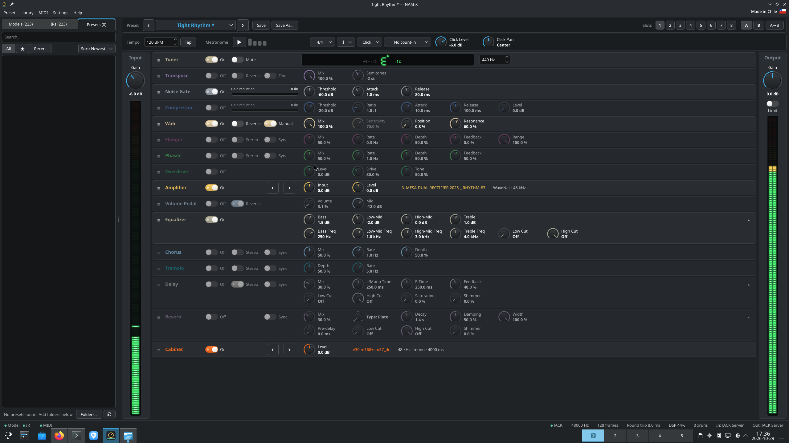

# NAM-X

A Linux-first, standalone, native Qt 6 app for Neural Amp Modeler, with a built-in stereo effects chain, tuner, metronome, MIDI support and other goodies.

* No DAW required
* No plugin host required
* No payment
* No activation
* No subscription
* No telemetry
* No bullshit
* ...and no warranty :)



## Why it exists

I built NAM-X to replace two things: the physical pedals on my floor, and a commercial
amp-sim plugin I had been running under Wine. The plugin worked, but every update
decided it was on a new machine and burned another activation, until there were none
left. I wanted the thing I actually use when I pick up the guitar:

- Real time, plug and play, on Linux.
- Not a plugin window: plugin GUIs tend to be skeuomorphic and ugly. NAM-X is a flat, native Qt desktop app. The two exceptions are deliberate: the tuner and the meters, because I thought they looked cool.
- Linux first, but not Linux only: most plugin authors ship for the OS they
  prefer and leave the rest. NAM-X is developed on Linux and builds and runs on Windows
  too.
- Built on NAM: the amp is Steven Atkinson's
  [NeuralAmpModelerCore](https://github.com/sdatkinson/NeuralAmpModelerCore), the same
  inference the official plugin uses. The models come from the community.
- Batteries included: tuner, metronome, tempo sync, MIDI mapping and learn, and a library panel for models, IRs and presets.

## Installation

- **Linux:** download `NAM-X-<version>-x86_64.AppImage` from the
  [releases page](https://github.com/Insapiable-Inc/namx/releases), then:
  ```bash
  chmod +x NAM-X-*-x86_64.AppImage
  ./NAM-X-*-x86_64.AppImage
  ```
  On the first start it offers to add itself to your applications menu. It uses your
  system's JACK or PipeWire-JACK (`libjack` is not bundled) and needs a distribution
  from 2024 or newer (glibc 2.39: Ubuntu 24.04, Debian 13, Fedora 40 and up); on an
  older one, build from source.
- **Windows:** from the [releases page](https://github.com/Insapiable-Inc/namx/releases),
  either the installer (`namx-<version>-windows-x64-setup.exe`: Start menu entry, opens
  `.nam` and `.nampreset` files, installs the Visual C++ runtime if needed) or the
  portable zip (unzip, run `namx.exe`; run `vc_redist.x64.exe` first on a machine
  without the Visual C++ runtime). Neither is signed yet, so Windows SmartScreen warns
  about an unknown publisher.

## Build from source
See [`BUILD.md`](BUILD.md).

## Repository layout

```
namx/
├── build.sh / build.ps1   # One-shot builds (Linux / Windows)
├── BUILD.md               # Build & usage manual
├── CMakeLists.txt
├── src/
│   ├── dsp/               # AudioEngine, effects, NAM/IR loaders, audio backends (no Qt GUI)
│   ├── midi/              # MIDI input (ALSA / WinMM) and mapping
│   └── ui/                # MainWindow, knobs, meters, library, presets, Theme, …
├── tests/ · bench/        # Headless tests; DSP benchmarks and the CPU regression check
├── resources/ · packaging/
└── external/              # Submodules: NeuralAmpModelerCore fork (with Eigen, nlohmann/json,
                           # AudioDSPTools), signalsmith-linear, signalsmith-stretch, chowdsp_wdf
```

Qt 6, JACK/PipeWire and ALSA come from your system.

## FAQ

**Is this another vibe-coded project?**

Yes, and that's a good thing! For years the Linux desktop has been lacking in the pro audio department, and now that frontier AI models have gotten better, we can finally build cool things that would otherwise have taken years of effort. I've dreamed of building something like this for years, and now I can finally make it come true. As of 2026-10-04, this program has been coded mostly by Fable 5 and Opus 5.5, with a few rounds of security and bug audits by Astra 6 and Fable 5.1, and I've already spent several hundred dollars on tokens, so hopefully there is something valuable in it for you. Please don't dismiss it merely because it's "slop".

**Is this really free?**

Free as in free beer and as in freedom. No payment, license key or subscription is required, and the project's license is GPL-3.0-or-later.

**What platforms are supported?**

- **Linux:** I imagine any Linux distribution that has Qt 6 and either JACK2 or PipeWire. I've only tested it on Arch Linux (Plasma desktop), but it compiles on Ubuntu 24.04 and 26.04 too.
- **Windows:** WASAPI (shared or exclusive mode) or ASIO.

There is no audio backend for macOS, merely because I don't have a device to test on, but I'm not ruling it out for the future.

**What are the system requirements?**

The release builds need an x86-64 CPU with AVX2 and FMA (Intel 2013+, AMD 2015+). Building from source on Linux defaults to `-march=native`, which uses whatever your CPU has: on an older CPU without AVX2 it builds, but it is unsupported and will be much slower; on a CPU with AVX-512 it uses that too, although I haven't tested it and don't know how much you'll gain.

**How do I install it?**

See [Installation](#installation): an AppImage on Linux, an installer or a zip on Windows, or build it from source.

**Is there a VST / CLAP / LV2 plugin?**

No, unfortunately. This is a standalone program, meaning it runs without a DAW host. There are several incompatible plugin formats, and making a cross-platform plugin UI that looks decent (especially on Linux) is very hard.

If you need NAM inside a DAW, use the official [Neural Amp Modeler plugin](https://www.neuralampmodeler.com) (VST3 and AU, for Windows and macOS). On Linux, the community [neural-amp-modeler-lv2](https://github.com/mikeoliphant/neural-amp-modeler-lv2) plugin runs the same models in any LV2 host.

**How do I build it from source?**

See [`BUILD.md`](BUILD.md).

**Where do I get models and IRs?**

You can browse the community models and IRs at https://www.tone3000.com/. Download the ones you like and import them or drag and drop the .nam or .wav files into the program.

**Which model formats and versions does it load?**

This project is based on the [NeuralAmpModelerCore](https://github.com/sdatkinson/NeuralAmpModelerCore) library, so everything it loads is supported: WaveNet (A1 and A2, slimmable included), LSTM, ConvNet and Linear models, file versions 0.5 to 0.7. Mono models only (one input, one output). A model runs at the sample rate it was trained at; if your interface runs at another rate the amp is resampled around it, like the official plugin does.

**Which IR files does it take?**

Any mono WAV file: PCM 16/24/32-bit or float 32/64-bit, 1 kHz to 768 kHz (it is resampled to the device's rate). Up to one second is used; a longer file is faded out at that point.

**What effects are included?**

1. Tuner: chromatic, adjustable reference pitch, can mute the output while tuning
1. Transpose: -12 to +12 semitones
1. Noise Gate
1. Compressor
1. Wah: follows your picking, or a Position knob for an expression pedal
1. Flanger: mono or stereo
1. Phaser: a model of the MXR Phase 90 circuit, mono or stereo
1. Overdrive: a model of the Tube Screamer circuit
1. Volume Pedal: with an adjustable mid-point for expression pedals
1. Equalizer: 4 bands plus low and high cuts
1. Chorus: mono or stereo
1. Tremolo: mono or stereo
1. Delay: mono or stereo with separate left/right times, with an octave-up shimmer on the repeats
1. Reverb: Plate, Hall and Room, with pre-delay and shimmer
1. Cabinet: loads an impulse response

The Output section also has an optional limiter (the **Limit** switch) that keeps the output below clipping.

All effects can be reordered by dragging them. The delay time, the modulation rates and the reverb pre-delay can sync to the global tempo.

**How many resources does this use?**

Not many, apparently. On Arch (Plasma) at 48 kHz and 128 samples, with all effects enabled at the same time and in stereo mode, I get between 1 and 4 xruns per minute on an i9-12900K in power-saving mode.

RAM usage, measured on a running instance:

| Memory | Size | What it is |
|---|---:|---|
| Total resident (RSS) | ~149 MB | Everything below |
| Private, anonymous | ~34 MB | The model, effect buffers, the UI's data |
| Mapped files | ~84 MB | Qt and other shared libraries, mostly shared with other Qt apps |
| Shared memory | ~31 MB | Probably JACK/PipeWire buffers and the window's pixel buffers |

**How do I get my interface's signal into it and the sound out?**

On Linux it is a JACK client (`NAM-X:input`, `NAM-X:output_L`, `NAM-X:output_R`). On the first run it connects itself to `system:capture_1` and `system:playback_1`/`playback_2`; after that, anything you patch in qpwgraph or qjackctl is remembered. The audio device itself is chosen in JACK or PipeWire. On Windows, the **In:** and **Out:** items in the status bar pick the WASAPI devices directly.

**Does it sound exactly like the official NAM plugin?**

This project is based on the NeuralAmpModelerCore library, so in theory the answer is yes if you disable EQ, gain adjustments and all other effects. In practice, it has been measured against the NAM core's reference renderer: at the model's own sample rate the difference is -46 to −65 dB, all of it from the fast tanh approximation, which the official plugin uses too (with the exact tanh it nulls to about −135 dB). It hasn't been nulled against the official plugin itself. At any other rate both resample with the same Lanczos resampler. Loudness normalization targets the same −18 dB as the official plugin's "Normalized" mode, and it can be switched off in Settings.

**What latency should I expect?**

Whatever your interface and buffer size give you, plus very little from the app: the chain adds nothing unless you enable an effect that needs look-ahead (the Transpose ~4 ms, up to ~20 ms on the low strings; the output limiter 1 ms; the Overdrive's oversampling half a millisecond; the amp's resampler ~1 ms when the model and the device run at different rates). The status bar shows the round trip, and its tooltip breaks it down.

**It crackles. Is the app bad or is my laptop bad?**

Usually the laptop, or rather its power management: battery-saver clocks and the `powersave` governor leave the CPU idling between audio buffers. Plug in, pick the performance mode, and look at the **DSP %** and **xruns** counters in the status bar: on an i9-12900K, a standard WaveNet, an IR and every other effect take about 4 % of a 128-frame buffer at 48 kHz (about 10 % with every effect in stereo and the amp per channel), and the slowest AVX2 laptops need about four times that. If it still crackles, raise the buffer to 256 frames. BUILD.md has the long version.

**Can I use a MIDI footswitch or an expression pedal?**

Yes, that's exactly how I use it! One thing that annoyed me about a certain commercial plugin was that you could not MIDI-map the metronome or tuner toggles. In NAM-X you can, along with every other knob and switch.

**Where are my presets and settings stored?**

Presets are plain JSON files (`.nampreset`) under `Documents/NAM-X/Presets` (the eight starter presets are copied into its `Starter` folder on the first run), or wherever you save them. Settings (devices, connections, window layout, MIDI mappings, the last session) are in `~/.config/Insapiable/namx.conf` on Linux and under `HKEY_CURRENT_USER\Software\Insapiable\namx` on Windows; the library's metadata cache lives in `~/.local/share/Insapiable/namx/`.

**Does it phone home?**

I'm glad you asked, and it's sad that these days we assume that's the default. This program makes zero network requests whatsoever, not even to check for updates. But as usual, don't take my word for it: audit the code if you can.

**Will you add [feature]? How do I report a bug or contribute?**

Use the [GitHub issues](https://github.com/Insapiable-Inc/namx/issues), I guess? This is my first public open-source project (and hopefully not the last one). I can't promise anything, but I look forward to hearing your feedback!

## License and credits

NAM-X is GPL-3.0-or-later (`LICENSE`; the copyright notice and the licenses of included
code are in `COPYRIGHT`). As the license says: this program is distributed in the hope
that it will be useful, but **WITHOUT ANY WARRANTY**; without even the implied warranty
of merchantability or fitness for a particular purpose.

It builds on:

- [NeuralAmpModelerCore](https://github.com/sdatkinson/NeuralAmpModelerCore) by Steven
  Atkinson (MIT; `LICENSE-MIT`; NAM-X uses [a fork](https://github.com/Insapiable-Inc/NeuralAmpModelerCore)
  with one fix), with Eigen (MPL-2.0), nlohmann/json (MIT) and AudioDSPTools (MIT), whose
  resampler comes from iPlug2 and Cockos WDL (zlib-style licenses);
- [signalsmith-linear](https://github.com/Signalsmith-Audio/linear) (FFT) and
  [signalsmith-stretch](https://github.com/Signalsmith-Audio/signalsmith-stretch)
  (the shimmers' pitch shifter), MIT;
- [chowdsp_wdf](https://github.com/Chowdhury-DSP/chowdsp_wdf) (the Overdrive's wave digital
  filter), BSD-3;
- the Phase 90 model follows "Wave Digital Model of the MXR Phase 90 based on a
  Time-Varying Resistor Approximation of JFET Elements" by Giampiccolo, Del Moro, Eutizi,
  Massimi, Massi and Bernardini (Politecnico di Milano) and their
  [MATLAB reference](https://github.com/polimi-ispl/mxrphase90) (MIT);
- [Qt 6](https://www.qt.io/) (LGPL-3.0), JACK and ALSA.

NAM-X is an independent project and is **not affiliated with the official Neural Amp
Modeler plugin**.
