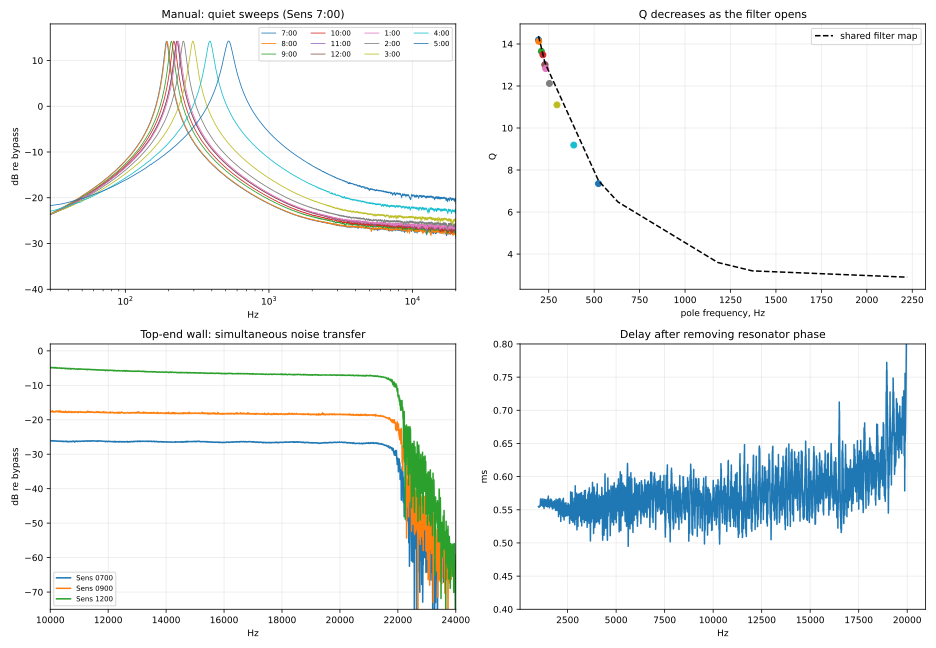
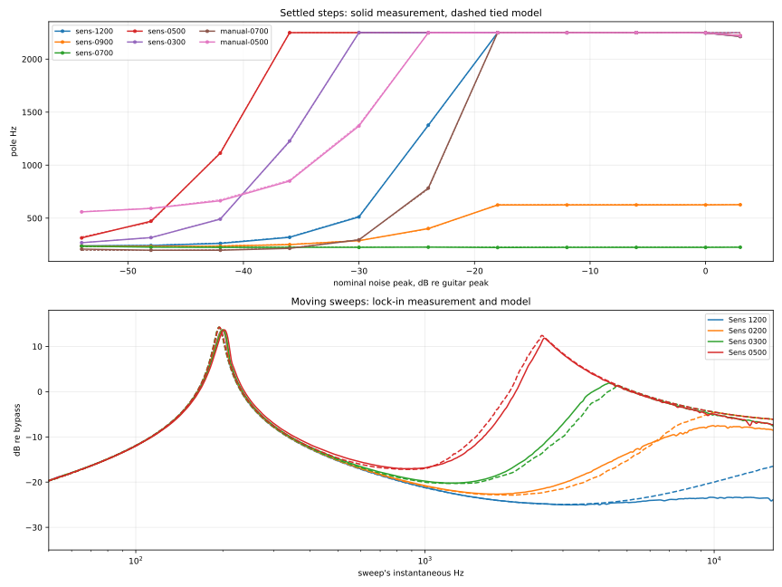
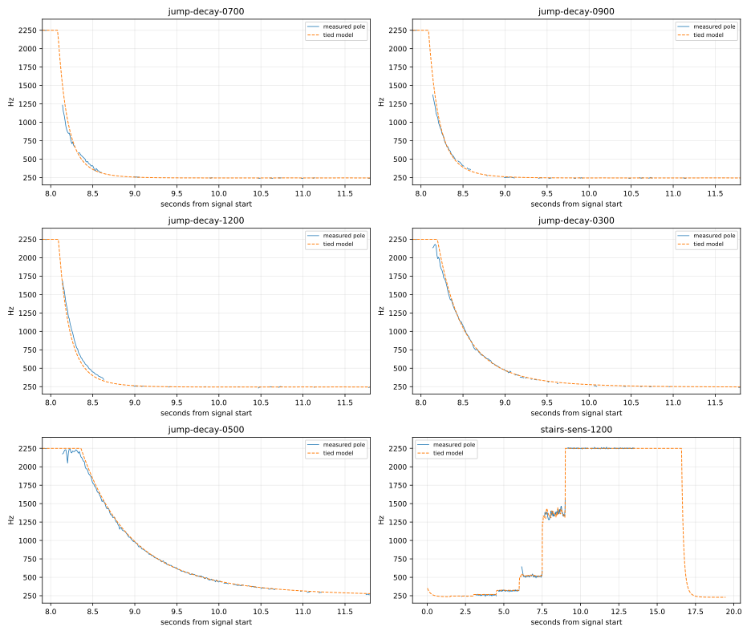
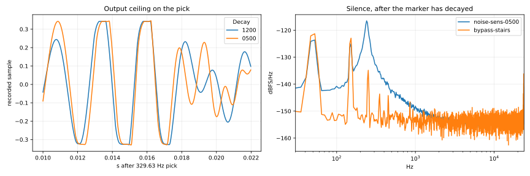
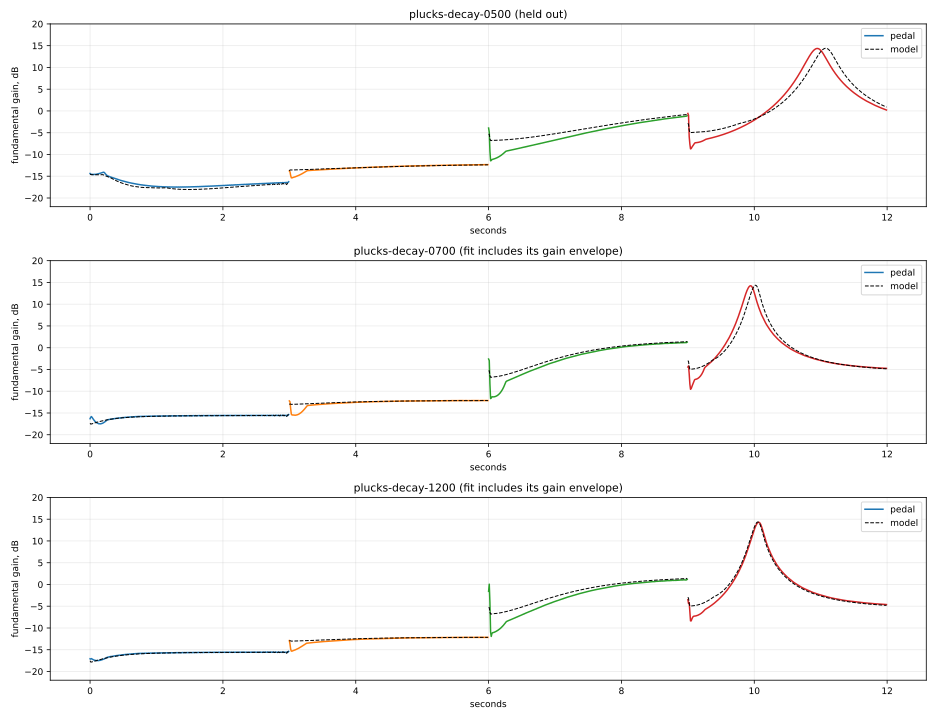
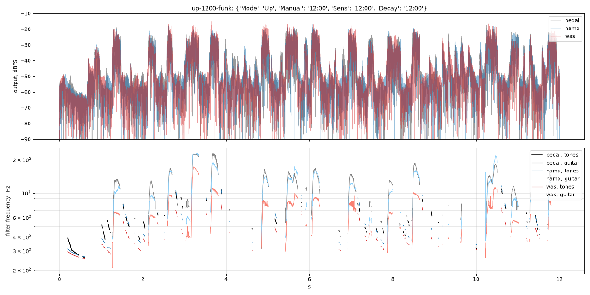
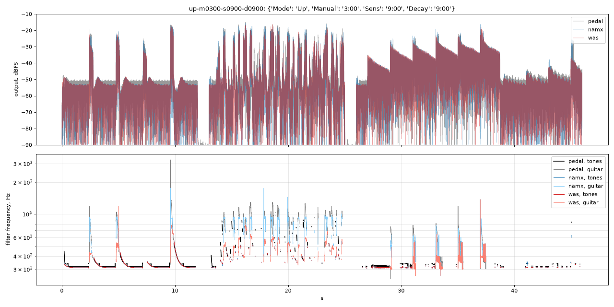
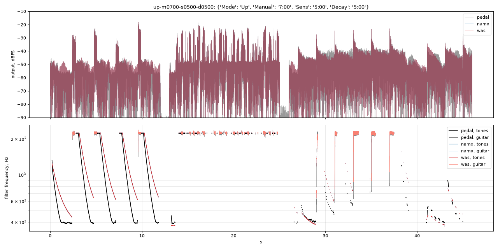

# Boss AW-3 Dynamic Wah

Measured 2026-10-31, **Up, Down and Sharp**, on a 9 V supply, mono: Guitar input → Output,
EXP/CTL empty.

| Session | What it gives |
|---|---|
| [`2026-10-31-up/`](2026-10-31-up/) | 41 takes: parked Manual responses at eleven hours; ten accidentally recorded Sens sweeps; seven noise staircases; five jumps; three pluck trains; four bypass references and silence |
| [`2026-10-31-modes/`](2026-10-31-modes/) | 28 takes: Down and Sharp — rest at Manual 7/12/5, staircases (Sens 9/12/3, Manual 7/5), jumps at Decay 7/12/5, plucks, bypass references |

Same [rig and method](../../../tools/capture/README.md) as the other pedals. The guitar
peak is −13.5 dBFS at the recording input; playback reference −4.67 dBFS. Signal levels
are **peaks relative to that guitar peak**, not noise RMS. `noise-steps` uses one
peak-normalized white-noise sequence across the whole take; its RMS is approximately
14 dB below its nominal peak. Individual steps need not attain that peak.

Plan: [`aw-3.json`](../../../tools/capture/plans/aw-3.json). Analysis:
[`analyze_aw3.py`](../../../tools/capture/analyze_aw3.py) →
[`aw-3.json`](2026-10-31-up/fit/aw-3.json) and the five figures below.

```sh
python -I tools/capture/analyze_aw3.py captures/boss/aw-3/2026-10-31-up
# If the WAVs are elsewhere, point AW3_AUDIO at their session directory:
python -I tools/capture/analyze_aw3.py captures/boss/aw-3/2026-10-31-up \
  --audio-source "$AW3_AUDIO" --fit
```

The sidecar directory receives `fit/`; the audio source is only read. Without `--fit`,
the script remeasures the data and evaluates the published model. With it, SciPy
refits the control law and shared detector/knob maps. The frequency-indexed filter
calibration is published in the script; its independent sweep/noise checks are also
remeasured. NumPy, SciPy, soundfile, matplotlib and numba are required.

Knobs: Manual, Sens, Decay. A clock string is converted to
`(((hour − 7) mod 12) + minute / 60) / 10`: 7:00 = 0, 5:00 = 1 of a 300° turn.
The five principal samples are 0, 0.2, 0.5, 0.8 and 1. Intermediate pointers were set
by eye; these are measurements of this session, not exact factory pot laws.

## The filter: a resonator with feedthrough, and changing Q



The quiet sweeps verify a **band-pass-like, two-pole resonance**, with small low- and
high-frequency feedthrough. A resonant low-pass alone is wrong: the bass rises toward
the peak, and the treble eventually flattens instead of continuing a low-pass slope.
A pure band-pass also misses those shelves. A two-integrator state-variable filter's
LP, BP and HP outputs give a compact equivalent response; this identifies an input/output
model, not the pedal's actual code or circuit.

| Manual | fraction | peak, Hz | peak gain re bypass, dB | Q from full −3 dB width |
|---|---:|---:|---:|---:|
| 7:00 | 0.0 | 194.5 | 14.17 | 14.19 |
| 8:00 | 0.1 | 194.5 | 14.19 | 14.13 |
| 9:00 | 0.2 | 209.1 | 14.22 | 13.65 |
| 10:00 | 0.3 | 218.2 | 14.25 | 13.48 |
| 11:00 | 0.4 | 229.1 | 14.24 | 13.02 |
| 12:00 | 0.5 | 229.1 | 14.23 | 13.00 |
| 1:00 | 0.6 | 232.7 | 14.22 | 12.83 |
| 2:00 | 0.7 | 252.7 | 14.21 | 12.12 |
| 3:00 | 0.8 | 296.4 | 14.24 | 11.10 |
| 4:00 | 0.9 | 389.1 | 14.23 | 9.19 |
| 5:00 | 1.0 | 525.5 | 14.26 | 7.35 |

The first-look “Q ≈ 7, +13.5 dB” is not a constant-Q result: at minimum Manual the
full bandwidth is only **13.7 Hz**, giving Q ≈ 14.2. The impulse-response measurement,
including negative times, gives about +14.2 dB. The narrow resonance also needs time to
build during a swept sine; its recorded peak alone underreads the steady gain.

The seeded noise independently verifies the parked frequency and the broadening:
roughly Q 6.5 at 630 Hz and Q 3 at the **2.23 kHz** upper resonance, still about
+14.2 dB at the peak. The local time-varying pole estimator reads the top about 1% higher
(2.25 kHz); that difference is estimator/model bias, not another ceiling.

There is **no unity-gain, unaffected dry path**. At rest, the fitted high-frequency
feedthrough is −27 dB at Manual 7:00, −26 dB at noon, −20 dB at 5:00; at the upper
resonance it is about −6.6 dB. The low-frequency feedthrough differs. Those components
share the processed path's delay and vary with frequency setting. Calling the whole
shelf a separate dry mix would over-identify the topology.

## Digital path and latency

After removing the resonator's phase, the sweeps have approximately **26.8 samples,
0.558 ms**, of delay relative to bypass. The resonance itself adds frequency-dependent
group delay (about 23 ms near the minimum-Manual peak). Outside it, the extra delay is
nearly flat through most of the audio band.

The full-band noise, divided by the simultaneous loopback and the bypass's response,
shows the same steep top-end wall at every setting: almost flat residual transmission
to 21 kHz, roughly another 5 dB down at 22 kHz and 30–33 dB down at 23 kHz. The delay and
wall together support a **digital signal path**. The 20 kHz-limited sweep alone could
not reveal that wall. This session does not establish the internal sample rate or
converter design. Per-take fractional clock offsets are nuisance parameters, not knob
parameters; the waveform checks allow ±1 recording sample.

## Control law: Sens also limits the available travel



The last 38% of each 1.5 s step gives these approximate poles, at Manual/Decay noon:

| Nominal noise peak, dB | Sens 7:00 | 9:00 | 12:00 | 3:00 | 5:00 |
|---|---:|---:|---:|---:|---:|
| −42 | 229 | 240 | 267 | 500 | 1130 |
| −36 | 229 | 255 | 324 | 1180 | 2220 |
| −30 | 229 | 295 | 525 | 2220 | 2220 |
| −24 | 229 | 402 | 1360 | 2220 | 2220 |
| −18 | 229 | 630 | 2220 | 2220 | 2220 |
| −6 | 229 | 630 | 2220 | 2220 | 2220 |

These rounded stationary-filter readings and the JSON's local-pole estimates differ
slightly in moving/noisy steps. The −54/−48 dB steps approach the output noise floor;
the script retains their measurements but excludes low-SNR frames from the model fit.

Sens 7:00 parks the filter, even at +3 dB. Sens 9:00 **stops near 630 Hz** for the entire
−18 through +3 dB range. Higher Sens reaches the common upper limit earlier: first
confirmed at −18, −30 and −36 dB for noon, 3:00 and 5:00. It therefore cannot be modelled
solely as gain before an otherwise identical, unlimited detector followed by one common
frequency clamp. A shared detector limit **before** the Sens multiplier explains the
lower 9:00 ceiling, followed by a separate maximum filter-frequency limit.

Manual changes the initial offset in control space. Its endpoint staircases meet the
same upper limit; it does not transpose the entire frequency range. For example at
−30 dB, Manual 7:00/noon/5:00 gives approximately 300/520/1370 Hz, converging near 2.2 kHz
at higher levels. The model adds Manual and the detected level before its nonlinear
frequency map, rather than adding a fixed number of hertz.

## Detector: fast opening, return and treble weighting



For the −48/0/−48 dB jump, the filter first moves appreciably about **8–13 ms** after the
loud edge, crosses halfway at 15–18 ms and reaches 90% at **21–23 ms**. These are observed
frequency crossings from an 8 ms analysis window (approximately ±4 ms resolution), not
individual circuit time constants. Decay changes the opening only modestly.

The return is curved, with a floor on how fast it can finish. A single exponential in
hertz misses that curvature. The adopted model uses two asymmetric one-pole followers:
a short fixed conditioning stage, then a Decay stage whose minimum release is already
about 0.26 s. Short Decays have similar late returns; longer settings add both lag and a
slower fall. This fit does not prove two physical detector stages, and their individual
time constants are less certain than the measured return times. The marker preceding
every take must be simulated too: at long Decay it is still moving the filter when
the quiet body starts.

| Decay | 7:00 | 9:00 | 12:00 | 3:00 | 5:00 |
|---|---:|---:|---:|---:|---:|
| Frequency return, 63% / 90%, ms | 180 / 450 | 220 / 480 | 260 / 510 | 540 / 1060 | 980 / 1920 |
| Apparent control-tail exponential τ, ms | 365 | 378 | 377 | 781 | 1504 |

The latter is a descriptive fit to `log((f − floor)^(1/power) − Manual_offset)` over
the observable middle of the return, excluding the abrupt edge and noise floor. It
is not the follower coefficient: the quiet probe is still present, the control-to-Hz
map is nonlinear, and the initial frequency clamp hides part of the release.

The accidentally recorded `rest-sens-*` sweeps are useful **moving-filter** tests. With
Manual fixed at 7:00, their low-frequency resonance barely moves, but the high-Sens
sweeps open strongly in the treble. At 4 kHz the response changes from roughly −26 dB at
low Sens to around +2 dB at full Sens. A flat detector calibrated to the white-noise
stairs predicts far too much low-frequency movement.

The model uses two first-order high-pass sections before its level detector. Their
fitted corners are phenomenological weighting parameters, not identified components.
The plucks help constrain the bass end: 82/110 Hz move the filter little, whereas
196/329.63 Hz produce substantial motion and the latter sweeps back through its own
fundamental. RMS versus peak rectification and the weighting cannot be uniquely
separated with these stimuli; a short equal-level, multi-frequency follow-up would
be more informative than further full-band staircases.

## Headroom and noise



The 329.63 Hz pick at Decay noon and 5:00 clips visibly before the filter has opened:
positive plateaux around **+0.344 to +0.346**, negative around **−0.328 to −0.330** in
the recorded samples. That is about **+4.3/+3.9 dB over the calibrated guitar peak**,
well below the interface's own full scale. The model places this asymmetric ceiling
after the resonator. The shape/location of every internal saturation stage is not
established by this capture.

There is also upstream nonlinearity: the +3 dB noise step loses coherence even with
Sens 7:00 and an output peak only around −29 dBFS, far below that output ceiling. A
fixed-filter waveform fit over 0–7 kHz has roughly −28 to −31 dB relative residual on
−24 through 0 dB noise steps, worsening to about −17 dB at +3. An input hard-clip proxy
near −4.3 dB re the guitar peak improves the hot step only modestly (about −18.5 dB).
That is evidence of another limit, **not a confidently measured hard-clip threshold**;
the proxy is reported separately and is not inserted into the main model.

At full Sens, silence after the marker has decayed is **−98.3 dBFS RMS**, versus
−100.1 to −100.9 dBFS in bypass tails: about 85 dB below the guitar peak. The −82.8 dBFS
maximum of the silence take includes the early marker aftermath and is not the settled
noise level. No self-oscillation is evident. There is only one pedal-on silence setting,
so this does not map noise across the knobs.

## The grey-box model and its errors

The same filter map, frequency law, Manual map, Sens map and Decay map are used across
all takes. There are no free frequency/gain/envelope parameters for individual dynamic
takes. The stationary response fits are measurements used to calibrate that shared
frequency-indexed resonator; they are not separate final pedal models.

In control units, with input 1.0 equal to the guitar peak:

```text
weighted input = HP1(HP2(input))
level          = RMS over 1 ms, limited before the followers
fast           = asymmetric follower(level, shared attack, fixed release)
envelope       = asymmetric follower(fast, shared attack, Decay release)
manual_offset  = (measured_rest_frequency(Manual) − floor)^(1 / power)
frequency      = min(top, floor + (manual_offset + Sens_gain * envelope)^power)
output         = time-varying two-integrator resonator, then asymmetric clip
```

For normalized bilinear frequency `r = tan(pi*f/Fs)/tan(pi*frequency/Fs)`, its parked
transfer is

```text
H = (low_feed + j*r*resonant_gain/Q − high_feed*r²) / (1 + j*r/Q − r²)
```

`Q`, resonant gain and the two feedthrough values are interpolated by frequency, never
by take. One shared measured frontend corrects the residual converter/rig response;
it is derived from the noon parked sweep, preserves negative times, and is used for
the waveform checks. This is a measurement-domain model, not portable production DSP
coefficients for an approved NAM-X sound.

| Shared quantity | Fitted value |
|---|---|
| Frequency floor / top | 191.34 / 2249.33 Hz |
| Frequency-map exponent | 3.223 |
| Detector high-pass corners | 1168 and 9047 Hz, one pole each |
| Attack of both followers | 2.82 ms |
| First follower release | 16.7 ms |
| Weighted 1 ms RMS limit, before Sens | 0.01788 (-35.0 dB re the guitar peak) |
| Sens gain at noon, in the equation's control units | 541.34 |

| Knob | 7:00 | 9:00 | 12:00 | 3:00 | 5:00 |
|---|---:|---:|---:|---:|---:|
| Sens gain relative to noon | 0.000 | 0.363 | 1.000 | 3.768 | 7.040 |
| Decay follower τ, ms | 264 | 289 | 296 | 708 | 1356 |

Manual uses the eleven measured **pole** frequencies (slightly different from spectral
peaks), interpolated in knob fraction. Sens is constrained monotonic at all eleven
clock samples; Decay is constrained monotonic at the five principal positions. Weakly
excited Sens positions should be treated as interpolation anchors, not precise pot
calibrations. The separate nominal-noise law reaches its detector ceiling near
-19.8 dB peak; that nominal peak is not the weighted-RMS limit above.

The optimization fits the seven stairs, five jumps, ten moving Sens sweeps and the
**7:00/noon pluck gain envelopes**. The **5:00 plucks are held out**. Noise frequency
errors use 40 ms windows every 10 ms and require output RMS above −88 dBFS (about 10 dB
above the idle floor). Step boundaries, the abrupt jump edges and the hottest two
stairs are excluded from that frequency objective. Sweeps use an instantaneous-chirp
lock-in; their first narrow resonance is excluded from the quasi-static model objective.
Every mask is recorded in the JSON.

| Check | Error |
|---|---|
| Shared filter, eleven parked sweeps, 60 Hz–6 kHz | median 0.11 dB RMS (0.10–0.41) |
| Twelve noise frequency trajectories, valid frames | median 0.49 semitone RMS (0.31–1.04); about 2.8% in frequency |
| Ten moving Sens sweeps, valid bands | median 0.58 dB RMS (0.15–1.13) |
| Rendered pluck fundamental gain, Decay 7:00 / noon (fitted) | 1.06 / 0.90 dB RMS |
| Rendered pluck fundamental gain, **Decay 5:00 held out** | **1.28 dB RMS** |
| Whole-waveform relative error, Decay 7:00 / noon / 5:00 | -5.82 / -9.17 / -5.13 dB; approximately 51% / 35% / 55% RMS of the pedal signal |

The last metric is `20*log10(RMS(model − pedal)/RMS(pedal))`, not a dB gain error.
The static control-law fit uses −42…−6 dB steps; dynamic residuals are balanced per take
within each measurement family (frequency, sweep response, pluck gain). These are not
one pooled error with interchangeable units.



The sample-by-sample filter is also rendered over the recorded bypass plucks, including
the marker and the output clip. Its fundamental-gain metric excludes the first 40 ms
and the last 200 ms of each note; the waveform residual includes the whole body. Those
metrics answer different questions. The waveform error remains substantial: the model
is a useful control/filter approximation, not a sample-accurate reconstruction.

In particular, the held-out long-Decay 329.63 Hz peak arrives late; the first part of the
196 Hz note and fast resonance passage also expose errors that settled noise hides.
The noon-Sens sweep also diverges by several dB at the top end (the fit metric stops
at 12 kHz); the figure deliberately retains that mismatch.
Two waveform timing fits reach the +1 sample bound; they are not precise latency
estimates. The small fitted clock offsets cannot repair those control/filter-state
errors. This is why matching a staircase alone would not finish the model.

## Takes and lessons

- All **41 played hashes match** their sidecars; all sidecars report zero xruns.
- The run log records an initial batch discarded because the input gain was not at
  minimum. The retained WAVs belong to the corrected batch. Ten “Manual” sweeps actually
  turned Sens; their corrected sidecars are authoritative. The real Manual sweeps were
  recorded afterward. No audio or sidecar was edited by this analysis.
- **A zero xrun count is not a complete alignment check.** In `stairs-manual-0700`, the
  marker aligns correctly, but both recorded channels are 47 samples later from about
  7 s into the body. Correlating the body loopback against the played noise finds it.
  Simultaneous output/loopback identification removes this common shift; directly
  dividing its output by an uncorrected bypass twin gives a false phase ramp.
- **Keep negative impulse-response time.** Every sweep retains 50 ms before time zero;
  neither bypass nor the processed response is truncated to positive times alone.
- **A digital pedal's clock is separate from the rig's.** The waveform comparison permits
  a bounded fractional-sample shift per take. It does not assign that shift to Decay.
- **Match references to new noise signals.** Stair and jump twins share seeds 1 and 2;
  their waveforms and loopbacks distinguish gain/filter changes from input variations.
- **Separate low-SNR parameter scatter from pedal motion.** The quiet noise probes are
  valuable during the return while the filter is open; at rest their Q is not reliable.
  The −36 dB swept sine is the better rest measurement.

## Second session plan: Down and Sharp, 28 takes, 7.7 minutes (recorded)

[`aw-3-modes.json`](../../../tools/capture/plans/aw-3-modes.json), recorded the same day (results below).
Duration is about **7.7 min** of audio, including markers, gaps and tails, excluding knob
changes and quiet waits. Humanizer and Tempo are left out (user, 2026-10-31: not
interested); the manual's notes on them are kept below for whoever picks them up.

| Block | Takes | Change and reason |
|---|---:|---|
| Bypass | 4 | Sweep, stairs, jump, plucks, recorded again in the new session. |
| Down | 12 | Parked Manual at 7/noon/5 instead of five positions; add the missing Manual-7 staircase. Keep Sens 9/noon/3, Decay 7/noon/5 jumps and noon plucks. |
| Sharp | 12 | Same trim and endpoint addition. Its stronger resonance may change Q/headroom, so do not inherit Up's filter or Decay law without checking. |

From the [Boss owner's manual](https://static.roland.com/assets/media/pdf/AW-3_M_eng02_W.pdf):
in **Humanizer**, Sens selects Vowel 1 and Manual Vowel 2 (equal vowels park the filter;
Decay sets the time from Vowel 1 to Vowel 2), so the original plan's Humanizer "Sens"
stairs would have changed a vowel. In **Tempo**, only Decay is active (Manual and Sens
are greyed out on the manual's Tempo panel).

## Down and Sharp (session `2026-10-31-modes`)

28 takes, same rig and calibration as Up: [`aw-3-modes.json`](../../../tools/capture/plans/aw-3-modes.json),
trimmed to Down and Sharp (Humanizer and Tempo left out, user). No clips, no xruns.
`down-rest-manual-0700` (recorded twice, the second kept) slipped 47 samples 1–2 s into
its sweep: measured against its own loopback, not the played file (see the tool's Lessons).
Measured with exploratory scripts reusing `analyze_aw3.py`'s `Session`/`resonator`: the
rest sweeps by the same complex resonator fit, the staircases and jumps by each window's
pedal-over-loopback response divided by the bypass twin's (the Up tracker stops at
3.5 kHz; Down parks above it). Not yet in `analyze_aw3.py`.

### Down is Up's filter, parked high and pulled down

| Manual | rest peak | dB re bypass | Q (−3 dB) | resonator fit (pole, Q, gain), rms |
|---|---:|---:|---:|---|
| 7:00 | 840 Hz | +14.3 | 5.0 | 840 Hz, 5.27, 5.01 — 0.41 dB (via the loopback) |
| 12:00 | 2551 Hz | +14.5 | 3.0 | 2534 Hz, 2.76, 4.55 — 0.49 dB |
| 5:00 | 3967 Hz | +14.7 | 3.0 | 4013 Hz, 2.62, 4.56 — 0.51 dB |

The same symmetric two-pole peak as Up (one octave either side: −17.6/−17.2 dB at 7:00,
like Up's −20.8/−20.6 at 525 Hz) and Q continuing Up's law of frequency (Up: 14 at
195 Hz, 7.4 at 525; Down: 5 at 840, 3 at 2.5–4 kHz); more treble feeds through at the
top (high_feed 0.5–0.7). Manual sets where it rests — 840 Hz to 4 kHz, the top of Up's
travel and above — and the level pulls it down to a **common floor near 400 Hz** at every
Manual, the mirror of Up's common 2.23 kHz ceiling:

| noise step, dB re guitar peak | −48 | −42 | −36 | −30 | −24 | −18 | −12 … +3 |
|---|---:|---:|---:|---:|---:|---:|---:|
| Manual 7:00, Sens 12:00 | 785 | 674 | 557 | 416 | 398 | 393 | ~400 |
| Manual 12:00, Sens 12:00 | 2408 | 2215 | 1857 | 1277 | 568 | 393 | ~400 |
| Manual 5:00, Sens 12:00 | 3674 | 3422 | 2941 | 2174 | 990 | 410 | ~410 |
| Manual 12:00, Sens 9:00 | 2549 | 2350 | 2244 | 1980 | 1477 | 1014 | ~1020 |
| Manual 12:00, Sens 3:00 | 1770 | 1266 | 557 | 398 | 398 | 393 | ~400 |

Hz, the settled peak of each step. Sens 9:00 stops half-way (~1 kHz), as Up's stops at
~630 Hz. Down's plucks don't reach the output ceiling (peak −0.9 dB re the guitar's):
low notes sit under the parked filter.

### Sharp: Up's control, a taller and lopsided filter

Sharp follows Up's control law step for step — Sens 12:00: 258, 275, 328, 533, 1359,
~2185 Hz from −48 to −18 dB (Up: 246, 264, 328, 516, 1365, ~2230); Sens 9:00 stops at
~690 Hz (Up ~630); Manual moves only the start (193 → 520 Hz at rest, as Up's 195 → 525).
The filter differs:

| | peak re bypass | Q (−3 dB) | octave below | octave above | 2×→8× slope |
|---|---:|---:|---:|---:|---:|
| Up, Manual 7:00 | +14.2 dB | 14.2 | −26.5 dB | −26.4 dB | −5.8 dB/oct |
| Sharp, Manual 7:00 | +17.3 dB | 8.1 | −23.6 dB | **−37.7 dB** | −7.2 dB/oct |

Sharp's shape is **the same at every Manual** (7:00, 12:00, 5:00 within 0.4 dB of each
other relative to the peak), where Up's Q falls as it rises. It drops 16 dB more an octave
above the peak than below, its phase turns ~450° through the peak (a single resonance
turns 180°), and it has no treble floor (Up's −27 dB feedthrough): −58 dB at 16× the peak.
Its structure is **not identified**: the Up resonator (one two-pole section with
feedthroughs) misses it by 2.6–3.5 dB rms, and two such sections in cascade, fitted
freely, by 4.6–5.7 dB with parameters at their bounds. The measured shape above is what
a model has to reproduce.

It shares Up's output ceiling (+0.346/−0.331 in the plucks, Up +0.344/−0.328, about
+4.3 dB over the guitar's peak) and reaches it more: the noon plucks sit flat-topped.

### Decay, the same in all three modes

| mode, Decay | 7:00 | 9:00 | 12:00 | 3:00 | 5:00 |
|---|---:|---:|---:|---:|---:|
| Up, 63 % / 90 % back (ms) | 351 / 661 | 371 / 671 | 411 / 751 | 851 / 1461 | 1521 / 2461 |
| Sharp | 401 / 781 | | 441 / 781 | | 1531 / 2631 |
| Down | 381 / 671 | | 471 / 621 | | 1241* / 1661* |

The return after the −48/0/−48 dB jump, in log frequency from the loud plateau to the
rest (frames of 43 ms, every 10 ms) — a different measure from the Up table above (in
Hz), for comparing the modes. *Down at 5:00 had not finished returning in the take's 4 s
(2.06 kHz, not 2.34), so its times are short.

### For NAM-X

The Wah's Up, Down and Sharp types (`src/dsp/Aw3Wah.h`, branch `dsp/wah-aw3`); since 2026-11-03
the only wah in NAM-X (its own envelope wah and pedal mode are gone). The user, 2026-11-03:
"despite not being 100 % accurate, all effects sound very good".

One engine covers the three modes: Up's detector and control law; Down = the control
reversed, from Manual's rest down to ~400 Hz; Sharp = Up's control with its own,
frequency-independent filter shape. Up's model (above) is still provisional; Sharp's
filter structure and Down's reversed frequency map are the parts to fit next.

## On guitar: the focused session (`2026-11-11-focused`, 24 takes)

Guitar excerpts over five quiet tones (331, 577, 997, 1723, 2971 Hz, each 50 dB under the
guitar's peak), Up with every knob at its ends, Down and Sharp at 12:00
(`tools/capture/aw3/focused.py`). The effect alone is where the filter sits over time, read
two ways, for the pedal and the model alike:

- **between hits, on the tones:** wherever the guitar leaves all five alone, each tone's
  gain (output over dry) — the five gains place the filter (the frequency at which the
  model's static filter fits them best; it fits the pedal's to 0.2–0.5 dB, so the filter's
  shape holds while it moves);
- **while playing, on the guitar:** the output's short spectrum over the dry's, fitted the
  same way over the bins the guitar fills.



**What it showed:** the October model moved far too little on a guitar. On funk at 12:00
the pedal's filter sweeps to 1.2–2.2 kHz on every chord; the model reached 600–1000 Hz
(0.6–0.8 octave short on every guitar take, Down's mirrored: too high), and only the hardest
hits met at the top. Its detector had been fitted on white noise alone, and weighted the
treble heavily (two high-pass corners, 1168 Hz and 9 kHz): right for noise, where the treble
is, but a guitar's level sits lower in frequency.

**The refit** (`tools/capture/aw3/fit_detector.py`: the same detector structure, fitted to the
pedal's track on the Up takes — lead, the funk repeat held out — together with October's
noise staircases and noise jumps): the corners at 820 Hz and 7.3 kHz, the attack 5 ms, the
two followers side by side instead of in a row — a ninth of the control follows the level at
once, the rest through Decay — the control's power 2.73, the Sens gains ×1.3–1.5, Decay's
releases 0.256 / 0.298 / 0.264 / 0.708 / 1.339 s at 7:00 … 5:00 (October's, nearly). The
staircases still fit (every settled step within 0.16 octave) and the jumps' returns too
(the filter's track through the 3.5 s after the loud noise, 0.03–0.13 octave rms at the five
Decay positions). A first refit on the guitar and the staircases alone had shortened the
release instead (0.236 s at 12:00): right on guitar, a third too fast on the jumps.

**The blind test** (`2026-11-11-blind`, 5 takes: the user set the knobs, the analysis read
them from a noise staircase and a jump): Mode Up (right), Sens about 1:00 (right), Manual
about 4:40 from a rest of 478 Hz (set: 4:00), Decay "the lower half, at a guess 7:00" (set:
10:30). From 7:00 to 12:00 the release is the same within the measurement (0.26–0.30 s, the
10:30 take 0.29): the pedal's Decay knob does nothing over its lower half. The blind jump
is in the fit above (0.02 octave rms).

| Filter frequency, model re pedal, octaves rms | October's | refit |
|---|---:|---:|
| Up 12:00 on the guitar: funk / stabs / chords / lead (held out) | 0.78 / 0.60 / 0.36 / 0.67 | 0.25 / 0.24 / 0.21 / 0.27 |
| Up, Manual 7:00 / 5:00, funk | 0.82 / 0.34 | 0.21 / 0.14 |
| Up, Sens 5:00, dynamics: on the guitar / between notes | 0.25 / 0.44 | 0.16 / 0.14 |
| Up, Decay 7:00 / 5:00, stabs, between hits | 0.07 / 0.21 | 0.07 / 0.09 |
| Down 12:00 on the guitar: stabs / funk / dynamics (never fitted) | 0.38 / 0.51 / 0.40 | 0.20 / 0.21 / 0.33 |
| Sharp 12:00 on the guitar: stabs / funk (never fitted) | 0.57 / 0.73 | 0.23 / 0.27 |

**Validation** (`2026-11-11-blind-2`, 5 takes, in no fit: the user set Up, Manual about
11:00, Sens about 2:00, Decay about 8:00; read blind as Up, 12:00, 1:45, "7:00 to 12:00"):

| Model at the user's settings, re the pedal, octaves rms | October's | refit |
|---|---:|---:|
| Funk, while playing | 0.41 | 0.17 |
| Funk, between hits | 0.56 | 0.41 |
| The return after loud noise (3.5 s) | 0.37 | 0.34 |

The opening on a guitar holds on unseen settings. **The return does not:** at this Sens the
pedal leaves the top 120 ms after the loud noise ends and is 63 % back at 240 ms; the model
(both) leaves at 300 ms and is 63 % back at 440. Every jump in the fit was at Sens 12:00 to
1:00: there the two-follower release fits (0.03–0.13), but it does not carry to more Sens —
the model's control climbs far over the top with Sens and takes that long to come back, the
pedal's does not.

**The jumps session** (`2026-11-11-jumps`, 9 takes, `tools/capture/aw3/jumps.py`): quiet noise
with three loud stretches (0, −12, −24 dB), Sens at 9:00, 12:00, 3:00 and 5:00, then Decay
and Manual at their ends with Sens fully up. After the loud noise the filter leaves the top
90 ms later at Sens 12:00 and 160–170 ms later at 3:00 and 5:00, and is 90 % back at about
500 ms at every Sens, whatever the loud level was: the pedal's control does not climb with
Sens. **In the model: a cap on the control** a quarter over what the top needs (`CONTROL_CAP`
1.257, in control units; `tools/capture/aw3/fit_jumps.py` fits it with everything above).
With it one set of values fits all of it — the guitar takes 0.06–0.26 octave, the staircases
within 0.07, October's jumps 0.04–0.11, this session's eight takes 0.06–0.13 — and the
values come back near October's (the Sens gains within 7 %, power 3.05, Decay 0.26 / 0.31 /
0.32 / 0.74 / 1.36 s), except the detector's corners (969 Hz and 6.8 kHz), the attack
(6.6 ms) and the fast share (8 %).

On the validation session, through NAM-X's code at the user's settings: the return leaves
the top at 100 ms, 63 % at 220, 90 % at 460 (pedal 120 / 240 / 520), the track 0.09 octave
rms (0.34 without the cap); funk while playing 0.22, between hits 0.44.
Down's cap (the same margin past its floor) is assumed, not measured.

Also seen: the tones don't move the filter at Sens 12:00 beyond what the model says (rest
261 Hz with them, 234 Hz at Sens 7:00); the funk take twice gives the same track; the model
lines up with the pedal 26–28 samples late (the pedal's 0.56 ms).

**Open:**
- Between quick hits (funk, lead) the pedal's filter still sits 0.2–0.3 octave above the
  model's on its way down.
- The waveform doesn't cancel (−1 to −4 dB with the filter moving, −13 with it parked at
  Sens 7:00): with a Q of 5–14 a few percent of frequency turns the phase round, and the
  rest frequency is a hand-set knob. The track is the measure here, not the residual.
- The two hard hits of `dynamics` at 12:00 read 0.5 octave apart for a moment at the
  attack (the reading's 21 ms window on a fast sweep); not examined.

## The check session (`2026-11-21-check`, 13 takes) and the onset path

A look for large differences where nothing was fitted (plan `aw-3-check`; the table is the
model as it was, the session in no fit): four knob
settings, each in Up, Down and Sharp; every take plays stabs, funk and dynamics over the
five tones. `tools/capture/aw3/focused.py` reads it (a line per excerpt), now also with what
is heard: the output's level per octave band in 43 ms windows, model re pedal. On the
fitted settings (the 2026-11-11 session, everything at 12:00) that measure reads 3–5 dB rms
in Up and Down and 7–8 in Sharp: a sharp filter a quarter octave off.

| Manual / Sens / Decay | Filter while playing, octaves rms: Up / Down / Sharp | Between hits (stabs) | Level on funk, dB rms |
|---|---|---|---|
| 7:00 / 5:00 / 5:00 | 0.02–0.14 / 0.01–0.11 / 0.10–0.37 | 0.60 / 0.03 / 0.61 | 0.9 / 0.7 / 2.1 |
| 5:00 / 5:00 / 7:00 | 0.02–0.04 / 0.08–0.28 / 0.10–0.40 | 0.21 / 0.52 / 0.22 | 0.6 / 4.7 / 2.4 |
| 3:00 / 9:00 / 9:00 | **0.59–0.86 / 0.61–0.74 / 0.64–0.86** | 0.05 / 0.13 / 0.04 | **10.6 / 6.4 / 14.7** |
| 9:00 / 3:00 / 3:00 | 0.03–0.32 / 0.03–0.14 / 0.10–0.39 | 0.30 / 0.51 / 0.33 | 1.4 / 1.9 / 2.8 |

- **With Sens at 3:00 and 5:00 the model follows the playing** as well as or better than at
  the fitted settings, in all three modes (the filter is at its end of the range most of
  the time).
- **At Sens 9:00 it moves far too little on a guitar.** The pedal's filter jumps to
  1–1.3 kHz on each hit (Up, from a rest of 340 Hz) and falls back within 0.2 s; the model's
  reaches 450–600 Hz: 0.6–0.8 octave short while playing in every mode, 12–20 dB short at
  1–2 kHz on funk. Between hits the two agree. No Sens of the model fits it (the model's
  Sens is flat from 9:00 to 11:00; at 11:30 the playing is right on average and still
  0.5–0.65 octave rms, and the rest is wrong): at this Sens the pedal lets a pick's attack
  through far more than the model's detector does. On noise the model is right there
  (October's staircases stop near 630 Hz at Sens 9:00, the model's too): the staircases
  only pin the product of the Sens gain and the detector's limit (`LEVEL_LIMIT`), and a
  guitar shows the two apart.

  

- **After a hit, with Sens at 3:00 or more, the model comes back too slowly** (0.2–0.6
  octave between stabs): at Decay 5:00 the pedal is back at rest 1.1 s after it leaves the
  top, the model is still at 650 Hz a second later. At Sens 12:00 (the 2026-11-11 session)
  the same returns fit within 0.1.

  

- **Down with Sens high rests 0.3 octave low** under the quiet tones (pedal 2.1 kHz, model
  1.7 kHz at Manual 5:00; 1020 and 800 Hz at Manual 9:00, a Manual position Down's map
  only interpolates).

**The fix: an onset path at low Sens** (`tools/capture/aw3/fit_onset.py`; `ONSET_*` in
`Aw3Wah.h`). Read closely, the Sens 9:00 take shows the pedal's filter thrown to about the
same place on every pick, soft or hard (that Sens position's ceiling, the one October's
staircase stops at), and falling back within 0.2 s under a chord that holds its level. So
beside the followers: the input through a one-pole high-pass at 175 Hz (the bass counts
here), its RMS per ms smoothed over 25 ms, less that smoothed again over 86 ms (what has
just risen), times a gain, added to the control, the sum stopping at the ceiling. Fitted on
the Up take at Sens 9:00 with October's staircase and the jumps session's take at that Sens
(both unchanged by it: the staircase within 0.07 octave, the jumps 0.10); three starts, two
agree. At Sens 12:00 the pedal has no such path (fitted there on the 2026-11-11 takes it
comes out at 7 % of this one and improves nothing), so the model has it only below 12:00:
measured at 9:00, fading out through 10:00 and 11:00 and shrinking with Sens's gain towards
7:00 (neither measured). Every take at Sens 12:00 or more renders as before.

| Sens 9:00 (Manual 3:00, Decay 9:00), filter while playing, octaves rms | was | with the onset path |
|---|---:|---:|
| Up: stabs / funk / dynamics (the fit) | 0.71 / 0.86 / 0.59 | 0.28 / 0.28 / 0.24 |
| Sharp (in no fit) | 0.74 / 0.86 / 0.64 | 0.23 / 0.29 / 0.29 |
| Down (in no fit) | 0.62 / 0.74 / 0.61 | 0.24 / 0.26 / 0.32 |
| Level per octave band on funk, dB rms: Up / Down / Sharp | 10.6 / 6.4 / 14.7 | 6.4 / 5.2 / 8.8 |

Left as found: the slow return after a hit with Sens high, Down's rest under quiet signal,
and at Sens 9:00 the filter between quick hits (funk: 0.5 octave rms, the model lower).
Listening files (pedal / before / after, the three Sens 9:00 takes): `2026-11-21-check/ab/`.

The loopback cable was out for the whole session (its channel silent): each take's latency
was read from the marker's crosstalk there (449–453 or 572–579 samples, the two values the
2026-11-11 session shows), right within a few samples; no slips could be read, and the
waveform residual means nothing here. The filter's track and the band levels don't need
more.

## Open, and a later NAM-X type

- Resolve the long-Decay pluck timing and dynamic filter-state error before a faithful
  NAM-X implementation. The fitted follower/weighting structure is not unique.
- A separate small Up follow-up should use equal-peak and equal-RMS held tones around
  82/330/1000/4000/12000 Hz, at two non-saturating levels, with bypass twins. This would
  distinguish weighting, rectification and threshold from a by-eye Sens repeat. A
  short descending/finer staircase around −24…−18 dB would test the detector limit.
- A held tone at a parked resonance, at several levels, would separate the input and
  output nonlinearities more cleanly than broadband noise. Recheck the ceiling at
  another Manual/Sens combination. These are proposals, not recorded or added silently
  to the modes session.
- Down and Sharp: Sharp's filter is matched (below, "In NAM-X") but its structure is
  still not the pedal's; Down's long-Decay return (longer than its 4 s take) is unchecked.
  Humanizer, Tempo, Bass input and expression control are left out.
  Internal sample rate and exact circuitry remain unidentified.
- The NAM-X types below are checked against these captures only; a guitar reamp and the
  user's listening comparison are still to come.

## In NAM-X (branch `dsp/wah-aw3`)

The Wah's Type knob: Wah | AW-3 Up | AW-3 Down | AW-3 Sharp (`dynamicWah/type` 0–3; Wah
stays the default). Sensitivity = Sens, Position = Manual (0–100 % = 7:00–5:00), Decay a
detail knob (`dynamicWah/aw3Decay`, 50 % = 12:00); Resonance and the Manual switch are
dimmed; Mix still blends the dry signal in. [`src/dsp/Aw3Wah.h`](../../../src/dsp/Aw3Wah.h):

- **Detector and Up control:** the published model above, at its 1 ms control rate
  (filter coefficients ramped across each millisecond).
- **Down:** the same detector and Sens gains, mirrored: `f = 393 Hz + max(0, offset −
  Sens·env)^3.22`, the offset from Manual's rest (840 / 2534 / 4013 Hz at 7:00 / 12:00 /
  5:00, log-interpolated between). Up's resonator table extended with Down's parked fits
  (840 Hz, 2.5 kHz, 4 kHz).
- **Sharp:** Up's control; the filter `(0.27356 + 0.17002 s + 0.01724 s² + 0.14706 s³) /
  (s² + s/5.355 + 1)²`, s normalized to the control frequency — fitted jointly to the three
  parked sweeps (1.1 dB rms 45 Hz–16 kHz, the octave points within 0.6 dB). Its numerator
  has a right-half-plane zero pair, which gives the extra ~270° of phase. This is a fit,
  not the pedal's circuit.
- **Output:** the asymmetric ceiling (+4.3 / +3.9 dB over the guitar's peak, assumed
  −6 dBFS in NAM-X as for the other pedals). Latency, the 21 kHz wall and the input-side
  limit are left out.

Rendered over the played files and compared with the recordings:

| Check | Result |
|---|---|
| Parked sweeps, model vs pedal/bypass, 60 Hz–6 kHz | Up 0.07–0.12 dB rms; Down 0.5–0.6; Sharp 0.15–0.6 |
| Settled staircase peaks, −42 … −12 dB | within ~5 % for Up and Sharp Sens 12:00; Down Manual 5:00 up to 12 % low at −36…−24 dB; Sharp Sens 9:00 stops at 633 Hz (pedal 691) |
| Pluck levels, 50 ms frames, model − pedal | Up within +1.3 dB mean per note (Decay 7/12/5); Down −0.4…−0.6 dB; Sharp +2.8 dB on 196 Hz, others ≤ 0.5 dB |

Not approved by ear yet.
