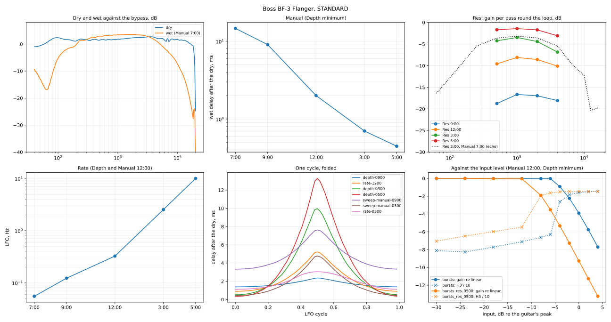

# Boss BF-3 Flanger

Measured 2026-10-27 on a 9 V supply, STANDARD mode, mono (Guitar In → Output A, nothing in
Output B):

| Session | What it gives |
|---|---|
| [`2026-10-27-standard/`](2026-10-27-standard/) | the dry path, the wet tone, Manual's delay, Res's feedback, saturation, the sweep (Rate, Depth, Manual), noise |
| [`2026-10-27-ultra/`](2026-10-27-ultra/) | ULTRA against STANDARD (`plans/bf-3-ultra.json`, 11 takes; first look below) |
| [`2026-10-27-ultra-res/`](2026-10-27-ultra-res/), [`2026-10-27-res-quiet/`](2026-10-27-res-quiet/) | Ultra's Res at Manual 7:00 (the first at −12 dB, clipped from Res 12:00 up; the second at −24 dB), and Standard's Res 5:00 at −24 dB |
| [`2026-10-27-standard-checks/`](2026-10-27-standard-checks/) | the model's sweep at knob combinations it wasn't fitted to; Output B in use |

Same rig and playback level as the TR-2, DD-8 and CE-5 ([`tools/capture/README.md`](../../../tools/capture/README.md)).
Plans: `tools/capture/plans/bf-3-standard.json` (31 takes; `manual-0900` and `manual-0500`
redone, only the second recordings kept), `tools/capture/plans/bf-3-standard-checks.json`
(8). Analysis:
`tools/capture/analyze_bf3.py captures/boss/bf-3/2026-10-27-standard captures/boss/bf-3/2026-10-27-standard-checks` →
[`2026-10-27-standard/fit/bf-3.json`](2026-10-27-standard/fit/bf-3.json) and the figure below.

The knobs: Manual, Res, Depth, Rate, and MODE (STANDARD, ULTRA, GATE/PAN, MOMENTARY).
Clock positions: 7:00 = fully counter-clockwise, 5:00 = fully clockwise.



## The model

```
out   = clip( 1.23 · x(t − 0.55 ms)  +  wet )            (clip: hard, +0.55 dB re the guitar's peak)
line  = x + r(Res) · wet                                  (the feedback: Res adds, nothing else changes)
wet   = 1.48 · Tone( line(t − d(t)) )                     (+3.4 dB re bypass at 1 kHz; Tone = 1 there)
Tone  = HP 192 Hz Q 0.52 · HP 94 Hz Q 1.56 · LP 6.3 kHz Q 0.54 · LP 17.5 kHz Q 0.92
d(t)  = floor + swing(Depth) · s(t)^2.5                   (after the dry; floor ≥ ~0.33 ms)
floor = (1 − b(Depth)) · m(Manual) + b(Depth) · 0.33 ms
s(t)  = one-pole low-pass at 1.53 Hz of a 0..1 triangle at f(Rate)
```

The order of the linear stages inside the wet path can't be told apart from outside; that
each pass round the loop goes through the same tone filter can (see *Res*).

## It's digital

The service notes: a Boss DSP (TC220) and an AK4552 converter, an 11.2896 MHz crystal,
so ~44.1 kHz inside — the dry path's wall at ~20 kHz (figure, top left). The dry comes out
0.55 ms late with flat group delay (0.54–0.59 ms from 1 to 12.5 kHz), 1.8 dB over the
bypass (+1.5 to +2.5 dB from 125 Hz to 12.5 kHz, within ±0.5 dB of flat).

Because the pedal has its own clock, its output lands up to a sample apart from take to
take against the interface's (the loopback can't see that): the click takes' dry template
is re-fitted per take (shift and gain), and Res is measured inside one take each.

## The wet path

From Manual 7:00, where the wet comes 14.67 ms after the dry and the two separate in the
impulse response (split at 7.3 ms):

- **Level:** +3.4 dB re bypass at 1 kHz, **+1.6 dB louder than the dry**: at the comb's
  notches the two don't cancel completely (~−12 dB re bypass, ~21 dB under the peaks).
- **Tone, re 1 kHz:** a low cut (−2 dB at 250 Hz, −6 at 125, −20 at 63) and a gentle
  high roll-off (−1.6 dB at 4 kHz, −5.3 at 6.3, −10.8 at 10, −23.8 at 16). The biquad
  chain above fits it within 0.33 dB rms (90 Hz–18 kHz). Below ~80 Hz the dry path's
  ringing reaches the wet window, so the low end's last few dB are approximate.
- **Group delay** after the dry: 14.79 ms at 250 Hz, 14.70 at 1 kHz, 14.64 at 10 kHz (the
  low cut's extra delay at the bottom).
- Above 8 kHz the wet's level moves with Manual by 1–3 dB (brighter at 9:00 than at
  7:00) — where it is already 6–20 dB down; not modelled.

### Manual

The wet's delay after the dry at minimum Depth (the comb's phase slope against the wet's
own response):

| Manual | 7:00 | 9:00 | 12:00 | 3:00 | 5:00 |
|---|---|---|---|---|---|
| delay, ms | 14.67 | 9.07 | 2.01 | 0.70 | 0.45 |

Counter-clockwise is the long end (low notches); the manual's 0.3–14.4 ms range (Guitar In)
is the whole sweep's, not Manual's alone (see *The sweep*). The click trains agree: Manual
12:00, Depth minimum = 2.018 ms, steady within 0.2 µs (`still-clicks`: at minimum Depth
the delay doesn't move at all). The wet's level doesn't change with Manual (within 0.07 dB).

### Res

The wet goes back into the delay line: each echo is the previous one through the wet's
tone filter again, times a gain. At Manual 7:00 / Res 3:00 the echoes are 14.67 ms apart
and the second one can be cut out cleanly: **−3.15 dB at 1 kHz**, −5.5 at 250 Hz and 4 kHz,
−11 at 125 Hz, −12 at 10 kHz — the same shape as the wet's tone (within 1–2 dB), so the
filter sits inside the loop.

Per Res position (Manual 12:00), from the depth of the comb's ripple — the wet over its
Res-minimum twin swings between 1/(1 − x) and 1/(1 + x) every 1/delay Hz, whatever the
loop's phase:

| Res | 7:00 | 9:00 | 12:00 | 3:00 | 5:00 |
|---|---|---|---|---|---|
| per pass at 1 kHz, dB | (none) | −16.7 | −8.1 | −3.5 | −1.4 |

Res 5:00 is from a redo at −24 dB (`2026-10-27-res-quiet`): at −12 dB the comb's peaks
reached the output clip and flattened the ripple (−2.3 dB then). Res 3:00 at Manual 12:00
peaked 1.5 dB under the clip; its −3.5 agrees with the clean Manual 7:00 echo.

At Manual 7:00 the ripple gives −3.06 dB for Res 3:00 (the echo itself: −3.15): **the
feedback doesn't depend on the delay**. Res changes neither the dry (+0.04 dB) nor the
first wet copy (−0.02 dB) — no input pad to make room for the resonance.

Res 5:00 is stable: one click at −12 dB rings out within 50 ms (−60 → −93 dBFS rms per
50 ms; `res-0500-click`). With the loop's high and low cuts the most a pass can keep is
−1.4 dB at 1 kHz, so the BF-3 never self-oscillates.

### Saturation

Bursts at 1 kHz, Manual 12:00, Depth minimum: linear (and clean, H3 < −63 dB) up to −6 dB
re the guitar's peak, then **a hard clip** (H3 jumps to −26 dB at −4 dB). With Res 5:00 the
1 kHz gain is 5.5 dB higher and the clip comes 4 dB sooner — but the output ceiling is the
same: **one hard clip on the summed output, +0.55 dB over the guitar's peak** (in the
bypass path's units), fitting both takes within 0.14 dB. A hot humbucker clips it on its
own peaks.

### Noise

−83.7 dBFS rms, peak −66 dBFS with nothing played (Res and Depth minimum): ~70 dB under
the guitar's peak at the input, mostly 500 Hz–4 kHz.

## The sweep

Click trains: a click every 25 ms (40 a second); each click's echo sits at the current
delay. The click's dry is taken out (the Manual 7:00 dry, re-fitted to the take) and the
rest matched against the wet's own impulse, 16× upsampled. The clicks are one sample at
full scale, so the pedal's input clips them — their timing is exact, their level isn't
used.

### Rate

| Rate | 7:00 | 9:00 | 12:00 | 3:00 | 5:00 |
|---|---|---|---|---|---|
| LFO, Hz | 0.0553 | 0.1228 | 0.326 | 2.52 | 10.0 |
| period, s | 18.1 | 8.1 | 3.07 | 0.40 | 0.10 |

The manual's 0.1–18 s, end to end. Rate 5:00 is exactly 4 clicks per cycle, so only four
phases ever come round: its swing is read from their fundamental (0.56 ms peak to peak).

### The cycle's shape

At slow rates the cycle has the same shape at every Depth and Manual position: a sharp
peak, long flat bottom — **floor + swing · triangle^2.5**. Faster, the peak rounds off and
the swing shrinks (Rate 3:00: 1.13–3.05 ms against 0.91–5.22 at 12:00). One one-pole
low-pass on the triangle, **1.53 Hz**, before the power explains every rate with one floor
and one swing (Depth and Manual 12:00): 30–66 µs rms per take, 49 overall; Rate 5:00's
swing predicted 0.52 ms (measured 0.56). Res doesn't touch the sweep (`sweep-res-1200` =
`rate-1200` within 6 µs).

### Depth and Manual

Depth blends Manual's delay toward a floor and adds the swing:

```
floor = (1 − b) · m(Manual) + b · 0.33 ms
top   = floor + swing                (before the smoothing)
```

Depth 12:00 at three Manual positions (9:00, 12:00, 3:00): the floor lies on a straight
line in Manual's delay (slope 0.344, i.e. b = 0.656, within a µs) and the swing is the
same (4.32 ms peak to peak, ±6 µs). Per Depth position (Manual 12:00; swing before the
smoothing, i.e. as at Rate 7:00):

| Depth | 7:00 | 9:00 | 12:00 | 3:00 | 5:00 |
|---|---|---|---|---|---|
| blend b | 0 | 0.368 | 0.657 | 0.882 | 0.984 |
| swing, ms | 0 | 1.10 | 4.87 | 10.66 | 14.58 |

At Depth 5:00 Manual hardly matters (the manual: "no function"): 0.36–13.28 ms at Manual
12:00, 0.46–13.38 at 7:00.

## Checks

A second, short session (knobs set again by eye) against the model, fed each take's own
LFO rate:

| Take | Measured, ms | Model, ms |
|---|---|---|
| Depth 3:00, Manual 9:00 | 1.373–10.815 | 1.366–10.817 |
| Depth 9:00, Manual 3:00 | 0.558–1.534 | 0.565–1.543 |
| Rate 3:00 (2.25 Hz this time), Depth 5:00 | 0.815–7.007 | 0.922–6.957 |
| Res 5:00, Depth 12:00 | 0.884–5.193 | 0.907–5.214 (Res left out) |
| Depth minimum, Manual 12:00 | 1.983 | 2.005 (Manual set again) |

Depth's floor law holds at Depth positions it was derived from one Manual position for.
At a fast rate and full Depth the model's floor is 0.1 ms high: the smoothing lifts the
bottom of a 14.6 ms swing a little more than the pedal's does. Res doesn't touch the
sweep at maximum either. (Whether the loop's gain changes while the delay moves isn't
measured: the full-scale clicks clip.)

### The model against the data

NAM-X's model (`src/dsp/Bf3Flanger.h`, its constants copied into `analyze_bf3.py`) against
every take, one panel each:
[`2026-10-27-standard/fit/bf-3-fit.svg`](2026-10-27-standard/fit/bf-3-fit.svg) (rms per
panel in `bf-3.json` → `model_fit`).

- **The static combs** (11 takes, Depth minimum; the sweep still): 0.84–1.39 dB rms over
  100 Hz–10 kHz at each take's own delay. Manual is set by hand, so a take's delay is fitted
  within ±4 % of the table's: the Res takes at Manual 12:00 sat at 2.07 ms against the
  Manual take's 2.015 — at the table's 2.005 ms their notches drift apart above 2 kHz
  (6.5 dB rms). Notch depths, peak heights and Res's resonance all land.
- **What it misses: below ~200 Hz.** The model has a dip around 100 Hz (to −4 dB at
  Manual 3:00 and 5:00) where the pedal rises smoothly — up to ~6 dB at 100 Hz. The wet's
  level there matches (the tone fit holds to 90 Hz), so it's likely the phase: the model's
  two high-passes turn the wet against the dry at ~100 Hz, the pedal's low cut doesn't.
  Not fixed yet.
- **The sweep** (11 cycles, 4 of them the check session's): 28–73 µs rms at Depth up to
  12:00 and every Rate; 190–325 µs at Depth 3:00 and 5:00 (2–3 % of a 10–13 ms swing), the
  pedal's peak a little earlier and narrower than the model's.
- **One pass round the loop** (Res 3:00) within 1 dB from 250 Hz to 8 kHz (1.3 at 125 Hz,
  2.2 at 10 kHz); at 63 Hz and 16 kHz the pedal's pass is 11 and 7 dB above the model's,
  where it is already 16–20 dB down.
- **The clip:** the gain loss against the input level, both Res settings, within 0.14 dB.

**Output B:** a plug in it (other end loose) changes nothing on Output A — dry and wet
within 0.00 dB at 250 Hz–10 kHz. No wet-only trick as on the CE-5; what B itself carries
is still unknown.

## ULTRA (first look)

**Three taps instead of one.** At Res minimum the wet is three copies of the input at
**d/2, d and 3d/2** after the dry, where d is STANDARD's delay for the same knobs (Manual
7:00: 7.35, 14.66, 22.00 ms; Manual 12:00: 1.04, 2.04, 3.08 ms), then nothing (−43 dB):
not feedback. The middle tap sweeps exactly like STANDARD's single one (Rate 12:00:
0.91–5.22 ms, STANDARD 0.91–5.22; Depth 5:00: 0.36–13.24, STANDARD 0.36–13.28); the
other two follow it at ×0.50 and ×1.50 throughout (1.98 ± 0.01 and 2.97 ± 0.01 times the
first tap). Three combs on top of each other: the "stronger flanger effect".

- Levels at 1 kHz re bypass: the taps +0.8, +0.6, +0.4 dB; the dry +1.0 dB (STANDARD's
  +1.8). Each tap has STANDARD's wet tone (the second against the first: within 0.3 dB
  to 4 kHz, −1 to −2 dB above 8 kHz).
- The clip: the same, +0.53 dB re the guitar's peak (0.13 dB rms).
- **The dry is the fourth copy:** dry, d/2, d, 3d/2 — evenly spaced and nearly equal
  (+1.0, +0.8, +0.6, +0.4 dB re bypass at 1 kHz). Four equal copies make the comb seen
  in the sweeps: a big peak every 2/d (every other STANDARD peak), two small ones between,
  and much deeper notches than STANDARD's (whose dry and wet differ by 1.6 dB).
- **Res: best reading so far, not proven.** From the −24 dB sweeps (the −12 dB ones
  clipped from Res 12:00 up): feedback from the middle copy (d), re-entering *before*
  the dry/copies split (so the echoes come through the dry too), with Res also turning
  copies 2 and 3 down (×0.9/0.85 at 9:00 … ×0.76/0.61 at 5:00). It beats every other
  wiring tried (from copy 1, copy 3, their sum, the whole output; after the split) at
  every Res position, and its gain per pass at 1 kHz — −15.9, −8.1, −4.2, −2.5 dB for
  9:00…5:00 — is close to STANDARD's (−16.7, −8.1, −3.5, −1.4): Ultra likely reuses
  STANDARD's loop. But it leaves 3–23 % (9:00…5:00) against a 0.2 % floor. Finer Res
  positions wouldn't help: Res 9:00 is already weak enough (second-order echoes 18–25 dB
  under the first-order ones); what's missing is the model.

## Takes and lessons

- 31 takes, plus 8 checks. `manual-0900` and `manual-0500` were redone during the session
  (the first recordings are overwritten).
- **Clicks for a flanger's sweep.** The CE-5's held-tone phase is ambiguous by whole
  periods; a flanger's delay goes from 0.3 to 14 ms, so the click train (one reading per
  25 ms) was the right call. Only the 10 Hz rate is too fast for it.
- **Don't compare two takes' fine timing.** The pedal's own clock puts its output up to
  a sample apart per take; anything that needs two takes aligned to a fraction of a
  sample (a dry template, a subtraction) has to fit the shift, or work inside one take.
- **Resonant settings need a quieter sweep.** At −12 dB the comb's peaks with Res up
  reached the output clip (Standard Res 5:00, Ultra from Res 12:00): check a take's peak
  against the clip before fitting it; −24 dB is clear.
- **Feedback from the ripple, not a complex fit.** Solving for the loop gain from the
  comb's complex response hinged on the loop's phase (and a sample of timing); the
  ripple's depth doesn't.

## Still to capture

- **ULTRA:** measured (above), except its Res loop.
- **GATE/PAN:** in mono the sound is gated on and off 32 times per flanger cycle (16 on
  the way up, 16 down); in stereo it pans. Left out (user, 2026-10-27): a special effect
  with no NAM-X counterpart.
- **MOMENTARY** (STANDARD's sound while the pedal is held, the sweep starting from the low
  end) and tap tempo: not planned.
- **Stereo:** what Output B carries isn't documented, and plugging it doesn't change A.
  NAM-X's Flanger sits in the mono section before the amp, so not planned.

## For NAM-X

The Flanger's **BF-3 Standard** and **BF-3 Ultra** types (`src/dsp/Bf3Flanger.h`, branch
`dsp/flanger-bf3`): the model above. Range is the pedal's Manual (100 % = 7:00, the long
end), Depth its Depth, Feedback its Res (0–99 %; negative counts as 0), Rate stays in Hz
(NAM-X's 0.05–2 Hz: the pedal's top 2–10 Hz is out of reach); Mix is dimmed (the pedal's
balance is fixed); Stereo gives the mono pedal on both sides. The clip is placed against an
assumed −6 dBFS guitar peak, as for the DD-8 and CE-5. Ultra's loop is the best reading
above, with its gains calibrated by rendering the model against the pedal's echo levels.

Rendered and measured like the pedal (Standard): Manual's delays exact at all five
positions, dry and wet levels exact, the wet's tone within 0.6 dB, Res per pass within
0.06 dB, the sweep's range within 0.03 ms at every Rate/Depth/Manual take. Ultra: the taps
within 0.02 ms and 0.2 dB, the echo levels per d/2 slot within 0.6–1.9 dB rms (Res 9:00 …
5:00). Not approved by ear yet.
