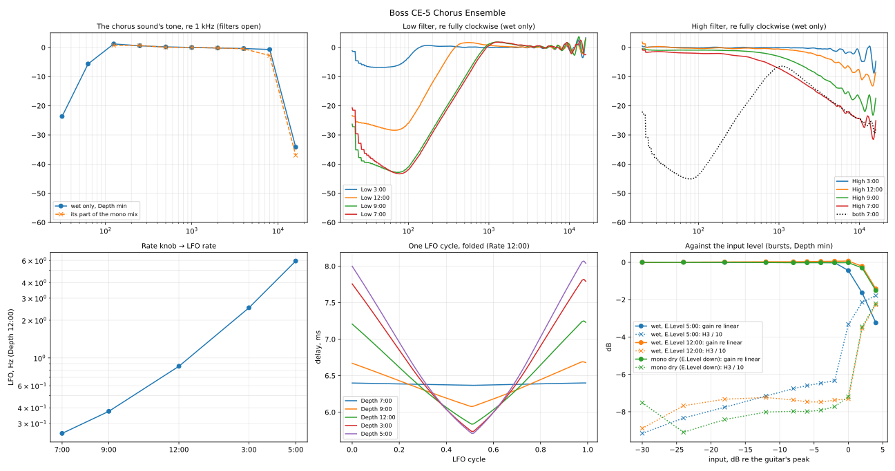

# Boss CE-5 Chorus Ensemble

Measured 2026-10-27 on a 9 V supply, in two sessions:

| Session | Output | What it gives |
|---|---|---|
| [`2026-10-27-wet/`](2026-10-27-wet/) | a plug in Output B (other end loose), Output A recorded: **the chorus sound alone** (manual: with B in use, A carries only the effect, B only the dry) | wet tone, delay, E.Level, the filter, the LFO, saturation, noise |
| [`2026-10-27-mono/`](2026-10-27-mono/) | Output A alone: **dry + chorus**, what a mono rig hears | the dry path, the dry/wet balance, the mix's tone, noise |

Same rig and playback level as the TR-2 and DD-8 ([`tools/capture/README.md`](../../../tools/capture/README.md)).
Plans: `tools/capture/plans/ce-5-wet.json`, `tools/capture/plans/ce-5.json`. Analysis:
`tools/capture/analyze_ce5.py captures/boss/ce-5/2026-10-27-wet captures/boss/ce-5/2026-10-27-mono`
→ [`2026-10-27-wet/fit/ce-5.json`](2026-10-27-wet/fit/ce-5.json) and the figure below.

The knobs: E.Level, Rate, Depth, and a concentric Filter: **Low** (outer) and **High**
(inner), which turn independently. Per the manual both filters shape only the chorus
sound, and clockwise widens the band — so fully clockwise (5:00) is the most open, and it
is the setting every take uses unless it says otherwise.



## The model

```
x'       = clip_in(x)                                   (≈ +2 dB re the guitar's peak)
mono out = 1.31 · x'(t − 0.98 ms)  +  wet
wet      = clip_wet( E(E.Level) · HighLP · LowHP · LP10k · HP60( x' ) (t − d(t)) )
d(t)     = d_min + swing · tri(f_LFO · t)^~1.2          (tri: 0 at the bottom, 1 at the top)
```

The order of the linear stages (filters, delay, E.Level) can't be told apart from outside.
The two clips are what the bursts show (see *Saturation*); `clip_wet` sits after at least
part of E.Level's gain.

## It's digital

A plain-reading result worth stating first, because a CE-5 is easy to assume analog:

- **The dry path, with the pedal on, is 0.98 ms late** (47 samples at 48 kHz), with the
  same group delay from 300 Hz to 14 kHz (0.97–0.99 ms) and a flat response (±0.9 dB,
  50 Hz–16 kHz), at **+2.3 dB** over bypass. A constant delay at every frequency is a
  converter's latency, not an analog circuit. Bypass is 0.00 ms (true or buffered bypass).
- **The wet path's top end is a linear-phase brick wall:** −0.1 dB at 8 kHz, −3.5 at
  10 kHz, −10.5 at 12, −25 at 14, −44 at 16, −64 at 18 kHz — and its group delay stays at
  6.37–6.54 ms right through that cliff (an analog low-pass this steep would add hundreds
  of µs near its corner). That is a digital, linear-phase filter.
- No level wobble (the LFO moves the level by 0.01–0.06 dB), no compander breathing, no
  saturation below the clips — and the dry path clips too, at the same level as the
  wet at a low E.Level (the input converter).

The LFO's shape (below) is the one bucket-brigade choruses have, so it may be imitated.

## The dry path and the mix

| | |
|---|---|
| Dry delay (pedal on) | 0.98 ms re bypass |
| Dry gain | +2.3 dB re bypass (at 1 kHz), flat ±0.9 dB 50 Hz–16 kHz |
| Filters | don't touch the dry: both at 7:00 vs both at 5:00, E.Level down: 0.0 dB at 1 kHz |
| Mono mix at E.Level 5:00 | the chorus 2.4 dB above the dry (at 1 kHz) |
| E.Level fully down | the chorus is still there at −29.7 dB (1 kHz), 23.5 dB under E.Level 5:00 — not muted |

**The mono output's chorus is darker than the wet-only output's**: the same level up to
4 kHz (±0.1 dB), then −1.2 to −1.4 dB at 6.3 kHz, −2.1 dB at 8 kHz, −1.8 dB at 10 kHz, −1.4
to −2.3 at 12.5 kHz. Checked twice in each mode (`sweep-check`, with High turned firmly
to its stop): each mode repeats itself to 0.2 dB, so it's the output, not the knob.

## The wet path

At minimum Depth (the delay moves 0.03 ms), filters open, E.Level 5:00:

- **Delay:** 6.41 ms after the input, **5.43 ms after the dry**.
- **Gain:** −6.2 dB at 1 kHz in wet-only mode (E.Level 5:00).
- **Tone**, re 1 kHz (third octaves): 31.5 Hz −23.6, 63 Hz −5.6, 125 Hz +1.2, 250 Hz +0.6,
  500 Hz +0.2, 2 kHz −0.2, 4 kHz −0.4, 8 kHz −0.7 dB, then the brick wall above. So a
  low cut at about 60 Hz with a small bump above it, flat, and the 10 kHz cliff.

### E.Level

Wet gain at 1 kHz (dB; wet only and the mono mix's wet part agree within 0.6 dB):

| E.Level | 7:00 | 9:00 | 12:00 | 3:00 | 5:00 |
|---|---|---|---|---|---|
| wet only | — | −26.2 | −19.5 | −11.1 | −6.2 |
| mono | −29.7 | −25.6 | −19.3 | −11.5 | −6.1 |

Close to linear in dB over the rotation from 9:00 up (2.2–2.8 dB per tenth of the
rotation), with a floor at the bottom.

### Saturation

Bursts at 1 kHz (Depth minimum), against the input level re the guitar's peak, in
three places:

| input (dB) | −2 | 0 | +2 | +4 |
|---|---|---|---|---|
| wet, E.Level 5:00: gain re linear / H3 | −0.02 / −63 | **−0.44 / −33** | −1.63 / −21 | −3.24 / −18 |
| wet, E.Level 12:00 | +0.06 / −74 | +0.07 / −73 | **−0.21 / −35** | −1.42 / −23 |
| mono dry (E.Level down) | −0.02 / −77 | −0.02 / −72 | **−0.30 / −35** | −1.51 / −22 |

Perfectly linear below the knee (gain within 0.02 dB), then a **hard clip** (2nd harmonic
below −52 dB: symmetric). **Two clips:** the dry path and the wet at E.Level 12:00 clip
alike at about **+2 dB** — the pedal's input (its converter), before the split; at
E.Level 5:00 the wet clips **2 dB earlier**, at 0 dB, so a second ceiling sits after
(part of) E.Level's gain. A hard-played guitar peaks right at the wet's knee with E.Level
up — the DD-8 clips 3 dB earlier still.

### The filter

Against both knobs fully clockwise (wet only):

| Low (outer) | corner (−3 dB) | slope | floor (25–40 Hz) |
|---|---|---|---|
| 3:00 | 104 Hz | a shelf | −6.5 dB |
| 12:00 | 315 Hz | 11.5 dB/oct | −26 dB |
| 9:00 | 731 Hz | 13.5 dB/oct | −40 dB |
| 7:00 | 778 Hz | 13.4 dB/oct | −37 dB |

A **resonant second-order high-pass with a floor** — a shelf at 3:00 that deepens and
moves up as the knob turns down. It peaks +1.1 to +1.6 dB just above its corner. **The
last quarter of the knob (9:00 → 7:00) does almost nothing** (+50 Hz, the same depth).

| High (inner) | corner (−3 dB) | slope | below the corner |
|---|---|---|---|
| 3:00 | 10.2 kHz | — | 0 dB |
| 12:00 | 3.4 kHz | 4.1 dB/oct | −0.2 to −0.4 dB |
| 9:00 | 980 Hz | 5.0 dB/oct | −0.9 to −1.1 dB |
| 7:00 | 352 Hz | 4.2 dB/oct | −1.4 to −2.6 dB |

A **gentle first-order-like low-pass** whose corner moves over five octaves (10 kHz →
350 Hz), with a slight broadband drop as it closes. At 7:00 it is −7 dB at 1 kHz and −31
at 16 kHz.

**The two combine as a product** (independent stages): both at 7:00 equals the sum of
the two curves in dB within 1.6 dB (median 0.1 dB) from 40 Hz to 10 kHz — a band-pass
peaking at −6.5 dB around 1 kHz.

### The LFO

From held 1 kHz tones (wet only): the delay over time, from the tone's phase against the
input.

| Rate | 7:00 | 9:00 | 12:00 | 3:00 | 5:00 |
|---|---|---|---|---|---|
| LFO (Hz) | 0.250 | 0.375 | 0.858 | 2.515 | 5.934 |
| delay swing, Depth 12:00 (ms) | 1.67 | 1.57 | 1.41 | 1.29 | 1.21 |

The rate rises exponentially and faster towards the top (0.29, 0.40, 0.52, 0.62 octaves
per clock hour across the four intervals): 0.25 → 5.9 Hz, 4.6 octaves. The swing at a
fixed Depth shrinks as Rate goes up:

| Depth | Rate 7:00 | 12:00 | 5:00 | fastest / slowest |
|---|---|---|---|---|
| 12:00 | 5.72–7.39 ms (1.67) | 5.84–7.25 (1.41) | 5.93–7.14 (1.21) | 0.72 |
| 5:00 | 5.49–8.07 ms (2.58) | 5.71–8.07 (2.36) | 5.90–7.98 (2.08) | 0.81 |

Not a fixed fraction (−28 % against −19 %), and not a smoothing filter on the LFO either
(the swing is already down 15 % at 0.86 Hz): the Rate setting itself scales the depth. At
full Depth the top stays at ~8.07 ms and the bottom rises with Rate.

| Depth (Rate 12:00) | 7:00 | 9:00 | 12:00 | 3:00 | 5:00 |
|---|---|---|---|---|---|
| delay min (ms) | 6.37 | 6.08 | 5.84 | 5.74 | 5.71 |
| delay max (ms) | 6.40 | 6.69 | 7.25 | 7.82 | 8.07 |
| swing (ms p-p) | 0.03 | 0.61 | 1.41 | 2.08 | 2.36 |

(Depth 12:00 is the Rate series' 12:00 take, 0.858 Hz; the Depth series ran at 0.892 Hz —
Rate set twice by hand.) **Depth mostly raises the top**: the bottom sinks only 0.66 ms
while the top climbs 1.67 ms; the bottom levels off near 5.7 ms.

**Shape:** a triangle with bowed sides, `delay = min + swing · tri^p`, p = 1.07 at Depth
9:00, 1.15–1.27 deeper (residual 7–39 µs on a 0.6–2.4 ms swing; a plain triangle leaves
33–71 µs, a sine 43–89 µs). The delay lingers near its minimum and turns sharply at both
ends — what a triangle on a bucket-brigade clock gives (delay ∝ 1/clock).

**The absolute delay** is only known modulo 1 ms from a 1 kHz tone; the analysis picks the
period that puts the mean nearest the Depth-minimum delay (6.41 ms). Checked twice:
- at Rate 7:00 / Depth 12:00, where a sweep's low end pins the delay (the discarded first
  `dry-sweep` take, recorded at exactly those settings): sweep 5.77–7.33 ms, held tone
  5.72–7.39 ms;
- at full Depth with a 200 Hz tone, whose 5 ms period no swing reaches, against one at
  minimum Depth: 5.73–8.10 ms (mean 6.79), the 1 kHz tone 5.71–8.07 (mean 6.78).

### Noise

Wet only: −84.1 dBFS RMS (peaks −65 dBFS, above the −75 dBFS the capture tool waited for —
the plans set `quiet_dbfs` −60), nearly white within the wet band (0 to −3 dB from 500 Hz
to 8 kHz, re 1 kHz), cut by the same 10 kHz wall. Mono: −81.9 dBFS RMS.

**After a note stops, the hiss dips for ~0.1 s**: −91 dBFS at 20–50 ms, −96 at 50–100 ms,
−88 at 100–150 ms, back to −84 by 150–300 ms. A digital quirk (a noise-shaper or dither
settling?), 84 dB down; not worth modelling.

## Takes and lessons

- 32 wet-only takes (`sweep-check` added after the mono session; five more for the open
  questions), 15 mono (`bursts-dry` added). The first mono
  `dry-sweep` was recorded at E.Level 5:00 / Rate 7:00 / Depth ~12:00 instead of 7:00 /
  12:00 / 7:00 — told apart from the recording alone (the wet matched the E.Level 5:00
  sweep band for band, the delay swung 1.56 ms at 0.245 Hz; Rate 7:00 is 0.250 Hz) — and
  is kept in [`2026-10-27-mono/discarded/`](2026-10-27-mono/discarded/).
- **Split dry and wet in time, not by subtraction.** Subtracting one take's dry path from
  another's needs them aligned to a fraction of a sample (the loopback latency can be a
  sample out between takes): a one-sample miss made a High 3:00 take look *brighter*
  than open. Windowing the impulse response at 3.5 ms (dry at 1 ms, wet at 6.4 ms) needs
  no alignment; it holds from ~125 Hz up, where the dry path's ringing has died out.
- **Wet-only mode** (a plug in Output B) made the chorus measurable on its own; worth
  checking for on every stereo pedal.

## Questions answered by the extra takes

The first analysis left four; a short extra session (takes appended to both plans)
settled them: the absolute delay at full Depth (200 Hz tones: 5.73–8.10 ms, as assumed),
where the clip sits (two clips, see *Saturation*), whether the dry path clips (yes, at
~+2 dB), and how Rate and Depth interact (the swing shrinks with Rate by a
Depth-dependent fraction, see *The LFO*).

## For NAM-X

Done 2026-10-27 (branch `dsp/chorus-ce5`): the Chorus has a Type knob, Chorus | CE-5
(`src/dsp/Ce5Chorus.h`), with Low and High in its ▾ row. Mix is E.Level, Depth the pedal's
knob, Rate stays in Hz; Stereo gives the pedal's two outputs (chorus left, dry right).

Fits behind it: the mono output's tone in 7 biquads (within 0.7 dB to 16 kHz); **Low is a
single resonant low shelf at Q 1.12 at every position** (103 Hz / −6 dB at 3:00 to
315 Hz / −41 dB at 7:00, within 0.2–0.4 dB rms) and High a one-pole low-pass with a small
broadband drop (639 Hz – 9.5 kHz, within 0.3 dB rms); the clips, an input one at +1.2 dB
over the reference and a wet one 1.0 dB under the wet at E.Level 5:00 (within 0.07 dB;
they predict the E.Level 12:00 bursts to 0.1 dB). Rendered and measured like the pedal,
the C++ gives E.Level within 0.01 dB, the filters within 0.3 dB, the delay swing within
0.05 ms at Rate 12:00 (0.15 ms at the Rate × Depth extremes: one mean swing-vs-Rate
curve), the wet 5.42 ms after the dry (pedal 5.43; the tone chain's own 0.07 ms taken
off), the tone within 1.5 dB (1–3 dB darker above 10 kHz). Choices beyond the data: the
clips are calibrated to a guitar peak of −6 dBFS after the amp model (as the DD-8's);
the dry isn't delayed by the pedal's 0.98 ms converter latency (only the spacing
matters); one tone (the mono output's) in both modes. Not approved by ear yet.
