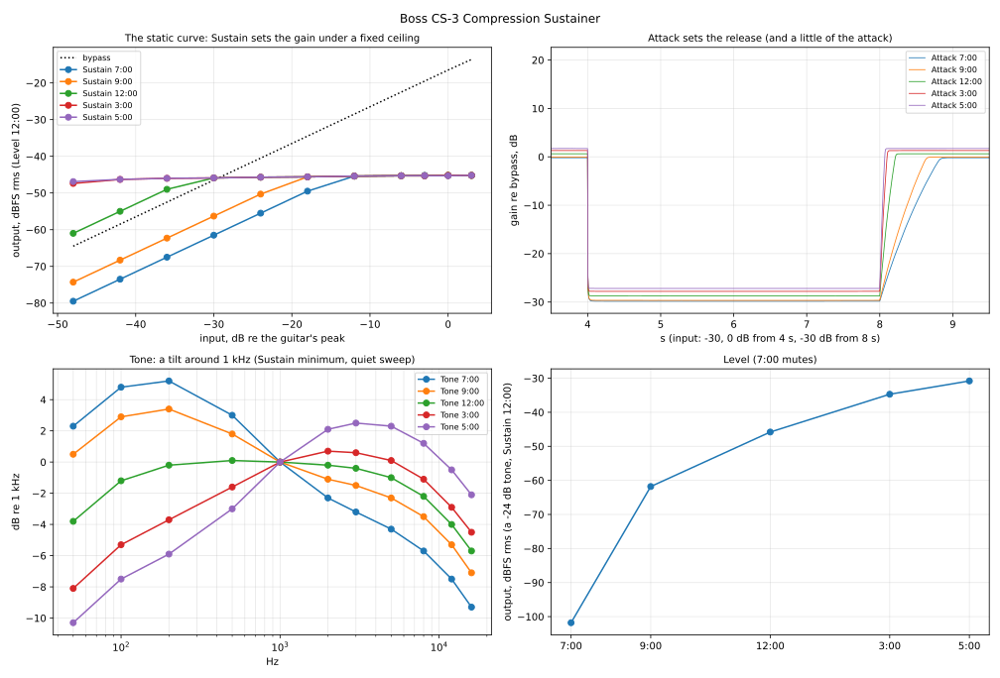
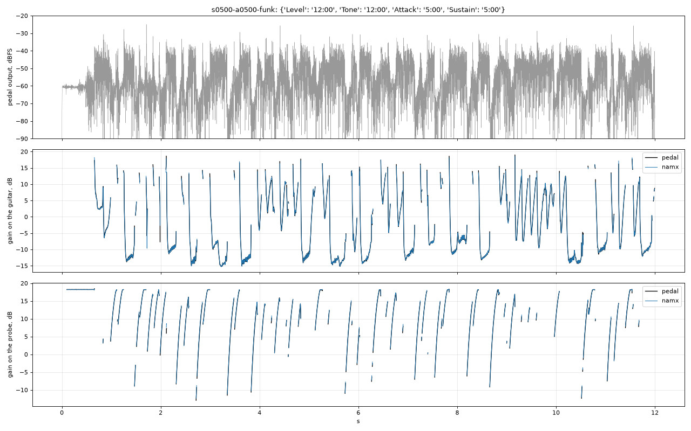

# Boss CS-3 Compression Sustainer

Measured 2026-10-27 on a 9 V supply, mono (Input → Output):

| Session | What it gives |
|---|---|
| [`2026-10-27/`](2026-10-27/) | the static curve per Sustain position, attack and release per Attack position, picked notes, Tone, Level, noise |
| [`2026-10-30-detector-check/`](2026-10-30-detector-check/) | two new level packets at 110 Hz and 1 kHz, Attack extremes; fixed-release generalization check |
| [`2026-10-30-detector-crossed/`](2026-10-30-detector-crossed/) | crossed starting/destination levels at 1 kHz; return-to-minimum gain repeat and frozen hypothesis test |
| [`2026-11-11-focused/`](2026-11-11-focused/) | guitar excerpts over a quiet probe at Sustain 7:00, 12:00, 5:00 and Attack 7:00, 12:00, 5:00: the gain over time on real playing, both models against it |

Same rig and playback level as the other pedals ([`tools/capture/README.md`](../../../tools/capture/README.md)).
Plan: `tools/capture/plans/cs-3.json` (31 takes, every knob at 12:00 unless a take says
otherwise). Analysis: `tools/capture/analyze_cs3.py captures/boss/cs-3/2026-10-27` →
[`2026-10-27/fit/cs-3.json`](2026-10-27/fit/cs-3.json) and the figure below.

The knobs: Level, Tone, Attack, Sustain. Clock positions: 7:00 = fully counter-clockwise,
5:00 = fully clockwise.

## It's analog

The service notes (1986): a µPC1252H2 VCA, M5218L and BA718 op-amps, a transistor peak
detector, FET switching. Pots: Level 50k audio taper, Tone and Sustain 20k linear, Attack
250k C-taper in the detector. Equivalent input noise −110 dBm. The manual: nominal input
and output −20 dBu; Level fully counter-clockwise mutes; Sustain counter-clockwise makes
it a limiter; Attack clockwise keeps the pick's attack ("drive sound"); Tone clockwise
brighter.

## The static curve: Sustain sets the gain under a fixed ceiling

A 1 kHz staircase (−48 to +3 dB re the guitar's peak, 1.5 s per step, the settled last
40 % of each step), Level 12:00:

| Sustain | 7:00 | 9:00 | 12:00 | 3:00 | 5:00 |
|---|---|---|---|---|---|
| gain at −48 dB, re bypass | −15.0 | −9.8 | +3.5 | +17.1 | +17.6 |

Above that the output **pins at the same level for every Sustain position** (−45.2 dBFS rms
at Level 12:00), rising 0.015 dB per dB of input (~66:1): a limiter with a fixed output.
Sustain is the gain before it — how quiet a note can get and still come out at the
ceiling. At Sustain 7:00 the curve is linear up to about −12 dB re the guitar's peak; at
3:00–5:00 even −48 dB is already at the ceiling. The knob does little between 3:00 and
5:00.

At full Level the ceiling is ~14 dB under a bypassed sine at the guitar's peak: hard
playing comes out much quieter than bypass; quiet playing louder.

## Attack and release

A jump: −30 dB, then 0 dB, then −30 dB, 4 s each; the gain every 1 ms against the bypass:

| Attack | 7:00 | 9:00 | 12:00 | 3:00 | 5:00 |
|---|---|---|---|---|---|
| clamp-down: within 1 dB after, ms | 14 | 13 | 9 | 7 | 6 |
| recovery after the drop, 63 % / 90 %, ms | 458 / 716 | 354 / 554 | 124 / 191 | 62 / 94 | 44 / 65 |

**Attack mostly sets the release** (×10 faster toward 5:00), the clamp-down only modestly.
The recovery is curved, but **not a single exponential of gain in dB toward the
measured final gain** (corrected 2026-10-30): the measured t90/t63 ratios are
1.48–1.56, versus about 2.30 for that law.
A decaying linear-domain detector followed by logarithmic gain fitted those windows
better than an exponential toward the measured final gain. **Later crossed-level data
qualify that inference:** a log-domain release toward a more distant latent floor,
stopped by input recapture, explains the new recoveries better. The domain is not
identified by the timing ratio alone. See the [crossed-level report](../../../tools/research/CS3_CROSSED_VALIDATION.html).
When the loud tone hits, the first cycle or two pass at the quiet gain
before the compressor clamps down (a pick: one big first cycle, clamped within 2–3 ms). Sustain doesn't change the timing (Sustain 5:00 =
Sustain 12:00 at Attack 12:00).

**Picked notes** (220 Hz bursts, 3 s apart, Sustain 12:00): the pick spikes 12–13 dB over
the note, then the note holds level — 0.1 dB of decay from 100 to 500 ms where the dry
note drops 5.8 dB. Attack hardly changes single notes this far apart (the gain recovers
between them at every position); its fast release is what keeps every pick's attack in
fast playing, as the manual says.

## On guitar: the focused session (2026-11-11)

Plan `tools/capture/plans/cs-3-focused.json`, 27 takes, Level and Tone at 12:00 throughout:
excerpts of the guitar DI dataset over a 9 kHz probe 50 dB under the guitar's peak (60 dB with
Sustain at 5:00), which sits under the threshold at every setting. A compressor is a gain that
moves, so the effect alone is that gain over time: read on the guitar where it plays (the
output's level over the dry's) and on the probe between hits (the recovery, to the hundredth
of a dB). Tools: `tools/capture/render_cs3.cpp` (NAM-X's Compressor offline),
`tools/capture/cs3/focused.py [--plot]` (the table below; `fit/gain-TAKE.png`).

**The method holds:** the stabs with and without the probe give the same gain (the probe
doesn't change what the pedal does), and the funk take played twice gives the same numbers.

**What the pedal does that the models didn't:**

- **The recovery heads for one fixed level, whatever Sustain is.** After a chord the gain
  climbs in dB along an exponential toward an asymptote 7.7 dB over the most gain Sustain 5:00
  gives, and stops where Sustain puts its ceiling on the gain. At Sustain 5:00 exponentials to
  that asymptote fit the eight recoveries within 0.02–0.06 dB, with T = 300 ms at Attack 12:00
  and 100 ms at 5:00: the refit's own time scales, found in October on other signals. At
  Sustain 12:00 the stop comes on the steep part of the curve (a sharp corner); at 5:00 near
  its flat end (a round one). The refit had the asymptote 24–27 dB under the threshold, which
  is the same place at Sustain 12:00 (where it was fitted) and 17 dB too low at 5:00.
- **Sustain 5:00 has 2.9 dB more gain** than October read: the probe shows the gain with
  nothing played, and October's quietest staircase step (−48 dB) was compressed already.
- Small, not modelled: the gain with nothing played moves with Attack (+0.5 dB at 5:00,
  −0.6 dB at 7:00 re 12:00, at either Sustain).

**The models against the pedal** (the model's Level matched once for the session; gain
difference on the guitar and on the probe in dB rms, the waveform's residual in dB):

| take | CS-3: guitar | probe | residual | refit, fixed asymptote: guitar | probe | residual |
|---|---|---|---|---|---|---|
| Sustain 7:00, funk | 0.72 | 0.20 | −28.8 | 0.78 | 0.17 | −27.9 |
| all 12:00, stabs | 0.25 | 0.53 | −26.8 | 0.28 | 0.16 | −26.5 |
| all 12:00, funk | 0.73 | 1.64 | −21.0 | 0.37 | 0.25 | −23.7 |
| all 12:00, lead (held out) | 0.42 | 0.70 | −24.7 | 0.42 | 0.19 | −24.8 |
| Attack 7:00, funk | 1.08 | 2.13 | −19.6 | 0.55 | 0.27 | −25.2 |
| Attack 7:00, chords | 0.35 | 2.11 | −25.8 | 0.33 | 0.41 | −26.4 |
| Attack 5:00, funk | 0.66 | 0.86 | −21.6 | 0.40 | 0.61 | −24.7 |
| Sustain 5:00, stabs | 0.35 | 2.83 | −18.6 | 0.46 | 0.10 | −23.3 |
| Sustain 5:00, lead (held out) | 0.71 | 4.31 | −18.8 | 0.56 | 0.41 | −22.6 |
| Sustain 5:00, Attack 5:00, funk | 1.08 | 5.12 | −15.4 | 0.64 | 0.32 | −21.9 |

(The refit before this session, on the last three: probe 3.25, 3.19, 3.70.) The first CS-3
type recovers too early between strokes at every setting; the refit with the fixed asymptote
lies on the pedal's curve. In NAM-X since this session: the refit's asymptote is fixed
(`REFIT_FLOOR_DB`), and the Threshold knob reaches 2.9 dB lower (Sustain 5:00).

### Attack in between (2026-11-11-attack, 10 takes)

The user asked about plots where the models ran a few tenths of a dB under the pedal wherever
the gain sat at its top; the offset followed Attack. Plan `cs-3-attack.json`: the stabs over
the probe at eight Attack positions with Sustain at 5:00 (the in-between angles approximate:
each take gives its own recovery time and its own top gain, and NAM-X's Release is in ms, not
in positions), four recoveries a take:

| Attack | 7:00 | 9:00 | ~10:30 | 12:00 | ~1:30 | 3:00 | ~4:00 | 5:00 |
|---|---|---|---|---|---|---|---|---|
| T, ms (the four within 1 %) | 1152 | 870 | 424 | 300 | 207 | 142 | 106 | 99.5 |
| the gain with nothing played, dB re 12:00 | −0.63 | −0.48 | −0.16 | 0 | +0.16 | +0.31 | +0.43 | +0.45 |
| the asymptote over it, dB | 8.4 | 8.2 | 7.9 | 7.7 | 7.5 | 7.2 | 7.0 | 6.9 |

**The most gain there is rises as the release gets faster: a straight line in log T**, 0.442 dB
per e-fold, within 0.04 dB at all eight. The asymptote itself hardly moves (0.35 dB over the
travel). In the refit: `REFIT_GAIN_DB_PER_E`, and `REFIT_RELEASE_MS` from this table (9:00 and
3:00 had been October's unvalidated ones: 920 and 144). On the focused session the recoveries
at Attack 5:00 went from 0.61–0.64 dB rms to 0.19, at 7:00 from 0.27–0.42 to 0.21–0.33; every
take's is now within 0.08–0.45 dB.

**In NAM-X since then (the user, 2026-11-11: "let's go with refit"):** the refit is the
Compressor. The first CS-3 type and the Type knob are gone; Release is T, the time scale in
the table above (99.5–1152 ms, default 300 = the pedal's 12:00); preset version 9 turns an
older Release (the 63 % recovery after a 30 dB drop, 44–458 ms) into T at the same position of
the pedal's knob. Not heard yet.

**Open: the detector on chords.** A 1 kHz staircase at Sustain 7:00 (`s0700-steps-1k`): on a
steady tone the pedal starts limiting about 1 dB *before* the model (gain re the quiet steps at
−12 dB: −2.26 against −1.31; above it both fall a dB per dB). Yet on the focused session's
chords at that setting the model dips 0.3–1 dB on the loudest moments where the pedal doesn't
move. So the pedal's detector answers a steady tone more and a chord's peaks less than a fast
peak detector does (October's 110 Hz packet said the same of low notes). Not pursued: under
1 dB, at Sustain 7:00 only.

## Tone

Quiet sweeps (−24 dB) at Sustain 7:00, where the compressor isn't working: a **tilt around
1 kHz** — at 7:00 +5.2 dB at 200 Hz and −9.3 dB at 16 kHz (re 1 kHz), at 5:00 −10.3 dB
at 50 Hz and +2.5 dB at 3 kHz. At 12:00 flat from 200 Hz to 3 kHz with a fixed roll-off
above (−5.7 dB at 16 kHz) and a low cut (−3.8 dB at 50 Hz). (Corrected 2026-10-29: the
bypass impulse response lost its negative times, which bent these curves by up to 1.5 dB at
the top and read every level re bypass ~2.3 dB high — the gains elsewhere come from the
staircases and are unaffected; see `tools/capture/README.md`, Lessons.)

## Level and noise

Level (a −24 dB tone, Sustain 12:00), re 5:00: 7:00 mutes (−71 dB, the floor), 9:00 −31,
12:00 −15, 3:00 −3.9 dB — an audio taper.

Noise (nothing played, Level 12:00): −101.9 dBFS rms at Sustain 7:00, −95.1 at 5:00,
mostly treble hiss; no howling at full Sustain with this rig.

## Takes and lessons

- 31 takes, none redone.
- **Order a plan by setting, not by signal** (the user, 2026-10-27): every knob at 12:00
  came back four times in this plan (staircase, jump, plucks, level). Group takes that share
  a setting and sequence the rest for the fewest knob turns.
- **A hard limiter's takes all peak alike:** the five staircases peaked at the same
  −37.8 dBFS — not a stuck knob, the ceiling.

## For NAM-X

**Validation update, 2026-10-30:** the two crossed-level takes are complete. The
original amplitude-release law fails to generalize; a one-state log-release candidate
predicts crossed t63 at 463/204 ms versus 466/205 ms measured. With parameters fitted
only to earlier 1 kHz takes, absolute recovery RMS is .123/.041 dB, versus .722/.696 dB
for the amplitude-release baseline recalibrated on those same earlier takes.
The candidate was selected after inspecting crossed curves, so this is retrospective
generalization, not a new blind validation. It still underpredicts fast-110-Hz steady
output by up to 1.36 dB, overpredicts its distortion and makes pick spikes too small.
See the [crossed-level report](../../../tools/research/CS3_CROSSED_VALIDATION.html)
for the equations, prototype parameters, full residuals and validation gates. Existing
captures constrain the next attack/recapture work; more CS-3 captures are not needed now.
The original-jump numbers below describe the earlier calibration, not a general
prediction guarantee. Production DSP is unchanged.

*(History: the two sections below describe the first CS-3 type, removed 2026-11-11, and the refit as it was on 2026-10-30; the model as it is now is in "On guitar" above.)*

The Compressor's **CS-3** type (`src/dsp/Cs3Compressor.h`, branch `dsp/compressor-cs3`;
since 2026-11-03 the only compressor in NAM-X): a peak detector on |x| into a hard-knee
ceiling (~85:1, the knee fitted at 0.02 dB), Tone after the gain. The knobs keep their units:
Threshold is Sustain as the input level that reaches the ceiling (−52.8 to −20.3 dBFS, the
pedal's span and the knob's, re an assumed −6 dBFS guitar peak), Release is the Attack knob as
the gain's 63 % recovery (44–458 ms, the knob's span too; the clamp-down follows from the same
position), Level is the output on top of the pedal at full Level, Tone the pedal's Tone (50 % =
12:00).

Rendered and measured like the pedal: the jumps' gain envelopes within 0.27–0.34 dB rms
(recovery within 6 ms, clamp-down within 2 ms — the detector's time constants are
calibrated so); the static curve within 0.5 dB at Sustain 7:00–12:00, up to 1.2 dB high
around the knee at 3:00–5:00; Tone within 0.4 dB with its 1 kHz level shift; picked notes
hold level like the pedal's, their pick spike 1–1.5 dB smaller. The user, 2026-11-03:
"despite not being 100 % accurate, all effects sound very good".

**CS-3 (refit)** (2026-10-30, the Compressor's type 2, beside CS-3 for an A/B): the release
from `tools/research/CS3_CROSSED_VALIDATION.html` (on `pedals/all`). New captures with two
drops to different levels showed one shared recovery curve, stopped earlier when the input
catches the detector — so the detector releases in dB toward a floor far below the knee
(26.8 dB at Attack 7:00, 24.4 dB at 5:00, linear between), with time scale T = 1203 ms at
7:00 and 99.8 ms at 5:00 (9:00–3:00: 920/307/144 ms, from the original jumps only; log
interpolation), and `env = max(|x|, that)`. The attack, ceiling, Tone and knobs are CS-3's;
the floor sits re the threshold, so it holds at any Sustain and Level. Rendered on the
crossed packet (Sustain 12:00, Attack 7:00): t63/t90 461/730 and 203/302 ms, the pedal's
466/734 and 205/304 (CS-3: 407/624 and 225/362). Known misses (research): at fast Attack on
110 Hz the compressed level ~1 dB low, more low-note distortion than the pedal (4.9 % vs 3.5 %
THD at −6 dB), pick spikes ~2 dB small. Not heard yet.
