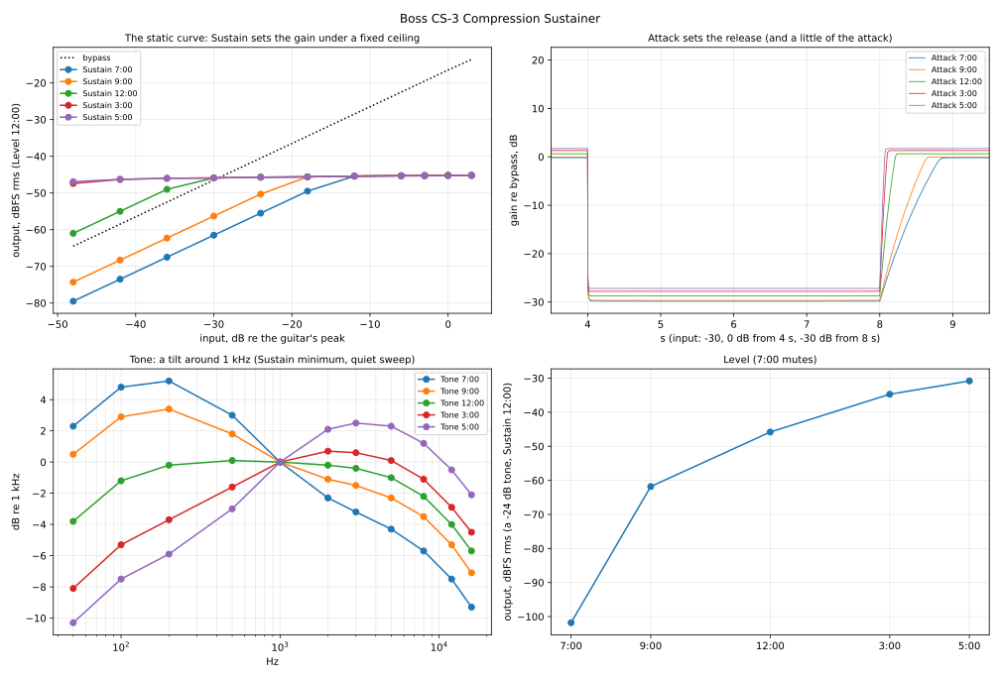

# Boss CS-3 Compression Sustainer

Measured 2026-10-27 on a 9 V supply, mono (Input → Output):

| Session | What it gives |
|---|---|
| [`2026-10-27/`](2026-10-27/) | the static curve per Sustain position, attack and release per Attack position, picked notes, Tone, Level, noise |

Same rig and playback level as the other pedals ([`tools/capture/README.md`](../../../tools/capture/README.md)).
Plan: `tools/capture/plans/cs-3.json` (31 takes, every knob at 12:00 unless a take says
otherwise). Analysis: `tools/capture/analyze_cs3.py captures/boss/cs-3/2026-10-27` →
[`2026-10-27/fit/cs-3.json`](2026-10-27/fit/cs-3.json) and the figure below.

The knobs: Level, Tone, Attack, Sustain. Clock positions: 7:00 = fully counter-clockwise,
5:00 = fully clockwise.

## It's analog

The service notes (1986): a µPC1252H2 VCA, M5218L and BA718 op-amps, a transistor peak
detector, FET switching. Pots: Level 50k audio taper, Tone and Sustain 20k linear, Attack
250k C-taper in the detector. Equivalent input noise −110 dBm. The manual: nominal input
and output −20 dBu; Level fully counter-clockwise mutes; Sustain counter-clockwise makes
it a limiter; Attack clockwise keeps the pick's attack ("drive sound"); Tone clockwise
brighter.

## The static curve: Sustain sets the gain under a fixed ceiling

A 1 kHz staircase (−48 to +3 dB re the guitar's peak, 1.5 s per step, the settled last
40 % of each step), Level 12:00:

| Sustain | 7:00 | 9:00 | 12:00 | 3:00 | 5:00 |
|---|---|---|---|---|---|
| gain at −48 dB, re bypass | −15.0 | −9.8 | +3.5 | +17.1 | +17.6 |

Above that the output **pins at the same level for every Sustain position** (−45.2 dBFS rms
at Level 12:00), rising 0.015 dB per dB of input (~66:1): a limiter with a fixed output.
Sustain is the gain before it — how quiet a note can get and still come out at the
ceiling. At Sustain 7:00 the curve is linear up to about −12 dB re the guitar's peak; at
3:00–5:00 even −48 dB is already at the ceiling. The knob does little between 3:00 and
5:00.

At full Level the ceiling is ~14 dB under a bypassed sine at the guitar's peak: hard
playing comes out much quieter than bypass; quiet playing louder.

## Attack and release

A jump: −30 dB, then 0 dB, then −30 dB, 4 s each; the gain every 1 ms against the bypass:

| Attack | 7:00 | 9:00 | 12:00 | 3:00 | 5:00 |
|---|---|---|---|---|---|
| clamp-down: within 1 dB after, ms | 14 | 13 | 9 | 7 | 6 |
| recovery after the drop, 63 % / 90 %, ms | 458 / 716 | 354 / 554 | 124 / 191 | 62 / 94 | 44 / 65 |

**Attack mostly sets the release** (×10 faster toward 5:00), the clamp-down only modestly.
The recovery is an exponential approach in dB — fast at first, slowing toward the quiet
gain (a 6-second-wide plot makes it look straight; it isn't). When the loud tone hits, the first cycle or two pass at the quiet gain
before the compressor clamps down (a pick: one big first cycle, clamped within 2–3 ms). Sustain doesn't change the timing (Sustain 5:00 =
Sustain 12:00 at Attack 12:00).

**Picked notes** (220 Hz bursts, 3 s apart, Sustain 12:00): the pick spikes 12–13 dB over
the note, then the note holds level — 0.1 dB of decay from 100 to 500 ms where the dry
note drops 5.8 dB. Attack hardly changes single notes this far apart (the gain recovers
between them at every position); its fast release is what keeps every pick's attack in
fast playing, as the manual says.

## Tone

Quiet sweeps (−24 dB) at Sustain 7:00, where the compressor isn't working: a **tilt around
1 kHz** — at 7:00 +5 dB at 200 Hz and −11 dB at 16 kHz (re 1 kHz), at 5:00 −11 dB at
50 Hz and +2.7 dB at 3 kHz. At 12:00 flat from 200 Hz to 3 kHz with a fixed roll-off
above (−8 dB at 16 kHz) and a low cut (−4.5 dB at 50 Hz).

## Level and noise

Level (a −24 dB tone, Sustain 12:00), re 5:00: 7:00 mutes (−71 dB, the floor), 9:00 −31,
12:00 −15, 3:00 −3.9 dB — an audio taper.

Noise (nothing played, Level 12:00): −101.9 dBFS rms at Sustain 7:00, −95.1 at 5:00,
mostly treble hiss; no howling at full Sustain with this rig.

## Takes and lessons

- 31 takes, none redone.
- **Order a plan by setting, not by signal** (the user, 2026-10-27): every knob at 12:00
  came back four times in this plan (staircase, jump, plucks, level). Group takes that share
  a setting and sequence the rest for the fewest knob turns.
- **A hard limiter's takes all peak alike:** the five staircases peaked at the same
  −37.8 dBFS — not a stuck knob, the ceiling.

## For NAM-X

The Compressor's **CS-3** type (`src/dsp/Cs3Compressor.h`, branch `dsp/compressor-cs3`): a
peak detector on |x| into a hard-knee ceiling (~85:1, the knee fitted at 0.02 dB), Tone after
the gain. The knobs keep their units: Threshold is Sustain as the input level that reaches
the ceiling (−52.8 to −20.3 dBFS, the pedal's span, re an assumed −6 dBFS guitar peak),
Release is the Attack knob as the gain's 63 % recovery (44–458 ms; the clamp-down follows
from the same position), Level is the output on top of the pedal at full Level, Tone (▾) the
pedal's Tone (50 % = 12:00); Ratio and Attack are dimmed.

Rendered and measured like the pedal: the jumps' gain envelopes within 0.27–0.34 dB rms
(recovery within 6 ms, clamp-down within 2 ms — the detector's time constants are
calibrated so); the static curve within 0.5 dB at Sustain 7:00–12:00, up to 1.2 dB high
around the knee at 3:00–5:00; Tone within 0.4 dB with its 1 kHz level shift; picked notes
hold level like the pedal's, their pick spike 1–1.5 dB smaller. Not approved by ear yet.
