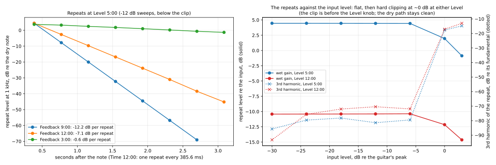
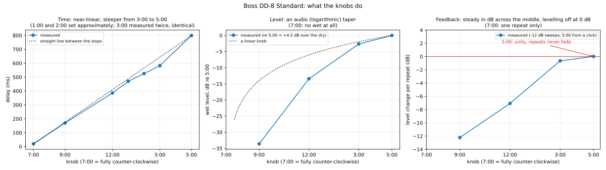
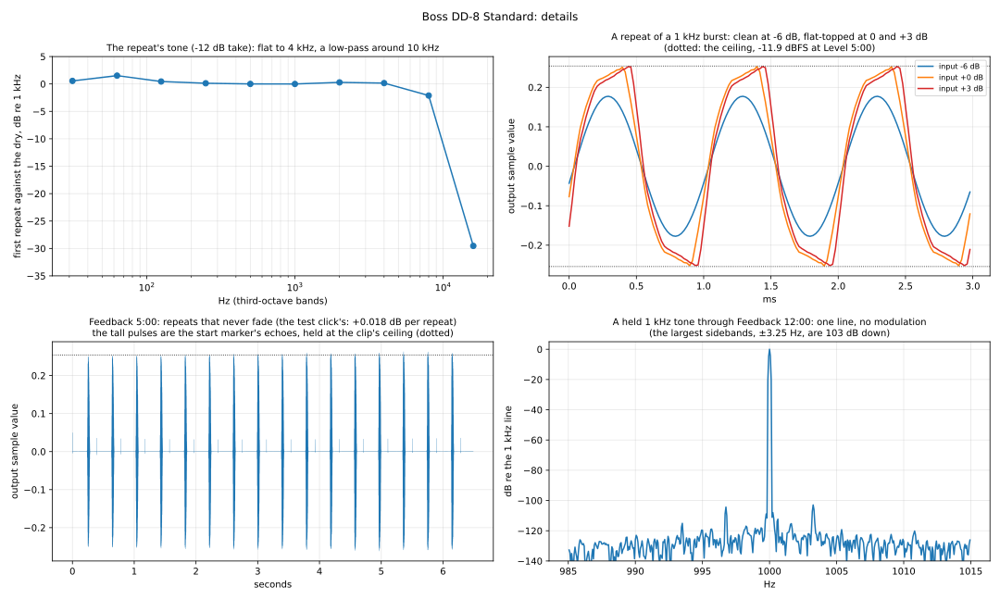
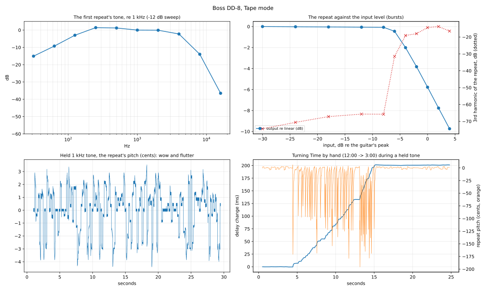
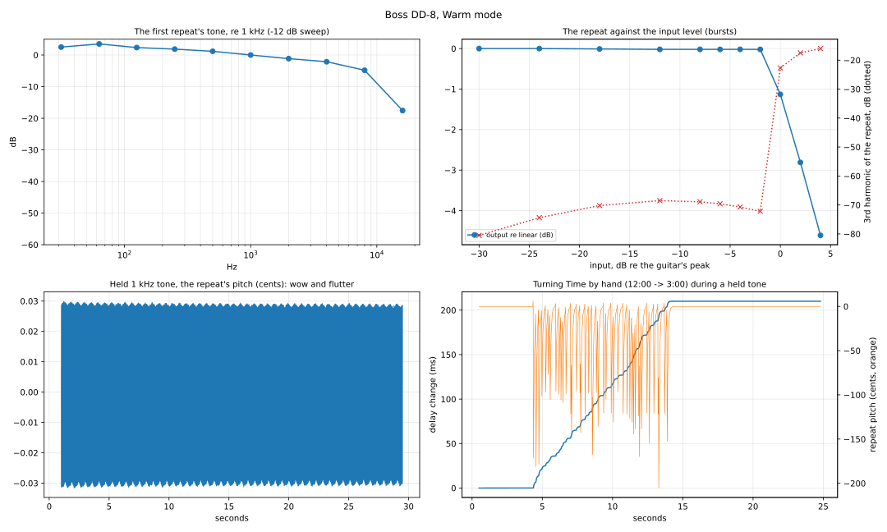

# Boss DD-8 Digital Delay

Measured 2026-10-26/27, mono (Input A → Output A), on a 9 V supply, one session per mode
under this folder. The modes at a glance — details in each section below:

| Mode | In one line | Session |
|---|---|---|
| [Standard](#boss-dd-8-digital-delay--standard-mode) | clean digital delay; analog dry; the repeats hard-clip ~3 dB under a hot guitar's peak; ~10 kHz low-pass; Feedback 5:00 holds | `2026-10-26-standard` |
| [Analog](#analog-mode) | darker on every pass (a ~2 kHz low-pass inside the loop), +1.6 dB, a soft knee; Feedback 5:00 runs away slowly | `2026-10-26-analog` |
| [Tape](#tape-mode) | a ~150 Hz – 5 kHz band, wow (0.53 Hz) and flutter (6.7 Hz), +3.4 dB, Feedback 3:00 near infinite | `2026-10-26-tape` |
| [Warm](#warm-mode) | Standard with a warm tilt (lows +2–3 dB, highs gently down), −1.6 dB | `2026-10-26-warm` |
| [Mod](#mod-mode) | Standard plus a 1.51 Hz sine LFO, ±0.62 ms of delay | `2026-10-27-mod` |
| [Reverse](#reverse-mode) | onset-triggered chunks (0.22–2.5 s) played backwards; Level as dry/wet | `2026-10-27-reverse` |
| [Shimmer](#shimmer-mode-minimal) | plain echoes plus an octave-up diffuse wash; not pursued | `2026-10-27-shimmer` |
| GLT | not measured (low priority) | |
| Warp, Looper, +RV | excluded | |

Standard, Analog, Tape, Warm and Mod are one engine — the same delay line and Time range,
the same clip ceiling before the Level knob, the same Feedback knob — with a parameter set
each (repeat level, tone filter and where it sits, saturation curve, modulation): see
[the four voicings side by side](#the-four-voicings-side-by-side).

Scripts: `tools/capture/analyze_dd8.py` (Standard), `tools/capture/analyze_dd8_mode.py`
(Analog, Tape, Warm, Mod); Reverse and Shimmer were analysed by hand (no script yet).

# Boss DD-8 Digital Delay — Standard mode

Captured 2026-10-26, session [`2026-10-26-standard/`](2026-10-26-standard/): mono (Input A
→ Output A, nothing in the B jacks), MODE on Standard, a 9 V power supply, the same rig
and playback level as the TR-2 ([`tools/capture/README.md`](../../../tools/capture/README.md)).
Measurements: `tools/capture/analyze_dd8.py captures/boss/dd-8/2026-10-26-standard` →
[`fit/dd-8-standard.json`](2026-10-26-standard/fit/dd-8-standard.json) and the figure below.

The question was whether Standard mode does anything besides repeating the signal. It
does one thing: **the repeats hard-clip about 3 dB below a hot guitar's peaks**, while
the dry signal stays clean. Everything else is a textbook digital delay.





## The model

```
y = x_dry + Level · LP10k( delay_T( clip(x) + F · repeats ) )
```

- **Dry path:** analog, untouched. It arrives at the same sample as bypass, at unity gain
  (within 0.2 dB), and stays clean at +3 dB over the guitar's peak. At Level 7:00 the
  output is the dry path alone.
- **Clip:** before the delay and before the Level knob (the converter's input, most
  likely): a hard ceiling about **3 dB below the reference** (the hardest bridge-humbucker
  peak, `rig.json`). Below it the wet path is linear (3rd harmonic ≈ −80 dB); at the
  reference the repeat loses 2.5 dB and has a 3rd harmonic at −18 dB, at +3 dB −15 dB. So
  how hard you play, not where Level sits, decides whether the repeats distort. In 2 dB
  steps (`bursts-fine`): perfectly linear up to −4 dB (−0.01 dB, H3 −73 dB), then a hard
  knee — −0.81 dB and H3 −25 dB at −2 dB, −2.47 / −18 dB at 0, −6.24 / −14 dB at +4 dB;
  the output peak stops at −11.9 dBFS (Level 5:00). No
  compressor: the wet gain is the same at the start, middle and end of a 0.3 s burst and
  follows a level step within 2 ms.
- **Delay time** (Time knob, Feedback at minimum = one repeat):

  | Time | 7:00 | 9:00 | 12:00 | 1:00* | 2:00* | 3:00 | 5:00 |
  |---|---|---|---|---|---|---|---|
  | fraction of the rotation | 0 | 0.2 | 0.5 | 0.6 | 0.7 | 0.8 | 1 |
  | delay (ms) | 19.65 | 169.62 | 385.62 | 469.62 | 525.60 | 582.60 | 799.60 |

  \* set approximately. Close to linear up to 3:00 (56–84 ms per 10 % of rotation), then
  the last stretch to 5:00 covers twice that (108 ms per 10 %): use the points, linear in
  between, not a formula. 3:00 set a second time gave 582.60 ms again, to the sample, so
  the bend is the knob's, not the placement's. Repeats land exactly on multiples of the
  delay (to the sample over 7 repeats).
- **Wet level** (Level knob), the first repeat against Level 5:00, which is **+4.46 dB
  over the dry** (bursts):

  | Level | 7:00 | 9:00 | 12:00 | 3:00 | 5:00 |
  |---|---|---|---|---|---|
  | dB re 5:00 | no repeat | −33.6 | −13.4 | −2.6 | 0 |

  A steep taper; the bursts at 12:00 agree (−14.9 dB re 5:00).
- **Feedback**, each repeat against the one before, at 1 kHz (from −12 dB sweeps):

  | Feedback | 7:00 | 9:00 | 12:00 | 3:00 | 5:00 |
  |---|---|---|---|---|---|
  | dB per repeat | one repeat only | −12.2 | −7.07 | ≈ −0.6 | **≈ 0: the repeats never fade** |
  | extra loss at 4 / 8 kHz | | −0.3 / −1.4 | −0.4 / −1.4 | −0.8 / −0.9 | |

  The first repeat's level doesn't depend on Feedback. Over 9:00–3:00 the loss per repeat
  is close to linear in dB (5–6.5 dB per 30 % of rotation); at 7:00 the loop is off. At
  **5:00 the loop gain is unity**: a −12 dB test click's repeats stayed level for 15
  repeats (+0.02 dB per repeat) — a hold, not a runaway. (The take also shows tall pulses
  at the clip's ceiling: the start marker's echoes, which played at the reference level,
  clipped going in, and then circulated without fading. First read as self-oscillation;
  corrected the same day.)
- **Knob curves, in short:** Time near-linear with a steeper top end; Level an audio
  (logarithmic) taper — −33.6 / −13.4 / −2.6 dB at 9:00 / 12:00 / 3:00 where a linear
  pot would give −14 / −6 / −1.9 dB (amplitude ≈ position^2.2–2.4 in the lower half);
  Feedback steady in dB across the middle, levelling off at unity at 5:00. The end values
  are exact (the knob's stops); the in-between fractions assume stops at 7:00 and 5:00
  (300°). How far a by-eye setting can be off: "Time 12:00" set twice gave 385.62 and
  392.96 ms, about 5° apart; 3:00 (pointer horizontal) repeated to the sample.
- **Wet tone:** the first repeat against the dry (−12 dB take, re 1 kHz): flat to 4 kHz
  (±0.9 dB, +1.9 dB at 63 Hz), −2.2 dB at 8 kHz, −28.9 dB at 16 kHz: a low-pass around
  10 kHz (corrected 2026-10-29: the dry window lost the impulse's negative times; see tools/capture/README.md, Lessons). Each pass through the loop adds the
  small high-frequency loss above.
- **No modulation:** a held 1 kHz tone through Feedback 12:00 comes out as one spectral
  line; the only sidebands (±3.25 Hz) are 103 dB down.
- **Noise:** −101 dBFS RMS with Level 5:00 and Feedback 12:00, no signal.

## How it was measured

- **Sweeps with long silent tails, deconvolved** into the impulse response from what was
  played to what came out: the dry impulse at time 0 and every repeat after it, with a
  far better signal-to-noise ratio than a click. 18 takes of
  [`plans/dd-8-standard.json`](../../../tools/capture/plans/dd-8-standard.json): bypass,
  Level 7:00 (dry alone), Time at five positions, Level at three, Feedback at three (8 s
  tails), a −12 dB repeat for linearity, clicks, a held sine, silence; then two more
  Feedback takes at −12 dB, and four click takes: Time at 3:00 set again, 2:00 and 1:00
  (delay read straight off the clicks), and Feedback 5:00 (one −12 dB click, 6 s).
- **The full-level sweeps clip in the wet path**, which first looked like a compressor
  (repeats 6.4 dB lower, relative to the dry, than at −12 dB) and made a spurious "echo"
  at 81 ms in the deconvolution (gone at −12 dB). Their delay times and the relative
  Level map are unaffected (the clip is before both); the absolute wet gain comes from
  the bursts, and the Feedback map from −12 dB sweeps.
- **Bursts and steps** ([`plans/dd-8-dynamics.json`](../../../tools/capture/plans/dd-8-dynamics.json)):
  0.3 s 1 kHz tones at −30…+3 dB with 0.9 s gaps, so each repeat lands in silence: the
  static curve, at Level 5:00 and 12:00. A −24 → 0 → −24 dB step (3 s each), with the
  dry path subtracted using its bypass take (residual −62 dB): no attack or release.
- Knob positions 7:00, 9:00, 12:00, 3:00 and 5:00 (0, 20, 50, 80, 100 % of the
  rotation): 9:00 and 3:00 (pointer horizontal) can be set reliably, 9:30/2:30 can't.
- PipeWire's round trip moved during the session (449 → 583 → 631 → 455 samples); every
  take measures its own from the loopback.

## Implementing it

Done 2026-10-27 (branch `dsp/delay-dd8`): NAM-X's Delay has a Type knob — DD-8 Standard,
Analog, Tape, Warm, Mod (`src/dsp/Dd8Delay.h`; NAM-X's own Digital delay was removed on
2026-11-03, the DD-8 being the only delay since), built from
[the voicings side by side](#the-four-voicings-side-by-side). Rendered and measured like
the pedal, the C++ gives the repeat levels within 0.15 dB, the Feedback map within
0.05 dB per repeat, the clip curves within 0.4 dB and the tones within ~1–2 dB (Analog
−58 dB at 8 kHz against −50: a plain 6th-order Butterworth at 2.78 kHz, so no band in the
loop can rise above 1 kHz and run away). Choices beyond the data: the clip is calibrated
to a guitar peak of −6 dBFS after the amp model; Tape's band and Warm's tilt sit on the
output (their loop placement wasn't measured); Tape's 2.4 dB level wobble is left out;
a static clip overstates the pedal's third harmonic by 3–6 dB. The user, 2026-11-03:
"despite not being 100 % accurate, all effects sound very good".

## Not measured yet

The stereo outputs (B jacks), what the Time knob does to the repeats while it moves, and
the other modes (Analog, Tape, Mod, Shimmer…).

# Analog mode

Session [`2026-10-26-analog/`](2026-10-26-analog/), plan
[`plans/dd-8-analog.json`](../../../tools/capture/plans/dd-8-analog.json): 19 takes, the
same rig, MODE on ANALOG. Analysed by hand (scratch scripts) on 2026-10-26; no analysis
script yet.

| | Standard | Analog |
|---|---|---|
| Delay range (Time 7:00 → 5:00) | 19.65 – 799.60 ms | the same: 19.85 – 799.81 ms (9:00 169.83 ms) |
| Repeat level, Level 5:00 | +4.46 dB over the dry | **+6.03 dB**, constant from −30 to −12 dB (bursts); level steps −30 → −12 → −30 dB: +6.05 dB throughout, no attack or release |
| Level 12:00 | −14.9 dB re 5:00 | −14.3 dB re 5:00 |
| First repeat's tone, re 1 kHz (−12 dB) | flat to 4 kHz; −2.2 dB at 8 kHz | **flat to 2 kHz (+0.4); −19.5 dB at 4 kHz, −50 dB at 8 kHz** |
| Each further repeat (Feedback 12:00, re the 1 kHz loss) | about the same at all frequencies | **another ~10 dB lower at 3.15 kHz and ~18 dB at 4 kHz: the filter is inside the loop**, every repeat darker |
| Fade per repeat, Feedback 9:00 / 12:00 / 3:00 | −12.2 / −7.07 / −0.6 dB | −12.0 / −7.9 / **−1.40** dB (3:00 from a burst: exactly −1.40 dB for 15 repeats, −17 → −36 dBFS, so nothing level-dependent in the loop) |
| Feedback 5:00 | unity: the repeats hold (+0.02 dB per repeat) | **a slow runaway:** a −12 dB click's repeats dip to −14.5 dB, then grow +0.4 dB per repeat (to −8 dB after 16), held by the clip at the ceiling — the classic analog-delay oscillation |
| Distortion of the repeat (2 dB steps, `bursts-fine`), output vs linear / H3 | linear to −4 dB (−0.01 / −73 dB), then a hard knee: −0.81 / −25 dB at −2, −2.47 / −18 dB at 0, −6.24 / −14 dB at +4 | **a soft knee in front of the same ceiling:** −0.00 / −64 dB at −12, −0.04 / −57 at −8, −0.26 / −44 at −6, −0.76 / −39 at −4, −2.33 / −22 at −2, −4.14 / −18 at 0, −7.99 / −16 dB at +4; some 2nd harmonic (−62 dB from −6 dB); the ceiling (~−12.0 dBFS peak at Level 5:00) is reached ~1.5 dB earlier; like Standard's, before the Level knob (the same onset at Level 12:00) |
| Modulation (held 1 kHz tone) | none (−103 dB) | **none** (nothing above −116 dB) |
| Turning Time while playing (Time 12:00 → 3:00 by hand, a held tone) | not measured | **the delay slides, never jumps:** a staircase of small steps, each a quick glide that bends the repeat's pitch down for tens of ms (up to −190 cents when turned fast), the level within ~2 dB (no crossfade or mute); +208 ms in total. The steps recurred every ~0.4 s, close to the delay time — the pedal updating once per pass, or the rhythm of the hand: one take can't tell. A take with the knob still stays at exactly 1000.00 Hz. [Figure](2026-10-26-analog/fit/time-glide.svg) |
| Noise | −101.1 dBFS | −101.2 dBFS |

So Analog is Standard's delay with **a darker loop that darkens every repeat** (a steep
low-pass just above 2 kHz, applied on each pass), **repeats 1.6 dB louder**, and **a
softer, earlier saturation** under the same ceiling — a bucket-brigade delay's character,
without its clock wobble or compander.

**A wrong turn, corrected the same day:** the first pass's two bypass takes
(`bypass-sweep`, `bypass-bursts`) were recorded with the pedal still on — their gaps and
tails hold repeats (−12 and −38 dBFS) where a bypassed pedal is silent. Measured against
that `bypass-bursts`, the repeat seemed to grow with the input level (−6.9 dB at −30 dB up
to +1.9 dB at −6 dB), which read as an expander. The level steps and the feedback burst
contradicted it; against the Standard session's clean `bypass-bursts` (the same signal and
rig) the repeat gain is flat. Nothing else here depends on those two takes (the tone
compares each repeat with the dry impulse in its own take). `capture.py` now flags a
bypass take with sound where nothing was played.

# Tape mode

Session [`2026-10-26-tape/`](2026-10-26-tape/), plan
[`plans/dd-8-tape.json`](../../../tools/capture/plans/dd-8-tape.json): 22 takes, the same
rig, MODE on TAPE. Measured with `tools/capture/analyze_dd8_mode.py
captures/boss/dd-8/2026-10-26-tape` → [`fit/dd-8-tape.json`](2026-10-26-tape/fit/dd-8-tape.json)
and the figure below (the same script reproduces the Analog numbers).

| | Standard | Analog | **Tape** |
|---|---|---|---|
| Delay range (Time 7:00 → 5:00) | 19.65 – 799.6 ms | 19.85 – 799.81 ms | **19.96 – 800.44 ms** (9:00 172.75) |
| Repeat level, Level 5:00 | +4.46 dB | +6.03 dB | **+7.9 dB**, constant (level steps: no attack or release) |
| First repeat's tone, re 1 kHz (−12 dB) | flat to 4 kHz, −2 dB at 8 kHz | flat to 2 kHz, −19 dB at 4 kHz | **band-limited: −15.1 / −9.2 / −3.0 dB at 31.5 / 63 / 125 Hz, +1.4 dB at 250 Hz, flat to 2 kHz, −2.3 dB at 4 kHz, −14.0 dB at 8 kHz, −36.5 dB at 16 kHz** (roughly 150 Hz – 5 kHz) |
| Distortion, output vs linear / H3 | linear to −4 dB, hard knee | soft knee from −8 dB | **some low-level H3 (−66…−74 dB), linear to −8 dB (−0.07), then a knee: −0.45 / −31.5 dB at −6, −2.0 / −19 dB at −4, −5.8 / −14 dB at 0**; the same ceiling (~−11.8 dBFS peak) |
| Fade per repeat, Feedback 9:00 / 12:00 / 3:00 (bursts, −12 dB) | −12.2 / −7.07 / −0.6 dB | −12.0 / −7.9 / −1.40 dB | **−10.8 / −6.65 / −0.04 dB** (3:00 measured twice, identical) |
| Feedback 5:00 | holds (unity) | slow runaway (+0.4 dB/repeat) | **holds** (+0.003 dB per repeat) |
| Wow and flutter (held 1 kHz tone, one repeat) | none | none (0.06 cents rms) | **yes: 1.7 cents rms, 8 cents peak to peak; wow at 0.53 Hz (1.65 cents rms), flutter at 6.7 Hz (0.48 cents rms); the level wobbles 2.4 dB** (0.84 dB rms over 28 s, the extremes mid-take: real, not an edge effect) |
| Turning Time while playing | — | slides in small glides | **the same:** +201 ms, dips to −196 cents, level within 2.6 dB |
| Noise | −101.1 dBFS | −101.2 dBFS | −101.2 dBFS |

So Tape is the delay with a **worn-tape voicing**: a narrow band (thin lows, dark highs),
**real wow and flutter** on the repeats, hotter repeats that saturate earlier, and a
Feedback knob whose top third sustains almost indefinitely.

**Notes:** the Feedback sweeps don't work in Tape — the wow wanders the delay, which the
deconvolution assumes fixed (the per-repeat numbers came out erratic) — so its feedback
comes from 50 ms bursts with each repeat's level read directly (`feedback-burst-*`,
`analyze_dd8_mode.burst_decays`). The first `feedback-burst-0900` was recorded with
Feedback elsewhere (the output sat at the clip ceiling for 8 s, the repeats never
fading); its retake (`-again`) is the one used. Retakes with high Feedback need the
pedal silent first: at 3:00 and above it keeps repeating on its own.



# Warm mode

Session [`2026-10-26-warm/`](2026-10-26-warm/), plan
[`plans/dd-8-warm.json`](../../../tools/capture/plans/dd-8-warm.json) (the Tape plan with
feedback from bursts): 17 takes. `analyze_dd8_mode.py` →
[`fit/dd-8-warm.json`](2026-10-26-warm/fit/dd-8-warm.json).

Warm is Standard with a **warm tilt** on the repeats:

| | Standard | **Warm** |
|---|---|---|
| First repeat's tone, re 1 kHz | flat to 4 kHz, −2.1 dB at 8 kHz | **+2.5 / +3.5 / +2.4 / +1.9 / +1.2 dB at 31.5 / 63 / 125 / 250 / 500 Hz, −1.1 / −2.1 / −4.8 / −17.6 dB at 2 / 4 / 8 / 16 kHz** |
| Repeat level, Level 5:00 | +4.46 dB | **+2.85 dB**, constant (level steps: no attack or release) |
| Distortion | linear to −4 dB, hard knee | **linear to −2 dB** (H3 −68…−80 dB), then a hard knee: −1.13 dB and H3 −22.7 dB at 0 dB, −4.6 / −16 dB at +4; the same ceiling (~−11.8 dBFS) |
| Fade per repeat, 9:00 / 12:00 / 3:00 (bursts) | −12.2 / −7.07 / −0.6 dB | −11.6 / −7.46 / −0.82 dB |
| Feedback 5:00 | holds | holds (+0.06 dB per repeat) |
| Wow | none | none (0.02 cents rms) |
| Turning Time | — | glides, as Analog and Tape (+210 ms, dips to −205 cents) |
| Delay range / noise | 19.65 – 799.6 ms / −101.1 dBFS | 19.62 – 799.58 ms / −101.2 dBFS |

## The four voicings side by side

Standard, Analog, Tape and Warm share the delay line, the Time range, the hard ceiling
before the Level knob and Feedback's shape; what changes is the voicing:

| | Standard | Analog | Tape | Warm |
|---|---|---|---|---|
| Repeat level (Level 5:00) | +4.46 dB | +6.03 dB | +7.9 dB | +2.85 dB |
| Tone | flat, ~10 kHz low-pass | flat to 2 kHz, steep low-pass **in the loop** | ~150 Hz – 5 kHz band | a tilt: lows up 2–3 dB, highs gently down |
| Distortion before the ceiling | none: hard knee at −3 dB | soft knee from −8 dB | knee at −7 dB, low-level H3 | none: hard knee at −1 dB |
| Pitch | steady | steady | wow 0.53 Hz + flutter 6.7 Hz | steady |
| Feedback 3:00 / 5:00 | −0.6 dB / holds | −1.4 dB / slow runaway | −0.04 dB / holds | −0.82 dB / holds |

That table is the parameter set of a "DD-8 voicings" Delay for NAM-X: one delay with a
saturation curve, a loop filter, a level, and (Tape) a pitch wander.



# Reverse mode

Session [`2026-10-27-reverse/`](2026-10-27-reverse/), plan
[`plans/dd-8-reverse.json`](../../../tools/capture/plans/dd-8-reverse.json): 18 takes, the
same rig, MODE on REVERSE. Analysed by hand (scratch scripts) on 2026-10-27; no analysis
script yet. New signals for it: `plucks` and `pluck-train` (a 1 kHz tone with a 2 ms
attack and a 0.3 s exponential decay, like a picked note — reversed, it swells).

**How it works:** a note **starts a chunk**; the chunk is recorded for a length set by
Time, then **played back reversed** right after it ends; while the input continues, the
next chunk follows, with a short fade at each join.

- **Triggered by the playing:** isolated plucks at irregular times (2.9, 11.2 and 15.0 s
  into a take) came back with identical timing, to the millisecond — the swell starts
  599 ms after the note, peaks at 1118 ms and cuts off at 1174 ms (Time 12:00) — where a
  free-running grid would shift them. Two plucks 0.25 s apart land in one chunk and come
  back reversed together. A held tone is chopped at a fixed length while it lasts.
  Lone one-sample clicks don't come back at all (too little energy to trigger, it seems;
  a −27 dB blip 9.1 ms after each is all that shows).
- **The reversal is clean:** a pluck's swell rises 2.9 dB per 100 ms, its decay mirrored.
- **Chunk length** (the joins' spacing in held tones) — a range of its own, much longer
  than the plain delay's:

  | Time | 9:00 | 12:00 | 3:00 | 5:00 |
  |---|---|---|---|---|
  | chunk (ms) | 221.8 | 573.85 | 1562 | ~2497 |
  | the fade at each join (ms, below −3 dB) | 25 | 45 | 101 | ~360 (less certain) |
  | Standard's delay at that position (ms) | 169.6 | 385.6 | 582.6 | 799.6 |

  At Time 12:00 the joins are 573.85 ± 0.2 ms apart over 26 joins, each a dip to
  −70…−77 dB.
- **Level is a dry/wet balance here:** at **5:00 the dry signal is muted** (−68 dB re
  bypass) and the reversed note is −2.0 dB re the pluck; at **12:00 the dry is back at
  unity** and the reversed note is −12.6 dB (about Standard's taper).
- **Feedback keeps everything reversed:** at Feedback 12:00 the repeats are swells too,
  never flipped back to a forward note — the main ones every two chunk lengths (~1.15 s),
  ~8.5 dB quieter each, with weaker swells (−21, −29 dB) in the chunks between.

**Test design, a lesson:** the first takes' plucks were 4.000 s apart — almost exactly
7 chunks at Time 12:00 — so they would have come back identical on a fixed grid too; it
took irregular onsets to tell "triggered" from "grid". The first pass also read the
held tone's joins as alternating deep and shallow dips: a coarse 50 ms sampling.

**Not measured:** the onset detector's threshold (how quiet a note still triggers), the
fade's exact shape, the tone of the reversed signal, and the 5:00 chunk precisely.

# Mod mode

Session [`2026-10-27-mod/`](2026-10-27-mod/), plan
[`plans/dd-8-mod.json`](../../../tools/capture/plans/dd-8-mod.json): 15 takes.
`analyze_dd8_mode.py` → [`fit/dd-8-mod.json`](2026-10-27-mod/fit/dd-8-mod.json) (its
`modulation` section: one entry per held-tone take).

**Mod is Standard with a sine LFO on the delay time:**

| | |
|---|---|
| LFO rate | **1.51 Hz** (1.509–1.514), the same at Time 9:00, 12:00 and 3:00 and at Feedback 12:00 |
| Depth | **±0.62 ms of delay** (1.23–1.34 ms peak to peak), the same at every Time setting — a fixed depth in ms, chorus-like, not a fraction of the delay; about ±13 cents of pitch (7.4 cents rms) |
| Waveform | close to a sine: the folded delay cycle's H2 −41…−49 dB, H3 −25…−35 dB (a triangle has H3 −19 dB); the 9.08 Hz "flutter" line is the LFO's 6th harmonic |
| Over the repeats | no build-up: the same depth at Feedback 12:00 |
| Repeat level and clip | Standard's: +4.47 dB (Level 5:00), linear to −4 dB, the hard knee between −4 and −2 dB, the same ceiling |
| Fade per repeat, 9:00 / 12:00 / 3:00 (bursts) | −12.2 / −7.45 / −0.84 dB |
| Delay range / noise | 19.79 – 800.08 ms / −101.2 dBFS |

**Not measured reliably:** the repeat's tone (the modulation smears the sweep's
deconvolution, ±5 dB scatter; everything else matching Standard suggests its tone too,
unverified), and Feedback 5:00 (the test click's repeats vanish after two — the pedal
was switched off and on just before, to silence it).

For the CE-5 / BF-3 captures: the DD-8's modulation is a 1.5 Hz sine of ±0.6 ms on the
clean Standard engine.

# Shimmer mode (minimal)

Session [`2026-10-27-shimmer/`](2026-10-27-shimmer/), plan
[`plans/dd-8-shimmer.json`](../../../tools/capture/plans/dd-8-shimmer.json): 3 takes, only
to answer one question — a reverb-like wash, or octave-shifted repeats? Analysed by hand:
energy per band (0.5, 1, 2, 4, 8 kHz) in 50 ms steps after a 50 ms 1 kHz burst.

**Both, side by side:** the repeats stay plain echoes, and an octave-up wash runs next to
them.

- **The echoes:** discrete, at 1 kHz (unshifted), one per delay time (0.40 s at Time
  12:00), fading 4–8 dB per repeat at Feedback 12:00, with silent gaps at 1 kHz.
- **The octave:** at 2 kHz, **diffuse** — it starts ~0.2 s after the note, before the first
  echo, swells to −13 dB at 0.35 s and fades smoothly (−19, −26, −34, −43, −49 dB over the
  next 0.35 s); with Feedback it keeps going between the echoes (−9 to −45 dB for 3 s),
  refreshed by each.
- **No stacking:** almost nothing at 4 kHz (mostly below −60 dB) and nothing at 8 kHz —
  not a pitch shifter inside the delay loop climbing an octave per pass.

So Shimmer is a delay feeding an octave-up diffuser: a reverb-style effect. Not pursued
further (2026-10-27): NAM-X's Reverb and Delay Shimmers cover that ground.

## On guitar: the focused reamp (2026-11-09)

Session [`2026-11-09-focused/`](2026-11-09-focused/) (16 takes; the adapter, OUTPUT A alone, the
CARRYOVER switch on; plan `tools/capture/plans/dd-8-focused.json`): the DI dataset's stabs (short
chords, each followed by nearly two seconds of silence) through Standard, Analog, Tape, Warm and
Mod. NAM-X's processor is rendered from each take's played signal (`tools/capture/render_dd8.cpp`:
the take's mode, the delay measured on the take, Mix and Feedback at the pedal's Level and
Feedback positions) and compared repeat by repeat (`tools/capture/dd8/repeats.py`: each stab's
1st, 2nd and 3rd repeat per third-octave band re the stab itself, so the difference is the wet's
alone) and as a whole (`dd8/focused.py`: the marker's first repeat, the decay per repeat after the
guitar stops, the scorecard). Nothing was changed in the models.

**Standard, Warm and Mod: the tone is right, the levels a little hot.** Model − pedal on the first
repeat, 100 Hz to 6.3 kHz:

| Mode (Level 12:00, Feedback 12:00) | first repeat re the dry, pedal | model − pedal | per repeat, pedal / model |
|---|---|---|---|
| Standard | −10.0 dB, flat | +1.1 dB (+1.7 at 100 Hz, +0.8 at 6.3 kHz) | −7.44 / −7.11 dB |
| Warm | −10.6 dB falling to −14.1 at 6.3 kHz | +1.9 dB (+2.5 to +1.3) | −7.45 / −7.50 |
| Mod | −10.6 dB, flat | +1.7 dB (+2.3 to +0.8) | −7.43 / −7.50 |

Standard at Level 9:00: +0.6 dB; at Level 5:00: 0.0 (±0.5 to 2.5 kHz). The Level knob is steep
around 12:00 (20 dB between 9:00 and 12:00: 1.1 dB is 5° of it) and so is Feedback (0.35 dB per
repeat is 6°): the hand, mostly. Warm's and Mod's extra 0.6–0.8 dB over Standard's is theirs.
Time: 176.6 ms at 9:00, 378.6–385.6 at 12:00 (set twice), 593.6 at 3:00.

**The level's effect on the tone is reproduced.** At full level the pedal's first repeat is flat
(−10.0 dB at 4 kHz); with the input 12 dB down it is 1.8 dB brighter there (−8.2), and at Level
5:00 the loud repeat loses its top (+4.6 dB at 250 Hz, −2.0 at 4 kHz, −3.2 at 6.3 kHz): the clip
flattening the picks' attacks. The model follows within 0.8 dB in all three.

**Analog: the loop has a shape the model lacks.** Per pass round the loop (the 2nd repeat against
the 1st, Feedback 12:00), the pedal loses 11.8 dB at 100 Hz, 10.4 at 160, 9.8 at 250, 9.2 at 400,
8.7 at 630, 8.0 at 1 kHz, **7.0 at 1.6 kHz**, 8.5 at 2.5 kHz, 11.5 at 4 kHz: a slope of about
1.2 dB per octave up to a hump at 1.6 kHz, then the low-pass. The model's loop is flat (−7.9 dB)
up to 1.6 kHz. So the model's repeats keep their bass: +3.1 dB at 100 Hz on the first repeat,
+6.8 on the second, +10.3 on the third (+1.8, +1.8, +1.9 at 1 kHz). At **Feedback 3:00** it is
plain to hear: the pedal's repeats thin to a midrange that hardly dies (−0.25 dB per repeat at
1.6 kHz, −4.9 at 100 Hz; the whole take rings on at −0.17 dB per repeat) where the model fades
evenly (−1.4 dB per repeat). The first repeat's own tone has the same hump (−10.5 dB at 100 Hz,
−8.3 at 1.6 kHz, −18.8 at 4 kHz; the model +3.1, +0.9, +4.4 over it).

**Tape: its band is inside the loop, and narrower than the model's.** The study had it on the
output (the loop placement was unmeasured). First repeat, pedal: −14.6 dB at 100 Hz, −9.1 at 250,
−7.2 at 1 kHz, −10.5 at 4 kHz, −14.8 at 6.3 kHz; the model is +5.7, +4.9, +1.8, +3.8, +4.1 over
it. Per pass the pedal loses 8.7 dB at 100 Hz, 8.1 at 250, 6.8 at 1 kHz, 7.9 at 2.5 kHz, 10.2 at
4 kHz, 12.5 at 6.3 kHz; the model 6.7 to 7.6 across: each of the pedal's repeats is narrower than
the last, the model's are all alike (the third repeat: +9.7 dB at 100 Hz, +9.6 at 4 kHz).

The scorecard (third-octave bands in 50 ms windows over the whole take, rms): Standard 2.0 dB
(the lead excerpt, held out: 1.3), Warm 1.7, Mod 1.6 — nearly all of it the level above —
Analog 5.8 (16 at Feedback 3:00), Tape 6.9.

Analog and Tape were refitted the next day (below). Warm's and Mod's 0.6–0.8 dB over Standard's
is not a finding: Level went to 9:00, to 5:00 and back to 12:00 by hand between Standard's take
and theirs, and 0.7 dB is 3° of that knob. October's levels (read at Level 5:00, the end stop)
stand.

## Analog and Tape refitted (2026-11-10)

The user: refit them and see if anything meaningful changes. It does. The October sessions'
sweeps already held the answer (`tools/capture/dd8/refit.py`): each repeat's response read on the
deconvolved sweeps at sixth octaves through a 170 ms window — the first repeat re the dry, and
repeat 2 re 1 and 3 re 2 at Feedback 9:00 and 12:00 (one more pass round the loop; in Analog the
four passes agree within 0.1 dB, in Tape within 0.5). October read the first repeat through a
21 ms window, which can't resolve the lows (Tape's 250 Hz came out 2.5 dB high, its 125 Hz 5 dB),
and the passes at 1, 2 and 4 kHz only.

| re 1 kHz, dB | 63 Hz | 100 | 200 | 400 | 1.6 k | 2.5 k | 4 k | 6.3 k |
|---|---|---|---|---|---|---|---|---|
| Analog, first repeat | −1.7 | −1.3 | −1.2 | −1.0 | **+1.0** | −4.6 | −19.4 | −38.5 |
| Analog, each further pass | **−7.0** | **−4.3** | −2.2 | −1.3 | **+1.1** | −4.2 | −19.0 | |
| Tape, first repeat | **−14.2** | **−8.4** | −1.9 | −0.3 | +0.3 | −1.7 | −4.7 | −9.5 |
| Tape, each further pass | −3.7 | −2.6 | −1.9 | −1.7 | −0.8 | −2.9 | **−6.7** | **−14.7** |

- **Analog**: the first repeat's tone is the loop's, once per pass: a resonant low-pass (a hump at
  1.6 kHz, the lows 1.3 dB under 1 kHz). On the way back into the line there is also a
  first-order high-pass at 103 Hz, which the first repeat doesn't have. Fitted within 0.14 dB
  (first repeat) and 0.11 dB (a pass), 60 Hz – 5 kHz. The Feedback map stays as measured at
  1 kHz; the hump is 1.1 dB over it, so at Feedback 3:00 the mids lose 0.3 dB per repeat while
  100 Hz loses 5.7.
- **Tape**: the low cut is on the output only (a second-order high-pass at 136 Hz); the high cut
  is in the loop (every repeat), and the way back adds a low-pass, a little bass loss and a
  broad peak at 1.2 kHz, so every repeat is narrower. Within 0.4 dB (first repeat) and 0.2 dB
  (a pass), 45 Hz – 9 kHz.

In `Dd8Delay.h` a voicing has three chains now: the loop's (every pass), the output's, and the
feedback path's (new; `BiquadChain.h` got first-order low- and high-pass sections for it).
Standard, Warm and Mod render exactly as before (the golden test's signatures unchanged).

**On guitar** (the focused session's takes, never used in the fit; model − pedal, 100 Hz – 4 kHz):

| | before | after |
|---|---|---|
| Analog, 1st / 2nd / 3rd repeat | +0.9…+4.4 / 0.0…+6.8 / −0.9…+10.3 dB | **+1.6…+1.8 / +1.6…+1.9 / +1.5…+2.0** |
| Analog, Feedback 3:00, 3rd repeat | −4.5…+10.1 | −0.6…+1.5 |
| Analog, Feedback 3:00, dB per repeat (pedal −0.17) | −1.43 | −0.61 |
| Tape, 1st / 2nd / 3rd repeat | +1.8…+5.7 / +1.8…+7.7 / +1.9…+9.7 | **+1.7…+3.1 / +0.8…+2.7 / −0.3…+2.4** |
| Scorecard, Analog / at Feedback 3:00 / Tape, dB rms | 5.8 / 16.0 / 6.9 | **1.5 / 3.8 / 1.9** |

**Analog's Feedback 3:00, corrected the same day** (the user, on the listening pairs: at 3:00 the
model's repeats start warmer than the pedal's). In the focused session the Feedback knob stayed
where it was between Standard's 3:00 take and Analog's; Standard's tail there matches the model
at −0.67 dB per repeat (October: −0.6), and against that same knob Analog's tail matches at
−1.1 dB per repeat at 1 kHz, not October's −1.40 (another session, another hand; so close to
unity 0.3 dB per pass is 7 dB after 24 repeats, and the stabs pile up on a tail that long, so the
mids were 2.6 dB short from the start). With −1.1 the tail's bands stay within about 2 dB of the
pedal's over 24 repeats (250 Hz – 3.2 kHz). The map's 3:00 point is −1.10 now. The other modes'
3:00 points each come from their own October session and carry the same doubt; Standard's is the
one checked.

**Where the clip sits, corrected the same day** (the user, on the listening pairs: the model's
pulse starts warmer than the pedal's, and the pairs didn't fix it). Read on the wet alone (the
take minus the bypass chain's dry) on the marker chirp, which is at the reference level and so
over every mode's ceiling:

- **The second repeat is louder than Feedback under the first** — Tape −3.9 dB where Feedback is
  −6.8, Standard −6.5 for −7.5, Analog −6.4 for −7.5, Mod −6.5, Warm −7.3 (500 Hz – 2.6 kHz).
  With the clip before the line (the model until now) the second repeat is the clipped first
  one a Feedback lower: −7.1 to −7.6 in every mode. So the line holds more than the clip lets
  out: **each repeat is clipped as it leaves the line**, and the line has its own hard limit on
  the way in. That limit, read from those steps: −2.6 dB re the reference in Standard, Tape and
  Mod (one limit: the converter's, presumably; Warm's clip, −2.46, is about that limit itself),
  −4.6 dB in Analog. The steps then agree within 0.3 dB rms over seven takes (1.1 before).
- **Analog's first repeat carries the clip's harmonics**: −56.9 dB at 4–6 kHz and −68.8 at
  6–9 kHz where the model, its whole low-pass after the clip, had −67.3 and −89.8 (warmer). The
  clip is inside the filter: the shelf and the resonant section before it, the other low-pass
  after. Now −62.2 and −77.2: 5 and 8 dB short, from 10 and 21.

- **Analog's line saturates softly** (the user: still off; plotted, `tools/capture/ab_plot.py` →
  [the pair at Feedback 3:00](2026-11-09-focused/fit/ab-analog-feedback-0300-stabs.png)). At
  Feedback 3:00 the marker's pulse goes round with the playing for the whole take: the pedal's
  falls 6.6 dB in peak over 55 repeats, a model with a hard limit kept it 4 dB too loud to the
  end (2.5 dB at 1–2 kHz). A soft saturation on the way into the line (−3 dB re the reference,
  exponent 4: every loud pass squeezed a little) follows the pedal's pulse within ~1 dB in peak
  and 0.5 dB at 1–2 kHz throughout; the take's scorecard 3.9 → 2.0 dB rms. Standard's pulse
  follows with the hard limit (within ~1 dB); a soft one is worse there.

- **Every pass round the loop takes 17 samples longer than the first repeat** (the user: the
  model − pedal plot shows differences in Standard too). The repeats alone, each against the one
  before: the pedal's come at T, 2T + 17, 3T + 34 samples (0.354 ms per pass at 48 kHz; 16.9–17.4
  in Standard at Time 9:00, 12:00 and 3:00, Warm and Tape) — the feedback path's own latency.
  The model's came at T, 2T, 3T, so each later repeat ran further ahead and overlapped the dry
  and the other repeats in another phase: partial by partial the two differed by ±10 dB (the
  speckle in the plots), in every mode. In Analog the pedal also reads the line early by its
  filters' delay (the first repeat on time, the loop T + 14). With both in the model
  (`FEEDBACK_DELAY_MS`, `advance_ms`) its repeats stay within 1–2 samples of the pedal's, and
  the two waveforms subtract: model − pedal re the pedal, over the listening pairs, Standard
  −11 → −22 dB, at Feedback 3:00 −0.2 → −16 dB, Warm −13 → −27, Analog −8 → −32, at Feedback
  3:00 −1 → −14. Tape (−4.5) and Mod (−6) can't subtract: their wow and sweep start at an
  unknown phase. A steady tone shows this too, as a level that depends on the note: 17 samples
  is 127° at 1 kHz, so where the pedal's repeats add to the dry the model's partly cancelled.

`Dd8Delay.h` / `DelayProcessor` follow: the line limits on the way in (`line_db`, `line_knee`), the clip and
the out chain are on each repeat as it is heard, Feedback takes the unclipped signal. This moves
all five modes whenever the input passes the ceiling (the golden signatures re-recorded); under
it nothing changes. The scorecard on the guitar takes is unchanged or better (Analog at Feedback
3:00: 3.8 → 2.9 dB rms). Open: in the stereo session the pedal's first pair is *not* louder than
Feedback allows (Standard −7.4 dB to the second pair, the model now −6.4; Tape −6.5, the model
−4.6): the ping-pong may stage its levels differently. And the listening pairs (`ab.py`) set the
model's Level and Feedback to what the pedal did, so a pair compares the same setting.

What is left in Analog is one flat offset, +1.7 dB on every repeat and band (the hand on the
Level knob, like Standard's +1.1). The two modes now score like Standard, Warm and Mod (2.0, 1.7,
1.6). Open in Tape: at full level the pedal's repeats keep ~1 dB more top per pass at 2.5–4 kHz
than the sweeps (at −12 dB) say, and a full-level chirp fades 6.5–7.2 dB per repeat on the pedal
against the model's 7.4–7.9: probably its saturation (a knee from −8 dB; the model's clip is
hard), not its filters. In stereo (`dd8/stereo.py`) Analog's pairs are now within 0.1–0.5 dB of
the pedal's (−11.7, −19.8, −27.7 against −11.8, −20.2, −28.2).

## The loop session (2026-11-11)

Session [`2026-11-10-loop/`](2026-11-10-loop/) (31 takes, plan `tools/capture/plans/dd-8-loop.json`;
the adapter, OUTPUT A alone, Level and Time at 12:00 throughout): per mode a ladder of 50 ms
bursts at 1 kHz and at 300 Hz from −18 to +3 dB re the reference, each with its repeats in
silence; quiet stabs; Feedback 3:00 on one knob setting in all five modes; one burst at Feedback
5:00. Read with `tools/capture/dd8/loop.py` (every take against NAM-X, the repeats alone as
waveforms). Analysed so far: the ladders and the knob laws.

**One clip for all five modes.** Each ladder gives, per input level, the first repeat's loss, the
second repeat against the first, and their third harmonics. Fitted on Standard alone: a hard
ceiling 1.2 dB over the reference on the repeat *after* the mode's own tone and gain (its first
repeat at Level 5:00), and the line's own hard limit 2.0 dB over the reference on the way in.
Applied unchanged to Warm, Tape and Mod it gives their ladders within 0.15–0.21 dB rms, at both
frequencies — Tape's repeats are 3.4 dB hotter, so they clip 3.4 dB sooner; Warm's bass lift
makes 300 Hz clip 1.2 dB sooner than 1 kHz, which the old placement (the tilt after the clip)
could not do. Analog takes the same hard ceiling (no knee of its own: October's "soft knee" was
its line), with its line a soft saturation 2.0 dB under the reference (exponent 4.3) and its last
low-pass after the clip: 0.21 dB rms. This replaces the per-mode ceilings fitted in October and
the line limits guessed from the marker chirp on 2026-11-10 (−2.6 dB: too low by 4.6 dB; the
chirp sweeps through the bands and reads a dB off).

| +3 dB burst, 1 kHz | first repeat's loss | second re first | first's H3 |
|---|---|---|---|
| Standard, pedal / model | −4.4 / −4.5 dB | −4.1 / −3.3 | −13.0 / −13.0 |
| Warm | −3.2 / −3.1 | −5.4 / −4.7 | −16.2 / −14.5 |
| Tape | −7.4 / −7.8 | −0.9 / −0.6 | −10.9 / −11.1 |
| Mod | −4.6 / −4.6 | −4.3 / −3.4 | −15.0 / −14.7 |
| Analog | −6.2 / −6.2 | −5.4 / −5.5 | −14.6 / −16.5 |

**One Feedback law.** On one knob setting Standard, Warm and Mod fade alike: −7.4 dB per repeat
at 12:00, −0.82 at 3:00 (October's −0.6 / −0.82 / −0.84 at "3:00" were three hands). Analog is
0.4 dB under them at 1 kHz, Tape 0.85 dB over: at 3:00 Tape all but holds (−0.04 to −0.09 dB per
repeat), and at 5:00 its loop is over unity at its 1.2 kHz peak — on the pedal a band of noise
round 1.2 kHz grows between the repeats from the eighth second on (the user heard it: "noisy
and distorted at the end"); Analog's hump does the same at 1.6 kHz. With the maps set so, the
model's Level and Feedback agree with the pedal's knobs as read within about 3° in every take
(they were 5° apart from mode to mode). Level 12:00 is 1.4 dB lower than October's reading.

**The Feedback 5:00 bursts**: Standard and Tape repeat a square wave at the ceiling for the whole
16 s (the line full, the clip on the way out); Analog's repeats stay rounder and lower.

**The rest of the session, with plots** (`dd8/loop.py --plot` → `2026-11-10-loop/fit/loop-TAKE.png`:
the repeats alone, pedal and model — envelopes, level per third octave and 20 ms, the difference,
waveforms at four repeats):

- **The loop's latency is 16.5 samples**, not 17 (the bursts' second repeat after the first:
  16.44 at 1 kHz, 16.57 at 300 Hz). With 16 + the loop low-pass's quarter sample the model's
  repeats stay on the pedal's through a Feedback 3:00 take ([Standard](2026-11-10-loop/fit/loop-standard-feedback-0300-stabs.png)).
  The marker chirp had read 17: with 17 the takes at Feedback 12:00 subtract 4–10 dB better
  (Warm −30 against −20) and those at 3:00 worse (Standard −2.5 against −12.5), with 16 the other
  way: the true figure is between, and a little longer for the highs than for the lows. Per pass
  the pedal also loses what a two-sample average loses (−0.3 dB at 4 kHz, −0.9 at 6.3, −1.4 at
  8, −2.4 at 10), whose delay is half a sample: it may simply read its line half-way between
  samples. The model keeps 16 and its one-pole (the same loss at any sample rate).
- **The model read the line between samples by a straight line**, losing treble on every pass
  whenever the delay wasn't a whole number of samples (half a sample: 0.7 dB at 6 kHz a pass),
  and a Time change left the read a few samples short of its target for good (the glide's last
  steps fall under a float's resolution). Now: a steady delay is a whole number of samples, the
  glide arrives, and a moving read (Mod, Tape, a turning knob) goes through four samples.
- **Per pass, Standard and Warm are the model's within 0.03 dB up to 2 kHz** (the tail at
  Feedback 3:00, band by band; 0.1 dB at 4 kHz), and Warm's loop is Standard's: its tilt is on
  the output, ahead of the clip (its sweep: flat per pass). Analog's tail was 0.08 dB a pass slow
  below 800 Hz (3 dB after 40 repeats): a −0.08 dB shelf in its feedback chain.
- **Standard's and Warm's tone refitted through the 170 ms window**: October's 21 ms one had
  their lows 1 dB high too (Standard's +1.9 dB peak at 60 Hz is +0.3 dB; Warm's lift +1.8 dB,
  not +2.8). Both now within 0.05 dB of the sweeps, 45 Hz – 10 kHz.
- **Mod's sweep, from the probe tone under the guitar**: the delay moves ±0.630 ms at 1.514 Hz
  (the model had ±0.62 at 1.51), a sine within 17 µs rms (a trace of second harmonic), centred
  one sample under Standard's delay (the bursts' arrivals fit that to 0.02 samples).
- **Tape's wow is a staircase, not a sine** (October's held tone read again, 28 s: the repeat's
  phase gives the delay, its slope the pitch; [pedal and model](2026-10-26-tape/fit/wander.png)).
  Every 0.18586 s the pedal takes a new pitch offset and holds it flat, changing over ~15 ms:
  152 steps between −3.2 and +2.4 cents, 1.68 cents rms, each independent of the last (lag-1
  correlation 0.03), the edges on that grid within 2 % of a tick. The delay wanders with it,
  within ±0.75 ms over the take. October's "wow at 0.53 Hz" and "flutter at 6.7 Hz" were this
  staircase's spectrum. In NAM-X since 2026-11-11 (`dd8::WANDER_*`): a fixed sequence of draws
  from 16 equally likely offsets (the measured ones' quantiles), a 6 ms one-pole on the pitch, a
  fifth of the way back to the centre per tick so the delay stays in the pedal's range; the
  sine and the flutter are gone. The same tone through the model: 1.61 cents rms (pedal 1.64),
  the delay within ±0.73 ms (0.30 ms rms; pedal 0.31), the pitch's spectrum the pedal's within
  ~1 dB up to 20 Hz.
- **Tape's line is hard**, like Standard's: 2 dB over the reference fits its ladders within
  0.35 dB and its pulse through the Feedback 3:00 takes within 1 dB; a soft one is worse.
  Analog's soft line (−2.0 dB, 4.3) holds on both of its tests (the pulse within 1.7 dB over 55
  repeats at full level, 0.7 dB with the guitar 12 dB down).
- **Feedback 5:00** ([plot](2026-11-10-loop/fit/feedback-0500.png)): Standard's repeats get
  squarer for ~30 passes (the loop 0.07 dB over unity, growing into the line's limit): the map's
  5:00 is +0.07 now (was +0.02, and the model's stayed as they started). Tape's and Analog's
  match the model's (Tape: peak −26.6 / −26.9 dBFS, the same brightness throughout).
- **The dry path is the same in every mode** (0.00 dB, 0° against bypass up to 10 kHz, on the
  first sound of each take).

Waveform against waveform, the repeats alone (the model slid by the fraction of a sample the
pedal's delay is off a whole one): the 1 kHz ladders −24 dB (Standard) and −23 (Warm), the quiet
stabs −22 (Analog) and −16 (Warm), Feedback 3:00 −8 to −9 (Standard, Warm). The 300 Hz ladders
are worse (−8 to −18): the pedal's lows arrive a sample earlier than its mids (a DC-blocking
high-pass's phase, about 11 Hz), which the model doesn't have. Mod and Tape don't subtract (the
sweep's phase would have to be placed to a degree; Tape's wander can't be).

Small and left: with Analog at Feedback 3:00 and full level the pedal adds a little broadband
grit above 4 kHz while a loud stab plays over the ringing repeats (−40 dB re the stab; not at
−12 dB, not in Standard); Mod's sweep has that trace of second harmonic; changing Mode clears
the pedal's line (NAM-X keeps the repeats).

## NAM-X's Delay knobs (2026-11-11)

Plain curves over the pedal's range, not its pots (the user; the rule in
`tools/capture/README.md`):

- **Level** (the card's old Mix; key `delay/mix`): the first repeat re the dry at 1 kHz, in dB,
  −30 (Off) to +6, the default −12 at the centre, the same in every mode (the pedal's pot runs 20 dB between 9:00 and 12:00, and
  its modes differ by up to 5 dB at one setting; each mode still clips where the pedal's does).
- **Feedback**: the gain per round at the loop's loudest frequency, 0–100 %, the same in every
  mode, so switching modes shows what each does to the repeats: 50 % is 10 repeats to −60 dB,
  75 % 24, 90 % 65, 100 % holds. Nothing grows: the pedal's stretch over unity (Standard +0.07 dB
  at 5:00, Tape +0.9, Analog's hump +0.8) is left out on purpose (the user doesn't want
  self-oscillation). The old knob followed the pot: its 75 % was 92.6 % of gain, a 33 s tail at
  386 ms.
- Older presets and sessions are converted on load (preset version 4): e.g. Standard's old
  Feedback 40 / 55 / 75 % → 38.3 / 56.3 / 92.6 %, its Mix 30 / 50 / 100 % → −22.9 / −10.3 /
  +4.5 dB; `render_dd8` still takes the pedal's positions and converts the same way (the
  session's takes give the same numbers through it).

- The card's Low and High Cut (NAM-X's own, inside the loop) are gone (the user: are they needed
  now?): the modes shape the repeats, and the two one-poles cost treble on every pass even wide
  open (20 kHz: −0.17 dB at 4 kHz a pass — the model's tail at Feedback 3:00 was that much
  faster than the pedal's up there).

## Stereo: a first look (2026-11-10)

Sessions [`2026-11-10-stereo/`](2026-11-10-stereo/) (24 takes: INPUT A fed, OUTPUT A on input 2 and
OUTPUT B on input 1; plan `tools/capture/plans/dd-8-stereo.json`) and
[`2026-11-10-stereo-input-b/`](2026-11-10-stereo-input-b/) (4 takes: the same cable in INPUT B,
INPUT A empty). The adapter, the CARRYOVER switch on, Level / Feedback / Time at 12:00 unless
said; the pedal's stereo output type as it was (not known which). Never measured before. Read
from the clicks and, better, from the marker chirp, which went through the pedal and whose
repeats are 30 dB over the clicks' (times below from the marker; levels of its envelope, dBFS).

**Fed through INPUT A, both outputs connected — a ping-pong, in all five modes:**

- **The dry is on both outputs**, at the same level (in bypass too).
- **The repeats alternate: the 1st, 3rd, 5th… on A, the 2nd, 4th, 6th… on B**, T apart (Standard:
  A at 377, 1135, 1893 ms after the dry, B at 756, 1514, 2272: T = 378 ms at Time 12:00, the
  same T on both sides; 173 ms at 9:00, 594 ms at 3:00).
- **They come in pairs of equal level, and Feedback acts once per pair**: Standard at Feedback
  12:00 gives A −24.4, B −24.3, A −31.8, B −31.7, A −39.3, B −39.2 (−7.4 dB per pair); at Feedback
  3:00, −0.67 dB per pair over 12 pairs. So it is one loop 2T long, tapped at T for A and at 2T
  for B, the Feedback gain around the whole loop — and the repeats last about twice as long as in
  mono, where the same knob is applied every T (the mono session of the day before: −25.3, −31.3,
  −6.0 dB per repeat at Feedback 12:00).
- **A plug in OUTPUT B changes OUTPUT A**: A alone carries every repeat; with B connected it
  keeps the odd ones. The first repeat's level against the dry is the same (−10.9 dB stereo,
  −11.8 mono, the Level knob re-set by hand between the sessions).
- **Every mode does it** (first pair, then the next: Analog −23.8 / −23.7, −31.0 / −30.9; Tape
  −22.7 / −22.7, −27.8 / −27.7; Warm −26.3 / −26.2, −33.7 / −33.6; Mod −24.4 / −24.3, −31.8 /
  −31.7).
- **Mod**: a steady 1 kHz sine wobbles by 8.6 dB and 55° on each side (the dry against the moving
  repeats), and the two sides are not in step (A against B moves 103° peak to peak); Standard's
  sine is steady on both (0.1–0.2 dB).

**Fed through INPUT B alone — not a second delay: a wet/dry split.** OUTPUT B carries the dry and
no repeat at all; OUTPUT A carries no dry (−66 dB) and every repeat, T apart, the Feedback applied
every T as in mono (0, −7.5, −14.9, −22.5 dB). So the two sides are not independent delays.

For NAM-X: its Delay has two lines with their own times and a cross-feed in the DSP without a
knob; the DD-8's stereo is that cross-feed — one loop through both sides, the right a whole T
behind the left, the feedback once round. Two independent lines can't make it (the left would
repeat every T, not every 2T).

**In NAM-X since 2026-11-10** (the user: mono in with Stereo on should behave like INPUT A with
both outputs; branch `dsp/delay-dd8`): `DelayProcessor::process_block_stereo_out` is that loop —
one line read twice: at Time for the left and at R Time for the right (the loop chain and the
cuts on each read: the same filters on the same signal), the later read being what Feedback
sends back through the clip. Each knob says when its side repeats (the user: R Time as the
right's lag behind the left was unintuitive): R Time = twice Time, the default, is the pedal;
equal times repeat on both sides together. Checked with a burst (Time 378 ms, R Time 756 ms,
Feedback 45 %): left at
378, 1134, 1890 ms and right at 756, 1512, 2268 ms, equal in each pair in level and tone, −7.5 dB
per pair (the pedal: −7.4), Analog darker pair by pair. Within a pair the pedal's two sides have
the same tone too (0.1–0.7 dB at 5–9 kHz), and Analog and Tape darken per pair (Analog: −14.6 dB
at 2.5–5 kHz from one pair to the next), Standard and Warm don't: the loop's filters act once per
round. Stereo in stays a line per channel (the pedal's isn't known).

Against the pedal's own stereo takes (`tools/capture/dd8/stereo.py`: the marker's repeats on each
side re the dry, NAM-X rendered with R Time = twice the take's delay): the same sides, the same
pairs, the levels within 0.2–0.8 dB in Standard at Time 9:00, 12:00 and 3:00 and at Feedback
3:00, in Analog, Mod and Tape, 1.2 dB in Warm — e.g. Standard, pedal A −11.0, B −10.8, A −18.4,
B −18.3, A −25.8, B −25.7; NAM-X left −10.6, right −10.6, −17.8, −17.8, −25.0, −25.0 (the same
0.4–0.8 dB of level and Feedback knob as in mono).

Not read yet: each repeat's tone per side (the noise bursts), Mod's sweep per side in detail, the
guitar takes, Time 9:00 and 3:00 beyond the delay itself. **A lesson for every delay and reverb
plan: set `marker_to_pedal: false`** — the marker's repeats land on the takes (here they were the
best signal in the session, but at Feedback 3:00 they ring through the whole take; the mono
focused session of 2026-11-09 has them too: a model rendered from the same played file gets them
as well, so the comparison stands, but "each repeat alone in the gap" doesn't).

## Validation: a blind test and the same knobs in every mode (2026-11-11)

In no fit. The fifth blind test (`../mystery/2026-11-11-mystery-5`, `../mystery/README.md`) was this pedal
in Warm with Level about 1:00, Feedback about 1:30 and Time about 2:00, by eye; the user then recorded
Standard, Analog, Tape and Mod at the same knobs, untouched (`2026-11-11-samesettings`,
`plans/dd-8-samesettings.json`, 21 takes: clicks, a 1 kHz staircase, plucks, funk and stabs per mode,
every take with its Warm twin in the blind session). The delay read 535.4–535.8 ms.

The first repeat of a funk stab re the dry stab, dB, by octave from 125 Hz to 4 kHz (the model rendered
from the same played file at Level 1:00, Feedback 1:30 and the measured time):

| Mode | Pedal | NAM-X |
|---|---|---|
| Standard | −7.5 −7.5 −7.5 −7.5 −7.4 −5.9 | −6.0 −6.1 −6.2 −6.2 −6.0 −4.8 |
| Warm | −7.6 −7.7 −8.3 −9.0 −9.8 −7.6 | −6.2 −6.4 −6.9 −7.7 −8.3 −5.9 |
| Analog | −7.4 −7.2 −6.9 −6.1 −5.9 −20.5 | −6.0 −5.9 −5.6 −4.8 −4.1 −19.0 |
| Tape | −9.0 −5.6 −4.6 −4.3 −4.7 −8.3 | −6.6 −3.9 −3.0 −2.9 −3.4 −6.6 |
| Mod | −7.4 −7.4 −7.5 −7.5 −7.4 −5.6 | −5.9 −6.0 −6.2 −6.2 −6.0 −4.8 |

- **One offset fits all five modes** (1.4 dB in level, and 0.5 dB more lost per further repeat: 4.6
  against 4.1), as it must with the knobs untouched: knob positions, not modes. With it out, each mode's
  tone is within about 0.5 dB of the pedal's; the largest leftover is Tape's 125 Hz, about 1 dB.
- **Warm's tilt is the model's:** 2.2 dB from 125 Hz to 2 kHz on the pedal, 2.1 in NAM-X.
- **Timing:** Standard, Warm and Analog repeat on the same sample after every click; Tape and Mod move by
  up to 0.7 ms, as modelled.
- **Clicks mislead.** After a one-sample click the pedal's first repeat is about 13 dB under the click
  in every mode (a guitar's: 7.5) and thinner in the bass; the model gives about 6 for both. Read that
  way, Warm looked like Standard and Level an hour and a half low. Not pursued: a click is not a guitar.

The Delay stays as it is (the user, 2026-11-11: done).
