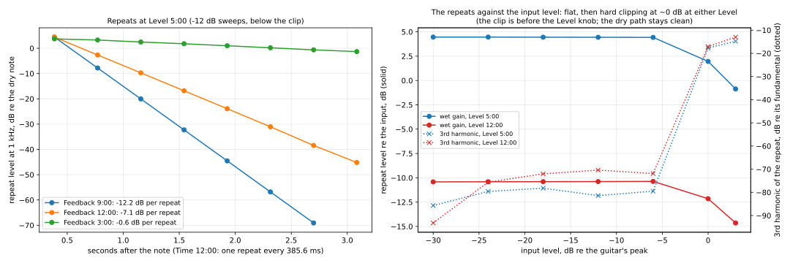
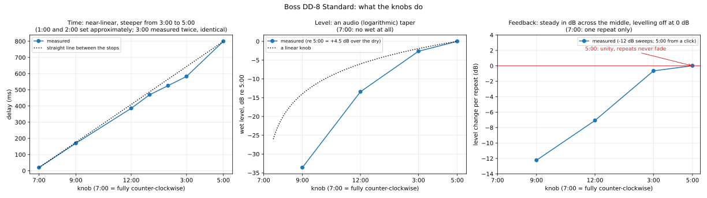
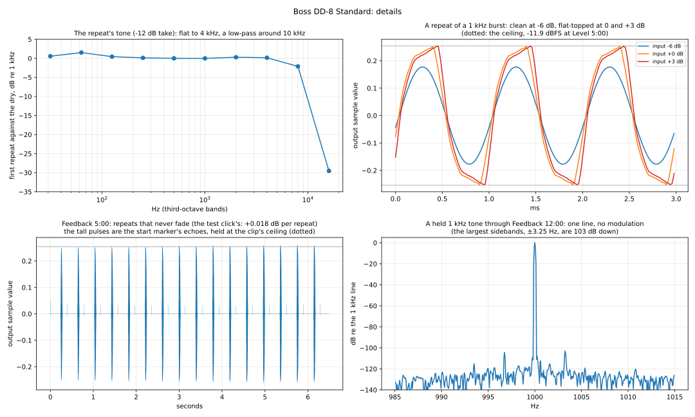
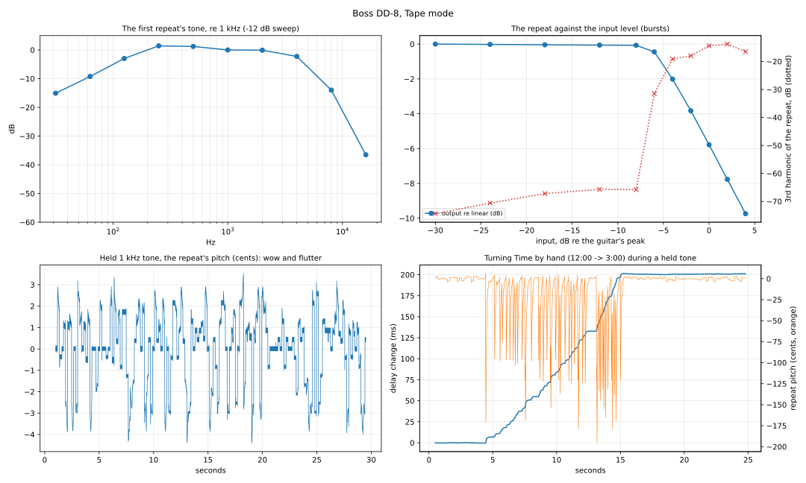
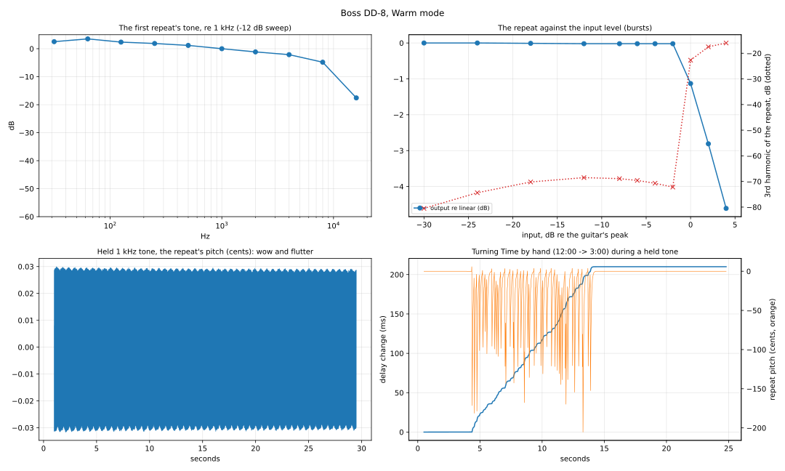

# Boss DD-8 Digital Delay — Standard mode

Captured 2026-10-26, session [`2026-10-26-standard/`](2026-10-26-standard/): mono (Input A
→ Output A, nothing in the B jacks), MODE on Standard, a 9 V power supply, the same rig
and playback level as the TR-2 ([`tools/capture/README.md`](../../../tools/capture/README.md)).
Measurements: `tools/capture/analyze_dd8.py captures/boss/dd-8/2026-10-26-standard` →
[`fit/dd-8-standard.json`](2026-10-26-standard/fit/dd-8-standard.json) and the figure below.

The question was whether Standard mode does anything besides repeating the signal. It
does one thing: **the repeats hard-clip about 3 dB below a hot guitar's peaks**, while
the dry signal stays clean. Everything else is a textbook digital delay.





## The model

```
y = x_dry + Level · LP10k( delay_T( clip(x) + F · repeats ) )
```

- **Dry path:** analog, untouched. It arrives at the same sample as bypass, at unity gain
  (within 0.2 dB), and stays clean at +3 dB over the guitar's peak. At Level 7:00 the
  output is the dry path alone.
- **Clip:** before the delay and before the Level knob (the converter's input, most
  likely): a hard ceiling about **3 dB below the reference** (the hardest bridge-humbucker
  peak, `rig.json`). Below it the wet path is linear (3rd harmonic ≈ −80 dB); at the
  reference the repeat loses 2.5 dB and has a 3rd harmonic at −18 dB, at +3 dB −15 dB. So
  how hard you play, not where Level sits, decides whether the repeats distort. In 2 dB
  steps (`bursts-fine`): perfectly linear up to −4 dB (−0.01 dB, H3 −73 dB), then a hard
  knee — −0.81 dB and H3 −25 dB at −2 dB, −2.47 / −18 dB at 0, −6.24 / −14 dB at +4 dB;
  the output peak stops at −11.9 dBFS (Level 5:00). No
  compressor: the wet gain is the same at the start, middle and end of a 0.3 s burst and
  follows a level step within 2 ms.
- **Delay time** (Time knob, Feedback at minimum = one repeat):

  | Time | 7:00 | 9:00 | 12:00 | 1:00* | 2:00* | 3:00 | 5:00 |
  |---|---|---|---|---|---|---|---|
  | fraction of the rotation | 0 | 0.2 | 0.5 | 0.6 | 0.7 | 0.8 | 1 |
  | delay (ms) | 19.65 | 169.62 | 385.62 | 469.62 | 525.60 | 582.60 | 799.60 |

  \* set approximately. Close to linear up to 3:00 (56–84 ms per 10 % of rotation), then
  the last stretch to 5:00 covers twice that (108 ms per 10 %): use the points, linear in
  between, not a formula. 3:00 set a second time gave 582.60 ms again, to the sample, so
  the bend is the knob's, not the placement's. Repeats land exactly on multiples of the
  delay (to the sample over 7 repeats).
- **Wet level** (Level knob), the first repeat against Level 5:00, which is **+4.46 dB
  over the dry** (bursts):

  | Level | 7:00 | 9:00 | 12:00 | 3:00 | 5:00 |
  |---|---|---|---|---|---|
  | dB re 5:00 | no repeat | −33.6 | −13.4 | −2.6 | 0 |

  A steep taper; the bursts at 12:00 agree (−14.9 dB re 5:00).
- **Feedback**, each repeat against the one before, at 1 kHz (from −12 dB sweeps):

  | Feedback | 7:00 | 9:00 | 12:00 | 3:00 | 5:00 |
  |---|---|---|---|---|---|
  | dB per repeat | one repeat only | −12.2 | −7.07 | ≈ −0.6 | **≈ 0: the repeats never fade** |
  | extra loss at 4 / 8 kHz | | −0.3 / −1.4 | −0.4 / −1.4 | −0.8 / −0.9 | |

  The first repeat's level doesn't depend on Feedback. Over 9:00–3:00 the loss per repeat
  is close to linear in dB (5–6.5 dB per 30 % of rotation); at 7:00 the loop is off. At
  **5:00 the loop gain is unity**: a −12 dB test click's repeats stayed level for 15
  repeats (+0.02 dB per repeat) — a hold, not a runaway. (The take also shows tall pulses
  at the clip's ceiling: the start marker's echoes, which played at the reference level,
  clipped going in, and then circulated without fading. First read as self-oscillation;
  corrected the same day.)
- **Knob curves, in short:** Time near-linear with a steeper top end; Level an audio
  (logarithmic) taper — −33.6 / −13.4 / −2.6 dB at 9:00 / 12:00 / 3:00 where a linear
  pot would give −14 / −6 / −1.9 dB (amplitude ≈ position^2.2–2.4 in the lower half);
  Feedback steady in dB across the middle, levelling off at unity at 5:00. The end values
  are exact (the knob's stops); the in-between fractions assume stops at 7:00 and 5:00
  (300°). How far a by-eye setting can be off: "Time 12:00" set twice gave 385.62 and
  392.96 ms, about 5° apart; 3:00 (pointer horizontal) repeated to the sample.
- **Wet tone:** the first repeat against the dry (−12 dB take, re 1 kHz): flat to 4 kHz
  (±0.6 dB, +1.5 dB at 63 Hz), −2.1 dB at 8 kHz, −29.5 dB at 16 kHz: a low-pass around
  10 kHz. Each pass through the loop adds the
  small high-frequency loss above.
- **No modulation:** a held 1 kHz tone through Feedback 12:00 comes out as one spectral
  line; the only sidebands (±3.25 Hz) are 103 dB down.
- **Noise:** −101 dBFS RMS with Level 5:00 and Feedback 12:00, no signal.

## How it was measured

- **Sweeps with long silent tails, deconvolved** into the impulse response from what was
  played to what came out: the dry impulse at time 0 and every repeat after it, with a
  far better signal-to-noise ratio than a click. 18 takes of
  [`plans/dd-8-standard.json`](../../../tools/capture/plans/dd-8-standard.json): bypass,
  Level 7:00 (dry alone), Time at five positions, Level at three, Feedback at three (8 s
  tails), a −12 dB repeat for linearity, clicks, a held sine, silence; then two more
  Feedback takes at −12 dB, and four click takes: Time at 3:00 set again, 2:00 and 1:00
  (delay read straight off the clicks), and Feedback 5:00 (one −12 dB click, 6 s).
- **The full-level sweeps clip in the wet path**, which first looked like a compressor
  (repeats 6.4 dB lower, relative to the dry, than at −12 dB) and made a spurious "echo"
  at 81 ms in the deconvolution (gone at −12 dB). Their delay times and the relative
  Level map are unaffected (the clip is before both); the absolute wet gain comes from
  the bursts, and the Feedback map from −12 dB sweeps.
- **Bursts and steps** ([`plans/dd-8-dynamics.json`](../../../tools/capture/plans/dd-8-dynamics.json)):
  0.3 s 1 kHz tones at −30…+3 dB with 0.9 s gaps, so each repeat lands in silence: the
  static curve, at Level 5:00 and 12:00. A −24 → 0 → −24 dB step (3 s each), with the
  dry path subtracted using its bypass take (residual −62 dB): no attack or release.
- Knob positions 7:00, 9:00, 12:00, 3:00 and 5:00 (0, 20, 50, 80, 100 % of the
  rotation): 9:00 and 3:00 (pointer horizontal) can be set reliably, 9:30/2:30 can't.
- PipeWire's round trip moved during the session (449 → 583 → 631 → 455 samples); every
  take measures its own from the loopback.

## Implementing it

NAM-X's Delay already has a delay line, feedback, Low/High Cut and saturation. A DD-8
Standard voicing would add: the analog dry path (no change), a hard clip on the wet
input at the reference level − 3 dB, the measured Time range (20–800 ms), the Level
taper with +4.5 dB at maximum, the Feedback map, a ~10 kHz low-pass in the wet path
and a gentle extra high cut in the loop. Not done yet.

## Not measured yet

The stereo outputs (B jacks), what the Time knob does to the repeats while it moves, and
the other modes (Analog, Tape, Mod, Shimmer…).

# Analog mode

Session [`2026-10-26-analog/`](2026-10-26-analog/), plan
[`plans/dd-8-analog.json`](../../../tools/capture/plans/dd-8-analog.json): 19 takes, the
same rig, MODE on ANALOG. Analysed by hand (scratch scripts) on 2026-10-26; no analysis
script yet.

| | Standard | Analog |
|---|---|---|
| Delay range (Time 7:00 → 5:00) | 19.65 – 799.60 ms | the same: 19.85 – 799.81 ms (9:00 169.83 ms) |
| Repeat level, Level 5:00 | +4.46 dB over the dry | **+6.03 dB**, constant from −30 to −12 dB (bursts); level steps −30 → −12 → −30 dB: +6.05 dB throughout, no attack or release |
| Level 12:00 | −14.9 dB re 5:00 | −14.3 dB re 5:00 |
| First repeat's tone, re 1 kHz (−12 dB) | flat to 4 kHz; −2.1 dB at 8 kHz | **flat to 2 kHz (+0.4); −19.0 dB at 4 kHz, −50 dB at 8 kHz** |
| Each further repeat (Feedback 12:00, re the 1 kHz loss) | about the same at all frequencies | **another ~10 dB lower at 3.15 kHz and ~18 dB at 4 kHz: the filter is inside the loop**, every repeat darker |
| Fade per repeat, Feedback 9:00 / 12:00 / 3:00 | −12.2 / −7.07 / −0.6 dB | −12.0 / −7.9 / **−1.40** dB (3:00 from a burst: exactly −1.40 dB for 15 repeats, −17 → −36 dBFS, so nothing level-dependent in the loop) |
| Feedback 5:00 | unity: the repeats hold (+0.02 dB per repeat) | **a slow runaway:** a −12 dB click's repeats dip to −14.5 dB, then grow +0.4 dB per repeat (to −8 dB after 16), held by the clip at the ceiling — the classic analog-delay oscillation |
| Distortion of the repeat (2 dB steps, `bursts-fine`), output vs linear / H3 | linear to −4 dB (−0.01 / −73 dB), then a hard knee: −0.81 / −25 dB at −2, −2.47 / −18 dB at 0, −6.24 / −14 dB at +4 | **a soft knee in front of the same ceiling:** −0.00 / −64 dB at −12, −0.04 / −57 at −8, −0.26 / −44 at −6, −0.76 / −39 at −4, −2.33 / −22 at −2, −4.14 / −18 at 0, −7.99 / −16 dB at +4; some 2nd harmonic (−62 dB from −6 dB); the ceiling (~−12.0 dBFS peak at Level 5:00) is reached ~1.5 dB earlier; like Standard's, before the Level knob (the same onset at Level 12:00) |
| Modulation (held 1 kHz tone) | none (−103 dB) | **none** (nothing above −116 dB) |
| Turning Time while playing (Time 12:00 → 3:00 by hand, a held tone) | not measured | **the delay slides, never jumps:** a staircase of small steps, each a quick glide that bends the repeat's pitch down for tens of ms (up to −190 cents when turned fast), the level within ~2 dB (no crossfade or mute); +208 ms in total. The steps recurred every ~0.4 s, close to the delay time — the pedal updating once per pass, or the rhythm of the hand: one take can't tell. A take with the knob still stays at exactly 1000.00 Hz. [Figure](2026-10-26-analog/fit/time-glide.svg) |
| Noise | −101.1 dBFS | −101.2 dBFS |

So Analog is Standard's delay with **a darker loop that darkens every repeat** (a steep
low-pass just above 2 kHz, applied on each pass), **repeats 1.6 dB louder**, and **a
softer, earlier saturation** under the same ceiling — a bucket-brigade delay's character,
without its clock wobble or compander.

**A wrong turn, corrected the same day:** the first pass's two bypass takes
(`bypass-sweep`, `bypass-bursts`) were recorded with the pedal still on — their gaps and
tails hold repeats (−12 and −38 dBFS) where a bypassed pedal is silent. Measured against
that `bypass-bursts`, the repeat seemed to grow with the input level (−6.9 dB at −30 dB up
to +1.9 dB at −6 dB), which read as an expander. The level steps and the feedback burst
contradicted it; against the Standard session's clean `bypass-bursts` (the same signal and
rig) the repeat gain is flat. Nothing else here depends on those two takes (the tone
compares each repeat with the dry impulse in its own take). `capture.py` now flags a
bypass take with sound where nothing was played.

# Tape mode

Session [`2026-10-26-tape/`](2026-10-26-tape/), plan
[`plans/dd-8-tape.json`](../../../tools/capture/plans/dd-8-tape.json): 22 takes, the same
rig, MODE on TAPE. Measured with `tools/capture/analyze_dd8_mode.py
captures/boss/dd-8/2026-10-26-tape` → [`fit/dd-8-tape.json`](2026-10-26-tape/fit/dd-8-tape.json)
and the figure below (the same script reproduces the Analog numbers).

| | Standard | Analog | **Tape** |
|---|---|---|---|
| Delay range (Time 7:00 → 5:00) | 19.65 – 799.6 ms | 19.85 – 799.81 ms | **19.96 – 800.44 ms** (9:00 172.75) |
| Repeat level, Level 5:00 | +4.46 dB | +6.03 dB | **+7.9 dB**, constant (level steps: no attack or release) |
| First repeat's tone, re 1 kHz (−12 dB) | flat to 4 kHz, −2 dB at 8 kHz | flat to 2 kHz, −19 dB at 4 kHz | **band-limited: −15.2 / −9.6 / −3.2 dB at 31.5 / 63 / 125 Hz, +1.2 dB at 250 Hz, flat to 2 kHz, −1.7 dB at 4 kHz, −13.9 dB at 8 kHz, −37 dB at 16 kHz** (roughly 150 Hz – 5 kHz) |
| Distortion, output vs linear / H3 | linear to −4 dB, hard knee | soft knee from −8 dB | **some low-level H3 (−66…−74 dB), linear to −8 dB (−0.07), then a knee: −0.45 / −31.5 dB at −6, −2.0 / −19 dB at −4, −5.8 / −14 dB at 0**; the same ceiling (~−11.8 dBFS peak) |
| Fade per repeat, Feedback 9:00 / 12:00 / 3:00 (bursts, −12 dB) | −12.2 / −7.07 / −0.6 dB | −12.0 / −7.9 / −1.40 dB | **−10.8 / −6.65 / −0.04 dB** (3:00 measured twice, identical) |
| Feedback 5:00 | holds (unity) | slow runaway (+0.4 dB/repeat) | **holds** (+0.003 dB per repeat) |
| Wow and flutter (held 1 kHz tone, one repeat) | none | none (0.06 cents rms) | **yes: 1.7 cents rms, 8 cents peak to peak; wow at 0.53 Hz (2.0 cents rms), flutter at 6.7 Hz (0.6 cents rms); the level wobbles 2.4 dB** |
| Turning Time while playing | — | slides in small glides | **the same:** +201 ms, dips to −196 cents, level within 2.6 dB |
| Noise | −101.1 dBFS | −101.2 dBFS | −101.2 dBFS |

So Tape is the delay with a **worn-tape voicing**: a narrow band (thin lows, dark highs),
**real wow and flutter** on the repeats, hotter repeats that saturate earlier, and a
Feedback knob whose top third sustains almost indefinitely.

**Notes:** the Feedback sweeps don't work in Tape — the wow wanders the delay, which the
deconvolution assumes fixed (the per-repeat numbers came out erratic) — so its feedback
comes from 50 ms bursts with each repeat's level read directly (`feedback-burst-*`,
`analyze_dd8_mode.burst_decays`). The first `feedback-burst-0900` was recorded with
Feedback elsewhere (the output sat at the clip ceiling for 8 s, the repeats never
fading); its retake (`-again`) is the one used. Retakes with high Feedback need the
pedal silent first: at 3:00 and above it keeps repeating on its own.



# Warm mode

Session [`2026-10-26-warm/`](2026-10-26-warm/), plan
[`plans/dd-8-warm.json`](../../../tools/capture/plans/dd-8-warm.json) (the Tape plan with
feedback from bursts): 17 takes. `analyze_dd8_mode.py` →
[`fit/dd-8-warm.json`](2026-10-26-warm/fit/dd-8-warm.json).

Warm is Standard with a **warm tilt** on the repeats:

| | Standard | **Warm** |
|---|---|---|
| First repeat's tone, re 1 kHz | flat to 4 kHz, −2.1 dB at 8 kHz | **+2.1 / +3.1 / +2.1 / +1.6 / +1.0 dB at 31.5 / 63 / 125 / 250 / 500 Hz, −0.7 / −1.6 / −4.7 / −18 dB at 2 / 4 / 8 / 16 kHz** |
| Repeat level, Level 5:00 | +4.46 dB | **+2.85 dB**, constant (level steps: no attack or release) |
| Distortion | linear to −4 dB, hard knee | **linear to −2 dB** (H3 −68…−80 dB), then a hard knee: −1.13 dB and H3 −22.7 dB at 0 dB, −4.6 / −16 dB at +4; the same ceiling (~−11.8 dBFS) |
| Fade per repeat, 9:00 / 12:00 / 3:00 (bursts) | −12.2 / −7.07 / −0.6 dB | −11.6 / −7.46 / −0.82 dB |
| Feedback 5:00 | holds | holds (+0.06 dB per repeat) |
| Wow | none | none (0.02 cents rms) |
| Turning Time | — | glides, as Analog and Tape (+210 ms, dips to −205 cents) |
| Delay range / noise | 19.65 – 799.6 ms / −101.1 dBFS | 19.62 – 799.58 ms / −101.2 dBFS |

## The four voicings side by side

Standard, Analog, Tape and Warm share the delay line, the Time range, the hard ceiling
before the Level knob and Feedback's shape; what changes is the voicing:

| | Standard | Analog | Tape | Warm |
|---|---|---|---|---|
| Repeat level (Level 5:00) | +4.46 dB | +6.03 dB | +7.9 dB | +2.85 dB |
| Tone | flat, ~10 kHz low-pass | flat to 2 kHz, steep low-pass **in the loop** | ~150 Hz – 5 kHz band | a tilt: lows up 2–3 dB, highs gently down |
| Distortion before the ceiling | none: hard knee at −3 dB | soft knee from −8 dB | knee at −7 dB, low-level H3 | none: hard knee at −1 dB |
| Pitch | steady | steady | wow 0.53 Hz + flutter 6.7 Hz | steady |
| Feedback 3:00 / 5:00 | −0.6 dB / holds | −1.4 dB / slow runaway | −0.04 dB / holds | −0.82 dB / holds |

That table is the parameter set of a "DD-8 voicings" Delay for NAM-X: one delay with a
saturation curve, a loop filter, a level, and (Tape) a pitch wander.



# Reverse mode

Session [`2026-10-27-reverse/`](2026-10-27-reverse/), plan
[`plans/dd-8-reverse.json`](../../../tools/capture/plans/dd-8-reverse.json): 18 takes, the
same rig, MODE on REVERSE. Analysed by hand (scratch scripts) on 2026-10-27; no analysis
script yet. New signals for it: `plucks` and `pluck-train` (a 1 kHz tone with a 2 ms
attack and a 0.3 s exponential decay, like a picked note — reversed, it swells).

**How it works:** a note **starts a chunk**; the chunk is recorded for a length set by
Time, then **played back reversed** right after it ends; while the input continues, the
next chunk follows, with a short fade at each join.

- **Triggered by the playing:** isolated plucks at irregular times (2.9, 11.2 and 15.0 s
  into a take) came back with identical timing, to the millisecond — the swell starts
  599 ms after the note, peaks at 1118 ms and cuts off at 1174 ms (Time 12:00) — where a
  free-running grid would shift them. Two plucks 0.25 s apart land in one chunk and come
  back reversed together. A held tone is chopped at a fixed length while it lasts.
  Lone one-sample clicks don't come back at all (too little energy to trigger, it seems;
  a −27 dB blip 9.1 ms after each is all that shows).
- **The reversal is clean:** a pluck's swell rises 2.9 dB per 100 ms, its decay mirrored.
- **Chunk length** (the joins' spacing in held tones) — a range of its own, much longer
  than the plain delay's:

  | Time | 9:00 | 12:00 | 3:00 | 5:00 |
  |---|---|---|---|---|
  | chunk (ms) | 221.8 | 573.85 | 1562 | ~2497 |
  | the fade at each join (ms, below −3 dB) | 25 | 45 | 101 | ~360 (less certain) |
  | Standard's delay at that position (ms) | 169.6 | 385.6 | 582.6 | 799.6 |

  At Time 12:00 the joins are 573.85 ± 0.2 ms apart over 26 joins, each a dip to
  −70…−77 dB.
- **Level is a dry/wet balance here:** at **5:00 the dry signal is muted** (−68 dB re
  bypass) and the reversed note is −2.0 dB re the pluck; at **12:00 the dry is back at
  unity** and the reversed note is −12.6 dB (about Standard's taper).
- **Feedback keeps everything reversed:** at Feedback 12:00 the repeats are swells too,
  never flipped back to a forward note — the main ones every two chunk lengths (~1.15 s),
  ~8.5 dB quieter each, with weaker swells (−21, −29 dB) in the chunks between.

**Test design, a lesson:** the first takes' plucks were 4.000 s apart — almost exactly
7 chunks at Time 12:00 — so they would have come back identical on a fixed grid too; it
took irregular onsets to tell "triggered" from "grid". The first pass also read the
held tone's joins as alternating deep and shallow dips: a coarse 50 ms sampling.

**Not measured:** the onset detector's threshold (how quiet a note still triggers), the
fade's exact shape, the tone of the reversed signal, and the 5:00 chunk precisely.
