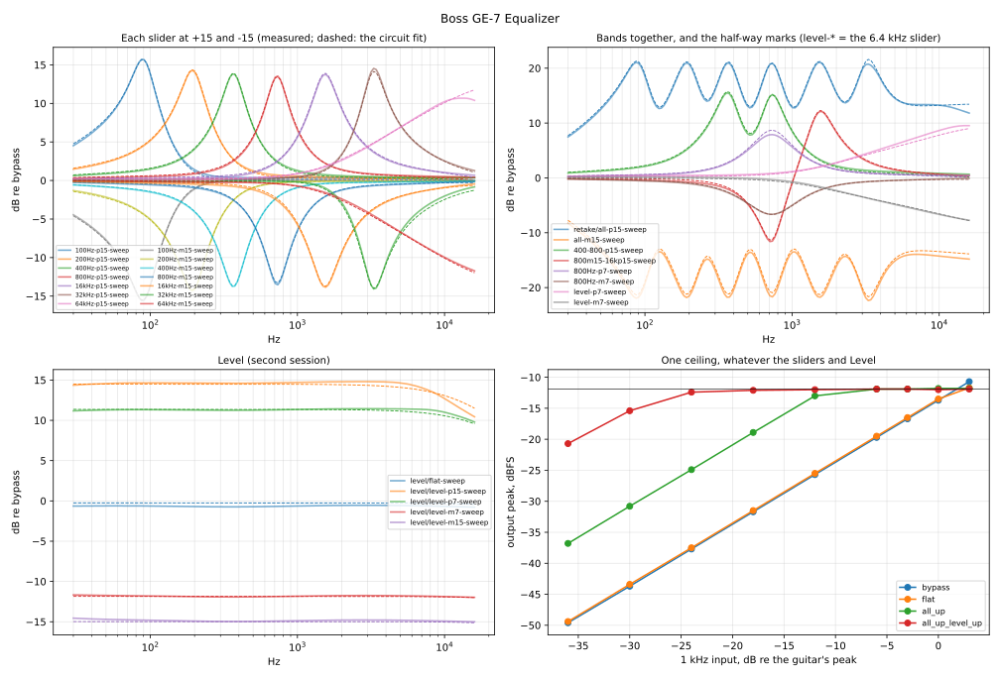

# Boss GE-7 Equalizer

Measured 2026-10-28 on a 9 V supply, mono (Input → Output):

| Session | What it gives |
|---|---|
| [`2026-10-28/`](2026-10-28/) | every band at +15 and −15, 800 Hz and 6.4 kHz also at their half-way marks, neighbours together, every band up and down; flat and bypass references, the clipping with every band up, noise |
| [`2026-10-28-level/`](2026-10-28-level/) | the Level slider at four positions, the clipping and noise with every slider up |
| [`2026-10-28-retake/`](2026-10-28-retake/) | 800 Hz at its half-way marks again, 3.2 kHz up, every band up twice (sliders pushed hard against their stops) |
| [`2026-10-28-marks/`](2026-10-28-marks/) | 100 Hz, 800 Hz, 6.4 kHz and Level on every printed mark (−15, −10, −5, +5, +10, +15): the sliders' law |

Same rig and playback level as the other pedals ([`tools/capture/README.md`](../../../tools/capture/README.md)).
Plans: `tools/capture/plans/ge-7.json` (33 takes), `ge-7-level.json` (8), `ge-7-retake.json`
(7) and `ge-7-marks.json` (26), every slider at 0 unless a take says otherwise. Analysis:

    tools/capture/analyze_ge7.py captures/boss/ge-7/2026-10-28 captures/boss/ge-7/2026-10-28-level \
        captures/boss/ge-7/2026-10-28-retake captures/boss/ge-7/2026-10-28-marks

→ [`2026-10-28/fit/ge-7.json`](2026-10-28/fit/ge-7.json), the figure below and a per-sweep fit figure.

The sliders: 100, 200, 400, 800 Hz, 1.6, 3.2, 6.4 kHz and Level, each ±15 dB on the printed
scale, marked at −15, −10, −5, 0, +5, +10, +15. The first three sessions also used ±7.5,
half-way between the centre and the end — hard to set exactly; the marks session uses the
printed marks (still not perfect on 5 and 10, by hand).

**Read the first session's `level-*` takes as the 6.4 kHz slider.** Its sidecars say Level,
but the 6.4 kHz slider was the one moved: their curves match the 6.4 kHz takes to 0.2 dB and
are flat below 1 kHz. `analyze_ge7.py` swaps them; the second session has the real Level
takes. **The first session's `all-p15-sweep` is left out:** two sliders were short of their
stops — the retake's two all-up takes agree with each other to 0.1 dB and sit 0.8 dB above it
at 3.3 kHz and 0.7–1.1 dB above it over 10 kHz. (The take names `16kHz`, `32kHz`, `64kHz` are 1.6, 3.2 and 6.4 kHz with the dot
dropped.)

## One circuit fits every sweep

Each sweep against its own session's bypass, per 1/12 octave from 30 Hz to 16 kHz, and one
circuit fitted to all 60 at once — **0.23 dB rms** overall, ≤ 0.2 dB for 38 of them:

- **The EQ stage** is the classic graphic equaliser: one op-amp, the seven slider pots
  between its two inputs (the input side fed through R, the feedback side from the output
  through the same R), each wiper into a series resonator to ground. With the op-amp's
  inputs at the same voltage, the response is
  `H = (1 + R·Σ x/(Z + x(1−x))) / (1 + R·Σ (1−x)/(Z + x(1−x)))` (impedances relative to the
  pot, x = the wiper, 1 = the boost end). The bands interact through the shared op-amp, which
  is why they don't simply add: with every band up, 1 kHz rises +13 dB, where the seven
  single-band curves added give +16.
- **Six bands are LC resonators** (gyrators, in the pedal) with nearly equal parts:
  impedance 0.10–0.12, series resistance 0.036, Q 2.8–3.3 (R = 0.341):

  | Band | 100 Hz | 200 Hz | 400 Hz | 800 Hz | 1.6 kHz | 3.2 kHz |
  |---|---|---|---|---|---|---|
  | resonance | 91.0 | 195.9 | 369.7 | 729.0 | 1530 | 3281 Hz |

  Each lands within 10 % of its label. At +15 a band peaks at +13.5 to +15.8 dB (a little
  off the resonance, the shared op-amp pulling it), at −15 it dips by about the same.
- **The 6.4 kHz slider is a shelf, not a band**: a capacitor and resistor in place of the
  resonator (corner 3.8 kHz, resistance 0.085). At +15 it rises steadily from 1 kHz to
  +10.7 dB at 13 kHz (+8.2 dB at 6.4 kHz) and never comes back down. A low-Q resonator up at
  12 kHz fits as well; the RC is the simpler part.
- **The sliders' law: the printed marks are not the dB they say, and boosts move faster
  than cuts.** Each mark gets one fitted wiper position, shared by all the band sliders
  (another set for Level); 100 Hz, 800 Hz and the 6.4 kHz shelf all fit it — as fractions
  of their ±15, 100 and 800 Hz agree within 0.05 at every mark. What the marks give (the
  fitted circuit):

  | Mark | −15 | −10 | −7.5 | −5 | +5 | +7.5 | +10 | +15 |
  |---|---|---|---|---|---|---|---|---|
  | 800 Hz peak/dip, dB | −13.4 | −8.5 | −6.8 | −4.0 | +5.9 | +8.6 | +10.7 | +13.4 |
  | 6.4 kHz at 10 kHz, dB | −10.1 | −7.8 | −6.6 | −4.4 | +5.9 | +7.8 | +8.9 | +10.1 |
  | Level at 1 kHz, dB | −14.7 | −13.4 | −11.5 | −10.8 | +8.6 | +11.7 | +12.8 | +14.7 |
  | band wiper | 0 | 0.035 | 0.06 | 0.131 | 0.924 | 0.966 | 0.985 | 1 |

  The 800 Hz −7.5 take repeated within 0.2 dB in the retake — the asymmetry is the pedal's,
  not the setting. In this circuit a linear pot at mid-travel would give only ~4 dB, and the
  fitted wipers crowd toward the ends: the sliders' law is not linear in travel, or the pots
  sit in a circuit with more parts than this one. NAM-X doesn't need to know which: a slider
  on these marks maps to the fitted wipers. Level's wipers come out within 0.01 of its ends
  (it is all one ratio there) — only its dB per mark mean anything.
- **Level** is a flat ±15 dB (measured −14.9 / +14.7): the same circuit with a resistor
  for the resonator. Its top end rolls off with its gain (an op-amp's bandwidth, about
  0.1 MHz over the stage's noise gain): −3 dB at 13 kHz at +15, nothing at 0.
- **Flat** (every slider at 0) is within 0.3 dB of bypass, 30 Hz–16 kHz. The sessions
  differ by up to 0.9 dB, the same at every frequency — Level's centre set by hand, not a
  band (an off-centre band would show at its own frequency). Each session's takes are
  fitted with their own offset (+0.08, −0.31, −0.14 and −0.40 dB).

Every sweep against the fit, one panel each with its error:
[`2026-10-28/fit/ge-7-fit.svg`](2026-10-28/fit/ge-7-fit.svg).

What's left: the −5 takes on 100 Hz and 6.4 kHz (0.4 dB rms, the marks set by hand; the
shared wiper sits between the sliders), ~0.5 dB flat on the all-down take (the sliders' own
setting), a click in the marks session's 6.4 kHz +15 take near 400 Hz, the model's
3.3 kHz peak 0.9 dB over the retaken all-up takes, and up to 1–1.5 dB above 10 kHz on the
takes that boost the top (the 6.4 kHz shelf, Level +15). Level's boosts wobble by ±0.2 dB
across the band where the model is a straight line — left as is.

## Clipping: one ceiling

A 1 kHz staircase (−36 to +3 dB re the guitar's peak, 1.5 s per step) flat, with every band
up, and with every band and Level up: the output never passes **−11.9 dBFS peak, +1.8 dB
over the guitar's peak** (which reads −13.7 dBFS in the bypass take), whatever the sliders
and Level. Level +15 doesn't raise the ceiling, it reaches it 15 dB sooner — so every stage
clips at the same rails, the last one after Level. Even flat, the +3 dB step clips (1 dB
short, H2 and H3 at −26 dB), and the bypass take starts to distort there too (H2 −38 dB):
the input buffer is near the same rails.

Clipped hard, the wave is a rounded square — H3 −14.5 dB, H5 −23 dB, a little H2 (−25 dB:
the positive side 0.1–0.3 dB lower). Its flat tops creep up to the ceiling over ~0.4 ms
and fall fast, so no static curve fits it (best: a soft clip, error −10 dB re the ceiling at
25 dB overdrive): the op-amp rails inside the reactive feedback network. A soft clip at the
ceiling gets the level and the harmonic balance, not the exact shape.

## Noise

Flat, the GE-7 adds nothing: −99.0 dBFS rms against −99.4 bypassed (85 dB under the
guitar's peak). Every slider up: −51.9 dBFS rms, peaks around −34 dBFS — +30 dB of gain on
the pedal's own hiss, and loud enough that `capture.py` needed a take-level quiet threshold
(−30 dBFS) to start those takes.

## Takes and lessons

- 33 + 8 + 7 + 26 takes; 800 Hz −7.5 redone once, two marks takes redone; the first session's Level takes moved the
  6.4 kHz slider, and its all-up take had two sliders short of their stops (above).
- **Retake what misses the fit before blaming the model:** the all-up miss was the take
  (the retakes moved 0.8 dB toward the fit); the 800 Hz −7.5 miss was the model (the retake
  matched the first take), fixed by fitting each half-way mark on its own.
- **Use the printed marks** (the user, 2026-10-28): ±7.5 between two marks couldn't be set
  exactly; −10/−5/+5/+10 can (nearly), and four shared marks per slider average the hand out.
- **Stairs must fit the interface:** the reference plays at −4.67 dBFS, so no step can go
  over about +4.5 dB. The first plan went to +12 and stopped mid-run; `run` now builds every
  take before the first one.
- **A take can set its own `quiet_dbfs`** for a setting that raises the hiss.
- **Slider takes: name the slider in the note.** Level sits beside the 6.4 kHz slider; the
  follow-up plan says which one it is.

## For NAM-X

The EQ's GE-7 type (`src/dsp/Ge7Eq.h`, branch `dsp/eq-ge7`): Type Parametric | GE-7 on the
Equalizer card, the seven sliders and Level in its detail rows (▾) on the pedal's printed
scale, −15…+15, each mapped to the fitted wiper between the marks (Level to its measured dB).
The circuit above is solved per sample: each branch is a zero-delay-feedback filter (a
state-variable band-pass, the shelf a one-pole), so the shared loop through the op-amp
closes in closed form and the bands interact as in the pedal. Against the fitted circuit:
within 0.01 dB flat or one band up, 0.25 dB with every band up or down, 0.4 dB below 5 kHz
with mixed settings, up to ~1.4 dB at 8–12 kHz (the digital filters' skirts near Nyquist;
2× oversampling would cut it about fourfold). Then Level and a rounded clip at +1.8 dB over
the guitar's peak (re an assumed −6 dBFS post-amp peak) after each stage. Low Cut and High
Cut stay active. A new type to A/B; the parametric EQ is unchanged.
