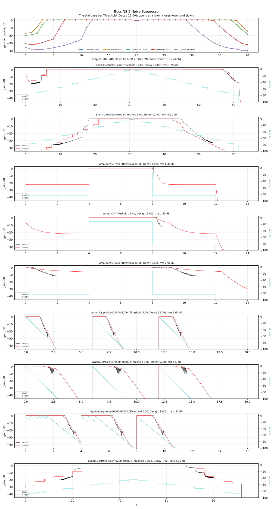

# Boss NS-2 Noise Suppressor

Measured 2026-10-27 on a 9 V supply, mono, Input → Output (Send and Return empty), Mode on
Reduction unless a take says otherwise:

| Session | What it gives |
|---|---|
| [`2026-10-27/`](2026-10-27/) | the open path, a staircase per Threshold position, -84/-12/-84 dB jumps per Threshold and Decay position, silence, Mute |
| [`2026-10-27-dynamics/`](2026-10-27-dynamics/) | notes that decay like a real string per Threshold and Decay position, light picking, a phrase, a slow staircase at three Decay positions, Decay at Threshold 5:00 |
| [`2026-10-30-threshold-locator/`](2026-10-30-threshold-locator/) | true bypass and 2 dB steps at Threshold 3:00; partial-opening trajectories above the coherent noise estimate |
| [`2026-10-30-history/`](2026-10-30-history/) | matched quiet/loud history at −56/−54/−44 dB, both Decay extremes, and a closing true-bypass check |
| [`2026-11-08-reamp/`](2026-11-08-reamp/) | the guitar DI dataset through the pedal (22 takes): every segment at Threshold and Decay 12:00, then Threshold 5:00 and 3:00 with Decay 7:00, 12:00, 3:00 — NAM-X's model against it below |
| [`2026-11-21-focused/`](2026-11-21-focused/) | **the gain read directly** (13 takes): the test signal into INPUT, a steady three-tone probe into RETURN, so the output is the probe times the gate's gain at every instant. Threshold 12:00, 3:00, 5:00 and Decay 7:00, 12:00, 5:00; per setting a take of tones placed round its threshold and a take of guitar — the circuit model below is fitted to it |
| [`2026-11-21-focused-plain/`](2026-11-21-focused-plain/) | the same 13 takes recorded the plain way, INPUT to OUTPUT (the session's first run: the probe's cable was not in RETURN, so no probe is in these recordings, whatever their sidecars' `loop_probe` says). The pedal's real output at those settings: what the model is heard against |

Same rig and playback level as the other pedals ([`tools/capture/README.md`](../../../tools/capture/README.md)).
Plans: `tools/capture/plans/ns-2.json` (36 takes), `ns-2-dynamics.json` (25). Analysis:
`tools/capture/analyze_ns2.py captures/boss/ns-2/2026-10-27 captures/boss/ns-2/2026-10-27-dynamics`
→ [`2026-10-27/fit/ns-2.json`](2026-10-27/fit/ns-2.json) and the figure below (`--fit`
refits the model, a few minutes).

The knobs: Threshold, Decay, Mode (Reduction / Mute). Clock positions: 7:00 = fully
counter-clockwise, 5:00 = fully clockwise. Levels are in dB re the guitar's peak at the
pedal's input; NAM-X places that at −6 dBFS, as for the other pedals.

**Capture follow-up complete, 2026-10-30:** the locator and matched-history captures
establish a near-threshold upward dynamic missing from the model. After 24 s quiet,
the first 0.1–1.5 s of opening agrees across Decay extremes within .037/.022 dB RMS
at −56/−54 dB, but late behavior depends on Decay. At −54 dB and minimum Decay,
the quiet/loud history difference shrinks to .042 dB, rather than the model's retained
7.56 dB switch gap. Threshold shifts alone and a universal one-second attack fail.
The −44 and −12 dB controls still open in the first valid 1 ms analysis bin.
See the [history findings and handoff](../../../tools/research/NS2_HISTORY_RESULTS.html).
No further NS-2 captures are requested now; remaining work is offline model fitting
and listening. Production DSP is unchanged; no replacement coefficients or extra state
are yet validated.

**Offline model selection, 2026-10-30:** five continuous-control candidates were
fitted and checked against 48 older captures. The strongest local fits reduce the
new near-threshold packet error to about .45 dB RMS but regress on note tails.
Joint fitting with whole input levels withheld still fails, including a capped
opening-time variant. Keep the current DSP; the
[model-selection report](../../../tools/research/NS2_CONTROL_MODEL_SELECTION.html)
contains equations, rejected parameter sets and reproducible validation results.
No additional captures are requested.



## The gain read directly (2026-11-21)

The schematic ([the PDF](https://schematicsonline.com/wp-content/uploads/2022/11/Boss-NS-2-Noise-Supressor.pdf))
shows the detector listening to INPUT only, and the gain element (a VCA) sitting between RETURN and
OUTPUT; a plug in RETURN disconnects INPUT from the output. So the test signal went into INPUT and a
steady probe (1877, 2341 and 3163 Hz together, 12 dB under the guitar's peak, from the interface's
loopback output) into RETURN: the output is the probe times the gate's gain, however quiet the input
(`tools/capture/plans/ns-2-focused.json`, written by `tools/capture/ns2/make_focused_plan.py`; the
capture tool's `loop_probe`). `tools/capture/ns2/focused.py` reads the gain from each take (2 ms
resolution). Checked against the plain run: that gain times the guitar gives the pedal's real output
within 0.4–1.0 dB in 20 ms windows (0.7 dB where the gate is partly closed, Threshold 5:00), two
recordings with the knobs set twice.

What it shows (levels re the guitar's peak, gains re fully open):

- **Not a switch.** Open, the pedal is +0.39 dB over its bypass at the probe's tones; closed, −38 dB
  (−34 at Threshold 12:00, where its own noise holds it up). In between the gain follows the input's
  level, **linearly in amplitude**: at Threshold 3:00 a 660 Hz tone starts to open it at about −58.5 dB and
  has it fully open at −51.4, 7 dB on. Every 2 dB step moves the gain at once, then it creeps on for
  some hundred ms.
- **It opens at once**: half open within 0.5 ms of a pick.
- **The detector has a band.** Lows need more level (82 Hz: 4–6 dB more than 220–660 Hz) and so do
  highs, more so the lower Threshold is set (at 12:00 a 2 kHz tone needs 6 dB more and 6 kHz
  about 17 dB more; at 5:00 hardly any).
- **A loud note holds it open**: after a tone 20 dB over the threshold stops, the gain stays at
  fully open for 24 ms at Decay 7:00, 170 ms at 12:00, 870 ms at 5:00, and the same after a tone at
  the guitar's peak (the detector is at its ceiling by then). Then it falls, more slowly the
  further it has closed (Decay 12:00: the first 10 dB in about 130 ms; 1.3 s after the hold it is
  still easing through −35 dB).
- **A signal that carries on slows the closing.** After the loud tone, a tone 2–5 dB under the
  threshold keeps the gate fully open (2.5 s and counting at Decay 12:00); 12 dB under, it is at
  −11 dB after 2 s and still falling. Coming up from silence the same levels open it far less: where the gain rests
  depends on where it came from, for seconds.

### The control circuit as a model

`tools/capture/ns2/circuit.py`, in volts above the pedal's 4.5 V reference:

```
u   INPUT → two high-passes (81 Hz) → the Threshold amplifier: gain A, a one-pole low-pass that falls
    as A rises (0.9 kHz at 12:00, 5.1 kHz at 3:00, 22 kHz at 5:00)
w   |u|, clamped at 2.65 V, smoothed over 0.1 ms: the rectifier's output
v   the hold capacitor (4.7 µF): charged through a diode from w less a diode's drop (at once: an
    op-amp drives it), discharged through the Decay pot back into the rectifier's output, so only
    while v > w
g   v / 0.84 V, from 0.012 (−38.4 dB) to 1: the VCA is linear in its control voltage (its datasheet),
    which the pedal clamps at fully open
```

Threshold is A; Decay is the pot (with its 4.7 kΩ series resistor: 5.2 kΩ at 7:00, 38 kΩ at 12:00,
178 kΩ at 5:00, fitted). Fifteen constants, fitted to the six takes of tones (the gain every ms):

| | circuit model | NAM-X's law before |
|---|---|---|
| the six takes of tones (fitted) | 1.5 dB rms | 6.2 |
| the six takes of guitar (in no fit) | **0.8** (0.4–1.3) | 4.6 (3.1–6.2) |

(the gain's error in dB, eased under −34 dB.) NAM-X's C++ gives the fitted model's gain within
0.003 dB (`circuit.py engine`). On recordings of the pedal's real output:

- **the plain run** (the same settings, another recording; `ns2/focused_ab.py`, gain in 20 ms
  windows): 0.5–1.4 dB rms against 0.4–2.8 before; the worst 5 % of windows 2.4 dB against 6.2
  (Threshold 3:00, Decay 7:00) and 3.1 against 6.5 (Threshold 5:00). One take is 0.1 dB worse
  (Threshold and Decay 12:00, the gate open nearly throughout).
- **the reamp of 2026-11-08** (18 playing takes, `ns2/reamp_ab.py`), the windows under the
  threshold, worst 5 %: stabs at Threshold 12:00 2.4 dB (was 9.8), stabs and funk at Decay 7:00
  1.1 and 2.8 (17.5 and 13.0), notes at Threshold 5:00 3.0 (4.8); no take worse. Decay 3:00, which
  the session did not visit, is placed from this reamp's two takes there (136 kΩ).

What the model misses:

- **The release's last stretch.** The pedal's fall slows as it closes; the model's is one
  exponential, so it reaches the floor about 0.3 s early at Decay 12:00 and is up to 7 dB under the
  pedal on the way, between −31 and −38 dB.
- **The hold with a signal carrying on** is too short: on hiss or a slow note's tail just under the
  threshold the model starts to close 0.1–0.4 s before the pedal.
- Tried for both, nothing gained (the fits drive each to no effect): a diode's drop in three places
  of the discharge path, a soft ceiling in the rectifier, a discharge that conducts less as it
  empties. The circuit has something the reading of the schematic here does not.
- Threshold 7:00 and 9:00 and Decay 9:00 were not visited: they continue the measured positions'
  lines.

## The reamp against NAM-X (2026-11-08)

NAM-X's model here is the first one (the switch and the slow expander of [The model](#the-model)), as it was until 2026-11-21.

The guitar DI dataset through the pedal and through NAM-X's own processor
(`tools/capture/render_ns2.cpp` runs `NoiseGateProcessor` as the app does;
`tools/capture/ns2/reamp_ab.py` compares them and writes listening pairs to `2026-11-08-reamp/ab/`).
The gain is the output re the open path (the bypass take's chain applied to the played signal), in
20 ms windows, every side through one 60 Hz high-pass run forward only, the rig's floor
(−110.6 dBFS) added to the model; scored where the open path is 12 dB over the floor, away from
level jumps and the pedal's clicks.

- **Over the threshold** — most of the playing at 12:00 and 3:00 — the model is the pedal: median
  +0.0 to +0.2 dB, 95 % of windows within 0.3 dB, in all 18 playing takes; the whole takes' energy
  within +0.1 to +0.2 dB.
- **Under the threshold the pedal turns down a little more.** Note tails, the lead and the hiss
  after stabs at 12:00: a median ~2.5 dB. Dying notes at 5:00: median +0.2 dB but p95 ~5 dB — the
  pedal starts sliding a few dB under the threshold and falls faster, the model ends a note's last
  second 3–7 dB higher. Muted funk scratches at 3:00, Decay 7:00: ~7 dB. Per take a median 0.75 dB
  rms (worst the 3:00 / Decay 7:00 stabs, 7.5 dB).
- **The detector hears bass less:** a dying note starts closing 3–7 dB under the threshold at
  110–220 Hz, 7–12 dB under at 390–660 Hz, ~9 dB at the 1 kHz staircase (5:00).
- **The open path is flat in playing:** with the same file, on re bypass +0.55 dB at 80 Hz, +0.31 at
  2 kHz, +0.39 at 8 kHz, +0.44 at 12.5 kHz (35 dB over the floor at 8 kHz). The model's high shelf
  (−1.2 dB at 8 kHz, −2.5 at 12.5, from the −12 dB sweeps above) makes it 1.5 dB darker at 8 kHz and
  3–5 dB at 12.5 kHz. Likely the sweeps' level: at −12 dB re the guitar's peak a sweep's top
  octaves are far hotter than a guitar's, and the open path already distorts near the peak (the
  3 kHz fundamental 7 dB down at 0 dB) — slew limiting, not a filter. Not changed: the model's sound
  was liked by ear (2026-11-03); an A/B first.
- **Each switch steps the pedal's DC level:** through the interface's input coupling a ~1 Hz swing
  (its peak −36 to −48 dB re the take's; bypass −75 dB), and its edge a click — up to −68 dBFS,
  ~30 dB over the input, when it switches on small sounds before a stab. Not modelled.
- The distortion at the guitar's full peak isn't reached: the DI segments peak 4.6–12.4 dB under
  the reference.
- Measuring a gate on music, two traps (both fell into here first, and the first report
  overstated the 5:00 gap): a two-way high-pass carries each switch's DC step back before the
  switch, and a floor read from a filtered stretch next to the marker came out 37 dB high (it
  inflated the model wherever the pedal had cut deep); 10 ms windows of hiss 6 dB over the floor
  scatter by several dB.

### Refit, 2026-11-08: nothing closer on guitar

`tools/capture/ns2/refit.py` (with `dataset.py`, `weighting.py`) scores a control law on every
recording at once — the 48 older takes, the 10-30 history probes, the reamp; each set weighing
alike — at a 1 ms control rate (within 0.04 dB of the processor; `refit.py check`). Tried: the six
constants refitted; the switch holding fully open (the 5:00 staircase stays open 4.7 and 8.7 dB
under the threshold, where the model already cuts); a ceiling on the cut (~35 dB); per-knob
threshold corrections for the switch and the slope term; a bass cut before the detector (first and
second order, 100–600 Hz; the older takes are tones, so for them a constant); an averaging
detector (attack 0.25–4 ms); and the reduction per band (the same in every band: a plain gain, no
closing low-pass). Median rms per take (`refit.py sweep`):

| | older | history (mean) | reamp | reamp 5:00 notes / dynamics |
|---|---|---|---|---|
| NAM-X | 1.82 | 0.40 (2.56) | 0.75 | 1.93 / 1.89 |
| extended law + threshold corrections, refitted | 1.69 | 0.33 (1.02) | 0.70 | 1.98 / 2.03 |
| NAM-X's law, detector bass cut (1st order, 150 Hz) | 1.79 | 0.40 (2.56) | 0.61 | 1.72 / 1.68 |
| NAM-X's law, detector attack 1 ms | 1.82 | 0.40 (2.56) | 0.66 | 1.65 / 1.88 |

The refits mend the history probes (the creep up after quiet) and leave the playing as it was —
the 5:00 takes a little worse; a detector change alone helps the playing by 0.15–0.2 dB, too little
to hear. NAM-X's model stays. What it misses in playing is under the threshold, a few dB, which an
amp's gain makes audible only in the tails and in the hiss between notes; the history probes'
creep is still the clearest structural gap.

The attempts, the evidence for a new law and how to continue: [`HANDOFF.md`](HANDOFF.md).

### Offline control candidate: rectified average (2026-11-08)

An A/B candidate is ready for listening; the application's default is unchanged. The user supplied
the [NS-2 schematic](https://schematicsonline.com/wp-content/uploads/2022/11/Boss-NS-2-Noise-Supressor.pdf).
Its rectifier, C19 charging/discharging network and linear-control VCA motivated examining the
rectified waveform as well as its peak. The
[Mitsubishi databook](https://bitsavers.trailing-edge.com/components/mitsubishi/_dataBooks/1995_Mitsubishi_Sound_Processor_ICs.pdf),
M5207L01 section, printed pages 4-204–4-213, confirms the VCA's linear amplitude control.
This candidate is an empirical reduction, **not a simulation of that circuit**. Initial fits of a
latched expander and two reduced diode/capacitor laws failed the older-take and 5:00 guitar limits.

The candidate retains the current peak, fast and slow followers, knob maps, open gain and output
shelf. It adds a 20 ms causal mean-absolute follower, `M`. With `P` the existing peak follower:

```
C = max(0, 20 log10(P / M) - 6)        # excess peak/mean ratio, dB
if E > T + 1.29:       G = 0
elif E - 2 C < T - 9.18:
                      G approaches -7.56 dB with tau = 4.42 * Decay
otherwise:            G holds its present value
gain = +0.6 dB + G - 0.889 * max(0, T - V)
```

There is no binary latch in this closing control: a brief crossing causes only the reduction
accumulated during that crossing. Strong peaks still open immediately. A first version that
latched after a crest-dependent crossing had larger audio-rate/surrogate differences and was
rejected. The 20 ms / 6 dB / 2 constants come from a coarse neighborhood screen, not component
values; nearby settings also improve the 5:00 takes. No thresholds were refitted.

`python3 tools/capture/ns2/refit.py score candidate` reproduces the scores, and
`python3 tools/capture/ns2/verify_candidate.py` checks the handoff's numerical gates (requiring
both 5:00 takes below 1.8 dB to make “clearly under 1.9” concrete):

| RMS error, dB | current | candidate |
|---|---:|---:|
| older median | 1.815 | 1.767 |
| history median / mean | 0.400 / 2.559 | 0.400 / 2.559 |
| reamp median | 0.750 | 0.713 |
| 5:00 notes | 1.934 | 1.445 |
| 5:00 dynamics | 1.892 | 1.561 |
| 12:00 stabs | 4.303 | 3.820 |
| 3:00, Decay 7:00 funk | 3.361 | 3.329 |

No older take or history group gets worse (apart from floating-point rounding). The largest
reamp take regression is 0.002 dB. These are scores on the measured set used for selection, not
an independent holdout. The history creep remains unresolved, and the fast-Decay funk barely
changes; the clearest improvement is in the 5:00 notes and dynamics.

The scratch C++ processor matches the 1 ms law's per-take RMS **scores** within 0.045 dB on
the reamp, 0.037 dB on older takes, and 0.032 dB on the two complete history takes. On the reamp,
the largest median absolute window difference is 0.0013 dB; the largest RMS window difference
is 0.096 dB, so this is not a claim that every window agrees within 0.05 dB. Reset, block
partitioning, stereo independence and finite output pass at 44.1/48/96 kHz; the proposed
processor's default path is identical to the original in those checks. The unchanged app passes
87 golden tests. A scratch `namx-bench` comparison at 48 kHz / 128 frames gives 1.32 microseconds
per block for the candidate and 1.14 for the current gate.

Listening triples are local, under `2026-11-08-reamp/ab/control-candidate/`: `pedal`, `namx` and
`candidate` for 5:00 notes, 12:00 stabs, and 3:00 / Decay 7:00 funk. Each triple uses one common
gain. Every side has the same causal 60 Hz high-pass; both C++ model outputs go through the
bypass-chain FIR and retain the original shelf. `manifest.json` records gains and file hashes.

The C++ integration is prepared in `build-ns2/dsp-candidate.patch`, with its checked source in
`build-ns2/proposed/`. It has **not** been applied to `src/`: the checkout remains on
`captures/reamps`, pending the branch-switch permission required by the handoff. Detailed local
records: `build-ns2/candidate-validation.json`, `conduction-check.json`, `candidate-smoke.log`,
`candidate-bench.log`, `golden-test.log`, and `sweep-reproduced.log`.

## Send and Return

The NS-2's detector listens to Input; Output is Return gated by it. Put a noisy pedal (or
an amp's preamp, through its effects loop) between Send and Return and the gate follows the
clean guitar while silencing the noise added after it. With Return empty, Send is passed
straight to it inside the pedal: a plain gate from Input to Output, which is what was
measured. The model below is that plain gate.

## The open path

+0.6 dB, flat from 30 Hz to 3 kHz within 0.2 dB, +0.1 dB at 5 kHz, −1.3 dB at 8 kHz,
−2.4 dB at 12 kHz, −3.1 dB at 20 kHz (corrected 2026-10-29: was −0.2 / −1.25 / −2.7 dB at
8 / 12 / 20 kHz — the bypass impulse response lost its negative times; see
`tools/capture/README.md`, Lessons). **It distorts at the guitar's full peak:** a 0 dB step's second and third
harmonics at −25 / −27 dB at 1 kHz and −16 / −19 dB at 3 kHz (the fundamental at 3 kHz 7 dB
down) — the bypassed rig gives −57 / −62. Gone 4 dB lower. In use the NS-2 usually sits after
the drives; not modelled.

Noise: nothing the rig can see (closed, −99 dBFS rms against the rig's −101). Mode on Mute:
silent whatever is played.

## It opens at once, and turns down rather than mutes

The staircases (1 kHz, −80 dB up to 0 dB in 4 dB steps of 1.5 s, and back down), Decay
12:00 — the gain re bypass:

| Threshold | 7:00 | 9:00 | 12:00 | 3:00 | 5:00 |
|---|---|---|---|---|---|
| fully open from (way up), dB | −68 | −68 | −64 | −52 | −32 |
| still open down to (way down), dB | −72 | −72 | −68 | −56 | −36 |
| closed gain at −80 dB (way up), dB | −17 | −17 | −20 | −31 | −35 |

Threshold does little below 12:00; its range is the top half of the knob.

Under the threshold the gain isn't a floor: it **creeps up** with the input (about 0.4–0.5 dB
per dB, slowly — no step at the step edges), then **snaps** ~15 dB once the input passes the
threshold, and creeps the rest of the way open over ~1 s. On the way down it **slides**: a
little at each step, then on, never settling within 1.5 s; the deeper the input sinks under the
threshold, the deeper the cut (−39 dB at Threshold 5:00, input −80).

A jump from −84 to −12 dB opens it within 1 ms at every setting.

## Decay: how a stopping note closes

The −12 → −84 dB drop: the gain holds, then slides down — 3 dB / 10 dB down after:

| Decay (Threshold 12:00) | 7:00 | 9:00 | 12:00 | 3:00 | 5:00 |
|---|---|---|---|---|---|
| ms | 75 / 81 | 117 / 131 | 305 / 478 | 1130 / 1676 | 1447 / 2194 |

At Threshold 3:00–5:00 (Decay 12:00) 220–240 / 310–330 ms: a higher threshold is reached
sooner. Decay sets both the hold and the slide.

**Decaying notes** (220 Hz, 35 dB/s, the dynamics session): at Threshold 12:00 and below the
gate closes only when the note is ~75–80 dB under its peak, at the rig's noise floor — the
gate is effectively inaudible on a note's tail, it works on the hiss after it. At 3:00 it
cuts the tail around −60 dB, at 5:00 around −40 dB (then slides ~25 dB in 0.7 s at Decay
12:00, more slowly toward 5:00). The phrase (notes 0.3 s and 0.5 s apart) keeps it open
between notes at Threshold 12:00 and 5:00.

## The model

The first model, NAM-X's until 2026-11-21 ([the circuit model](#the-control-circuit-as-a-model)
replaced it). A grey-box fit to all 39 gain envelopes (1 ms, a lock-in at the test tone; staircases, jumps,
plucks, phrases), each take weighing alike per second, levels in dB re the guitar's peak:

```
L       the input's level
E       fast level: rises with L at once, falls toward it exponentially in dB (τ = Decay)
V       slow level: the same, falling RATIO = 7.9 times slower
switch  opens once E > T + 1.3 dB, closes once E < T + 1.3 − 10.5 dB
G       0 dB open; closed, it sinks toward −7.6 dB (τ = Decay × 4.4)
gain    = +0.6 dB + G − 0.89 · max(0, T − V)
```

| | 7:00 | 9:00 | 12:00 | 3:00 | 5:00 |
|---|---|---|---|---|---|
| Threshold: T, dB | −69.4 | −69.0 | −66.7 | −49.4 | −27.3 |
| opens at (T + 1.3), dBFS for a −6 dBFS peak | −74.1 | −73.7 | −71.4 | −54.1 | −32.0 |
| Decay: τ, ms | 24.6 | 63.5 | 93.0 | 145.1 | 460.3 |

Within a median 1.5 dB rms of the pedal over the 39 takes (0.45–1.8 dB on most jumps,
plucks and phrases). Where it misses: the Threshold 5:00 staircase (4.6 dB: the pedal's slow
creep up under the threshold and its snap are coarser in the model, and it closes ~1 s late
on the way down), and the slide after an abrupt stop at Decay 12:00–5:00 (the model's is
slower at first: Decay 5:00 −4 dB where the pedal is at −12 dB, 1.5 s on). The decaying
notes — what the gate does in playing — are within 0.5–3.2 dB where the rig can see them
(light picking at Threshold 12:00: 3.7).

The study's earlier readings, kept as lessons: a single detector (attack and release in one
level) can't give the snap and the creep together; the first session's plucks decayed
15 dB/s and never reached the threshold.

## Open: the slow creep near the threshold

Not captured by the model (seen by the user in the figure's bottom plot, 2026-10-27). Within
a step near the threshold the pedal's gain keeps moving at a constant input — the model's
steps are flat:

| Slow staircase, Threshold 12:00 | Decay 7:00 | Decay 12:00 | Decay 5:00 |
|---|---|---|---|
| input −68 dB (the 20 s step): snaps to, then rises with τ | −11 dB, 1.00 s | −12 dB, 1.11 s | −11 dB, 1.23 s |
| input −72 dB (16 s): rises at | 1.07 dB/s | 1.05 dB/s | 0.94 dB/s |

and on the way down each step drops a little, then keeps sliding. These original takes
suggested a roughly one-second rise near threshold. **The later history test qualifies
that interpretation:** early opening is nearly shared across Decay settings, but the
late trajectory is not; a single global one-second pole does not fit both levels.
In the original captures, at −64 dB the pedal
snaps fully open at once, and a picked note opens it within 1 ms. (The 16 s step looks noisy
only because its output sits near the rig's floor, ~−98 dBFS; its scatter is 0.25 dB.) It
matters when a signal lingers near the threshold — a long compressed sustain fading through
it, hum sitting at it; not for notes decaying like a string, which the model follows.

Tried in scratch, not adopted:
- the slow level charging in the linear domain with a fixed rise: fitted to 0.11 s, not 1 s,
  and light picking got worse (1.5 → 3.5 dB);
- a switch that opens slowly when the input is just over the threshold (a soft target, its rise
  τ = rise · exp(−(E − open)/k)): the staircases improved (5:00 4.6 → 3.3 dB, the slow ones
  2.3 → 1.7; median 1.52 → 1.41) but it still draws flat steps — it fits by softening the switch,
  not by creeping.

**Earlier proposed direction, superseded by the 2026-10-30 experiment above:** model the control circuit (an RC through a resistor, the comparator's hysteresis)
from the schematic, as for the CS-3 — no new captures needed, the staircases and notes here
check it. No free copy found: the freestompboxes.org thread (topic 11953) has the schematic
but refuses automated access (the user can fetch it in a browser); Ronsound sells the
October 1987 schematic; Reverb lists the 1987 service notes on paper; synfo.nl (where the
CS-3 and BF-3 notes came from) and eserviceinfo.com don't have it. Fallback without a
schematic: ~6 takes of fine steps (1 dB, 5 s) around the threshold at two Threshold
positions, fitted empirically.

## Takes and lessons

- 61 takes, none redone. `stairs-110` had one xrun (in its bypassed low end).
- **The dynamics session's "bypass" takes were recorded with the pedal on** — Threshold
  5:00, Decay 12:00, as the first session ended (their open gain is the pedal's +0.6 dB; the
  slow staircase came out gated, peaking at −77 dBFS). They're used as takes at that
  setting, and every take of that session is measured against its played signal and the
  first session's bypass gain instead. A plan whose bypass takes come first should say
  "switch the pedal off" — `capture.py` asks for it only at the first pedal-on take.
- **Dynamic pedals need notes that decay like a string** (35 dB/s here): the first plan's
  15 dB/s plucks were still 60 dB above the threshold when the next one came.
- **Mask the rig's floor:** gain points whose output is under −110 dBFS are noise; the
  gain measured there rises as the note fades and pulls a fit toward an open gate.

## For NAM-X

**Since 2026-11-21**: the circuit model above, per sample
(`ns2::Control` in `src/dsp/Ns2Gate.h`; 0.14 % of a core at 48 kHz). The knobs keep their scales
(Threshold in dBFS, Release in ms, both placing the pedal's positions as before), so presets are
unchanged; the numbers on them are the first model's and only roughly what the new one does at
them. The user approved it by ear (2026-11-21). Listening files, the pedal, NAM-X before and after, in
`2026-11-21-focused-plain/ab/` (`tools/capture/ns2/focused_ab.py`).

**Before** (the model the user approved by ear, 2026-11-03): the Gate's **NS-2** type
(`src/dsp/Ns2Gate.h`, branch `dsp/gate-ns2`; since 2026-11-03 the
only noise gate in NAM-X): the first model on a peak follower of the input (instant rise, 50 ms
fall: a low E's ripple ~2 dB). Threshold is where it opens, in dBFS (the pedal's −74.1 to
−32.0, the knob's span), Release is Decay (the fast level's τ, 25–460 ms, the knob's span), no
Attack (it opens at once). Rendering the pedal's own
test signals through the C++ gives the pedal's gain envelopes within a median 1.8 dB rms,
like the model. Not modelled: the distortion at full level, the 20 kHz roll-off, Send/Return
(gating after the amp from the guitar's signal — a placement feature), Mute. The user,
2026-11-03: "despite not being 100 % accurate, all effects sound very good".
