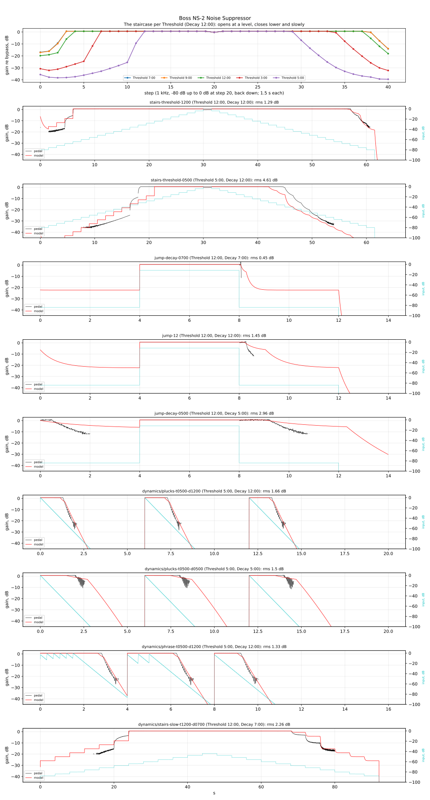

# Boss NS-2 Noise Suppressor

Measured 2026-10-27 on a 9 V supply, mono, Input → Output (Send and Return empty), Mode on
Reduction unless a take says otherwise:

| Session | What it gives |
|---|---|
| [`2026-10-27/`](2026-10-27/) | the open path, a staircase per Threshold position, -84/-12/-84 dB jumps per Threshold and Decay position, silence, Mute |
| [`2026-10-27-dynamics/`](2026-10-27-dynamics/) | notes that decay like a real string per Threshold and Decay position, light picking, a phrase, a slow staircase at three Decay positions, Decay at Threshold 5:00 |

Same rig and playback level as the other pedals ([`tools/capture/README.md`](../../../tools/capture/README.md)).
Plans: `tools/capture/plans/ns-2.json` (36 takes), `ns-2-dynamics.json` (25). Analysis:
`tools/capture/analyze_ns2.py captures/boss/ns-2/2026-10-27 captures/boss/ns-2/2026-10-27-dynamics`
→ [`2026-10-27/fit/ns-2.json`](2026-10-27/fit/ns-2.json) and the figure below (`--fit`
refits the model, a few minutes).

The knobs: Threshold, Decay, Mode (Reduction / Mute). Clock positions: 7:00 = fully
counter-clockwise, 5:00 = fully clockwise. Levels are in dB re the guitar's peak at the
pedal's input; NAM-X places that at −6 dBFS, as for the other pedals.



## Send and Return

The NS-2's detector listens to Input; Output is Return gated by it. Put a noisy pedal (or
an amp's preamp, through its effects loop) between Send and Return and the gate follows the
clean guitar while silencing the noise added after it. With Return empty, Send is passed
straight to it inside the pedal: a plain gate from Input to Output, which is what was
measured. The model below is that plain gate.

## The open path

+0.6 dB, flat from 50 Hz to 5 kHz within 0.2 dB, −0.2 dB at 8 kHz, −1.25 dB at 12 kHz,
−2.7 dB at 20 kHz. **It distorts at the guitar's full peak:** a 0 dB step's second and third
harmonics at −25 / −27 dB at 1 kHz and −16 / −19 dB at 3 kHz (the fundamental at 3 kHz 7 dB
down) — the bypassed rig gives −57 / −62. Gone 4 dB lower. In use the NS-2 usually sits after
the drives; not modelled.

Noise: nothing the rig can see (closed, −99 dBFS rms against the rig's −101). Mode on Mute:
silent whatever is played.

## It opens at once, and turns down rather than mutes

The staircases (1 kHz, −80 dB up to 0 dB in 4 dB steps of 1.5 s, and back down), Decay
12:00 — the gain re bypass:

| Threshold | 7:00 | 9:00 | 12:00 | 3:00 | 5:00 |
|---|---|---|---|---|---|
| fully open from (way up), dB | −68 | −68 | −64 | −52 | −32 |
| still open down to (way down), dB | −72 | −72 | −68 | −56 | −36 |
| closed gain at −80 dB (way up), dB | −17 | −17 | −20 | −31 | −35 |

Threshold does little below 12:00; its range is the top half of the knob.

Under the threshold the gain isn't a floor: it **creeps up** with the input (about 0.4–0.5 dB
per dB, slowly — no step at the step edges), then **snaps** ~15 dB once the input passes the
threshold, and creeps the rest of the way open over ~1 s. On the way down it **slides**: a
little at each step, then on, never settling within 1.5 s; the deeper the input sinks under the
threshold, the deeper the cut (−39 dB at Threshold 5:00, input −80).

A jump from −84 to −12 dB opens it within 1 ms at every setting.

## Decay: how a stopping note closes

The −12 → −84 dB drop: the gain holds, then slides down — 3 dB / 10 dB down after:

| Decay (Threshold 12:00) | 7:00 | 9:00 | 12:00 | 3:00 | 5:00 |
|---|---|---|---|---|---|
| ms | 75 / 81 | 117 / 131 | 305 / 478 | 1130 / 1676 | 1447 / 2194 |

At Threshold 3:00–5:00 (Decay 12:00) 220–240 / 310–330 ms: a higher threshold is reached
sooner. Decay sets both the hold and the slide.

**Decaying notes** (220 Hz, 35 dB/s, the dynamics session): at Threshold 12:00 and below the
gate closes only when the note is ~75–80 dB under its peak, at the rig's noise floor — the
gate is effectively inaudible on a note's tail, it works on the hiss after it. At 3:00 it
cuts the tail around −60 dB, at 5:00 around −40 dB (then slides ~25 dB in 0.7 s at Decay
12:00, more slowly toward 5:00). The phrase (notes 0.3 s and 0.5 s apart) keeps it open
between notes at Threshold 12:00 and 5:00.

## The model

A grey-box fit to all 39 gain envelopes (1 ms, a lock-in at the test tone; staircases, jumps,
plucks, phrases), each take weighing alike per second, levels in dB re the guitar's peak:

```
L       the input's level
E       fast level: rises with L at once, falls toward it exponentially in dB (τ = Decay)
V       slow level: the same, falling RATIO = 7.9 times slower
switch  opens once E > T + 1.3 dB, closes once E < T + 1.3 − 10.5 dB
G       0 dB open; closed, it sinks toward −7.6 dB (τ = Decay × 4.4)
gain    = +0.6 dB + G − 0.89 · max(0, T − V)
```

| | 7:00 | 9:00 | 12:00 | 3:00 | 5:00 |
|---|---|---|---|---|---|
| Threshold: T, dB | −69.4 | −69.0 | −66.7 | −49.4 | −27.3 |
| opens at (T + 1.3), dBFS for a −6 dBFS peak | −74.1 | −73.7 | −71.4 | −54.1 | −32.0 |
| Decay: τ, ms | 24.6 | 63.5 | 93.0 | 145.1 | 460.3 |

Within a median 1.5 dB rms of the pedal over the 39 takes (0.45–1.8 dB on most jumps,
plucks and phrases). Where it misses: the Threshold 5:00 staircase (4.6 dB: the pedal's slow
creep up under the threshold and its snap are coarser in the model, and it closes ~1 s late
on the way down), and the slide after an abrupt stop at Decay 12:00–5:00 (the model's is
slower at first: Decay 5:00 −4 dB where the pedal is at −12 dB, 1.5 s on). The decaying
notes — what the gate does in playing — are within 0.5–3.2 dB where the rig can see them
(light picking at Threshold 12:00: 3.7).

The study's earlier readings, kept as lessons: a single detector (attack and release in one
level) can't give the snap and the creep together; the first session's plucks decayed
15 dB/s and never reached the threshold.

## Open: the slow creep near the threshold

Not captured by the model (seen by the user in the figure's bottom plot, 2026-10-27). Within
a step near the threshold the pedal's gain keeps moving at a constant input — the model's
steps are flat:

| Slow staircase, Threshold 12:00 | Decay 7:00 | Decay 12:00 | Decay 5:00 |
|---|---|---|---|
| input −68 dB (the 20 s step): snaps to, then rises with τ | −11 dB, 1.00 s | −12 dB, 1.11 s | −11 dB, 1.23 s |
| input −72 dB (16 s): rises at | 1.07 dB/s | 1.05 dB/s | 0.94 dB/s |

and on the way down each step drops a little, then keeps sliding. A fixed ~1 s time constant,
**independent of Decay**, acting only within a few dB of the threshold: at −64 dB the pedal
snaps fully open at once, and a picked note opens it within 1 ms. (The 16 s step looks noisy
only because its output sits near the rig's floor, ~−98 dBFS; its scatter is 0.25 dB.) It
matters when a signal lingers near the threshold — a long compressed sustain fading through
it, hum sitting at it; not for notes decaying like a string, which the model follows.

Tried in scratch, not adopted:
- the slow level charging in the linear domain with a fixed rise: fitted to 0.11 s, not 1 s,
  and light picking got worse (1.5 → 3.5 dB);
- a switch that opens slowly when the input is just over the threshold (a soft target, its rise
  τ = rise · exp(−(E − open)/k)): the staircases improved (5:00 4.6 → 3.3 dB, the slow ones
  2.3 → 1.7; median 1.52 → 1.41) but it still draws flat steps — it fits by softening the switch,
  not by creeping.

**Next: model the control circuit** (an RC through a resistor, the comparator's hysteresis)
from the schematic, as for the CS-3 — no new captures needed, the staircases and notes here
check it. No free copy found: the freestompboxes.org thread (topic 11953) has the schematic
but refuses automated access (the user can fetch it in a browser); Ronsound sells the
October 1987 schematic; Reverb lists the 1987 service notes on paper; synfo.nl (where the
CS-3 and BF-3 notes came from) and eserviceinfo.com don't have it. Fallback without a
schematic: ~6 takes of fine steps (1 dB, 5 s) around the threshold at two Threshold
positions, fitted empirically.

## Takes and lessons

- 61 takes, none redone. `stairs-110` had one xrun (in its bypassed low end).
- **The dynamics session's "bypass" takes were recorded with the pedal on** — Threshold
  5:00, Decay 12:00, as the first session ended (their open gain is the pedal's +0.6 dB; the
  slow staircase came out gated, peaking at −77 dBFS). They're used as takes at that
  setting, and every take of that session is measured against its played signal and the
  first session's bypass gain instead. A plan whose bypass takes come first should say
  "switch the pedal off" — `capture.py` asks for it only at the first pedal-on take.
- **Dynamic pedals need notes that decay like a string** (35 dB/s here): the first plan's
  15 dB/s plucks were still 60 dB above the threshold when the next one came.
- **Mask the rig's floor:** gain points whose output is under −110 dBFS are noise; the
  gain measured there rises as the note fades and pulls a fit toward an open gate.

## For NAM-X

The Gate's **NS-2** type (`src/dsp/Ns2Gate.h`, branch `dsp/gate-ns2`): the model above on
a peak follower of the input (instant rise, 50 ms fall: a low E's ripple ~2 dB). Threshold
is where it opens, in dBFS (the pedal's −74.1 to −32.0, clamped), Release is Decay (the fast
level's τ, 25–460 ms, clamped), Attack dimmed (it opens at once). Rendering the pedal's own
test signals through the C++ gives the pedal's gain envelopes within a median 1.8 dB rms,
like the model. Not modelled: the distortion at full level, the 20 kHz roll-off, Send/Return
(gating after the amp from the guitar's signal — a placement feature), Mute. Not approved by
ear yet.
