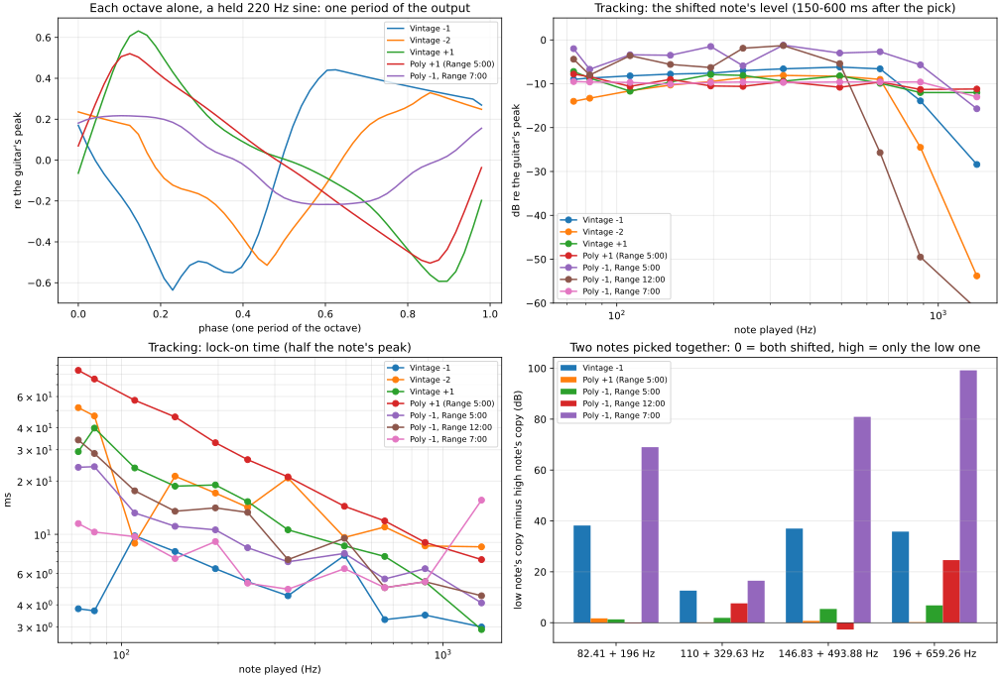

# Boss OC-5 Octave

Measured 2026-10-29 (mono, Input → Output, 9 V supply, GUITAR/BASS on GUITAR). Analysis:
[`tools/capture/analyze_oc5.py`](../../../tools/capture/analyze_oc5.py) →
[`2026-10-29/fit/oc-5.json`](2026-10-29/fit/oc-5.json) and the figure below. Levels are in
dB re the guitar's peak at the pedal input (the rig's reference). Controls: Direct Level,
+1 OCT Level, −1 OCT Level, −2 OCT/Range (the −2 octave's level in Vintage, Range in Poly),
the VINTAGE/POLY switch and the GUITAR/BASS switch.

| Session | Plan | What |
|---|---|---|
| [`2026-10-29/`](2026-10-29/) | [`oc-5.json`](../../../tools/capture/plans/oc-5.json) | 34 takes: the dry path, the knob laws, each octave alone with a held sine, re-picked notes from 73 Hz to 1.3 kHz, two dying notes, low-under-high note pairs, Range at three positions |
| [`2026-10-29-followup/`](2026-10-29-followup/) | [`oc-5-followup.json`](../../../tools/capture/plans/oc-5-followup.json) | 4 takes: the dry path's clip against the level (a 220 Hz staircase, 110 Hz plucks) |
| — | [`oc-5-reamp.json`](../../../tools/capture/plans/oc-5-reamp.json) | the guitar DI at six blends, for the by-ear A/B (to record, after the DI) |

Purpose (user, 2026-10-29): a NAM-X octave only if the pedal sounds good — so this pass
measures what a model would need, and the reamp takes decide.

## At a glance

- **Digital.** The dry path is a converter delay: **1.00 ms** late (48 samples), **+0.3 dB**
  at Direct 12:00, flat within ±0.2 dB from 63 Hz to 18 kHz.
- **The dry path hard-clips at −8.1 dB re the guitar's peak.** Clean (3rd harmonic under
  −77 dB) up to −9 dB, then a flat ceiling; a pluck at the guitar's peak loses 7.8 dB of
  its attack. The clip is before the Direct knob (the same square at 12:00 and 5:00,
  ceilings −8.0 and −1.8 dB). The octaves don't see it (they follow a dying note 1:1 from
  −3 dB): the dry has its own stage.
- **Two engines.** Vintage is an analog-style divider: square-wave subs (−1 locks on in
  3–10 ms, −2 in 9–52), monophonic — two notes make it follow the lower one, or wobble.
  Poly is a polyphonic shifter (both notes of a pair shifted, 7–84 ms to lock on, longer
  for low notes). +1 has the same sawtooth-like wave in both modes; Vintage's locks on in
  ~2 periods, Poly's about three times slower.
- **Range** (Poly): 7:00 is a different engine — only the **lowest note** of a chord is
  shifted, a smooth near-sine sub, fast (5–11 ms), 6–8 dB quieter; above 7:00 it is the
  polyphonic shifter with a **ceiling**: notes above ~500 Hz (12:00) or ~1 kHz (5:00) aren't
  shifted.
- **Knob laws:** Direct and −1 OCT share one audio taper: −9.7 / 0 / +4.6 / +6.1 dB at
  9:00 / 12:00 / 3:00 / 5:00; Direct at 7:00 mutes (−76 dB).
- **Noise:** switched on, the output idles at ~−72 dBFS peak (−97 bypassed) — why the plan
  waits for −60 dBFS between takes.

## The dry path

`dry-sweep` (Direct 12:00, every octave down, −12 dB) against `bypass-sweep`: 1.006 ms late,
the same at every frequency (a converter's latency, like the CE-5 and BF-3), response re
bypass −1.3 dB at 31.5 Hz, 0.0 at 63, then +0.2 to +0.4 dB from 125 Hz to 18 kHz.

**The clip** (follow-up, Direct 12:00, octaves down, a 220 Hz staircase against its bypass):

| Input (dB re the guitar's peak) | −30 … −9 | −6 | −3 | 0 | +3 |
|---|---|---|---|---|---|
| Gain at 220 Hz (dB) | +0.07 | −1.14 | −3.59 | −6.35 | −9.22 |
| Output peak (dB) | input + 0.1 | −8.0 | −8.0 | −8.0 | −8.1 |
| 3rd harmonic re fundamental (dB) | −77 to −90 | −20.2 | −13.7 | −11.5 | −10.5 |

A hard clip: clean to −9 dB, then a flat ceiling at −8.0 dB — the clip point is **−8.1 dB re
the guitar's peak**. The held sines of the first session (`direct-*`) show the same square at
every Direct position, scaled by the knob (ceilings −8.0 at 12:00, −1.8 at 5:00), so the
clip comes before Direct. Plucks at the guitar's peak (110 Hz, 0.6 s decay): the first
~100 ms come out 7.8 dB under the bypass's peak, then the note passes unchanged (0.0 dB at
1 s). So the OC-5 squares off the attack of every hard-picked note by up to 8 dB; at a
lower input (a quieter guitar or a pad) it wouldn't.

## The knobs

220 Hz held sine, the output's level at the frequency of interest (dB re the guitar's peak):

| | 7:00 | 9:00 | 12:00 | 3:00 | 5:00 |
|---|---|---|---|---|---|
| Direct (the 220 Hz dry; clipped) | −76.3 | −15.7 | −6.1 | −1.6 | −0.1 |
| −1 OCT, Vintage (110 Hz) | — | −15.5 | −5.7 | −0.9 | +0.5 |

Both re 12:00: −9.6/−9.8 at 9:00, +4.5/+4.8 at 3:00, +6.0/+6.2 at 5:00 — one audio taper
(the dry's numbers are of a clipped wave, but the clip is before the knob, so the ratios
hold). The other octave knobs are assumed to follow it (measured at 12:00 only).

## Each octave alone (a held 220 Hz sine)

| Octave | Fundamental (dB) | Harmonics 2–6 re fundamental (dB) | Waveform |
|---|---|---|---|
| Vintage −1 (110 Hz) | −5.7 | −12.3, −18.5, −23.5, −23.9, −25.6 | a square with rounded edges and sagging tops (high-pass ~15 Hz), not 50 % duty (even harmonics) |
| Vintage −2 (55 Hz) | −9.1 | −13.3, −22.0, −19.9, −23.7, −31.4 | the same kind, softer |
| Vintage +1 (440 Hz) | −7.5 | −4.9, −14.9, −35.1, −31.4, −31.1 | a sawtooth-like wave: fast rise, slow fall |
| Poly +1 (440 Hz, Range 5:00) | −7.6 | −8.6, −17.6, −30.3, −33.7, −32.5 | the same shape, smoother |
| Poly −1, Range 7:00 (110 Hz) | −13.1 | −41.8, −29.6, −45.9, −23.9, −55.1 | a smooth, near-sine sub |

The cycles barely change from one period to the next (spread ~0.02 of the guitar's peak):
the subs are synthesized waves at the tracked pitch, scaled by the input's envelope — not
the input's own waveform. Under +1 the input itself doesn't leak through (220 Hz at −72 dB in
Vintage, −91 in Poly; for the subs 220 Hz is their own 2nd or 4th harmonic).

## Tracking

Re-picked notes 3 s apart, 73 Hz (drop D) to 1.3 kHz; level 150–600 ms after the pick;
lock-on = the output's envelope reaching half its peak.

| | Pitch | Level | Lock-on |
|---|---|---|---|
| Vintage −1 | ×½ on every note | −6 to −8 dB to 659 Hz; −14 at 880, −28 at 1318 | **3–10 ms** |
| Vintage −2 | ×¼ on every note | −8 to −10 dB (−12 to −14 on the two lowest: 18–21 Hz, at the high-pass); −24 at 880, −54 at 1318 | 9–52 ms |
| Vintage +1 | ×2 on every note | −7 to −12 dB, all the way up | ~2 periods: 29–40 ms at 73–82 Hz → 3 ms at 1.3 kHz |
| Poly +1 (Range 5:00) | ×2 | −8 to −11 dB, all the way up | **84 ms at 73 Hz** → 7 ms at 1.3 kHz |
| Poly −1, Range 5:00 | ×½ | −1.3 to −5.6 dB (a note-to-note ripple), −15.5 at 1318 | 24 → 4 ms |
| Poly −1, Range 12:00 | ×½ | the same up to 494 Hz; **−25.5 at 659**, −49 at 880 | 34 → 5 ms |
| Poly −1, Range 7:00 | ×½ | **−9 dB flat** to 880, −13 at 1318 | 5–12 ms (16 at 1318) |

Every note came out at exactly its octave (the one odd reading, −2 on the low D at
20.1 Hz, was a sideband of the decaying note: 18.31 Hz on a longer window). Vintage's
fall above 659 Hz is the divider's band: its input filter keeps the highest notes from
triggering it (the OC-2 does the same). Poly's lock-on falls with pitch like a shifter
working in pitch periods; its −1 at Range 12:00 shows Range as a ceiling between 494 and
659 Hz.

## Two notes at once

A low note under a higher one, picked together (level of each note's shifted copy):

| | 82 + 196 Hz | 110 + 330 Hz | 147 + 494 Hz | 196 + 659 Hz |
|---|---|---|---|---|
| Vintage −1 | low −11.4, high −52 | **low −33, high −41**: a wobbling sub (52.7 / 57.1 Hz and sidebands) | low −9.8, high −49 | low −9.3, high −45 |
| Poly +1 (Range 5:00) | −14.6 / −16.3 | −15.9 / −16.0 | −15.6 / −16.3 | −16.0 / −16.2 |
| Poly −1, Range 5:00 | −8.3 / −9.6 | −14.4 / −16.3 | −9.3 / −14.7 | −8.2 / −15.0 |
| Poly −1, Range 12:00 | −15.1 / −14.9 | −7.5 / −15.1 | −15.7 / −13.0 | −8.5 / **−33.1** |
| Poly −1, Range 7:00 | −9.9 / −80 | −10.5 / −28 | −11.0 / −97 | −10.4 / −112 |

So: **Vintage** follows the lower note and drops the upper one, except where the two
fight — 110 + 330 Hz (a twelfth: the upper note is the lower one's 3rd harmonic) breaks
the divider into the classic OC-2 warble; it also makes intermodulation products (155 and
237 Hz under 82 + 196). **Poly** shifts both notes at Range 5:00 and up to its ceiling at
12:00 (the 659 Hz note dropped). **Range 7:00** shifts only the lowest note, cleanly.

## Dying notes

Two notes (82 and 196 Hz) decaying 3.5 dB/s over 10 s, Vintage −1, −2 and +1: every
octave follows the input's level **1:1 (slope 0.98–1.08 dB/dB) from −3 dB down to −33 dB**
(the end of the take), no dropout, no glitch, no gate. The top ~3 dB are slightly
compressed. Where the divider finally loses a note is below −33 dB — not reached.

## Open

- **By ear:** the reamp takes (`oc-5-reamp.json`, after the guitar DI) — the decision on a
  NAM-X octave rests on them.
- Not measured: the +1 / −2 knob laws (assumed the −1's), Range's ceiling between 7:00 and
  12:00 and above, Poly's −2 (none: the knob is Range there), BASS mode, where Vintage
  loses a note below −33 dB, the noise floor as a take (only the silence meter's −72 dBFS).

## For NAM-X (if it sounds good)

What a model would need, from the above: a dry path with its hard clip at −8.1 dB re
the guitar's peak (before the Direct knob) and the audio taper; **Vintage** as a divider: a lowest-note pitch tracker fast enough to lock in
a few ms (or a zero-crossing flip-flop on a filtered input, as the OC-2), driving a
square (−1) and a half-rate square (−2) through a ~15 Hz high-pass and a low-pass, scaled
by the input's envelope — the chord glitches come for free with a flip-flop; **+1** as a
rectifier-like doubler (sawtooth-ish, ~2 periods to lock); **Poly** as a polyphonic shifter
— NAM-X's Transpose (`FilterBankShifter`, ~20 ms at the low E) is a candidate, with a Range
ceiling as a low-pass on what it shifts; **Range 7:00** as a clean monophonic sub (a sine
at the lowest note's half). The tracking table is the acceptance test: pitch, level per
note, lock-on time.

## Lessons

- **Roll a deconvolved impulse response before cutting it.** The bypass's peak lands a
  fraction of a sample before the loopback alignment, so a fifth of its energy wraps to
  the end of the circular deconvolution; cutting the first 0.5 s read the bypass ~2 dB low
  (1 dB in the DD-8 sessions) and a digital pedal's gain re bypass ~2 dB high. Caught here
  because the staircase's gain (+0.07 dB) disagreed with the sweep's (+2.3 dB).

- **A long window around a decaying note shows sidebands.** The −2 octave's low D read
  20.1 Hz on a 1 s window: the note's 0.8 s decay put sidebands ±1.6 Hz around the true
  18.3 Hz, and with the high-pass cutting the fundamental, a sideband won. Read pitch on
  several windows before calling a tracking error.
- **A digital pedal's own hiss can exceed the silence threshold.** The run waited forever
  before the first pedal-on take (−72 dBFS idle against −75); the plan sets `quiet_dbfs`.
- **Check every take that says PROBLEM before going on:** take 22 was kept silent once;
  redoing it meant deleting its three files.
