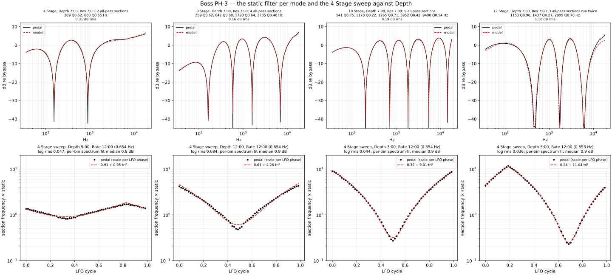
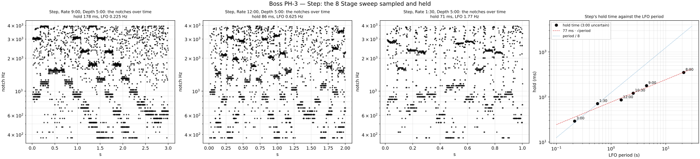
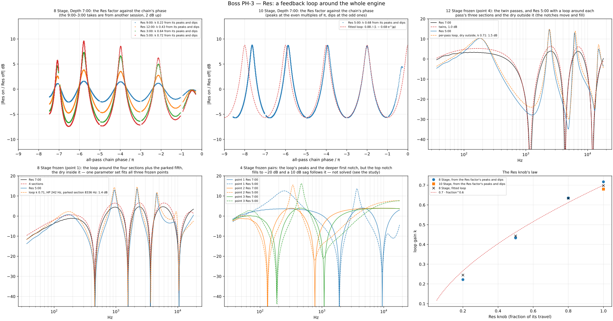

# Boss PH-3 Phase Shifter

Measured 2026-10-28 on a 9 V supply, mono (Input → Output; the PH-3 has one output):

| Session | What it gives |
|---|---|
| [`2026-10-28/`](2026-10-28/) | the Stage modes: static sweeps at Depth 7:00, Res and Depth ladders, Rate positions, bursts (`plans/ph-3.json`, 33 takes) |
| [`2026-10-28-modes/`](2026-10-28-modes/) | Step, Rise, Fall (`plans/ph-3-modes.json`, 17 takes) |
| [`2026-10-28-slow/`](2026-10-28-slow/) | Rate 7:00 for four minutes, Rate 8:00 in every mode (`plans/ph-3-slow.json`, 9 takes) |
| [`2026-10-28-followup/`](2026-10-28-followup/) | fast Rates, 8 and 10 Stage frozen at several sweep points, Rise at more Rates (`plans/ph-3-followup.json`, 14 takes) |
| [`2026-10-28-followup2/`](2026-10-28-followup2/) | Step at six Rates, 12 Stage frozen at four points, the 8 Stage Res ladder, Res off/on pairs at frozen points (`plans/ph-3-followup2.json`, 29 takes) |
| [`2026-11-10-res4/`](2026-11-10-res4/) | 4 Stage with Res at five standing points: Res 7:00, 12:00 and 5:00 at each (`plans/ph-3-res4.json`, 17 takes) |
| [`2026-11-11-rise/`](2026-11-11-rise/) | Depth in Rise and Fall: the nine tones at each of Depth's positions, the guitar at 5:00 (`plans/ph-3-rise.json`, 9 takes) |

Same rig and playback level as the other pedals ([`tools/capture/README.md`](../../../tools/capture/README.md)).
Analysis: `tools/capture/analyze_ph3.py <the five sessions>` →
[`2026-10-28/fit/ph-3.json`](2026-10-28/fit/ph-3.json) and the figures below. The script measures
what is cheap (responses, notches, the Res factor, the sweep's scale per LFO phase, Step's
hold, LFO rates, levels) and draws the fitted models over the measurements; the fits
themselves were done with exploratory scripts that weren't kept — how, is in each section.

**Correction 2026-10-29:** the responses were cut from impulse responses that lost their
negative times, which read the bypass ~2 dB low and filled the notches in (−41 to −52 dB
then, −45 to −88 dB now). `analyze_ph3.py` now measures correctly, but the fitted models
below were fitted to the old responses: against the corrected ones the static fits are
1.08 / 1.12 / 1.24 dB rms for 4 / 8 / 10 Stage (were 0.31 / 0.16 / 0.19) and 0.83 dB for
12 Stage (was 1.10). The structures stand; the tone and mix (`gd`, `gw`, the high shelf)
need a refit. Numbers in the sections below are the old ones unless marked.

The knobs: Rate, Depth, Res, and the Stage switch: 4, 8, 10, 12 Stage, Rise, Fall, Step. Clock
positions: 7:00 = fully counter-clockwise, 5:00 = fully clockwise. The user wanted every mode;
nothing was left out.

## The focused session (2026-11-10): the Stage modes are chains of identical first-order stages

[`2026-11-10-focused/`](2026-11-10-focused/): 38 takes (`tools/capture/plans/ph-3-focused.json`),
the adapter, every mode. Two kinds of take: **tones** — nine quiet sines together (113 Hz to
8.9 kHz), each one's level and phase on the output being the phaser's response at its
frequency at every moment, folded on the sweep's rate into the whole cycle — and guitar at
−12 dB over an 8 kHz probe. Tools: `tools/capture/render_ph3.cpp` (NAM-X's Phaser offline),
`tools/capture/ph3/focused.py` (the tone takes against the model, plots:
`fit/tones-TAKE.png`), `ph3/stages.py` (the structure's fit).

**What the pedal is.** October fitted second-order all-pass sections and couldn't make 8 and
10 Stage both rest and sweep right. The tones say something simpler: a "stage" is a
first-order all-pass (90° at its corner) at the pedal's 44.1 kHz, the sweeping ones all on
**one corner fc(t)**, dry and wet mixed equally:

| Mode | Structure | Tones over the whole cycle | Standing sweep |
|---|---|---|---|
| 4 Stage | `g·(1 + A⁴)` — its two notches 5.83 apart, as four identical stages give (measured 5.81) | 0.2–0.6 % complex, 0.09–0.19 dB | 0.07 dB |
| 8 Stage | six sweeping stages and **two parked at 4.35 kHz** | 0.6 %, 0.22 dB | 0.20 dB |
| 10 Stage | six sweeping stages and **four parked at 7.65 kHz** | 1.0 %, 0.39 dB | 0.56 dB |
| 12 Stage | a 6 Stage phaser run twice, `(g·(1 + A⁶))²` | 3.2 %, 0.90 dB | 0.47 dB |

(8 or 10 identical stages: 45 %; two groups a fixed ratio apart: 35–45 %; found by letting
every stage's corner go free per moment and watching six move together while the rest stood
still.) Rest corners (Depth 7:00): 371.6, 638.0, 802.0, 1735.1 Hz; gain g 0.798, 0.86, 0.765,
0.64 per pass; a first-order high-pass at 63 Hz (8 Stage: 228 Hz); latency 0.558 ms.

**The sweep.** At Depth 5:00 the corner runs 84–4544 Hz (4 Stage), 279–4625 (8), 366–9766 (10),
503–9289 (12), each along its own curve over the LFO's triangle (tabulated in `Ph3Phaser.h`;
the rise and the fall differ by 5–15 % of the corner at most, averaged). **Depth shrinks the
LFO's travel about the rest point and nothing else**: the corner stays on the same curve, read
at `u = rest + D·(tri − rest)`. 4 Stage at Depth 12:00 (set by hand) gives D = 0.478 from the
bottom of its sweep and 0.482 from the top, and that piece of the Depth-5:00 curve is its curve
to 0.4 %. The rates: 0.6250 Hz at 12:00 (4 Stage block), 0.6854 after the knob was set again,
0.2195 at 9:00.

**The model against it** — each tone's level over the cycle, dB rms (floored at −30), `was`:
NAM-X's Phaser as it stood, `now`: the stages:

| Take | was | now |
|---|---|---|
| 4 Stage, Depth 12:00 | 3.2 | 0.35 |
| 4 Stage, Depth 5:00 (Rate 12:00, 9:00) | 2.0 | 1.0 |
| 8 Stage | 8.4 | 1.3 |
| 10 Stage | 7.7 | 1.2 |
| 12 Stage | 6.1 | 1.2 |
| 4 Stage, Res 5:00 | 4.7 | 3.0 |
| 8 Stage, Res 5:00 | 9.6 | 1.6 |
| 10 Stage, Res 5:00 | 9.8 | 1.2 |
| 12 Stage, Res 5:00 | 5.8 | 1.8 |

What is left with Res off is the notches' timing (the averaged rise and fall, the engine's
48 kHz against the pedal's 44.1). **Res** is October's loop (round the whole chain, the dry inside; 12 Stage a loop per pass),
which is right for 10 and 12 Stage as it was, and:

- **8 Stage: the loop passes one more parked stage that the output doesn't** (October's
  "fifth section parked at 8.3 kHz", now a first-order stage): at 8169 Hz with the sample of
  delay, k 0.743, s 0.749, high-pass 242 Hz it fits the Res 5:00 tones over the cycle to 10 %
  complex and 1.1 dB (3.1 dB without it; two at 13.3 kHz 0.8 dB, a plain 2.7-sample delay
  1.0 dB: what it adds is about 1.7 samples of delay in the loop). `build-ph3` scratch.
- **4 Stage: the loop has no sample of delay.** With the corner at its bottom the high tones
  sit on a flat +8 dB with the chain's own phase; a sample of delay puts shoulders at 5–9 kHz
  that the pedal doesn't have. The model closes the loop within the sample (solved: the four
  stages' and the high-pass's instantaneous gains): k 0.664, s 0.742, high-pass 89 Hz, 3.0 dB
  (the best with the delay 3.9). **Its structure is still not the pedal's**: see "4 Stage Res"
  below for what was added to that today.

**Not looked at yet:** the guitar takes (waveform), Step, Rise and Fall (their tone takes are
recorded), the fast Rates (the tone method needs wider filters there).

**In the app** since 2026-11-10 (the user, on these plots): `src/dsp/Ph3Phaser.h`,
`PhaserProcessor`. The sections below describe October's model, which it replaced for the
Stage modes.

## It's digital

0.544 ms of latency, a wall just under 20 kHz, and everything fits as filters designed at
44.1 kHz. No service notes, schematic or algorithm description exists online (searched
2026-10-28: retailer copy, reviews, repair threads naming a fried IC, nothing more). One
retailer listing says the 12-stage mode "combines two six stage phasers" — the one claim
the measurements confirm.

## The static filter: dry + wet through all-pass sections

With Depth at 7:00 the sweep stops and a sine sweep reads the filter. Every Stage mode is

    out = latency · tone · (gd + gw · A)

- **tone:** a one-pole high-pass near 56–64 Hz and a first-order high shelf of about
  +3.4 dB from 12 kHz up (8 Stage fitted a 240 Hz high-pass and a +2.9 dB shelf from 6.6 kHz
  — the tone and the mix trade off against each other and the fit is not unique in that).
- **gd ≈ gw ≈ 0.68–0.76** (the mix), the same at every Depth: no feedback at Res 7:00.
- **A:** a product of RBJ second-order all-pass sections, two per "4 stages".

| Mode | Sections at Depth 7:00 (Hz, Q) | Notches (Hz) | Fit |
|---|---|---|---|
| 4 Stage | 209 Q0.62, 660 Q0.64 | 154, 895 | 0.31 dB rms |
| 8 Stage | 259 Q0.62, 642 Q0.88, 1798 Q0.64, 3785 Q0.40 | 162, 586, 1604, 6950 | 0.16 dB |
| 10 Stage | 541 Q0.75, 1178 Q0.22, 1265 Q0.71, 3952 Q0.42, 9497 Q0.54 | 202, 718, 1855, 5476, 14560 | 0.19 dB |
| 12 Stage | 1153 Q0.96, 1437 Q0.27, 2999 Q0.78 — **run twice** | 482, 1730, 5930 + 6248 | 1.10 dB |

Fitted on the magnitude (dB, clipped at −30) with many starts and differential evolution;
the section sets aren't unique (a 2nd-order all-pass at low Q spreads its phase over octaves,
so several sets give the same notches), which matters for the sweep (below).

**Level:** the output rms over a noise take, against bypass, 4 Stage at Rate 12:00: Depth 7:00
+3.1 dB, 9:00 +3.0, 12:00 +2.7, 3:00 +2.4, 5:00 +2.3 — the mix doesn't change with Depth,
the small fall is the notches sweeping through more of the band. By mode at Depth 5:00:
8 Stage +1.5, 10 Stage +0.1, 12 Stage −0.4 (more notches, less energy). Res raises it
(4 Stage Res 5:00 +4.6 dB, Rise Res 5:00 +9.0 dB).

### 12 Stage: a 6 Stage phaser run twice

One chain of six sections can't be it: its notches would be simple zeros, and the 12 Stage
notches at 482 and 1730 Hz are **double zeros** — 12 dB per halving of the distance to the
notch on each side, against 6 for every 4 and 8 Stage notch. Only a product of two
(dry + wet) phasers with coincident notches does that:

    out = latency · tone · (gd + gw · A3) · (gd′ + gw′ · A3′)

with the same three sections in both passes. Six free sections in one chain fit to 8 dB, two
free three-section chains to 3.7 dB, the twins to 1.1 dB (mix 0.68/0.62 per pass; the fitted
tone came out odd — a −1.4 dB shelf from 500 Hz — the mixes and tone trade off).

**The two passes aren't quite together.** At Depth 7:00 the top notch is a split pair (5930 and
6248 Hz). At the four frozen points of the last session, the two high in the sweep (notches
2096/7124/15886 and 1164/4362/11966 Hz) are clean double zeros and fit as identical twins
(1.0 dB: 2864 Q0.83, 3855 Q0.28, 6786 Q0.84 — though point 4's two upper notches are split
pairs 1–3 % apart, 4240/4360 and 11962/12088 Hz); the two low in the sweep (128/484/1764 and
136/516/1876) have blurred notches (slopes 8–10 dB per halving) and fit as twins only with the
second pass **detuned 10–18 % on its two lower sections** (point 1: 184/489/1095 Hz, the
second pass ×1.18/×1.10/×1.00, 0.78 dB; point 3: 231/568/1160, ×0.84/×0.91/×1.00, 0.81 dB)
— in opposite directions at the two points. That is what a second pass running on a
*delayed copy of the LFO* does: frozen on a falling ramp the second pass sits higher, on a
rising ramp lower. The lag isn't measured (the Rate before each freeze isn't known).

## The sweep

Noise takes, folded over the LFO period: each short-time response is assigned to a bin of
LFO phase and averaged (Y·X̄ and |X|² per bin, divided by the same session's bypass-noise —
without that the result sits 8 dB low, the interface gain differs from the sweep takes). The
period is the fold that explains the most variance of the frames' dB, then the shortest
submultiple that explains at least 90 % as much (a 0.03 s floor once folded Rate 5:00 as two
cycles and read 10.8 Hz for 21.5). Per bin, one scale c on every section frequency of the
static model is fitted (mix and tone fixed; medians about 1 dB).

**Shape:** c = a + b·tri², tri the LFO's triangle from 0 to 1 — a triangle beats a sine
(0.034 against 0.14 log rms). **Depth sets the swing**, in 4 Stage:

| Depth | a | b | swing |
|---|---|---|---|
| 9:00 | 0.912 | 0.947 | ×2.0 |
| 12:00 | 0.609 | 4.257 | ×8.0 |
| 3:00 | 0.316 | 9.009 | ×29 |
| 5:00 | 0.244 | 11.043 | ×46 |

**Rate** (the LFO; Rate 7:00 stops it wherever it is — four minutes without moving; 10:30 and
1:30 from the Step takes, which sweep the same way):

| Rate | 8:00 | 9:00 | 10:30 | 12:00 | 1:30 | 3:00 | ~4:00 | 5:00 |
|---|---|---|---|---|---|---|---|---|
| LFO | 0.047 Hz | 0.225 Hz | 0.394 Hz | 0.654 Hz | 1.77 Hz | 4.64 Hz | 12.1 Hz | 21.5 Hz |

Knob positions repeat to about 5 % (the last session read 0.625 Hz at 12:00 and 4.31 at 3:00;
"4:00" came back at 13.5 Hz).

**Fast Rates shrink the swing** (Depth 5:00): at ~4:00 c runs 0.725–10.4 (a 0.725, b 9.65), at
5:00 1.42–8.76 (a 1.42, b 7.34), against 0.24–11.3 at 3:00 and below. A one-pole smoothing of
the triangle doesn't explain it (0.14 log rms at best): the swing shrinks *and* its centre
rises (geometric centre 1.7 at 3:00, 2.7 at 4:00, 3.5 at 5:00), which a smoothed control
can't do. Use the measured a and b per Rate, interpolated in log Rate. At 5:00 the top is also
flattened and the rise lopsided; not modelled.

**8 and 10 Stage** sweep the same way (c 0.46–5.2 and 0.50–5.3 at Depth 5:00, ×11), but one
common scale on the Depth-7:00 sections doesn't fit their frozen sweeps: the section sets
aren't unique, and only a base fitted **jointly** to the frozen sweeps and the folded
Rate 8:00 cycle works — 8 Stage 600 Q0.66, 1025 Q0.42, 1198 Q0.36, 2697 Q0.13; 10 Stage
449 Q0.67, 936 Q1.10, 3146 Q0.89, 3775 Q0.08, 10081 Q1.11 (mix ≈ 0.86/0.75, latency
0.563 ms), complex error about 0.10, worse than 4 Stage; letting Q rise as c^0.2 helps a
little. **12 Stage** sweeps 0.32–5.1 (×16) with the shared sections; 0.13 complex error where
c > 1, 0.3–0.4 at the bottom — where the passes drift apart (above), so a twin model with
the LFO lag between the passes should fix it.

### Rise and Fall

A barber pole: **each LFO period the notch pattern slides up (Rise) or down (Fall) by one notch
spacing**, on the same Rate scale as the Stage modes —

| Rate | 8:00 | 9:00 | 12:00 | 3:00 | 5:00 |
|---|---|---|---|---|---|
| a new notch every | 21.1 s | 4.56 s | 1.53 s | 0.20 s | 0.047 s |

— the notches **1.88 octaves apart** (1.7–1.8 at Res 5:00), straight lines in log frequency.
**Depth does nothing** (7:00, 12:00 and 5:00 all give 1.23 octaves/s at Rate 12:00). Fall is
Rise reversed, at the same speed. Measured from the phase of the pattern's repeat along log
frequency, unwrapped over time (cross-correlating frames is too coarse at Rate 8:00).

**Depth is not dead in Rise and Fall (2026-11-11, the focused session's tone and guitar takes
at Depth 7:00, and October's noise takes read again per band).** It never changes the speed,
but it changes the notches and the level:

| | Depth 7:00 | Depth 12:00 | Depth 5:00 |
|---|---|---|---|
| level re bypass, noise, 200 Hz – 12 kHz bands | +2.2 to +4.9 dB | +1.9 to +4.9 dB | −0.7 to +2.0 dB |
| a tone through the cycle (7:00: the nine tones; 5:00: October's bands) | tops +4 to +10 dB, dips of 1.5 to 21 dB | — | deep notches (−30 dB and under) |

At 7:00 on guitar the pedal's Rise and Fall are **+6.4 dB** re bypass (`rise-chords-m12`,
`fall-chords-m12`); NAM-X's, fitted at Depth 5:00 with Depth doing nothing, +0.5 dB with deep
notches (the tone takes: 8.4 dB rms). 7:00 and 12:00 are the same within 0.3 dB per band, so
the change comes between 12:00 and 5:00 on noise. Fall is Rise run backwards to the plot's
width.

**The law (session `2026-11-11-rise`, `plans/ph-3-rise.json`: the nine tones at each of
Depth's five positions).** Over the cycle each tone's response draws a circle in the complex
plane, one turn per cycle at every Depth: a steady part (the centre) plus a moving part (the
radius). Mid tones, re bypass:

| Depth | 7:00 | 9:00 | 12:00 | 3:00 | 5:00 |
|---|---|---|---|---|---|
| steady part | 1.71 | 1.43 | 1.13 | 0.87 | 0.79 |
| moving part | 1.16 | 1.28 | 1.29 | 1.12 | 1.03 |
| moving part at 8.9 kHz re the mid tones | 0.09 | 0.12 | 0.24 | 0.43 | 0.61 |
| loudness of the nine tones re bypass | +5.6 dB | +4.6 | +2.9 | +1.1 | +0.4 |

Fully up the moving part is the larger: the circle goes round zero (deep notches, a double dip).
Turned down the steady part grows past it (the circle misses zero: shallow notches, louder) and
the moving part loses its top (nothing moves above about 4 kHz at 7:00). The notch spacing
reads 1.86 to 1.98 octaves; each tone's notch comes up to 0.1 cycle off an even ladder.

**In NAM-X** (`LADDER_DRY`, `LADDER_WET`, `LADDER_WET_TOP_HZ`): the ladder's dry and wet gains
and a second-order low-pass on the wet per Depth position, 5:00 left as October's fit. Level
over the cycle with each tone's timing free, was → now: 8.2 → 2.2 dB rms at 7:00, 6.4 → 3.0 at
9:00, 4.8 → 4.2 at 12:00, unchanged at 3:00 and 5:00 (6.0, 6.7: the notches' shape, not the
mix); loudness within 0.2 dB of the pedal's at every position (5:00: 0.3); on guitar at 7:00
+6.0 dB re bypass against the pedal's +6.45 (was +0.5), at 5:00 +0.5 against 0.0. Open: the
notches' shape at the deep end (the pedal's wet is the larger there: a double dip) and their
timing per tone.

The same guitar takes, level re bypass, pedal / NAM-X: 4 Stage +0.8 / +0.7, at Depth 12:00
0.0 / 0.0, 8 Stage 0.0 / −0.2, 10 Stage +0.3 / +0.5, 12 Stage +1.0 / +1.2, Step +0.2 / −0.2,
8 Stage Res 5:00 +2.3 / +1.7, 4 Stage Res 5:00 **+4.6 / +2.1** (the unsolved structure: what
it adds below the corner). Step's tone takes don't fold on the sweep's cycle (the hold isn't
locked to it): not scored.

### Step

**The 8 Stage sweep sampled and held:** four notches, the triangle law, the LFO's value frozen
between steps — the jumps are uniform in time and vary in size (big mid-ramp, small at the
turns), so it is a sample-and-hold of the LFO, not a quantised LFO value (the plain 4 Stage
sweep at Rate 8:00 shows no steps at all). **Depth 7:00 sits still.**

| Rate | 8:00 | 9:00 | 10:30 | 12:00 | 1:30 | 3:00 | 4:00, 5:00 |
|---|---|---|---|---|---|---|---|
| hold | ≈ 350 ms | 178 ms | 121 ms | 86 ms | 71 ms | 29 ms? | unresolved |
| steps per LFO cycle | ≈ 60 | 25 | 21 | 18.6 | 8.0 | 8.0? | |

Neither a fixed time nor a fixed count: at the slow end the hold goes roughly as
77 ms · √(period in s); at 1:30 it is exactly the LFO period / 8. The 3:00 reading is the LFO's
8th harmonic — the same thing if there really are 8 steps per cycle, an artefact if not; at
4:00 and 5:00 the steps can't be resolved and the pattern looks random, which is what
sampling a 47–74 ms triangle at a comparable hold does (and what reviews call Step's
"random" character). Interpolate the table in log Rate; the fast end needs a different
measurement (a held sine where a notch passes, so the steps show as level jumps). Measured as
the spectral line of the frame-to-frame change (mean |ΔdB| over 250–7000 Hz; the LFO's own
harmonics masked); 8:00 read off the notch track (nine plateaus in three seconds).

## Res: a feedback loop around the whole engine

**10 Stage (0.28 dB):**

    out = s · tone · (gd + gw · A) / (1 − k · z⁻¹ · HP · A)

— the feedback from the end of the chain to its input, **the dry taken inside the loop** (so the
notches stay exactly where they are: every 8 and 10 Stage notch is within 0.1 % and as deep
with Res 5:00 as without), one sample of delay and a first-order high-pass near 50 Hz (a DC
blocker) in the loop, k = 0.68 at Res 5:00, the mix scaled by s = 0.88. The sections don't
change (a common frequency scale and Q factor fitted to 0.999 and 1.00). Without the sample
of delay 2.5 dB, without the high-pass 0.8 dB.

**8 Stage** is the same loop passing a **fifth all-pass section parked at 8.3 kHz** (Q 0.6–0.9):
the engine is the 10 Stage chain, the 8 Stage wet is tapped after four sections and the
feedback comes from the end of all five. Depth 7:00: k 0.70, s 0.75, high-pass 200 Hz, no
delay, 0.77 dB (2.5 dB without the parked section). Confirmed across the sweep by the three
frozen Res off/on pairs: one shared loop (k 0.71, s 0.76, HP 242 Hz, the parked section at
8336 Hz Q0.60) fits the three Res 5:00 takes to 1.0–1.9 dB, the same as their Res 7:00 fits
— and the parked section sits at a fixed frequency, not scaled with the sweep (2.5 dB scaled).

**Reading a loop straight off a take:** the ratio Res-on / Res-off against the chain's phase φ
(from the static fit) is periodic — +9 dB at even multiples of π, −5.5 dB at odd ones, a ±45°
phase sawtooth — exactly s/(1 − k·e^{jφ}); and (1 + k)/(1 − k) = peak/dip gives k without
caring about the level. That is the first check for any Res take.

**The Res knob** (8 Stage ladder at Depth 7:00, the same loop; the parked section lands at
8.1–8.4 kHz every time):

| Res | 9:00 | 12:00 | 3:00 | 5:00 |
|---|---|---|---|---|
| k | 0.25 | 0.44 | 0.63 | 0.70 |

about 0.7 · (fraction of the knob's travel)^0.6, within ±0.02. The mix scale s is only
comparable within a session (below): the pairs give 0.75 at 5:00.

**12 Stage** (frozen point 4, 1.5 dB): the notches move up 8–11 % and fill to −25…−31 dB
(1164 → 1256, 4362 → 4838, 11966 → 13000 Hz), so here the dry sits **outside** the loop. Of
seven arrangements on the twin structure only "each pass a phaser with the loop around its own
three sections, dry outside, one sample of delay" works (k 0.71, s 0.58, HP 103 Hz; the others
3.7–8 dB; the same with the dry inside 4.8 dB). Why the dry is outside here and inside in
8/10 Stage is unexplained — the two are the same transfer function when the wet gain rises as
1 + k with Res; maybe the twice-6 block simply lacks that.

**Rise** with Res 5:00 is +9 dB louder than without: the resonance rides the barber pole. Not
modelled.

### 4 Stage Res: not solved

**2026-11-10, the standing points** (session `2026-11-10-res4`, `tools/capture/ph3/res4.py`,
`fit/res4-slide.png`): the sweep stopped at five corners — 85, 307, 1110, 1667 and 4532 Hz — and
each read with Res at 7:00, 12:00 and 5:00, Rate untouched.

- **Align each take by its loopback to a fraction of a sample.** With the sidecars' whole-sample
  latencies the Res-off takes fit K·(1 + A⁴) to 10–50 %; aligned, to **0.05–0.17 %** at all
  five corners (one shared tone K). A stopped sweep stays put (point 1 read again: 0.6 %).
- **What Res adds follows the corner.** Drawn against frequency / corner the five points lie on
  each other at both Res positions; the only fixed part found is the loop's high-pass (about
  100 Hz: the point at 85 Hz resonates less, +9 dB against +15 to +17). Yesterday's "some of it
  is fixed in frequency" came from the sweeping take, not from the pedal.
- **The loop is the plain one:** its poles sit where A⁴ = 1/k at every corner, k = 0.78 at
  Res 5:00 and 0.47 at 12:00, the same at each point.
- **On top of it, two more orders that sweep:** per point, order 6–7 in the stage variable fits
  to 0.2–2 % (order 4: 10–20 %). In units of the corner, at Res 5:00: the lower notch untouched
  (±0.41j), the top notch's zero moved off the axis (−0.3 ± 2.25j), a zero pair in the right
  half plane (1.4 ± 1.45j) and a pole pair at −0.7 ± 1.4j; at 12:00 the same, milder. Close to
  the plain loop in series with one second-order section, (0.37 + 1.2A + A²)/(1 + 0.46A + 0.35A²)
  in the stage A — 6 dB more below the corner than above, a whole turn of phase.
- **Not one network, though:** that section's numbers drift with the corner (its poles at 2.1,
  1.56, 1.56 and 2.4 times the corner at 307, 1110, 1667 and 4532 Hz), and nothing fitted to all
  five points together gets under 9–14 % — six stages with free output and feedback taps, the
  loop's fixed filter left free per frequency, a loop delay, two extra stages on a corner of
  their own (no preferred corner: the fit is flat). The plain loop on the same data: 17–95 %.

So the pedal's 4 Stage with Res is the plain loop plus something of second order that follows
the sweep without being a fixed network of identical stages. Still not found. What would work
without knowing it: the plain loop times a second-order section in two more sweeping stages,
its four numbers tabulated against Res and the corner — an imitation, and it needs Res positions
between 7:00 and 12:00 that this session doesn't have.

**2026-11-10, on first-order stages** (the standing sweeps of 2026-10-28 at Res 9:00, 12:00,
3:00, 5:00 against Res 7:00, and the focused session's tones; scratch scripts, not kept):

- It is linear (no products between the nine tones above −75 dB), and it is **not any network
  of the four stages**: one loop from any node to any node with the dry from any node, with or
  without a sample of delay (best 55 % complex error on the four Res positions together), two
  loops at once (every pair, 45 %), free weights on all five nodes for both the fed-back and
  the output sum (16 %), extra fixed first- or second-order all-passes in the loop (50 %).
  10 Stage through the same code: 2–4 %.
- A free rational function of f/fc fits the standing Res 5:00 response to 0.4 % at order 8.
  Its roots, in units of the corner: the lower notch untouched (±0.40j), the top notch damped
  (−0.21 ± 2.34j), the loop's resonance (−0.07 ± 1.05j: k ≈ 0.7, no delay), and what no loop
  on four stages has: **a zero pair in the right half plane at 1.61 ± 1.82j with a pole pair
  at −0.74 ± 1.78j** (an all-pass-like pair near 2.2–2.4× the corner: a whole extra turn of
  phase from below the top notch to the top of the band) and real poles at −2.6, −10, −15.
  Res 12:00 shows the same pairs, milder (zeros 0.98 ± 2.08j).
- That pattern does not simply slide with the corner: the standing fit carried along the
  sweeping take is 40–120 % off on the middle tones. Some of it is fixed in frequency.
- The loop gain read from the three places the chain's phase is whole differs: +10 dB at
  f = fc, +4 dB far above the corner, about +7 dB far below.

So the pedal's 4 Stage with Res has more in it than four stages and a loop — as 8 Stage's loop
has a stage the output doesn't. Not found: what, and where. A standing take per corner (the
LFO stopped at several points, Res 7:00 and 5:00, sweeps) would separate what follows the
corner from what is fixed; the frozen pairs of followup2 are that, three points.

October's notes, on second-order sections:

Well characterised, though. The frozen pairs (notches 1916/9458, 132/770, 188/1086 Hz, plus
154/895 at Depth 7:00) all show the same thing, so it is tied to the sections, not to a
fixed filter:

- the loop is there: peaks at the even multiples of the chain phase (+9 to +12 dB, k ≈ 0.72–0.78
  from them), the first notch gets *deeper* (−38 → −52 dB, as 1/(1 + k) predicts) and stays
  put (≤ 1 %);
- the **top notch loses its phase flip and fills** to −19…−26 dB, 1–2 % lower (a wide shallow
  dip; the phase makes a bump instead of jumping 180°) — its zero has left the unit circle,
  which no loop with the dry inside can do, and the first notch rules out the dry being
  outside;
- above the top notch the response **sags by up to 10 dB** at about 1.6–1.75× the notch
  (1346 Hz for 770, ~1.4 kHz for 895, ~1.9 kHz for 1086), then rises to +3–4 dB at
  10–15 kHz.

Tried on the four points jointly (shared k, s and high-pass; the sections from each point's
own Res 7:00 fit; stability checked on the closed-loop poles) and rejected: the plain loop
(3.4 dB mean), a one-sample loop delay (4.4), one or two extra all-pass sections in the loop
at fixed frequencies (3.3) or scaled with the sweep (3.3), a free biquad in the loop fixed or
scaled (2.7–3.0, the best of those with a pole outside the unit circle), the biquad in the wet
path too (2.3–2.9, unstable), the unused sections as pure delays (worse), the sections' Q or
frequency changing with Res (3.3), and a pole/zero mismatch of the top section — its all-pass
zeros no longer matching its poles, with or without the loop (2.6–2.7; of the bottom section
or both 2.8–5.1). Free fits keep asking for a sharp all-pass (Q 4–6) at 1.1–1.2× the top notch,
which only reshapes the band around the moved notch.

**For NAM-X:** use the 8/10 Stage loop with k(Res) for 4 Stage too — the peaks, the first
notch and the level are right; the pedal's filled top notch and the sag are not reproduced.
The idea left: a feedback that enters *between* the two sections with the dry taken from a
different node than the wet — enumerate the two-section topologies (injection node, source
node, dry node, wet node: 36–54 combinations, one generator with Mason's rule) against the four
points with the pole check. About two hours, odds maybe one in three; parked until the 4 Stage
Res sounds wrong by ear.

## Lessons

- **Frozen points** (Rate 7:00 after a nudge: the LFO stops wherever it is) are the way to study
  anything static along the sweep; a Res 7:00 and a Res 5:00 take at the same point give the
  Res factor directly. Frozen fits need the tone free per take (1–3 dB with session 1's tone
  held, 0.7–1.3 dB free).
- **Fit the complex response** (weighted 1/√f, many starts, differential evolution) to find
  sections; magnitude-only fits of notched responses land in local minima. But for *structure*
  questions (which loop, which filter) a dB fit clipped at −30 dB with the sections held is far
  more robust: every free complex fit of a Res take wandered into degenerate sections.
- **Check a loop on its closed-loop poles**, not its open-loop gain: a loop gain above 1 is
  fine where the loop phase is near π (it is what makes a deep sag); only the zero-phase
  crossings must stay below 1. A fit with a pole outside the unit circle means nothing.
- **Notch order:** the slope of dB against log|f − f0| on each side — 6 dB per halving of the
  distance is a simple zero, 12 a double one. It is what gave 12 Stage away.
- **Fold slow takes** (Rate 8:00) when fitting a static model per bin: at Rate 12:00 with 16
  bins the sweep moves too much within a bin and the notches smear (3–7 dB per bin even with
  Res off). Remove the 0.544 ms latency before unwrapping phase, or the unwrap invents a filter.
- **Sessions differ in level (corrected 2026-10-30):** after preserving the bypass
  impulse's negative times, `followup2` agrees with the original session. `followup`
  is about 2.35 dB higher in both bypass and the repeated engaged `s4-rate-0500` setting;
  same-session bypass normalization leaves only 0.011 dB difference in that setting's
  total gain. This supports a shared pedal-side gain change, not a different wet mix.
  Its physical cause and persistence in every frozen take remain unknown. Use the
  same session's bypass; see the [follow-up measurements](../../../tools/research/BF3_PHASE_FOLLOWUP.html).
- **Step's hold** from the change signal's spectral line works where the LFO's harmonics don't
  land on it (9:00 to 1:30); peak-picking the change signal reads noise at the slow end, the
  notch track is the fallback there.

## Open

1. **4 Stage Res** (above).
2. **Step's hold at Rate 3:00 and up** (a sine-based take), and whether eight steps per cycle is
   a real lock at fast Rates.
3. **12 Stage's second pass:** the LFO lag between the passes (frozen pairs at a known Rate
   before the freeze, or two sweeping takes and the fold).
4. **Res in Rise** (the pattern does stop, at Rate 7:00: see the Res session below) and **Res and distortion**
   (reviews say more Res = more distortion; `s4-bursts-res-0500` against `s4-bursts` is there,
   not analysed).
5. **Fast-Rate swing** stays a table.

## Rise and Fall again: the Res session (`2026-11-11-res`, 118 takes)

Why: a blind test (2026-11-11) found NAM-X's Fall far from the pedal with Res up. The takes are grouped
by knob setting, only the Mode switch moving inside a group (`plans/ph-3-res.json`): a Res ladder at
seven positions in every mode (Rate 12:00, Depth 5:00), the sweep stopped (Rate 7:00) at three, Depth at
12:00 and 7:00, a fast Rate, and two settings of the user's own (V1, V2: **validation, in no fit**).
Signals: nine quiet sines together; a sweep where the pedal stands still. Every take's mode was checked
by its fingerprint; one was recorded twice in Fall (`a-res400-fall-again`).

**The baseline is worse than thought, and not only with Res** (`tools/capture/ph3/baseline.py`: the real
model rendered from the played tones, each tone's level over the cycle, dB rms, 197 Hz–5.1 kHz):

| Take | NAM-X's Phaser, dB rms |
|---|---:|
| 8 Stage, Res 7:00 / 5:00 | 1.2 / 1.2 |
| Rise, Depth 5:00, Res 7:00 / 12:00 / 3:00 / 5:00 | 8.9 / 7.9 / 9.2 / 10.5 |
| Fall, Depth 5:00, Res 5:00 | 10.5 |
| Rise, Depth 12:00 / 7:00, Res 12:00 | 5.9 / 4.2 |

So Rise and Fall miss the pedal by 8–10 dB over the cycle at full Depth even with Res at its minimum:
the ladder that carries them is not the pedal's, as its own comment says. The Stage modes hold.

**What the pedal does, read without a model:**

- **Rate 7:00 stops Rise and Fall too** (the study's open point: "the pattern never stops"). Rise and
  Fall then give the same response to 0.2 % (`tools/capture/ph3/still.py`, `fit/still.png`): notches at
  53, 199, 669, 2581 and 9622 Hz that hardly move with Res, and resonances at about 111, 390, 1106 and
  1400, 3810, 12 280 Hz. The one at 390 Hz stands +9.6 / +18 / +27 dB at Res 12:00 / 3:00 / 5:00.
- **Peak height by Res** (Rate 12:00, Depth 5:00, the tallest tone peak over the cycle), 7:00 … 5:00:
  Rise and Fall +6.0, 7.3, 10.0, 12.7, 15.6, 19.7, 21.7 dB; 8 Stage +4.6, 5.7, 8.0, 9.7, 11.0, 12.5, 13.0.
- **Res does not distort at these levels:** the tones 12 dB louder give the same peaks.
- **One loop is not enough.** For 8 Stage the three still responses pass an exact test of "one feedback
  loop, one gain" (1/H is linear in the gain: the three curves are dependent to 0.05 %). For Rise they
  fail it (9 %).
- **Two passes in series, a loop each** (`tools/capture/ph3/cycle.py`). Over the sweep cycle each tone's
  complex gain has a one-sided Fourier series (the other side 35–60 dB down) that from its third term
  on obeys a two-term recurrence (to 0.2–3 % from 331 Hz to 1.7 kHz): H is a ratio of two quadratics in
  u = exp(j·2π·t/T), with **two poles in u of equal size**. Their size is each loop's gain at that tone:

  | Res | 7:00 | 9:00 | 12:00 | 1:30 | 3:00 | 4:00 | 5:00 |
  |---|---:|---:|---:|---:|---:|---:|---:|
  | loop gain, 577 Hz–1.7 kHz | ~0.2–0.3 | 0.31–0.42 | 0.56–0.62 | 0.66–0.76 | 0.78–0.85 | 0.89–0.92 | 0.92–0.94 |

  NAM-X's ladder has one loop that tops out at 0.68. Even at Res 7:00 the pedal's loops are not shut.
- **The second pass's resonance comes earlier in the cycle than the first's, more so higher up:**
  17° at 331 Hz, 28° at 577 Hz, 57° at 997 Hz, 78° at 1.7 kHz, 99° at 3 kHz (the same in Rise and Fall,
  within 1–5° over five Res positions), about the phase of one first-order all-pass near 2.2 kHz. At
  331 Hz the two resonances fall together (one tall peak per cycle), from 1 kHz up they are two peaks.
  The notches of the two passes do not split the same way, so the difference is in a feedback path.
- **The dry is added outside each loop:** the zeros in u move out as Res rises (at 997 Hz from 0.7 to
  2.7 and 6.3): the notches fill in as the resonance grows. With the dry inside they would stay put.
  The wet stands about 10 % over the dry in each pass.
- **Each cycle is the same** (peaks within 0.1–0.2 dB from cycle to cycle): nothing rotates over
  several cycles.

**Not there yet:** a model. A first two-pass engine (each pass `dry + wet · ladder / (1 − k · loop ·
ladder)`, the present ladder in both, one more first-order stage in the first pass's feedback) reaches
5.5–7.8 dB over the Res ladder: better than 7–10, far from 8 Stage's 1.2. What it lacks is the ladder
itself: per tone the pedal's dry and wet shares change with frequency (at Res 7:00 the constant term is
−12 dB at 1 kHz and −2 dB at 5 kHz), which a uniform ladder of equal sections with flat mixes does not
give. Fits of whole structures to the still responses failed before the two passes were known (nine
structures, 2.5–7 dB) and were not repeated with what is known now.

**The two settings of the user's own, read blind** (V1 and V2; told 2026-11-12, the answer not yet in):
V1 Rate about 4:30 (the pattern runs at 17.5 Hz), Depth just over 7:00 (the Stage modes barely move:
their tones swing 2–4 dB, against 20–35 at Depth 12:00 and up), Res 1:00–3:00; V2 Rate about 8:15 (0.064–
0.072 cycles a second), Depth about 10:15 (from Rise's level), Res about 10:45 (from the Stage modes'
peaks). The blind test before it (`../mystery/2026-11-11-mystery-3`: Fall, aimed at Rate 11:00, Depth
1:00, Res 4:00) read Fall and Rate 10:45, and could not read Res or Depth through the model.

**Next:** per tone and Res, each pass's dry, wet and loop terms from the poles and zeros in u (they are
exact up to one rotation per take, shared by the nine tones); then filters that give those; then the
time-domain engine, checked on Fall, on Depth 12:00 and 7:00, the fast Rate, the still responses, and
last on V1 and V2. The Phaser is unchanged. (2026-11-13: "two passes" is one stage short, and the per-tone
route is replaced by noise takes read at every frequency: the next section.)

## Rise and Fall, read a third time (2026-11-13): frequency shifters, three stages

No new takes: the Res session's tones, and October's noise takes in Rise read in a new way. Still no model;
the Phaser is unchanged. What is known now:

- **The wet is shifted in frequency, not swept.** Each tone's series over the cycle is one-sided at all nine
  tones and every Res, 5.1 and 8.9 kHz included (the other side 28–48 dB down): a tone comes out with
  copies a whole number of sweep rates above it (Rise) or below (Fall) and none on the other side. A
  single-sideband shifter does that at any frequency; real all-pass sections sliding along the spectrum
  cannot where the ladder is uneven, and NAM-X's ladder is that kind of engine. Stopped (Rate 7:00), Rise
  and Fall give the same complex response within 2.6 % from 60 Hz to 10 kHz: the oscillator stops where
  the two directions coincide.
- **Third order, not second** (`tools/capture/ph3/orders.py`: each tone's series fitted with ratios of
  polynomials in u, relative error). Three zeros and three poles reach the takes' floor (0.0–0.9 %) at
  every tone and Res, in Rise and in Fall. Two and two leave 11 % at 3 kHz and 7 % at 5 kHz with Res at
  5:00. With Res at 7:00 the series stops after u³ (the next term 20 dB down; a cubic polynomial is within
  0.5–2 %): three stages, each a dry + shifted mix, the loops nearly shut.
- **Noise reads the stages at every frequency** (`tools/capture/ph3/noise.py`: short-time cross-spectra of
  the pedal channel against the loopback, projected on the cycle's harmonics, over the bypass take's). On
  `2026-10-28-modes/rise-rate-1200` (12 s) it gives the Res session's tone values within about 1 dB at all
  nine tones; `2026-10-28-slow/rise-rate-0800` (60 s, a 21 s cycle) is the clean one
  (`fit/noise-stages-*.png`), re bypass:

  | Hz | 100 | 200 | 300 | 450 | 700 | 1 k | 1.5 k | 2.2 k | 3.3 k | 5 k | 7.5 k | 10 k |
  |---|---:|---:|---:|---:|---:|---:|---:|---:|---:|---:|---:|---:|
  | unshifted, dB | −6.6 | −6.8 | −7.0 | −9.0 | −9.8 | −12.4 | −9.0 | −6.5 | −4.5 | −2.7 | −1.7 | −0.8 |
  | shifted once | −5.4 | −3.3 | −1.1 | −1.4 | −3.6 | −4.4 | −2.7 | −1.5 | −0.7 | −0.6 | −1.8 | −4.3 |
  | twice | −18.6 | −8.5 | −5.0 | −4.4 | −6.1 | −5.4 | −6.2 | −8.5 | −11.2 | −11.9 | −14.3 | −21.6 |
  | three times | −26 | −25 | −21 | −17 | −16 | −16 | −18 | −20 | −20 | −29 | −27 | −34 |

  The second shift lives between about 300 Hz and 3 kHz, the third between 450 Hz and 2 kHz, and the
  unshifted part rises to bypass level at the top. Factored per frequency (the stages share their phase
  network, so their wet-over-dry ratios come out without knowing it): **one stage over the whole range**
  (wet = dry from 100 Hz to 7.5 kHz, 0.65 at 10 kHz), **one between about 170 Hz and 3.3 kHz** (0.2 at
  100 Hz, 0.5 at 150 Hz, 1 from 300 Hz to 2.2 kHz, 0.8 at 3.3 kHz, 0.5 at 5 kHz, 0.25 at 10 kHz), **one
  narrow about 1 kHz** (0.4 at 450 Hz, 0.7 at 700 Hz, about 1 at 1 kHz, 0.4 at 1.5 kHz, 0.25 at 2.2 kHz,
  under 0.15 below 300 Hz and from 5 kHz). Each stage's shifter gets a band; what it doesn't get passes
  straight (the unshifted part is the product of the stages' straight shares: one stage alone at the
  bottom, all three near 1 kHz, hardly any at the top). Between 450 Hz and 1.5 kHz the three are alike
  and the factoring can't tell them apart: the curves there are a guess.
- **The loops, from noise at Res 5:00** (`noise.py poles`, `2026-10-28-modes/rise-depth-0500-res-0500`,
  `fit/noise-poles-*.png`): two poles in u of equal size (0.85–0.93) from 400 Hz to 4 kHz, their angles
  **straight lines in log frequency, −190° an octave**, from 300 Hz to 4 kHz: the shifters' phase network.
  The second leads the first by 35° from 300 to 700 Hz, 59° at 1 kHz, 81° at 1.7 kHz, 98° at 3 kHz, 115°
  at 4 kHz (the tones gave 28, 57, 78, 100): what a second-order low-pass about 2–2.6 kHz in one stage's
  band filter would add. Above 4.3 kHz the two-pole reading breaks down (the third loop shows).
- **Over the Res ladder** (the tones, each take's poles and zeros by algebra): the two poles' angles don't
  move from Res 12:00 up (within 1°); their sizes at 1 kHz are 0.31 and 0.35 at Res 7:00, 0.39 / 0.41,
  0.62 / 0.59, 0.75 / 0.73, 0.84 / 0.83, 0.91 / 0.91, 0.94 / 0.94 at 5:00, and at 5:00 both are 0.92–0.95
  from 577 Hz to 5 kHz. The unshifted term moves with Res where the stages' bands end: −4.4 dB at 1.7 kHz,
  +8.5 dB at 5.1 kHz, a turn of 58° at 3 kHz from Res 7:00 to 5:00, nothing at 577 and 997 Hz: the
  straight share is inside the loops.

**What did not work (so it isn't tried again):** carrying one loop gain across the seven Res takes with a
fixed form per tone. Two looped stages with the dry outside (3–9 % at 577 and 997 Hz, far worse above,
against 0.2–1 % for each take alone), an all-pass in u inside each loop, a loop round a mix of straight
and shifted signal, two looped stages plus a fixed third: none under 2–6 % at the best tones, and free
fits wandered. Two-stage models with smooth filters scored 4.6 dB (plain) and 3.8 dB (band-split) on the
level over the cycle, against the Phaser's 8–10: not worth an engine. The per-tone data cannot place
three stages' bands; the noise takes can.

**Not settled:** which stage carries which loop, and the third stage's loop; how the bands' straight
shares are made (complement of the band filter, or their own filters); Depth (the two noise takes, logged
at Depth 5:00 and 12:00, give the same terms within 0.3 dB, while the tones of `2026-11-11-rise` moved by
3 dB between those positions: one log may be wrong; `cycle.py` on those tone takes would say).

**Next:** the engine in the time domain: one pair of all-pass chains in quadrature (phase −190° an octave)
and an oscillator for the shift; three stages in series, each `dry + wet · (straight share + shift(band
share))` with its loop; bands from `noise.py stages`, loop gains from the Res ladder, checked on the still
sweeps, the tones (`baseline.py`), Fall, and last V1 and V2. **One short session would make the fit
direct** (four takes and a bypass): 60 s of noise in Rise at Rate 9:00, Depth 5:00, at Res 7:00, 12:00,
3:00 and 5:00: the same reading then gives every stage's wet, band and loop at every frequency.

### The noise session (`2026-11-14-noise`, `plans/ph-3-noise.json`, 7 takes, no xruns)

A minute of white noise in Rise at Rate 9:00 (a 4.83 s cycle) per take: Res 7:00, 12:00, 3:00, 5:00 with
Depth fully up, then Depth 12:00 and 7:00 with Res down. Read with `ph3/noise.py` (window 4096);
plots in the session's `fit/`. First reading, no model yet:

- **It repeats October.** Depth 5:00, Res 7:00 gives the table above within 0.3 dB at every frequency. So
  October's slow take, logged at Depth 12:00, was at 5:00: the log was wrong, not the pedal.
- **Depth takes stages out.** The terms re bypass at 1 kHz, unshifted / shifted once / twice / three
  times: Depth 5:00 −12.7 / −4.5 / −5.6 / −16.1 dB; 12:00 −2.0 / +1.5 / −6.0 / −23.4; 7:00 +5.6 / +1.7 /
  −16.5 / −19.3. Fully down one shifted term is left on a loud dry (+1 to +6 dB) and it fades above
  3 kHz (−7 dB at 5 kHz, −21 at 10 kHz); at 12:00 there are two; fully up three. At 12:00 the stages'
  bands read apart: one below about 300 Hz, one from 300 Hz to 1.3 kHz, one from 1.3 to 5 kHz, each with
  wet = dry in its band.
- **The loops at every frequency.** At Res 12:00, 3:00 and 5:00 the two poles are of equal size from
  300 Hz to 4 kHz: about 0.55–0.65, 0.80–0.84, 0.90–0.93 (the tones: 0.6, 0.84, 0.94), their angles two
  straight lines in log frequency, the second ahead by 28° at 570 Hz, 57° at 1 kHz, 78° at 1.7 kHz, 98°
  at 3 kHz at every Res. Above 4.3 kHz one pole drops to 0.55–0.65 and its angle falls twice as fast.
- **One loop gain still doesn't carry the Res ladder, even free at every frequency** (2026-11-14, scratch
  `build-ph3/m2.py`): two looped stages and a fixed third, every term free per frequency (130 of them)
  and only the four loop gains and the takes' rotations shared, leave 2.5–4 dB rms over the cycle at Res
  12:00–5:00 and 5.5 dB at 7:00; with a straight share inside each loop 1.8–3.2 and 3.9. Each take alone
  fits at its noise floor. So Res moves more than a loop gain (the stages' mixes too, as Depth does), and
  the take at Res 7:00 is not the small-gain end of the others. An engine has to interpolate between
  measured Res positions rather than follow one law.

**Closed (the user, 2026-11-14):** Rise and Fall stay as they are in NAM-X; the readings above are kept as a
record. Not to be reopened unasked.

## In NAM-X

Phaser types PH-3 4/8/10/12 Stage, Rise, Fall, Step (2026-10-29, `src/dsp/Ph3Phaser.h`, branch
`dsp/phaser-ph3`), first beside the Phase 90; since 2026-11-03 the only phaser in NAM-X (the
Phase 90 model and the Mix knob are gone). **By ear (user, 2026-10-29):
"sounds real good in all modes", even at maximum Depth and Rate.** Afterwards, the user asked
for Rate to reach 0: it now goes down to **Stop** in every Phaser type, the sweep frozen where
it is (the PH-3's 7:00; 70bbe04). The pedal never self-oscillates, and neither does the model.

**The knobs since 2026-11-11** (preset version 8; older presets and sessions are converted,
`ph3::depth_from_pedal`, `feedback_from_pedal`) are plain curves, not the pedal's rotation:
**Depth** 0–100 % is the share of the travel D (the pedal's 7:00, 9:00, 12:00, 3:00, 5:00 =
0, 12, 48, 78, 100 %; in Rise and Fall the same value walks the pedal's mix path,
`ph3::depth_position`); **Feedback** is the loop's gain per pass k in %, 0–75, the same in
every mode (the pedal's Res fully clockwise: 4 Stage 66.4, 8 Stage and Step 74.3, 10 Stage,
Rise and Fall 68.1, 12 Stage 70.6; its 12:00 is 0.635 of that). The top of the knob is a little
past the pedal's own in every mode but 8 Stage. The sound at a pedal position is what it was
(the golden test's Phaser entries did not move). How the study maps onto the code:

- **Mix and tone refitted** to the corrected responses with the sections held (dry, wet,
  high-pass, first-order shelf; dB clipped at −30, 40 Hz–18 kHz): 4 Stage 0.757/0.757, 52 Hz,
  +0.35 dB from 2.7 kHz (0.14 dB rms); 8 Stage 0.823/0.836, 221 Hz, +0.56 dB from 2.0 kHz
  (0.33); 10 Stage 0.766/0.768, 55 Hz, −0.54 dB from 12.3 kHz (0.16); 12 Stage 0.712/0.638,
  58 Hz, −1.64 dB from 1.4 kHz (0.48). Rendered levels on noise at full Depth (re input):
  +2.9, +1.7, 0.0, +0.4 dB, against the pedal's +2.3, +1.5, +0.1, −0.4.
- **The sweep:** 4 Stage's c = a + b·tri² with Depth's table. The other modes map that range
  onto their own measured one in log, each side of the point Depth 7:00 rests on, so Depth
  7:00 gives the static filter. 8 and 10 Stage sweep their jointly fitted sections, which
  can't reproduce the Depth-7:00 response: their rest point is the closest scale, 10 and
  6 dB rms off it. 12 Stage's two passes share one LFO. Fast Rates remap the range toward
  the ~4:00 and 5:00 measurements, more so as Depth rises. The Rate knob stays NAM-X's
  0.1–10 Hz.
- **Res:** k = the 8 Stage ladder scaled to each mode's k at 5:00, with s gliding the same
  way. Every loop has one sample of delay. 4 Stage uses the 10 Stage loop (open item 1).
- **Step:** the hold from the table, interpolated in log Rate; above 1.77 Hz it's the LFO
  period / 8.
- **Rise / Fall:** not the pedal's structure. Six sections 1.88 octaves apart from 8 Hz
  slide one spacing per LFO cycle. Each section fades in over the bottom spacing and out
  over the top one, so it can wrap from one end to the other unheard: re-seating it
  abruptly clicked (−9 dB above 6 kHz on a 220 Hz sine). The notches come out 1.9–2.0
  octaves apart.
