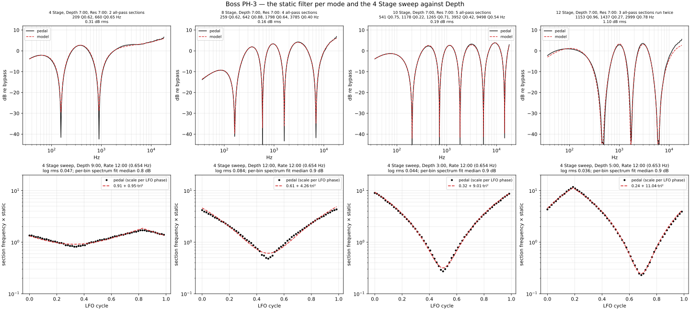
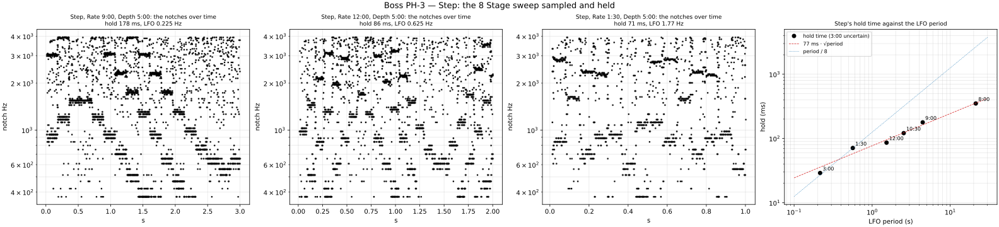
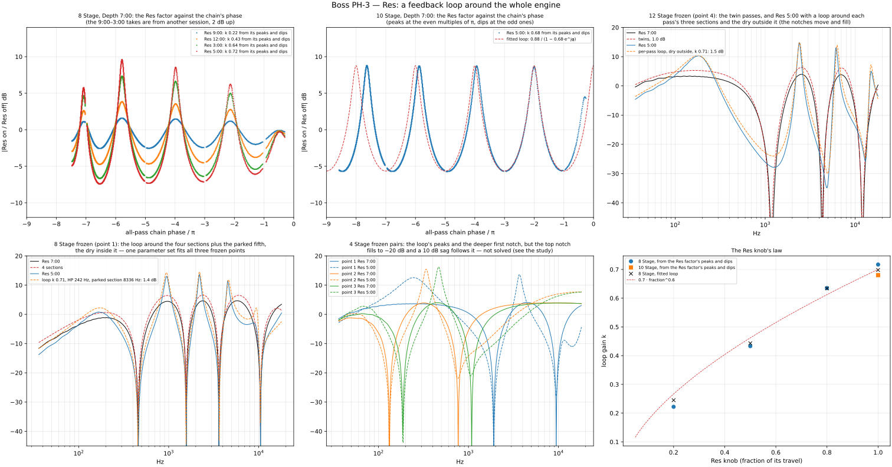

# Boss PH-3 Phase Shifter

Measured 2026-10-28 on a 9 V supply, mono (Input → Output; the PH-3 has one output):

| Session | What it gives |
|---|---|
| [`2026-10-28/`](2026-10-28/) | the Stage modes: static sweeps at Depth 7:00, Res and Depth ladders, Rate positions, bursts (`plans/ph-3.json`, 33 takes) |
| [`2026-10-28-modes/`](2026-10-28-modes/) | Step, Rise, Fall (`plans/ph-3-modes.json`, 17 takes) |
| [`2026-10-28-slow/`](2026-10-28-slow/) | Rate 7:00 for four minutes, Rate 8:00 in every mode (`plans/ph-3-slow.json`, 9 takes) |
| [`2026-10-28-followup/`](2026-10-28-followup/) | fast Rates, 8 and 10 Stage frozen at several sweep points, Rise at more Rates (`plans/ph-3-followup.json`, 14 takes) |
| [`2026-10-28-followup2/`](2026-10-28-followup2/) | Step at six Rates, 12 Stage frozen at four points, the 8 Stage Res ladder, Res off/on pairs at frozen points (`plans/ph-3-followup2.json`, 29 takes) |

Same rig and playback level as the other pedals ([`tools/capture/README.md`](../../../tools/capture/README.md)).
Analysis: `tools/capture/analyze_ph3.py <the five sessions>` →
[`2026-10-28/fit/ph-3.json`](2026-10-28/fit/ph-3.json) and the figures below. The script measures
what is cheap (responses, notches, the Res factor, the sweep's scale per LFO phase, Step's
hold, LFO rates, levels) and draws the fitted models over the measurements; the fits
themselves were done with exploratory scripts that weren't kept — how, is in each section.

The knobs: Rate, Depth, Res, and the Stage switch: 4, 8, 10, 12 Stage, Rise, Fall, Step. Clock
positions: 7:00 = fully counter-clockwise, 5:00 = fully clockwise. The user wanted every mode;
nothing was left out.

## It's digital

0.544 ms of latency, a wall just under 20 kHz, and everything fits as filters designed at
44.1 kHz. No service notes, schematic or algorithm description exists online (searched
2026-10-28: retailer copy, reviews, repair threads naming a fried IC, nothing more). One
retailer listing says the 12-stage mode "combines two six stage phasers" — the one claim
the measurements confirm.

## The static filter: dry + wet through all-pass sections

With Depth at 7:00 the sweep stops and a sine sweep reads the filter. Every Stage mode is

    out = latency · tone · (gd + gw · A)

- **tone:** a one-pole high-pass near 56–64 Hz and a first-order high shelf of about
  +3.4 dB from 12 kHz up (8 Stage fitted a 240 Hz high-pass and a +2.9 dB shelf from 6.6 kHz
  — the tone and the mix trade off against each other and the fit is not unique in that).
- **gd ≈ gw ≈ 0.68–0.76** (the mix), the same at every Depth: no feedback at Res 7:00.
- **A:** a product of RBJ second-order all-pass sections, two per "4 stages".

| Mode | Sections at Depth 7:00 (Hz, Q) | Notches (Hz) | Fit |
|---|---|---|---|
| 4 Stage | 209 Q0.62, 660 Q0.64 | 154, 895 | 0.31 dB rms |
| 8 Stage | 259 Q0.62, 642 Q0.88, 1798 Q0.64, 3785 Q0.40 | 162, 586, 1604, 6950 | 0.16 dB |
| 10 Stage | 541 Q0.75, 1178 Q0.22, 1265 Q0.71, 3952 Q0.42, 9497 Q0.54 | 202, 718, 1855, 5476, 14560 | 0.19 dB |
| 12 Stage | 1153 Q0.96, 1437 Q0.27, 2999 Q0.78 — **run twice** | 482, 1730, 5930 + 6248 | 1.10 dB |

Fitted on the magnitude (dB, clipped at −30) with many starts and differential evolution;
the section sets aren't unique (a 2nd-order all-pass at low Q spreads its phase over octaves,
so several sets give the same notches), which matters for the sweep (below).

**Level:** the output rms over a noise take, against bypass, 4 Stage at Rate 12:00: Depth 7:00
+3.1 dB, 9:00 +3.0, 12:00 +2.7, 3:00 +2.4, 5:00 +2.3 — the mix doesn't change with Depth,
the small fall is the notches sweeping through more of the band. By mode at Depth 5:00:
8 Stage +1.5, 10 Stage +0.1, 12 Stage −0.4 (more notches, less energy). Res raises it
(4 Stage Res 5:00 +4.6 dB, Rise Res 5:00 +9.0 dB).

### 12 Stage: a 6 Stage phaser run twice

One chain of six sections can't be it: its notches would be simple zeros, and the 12 Stage
notches at 482 and 1730 Hz are **double zeros** — 12 dB per halving of the distance to the
notch on each side, against 6 for every 4 and 8 Stage notch. Only a product of two
(dry + wet) phasers with coincident notches does that:

    out = latency · tone · (gd + gw · A3) · (gd′ + gw′ · A3′)

with the same three sections in both passes. Six free sections in one chain fit to 8 dB, two
free three-section chains to 3.7 dB, the twins to 1.1 dB (mix 0.68/0.62 per pass; the fitted
tone came out odd — a −1.4 dB shelf from 500 Hz — the mixes and tone trade off).

**The two passes aren't quite together.** At Depth 7:00 the top notch is a split pair (5930 and
6248 Hz). At the four frozen points of the last session, the two high in the sweep (notches
2096/7124/15886 and 1164/4362/11966 Hz) are clean double zeros and fit as identical twins
(1.0 dB: 2864 Q0.83, 3855 Q0.28, 6786 Q0.84 — though point 4's two upper notches are split
pairs 1–3 % apart, 4240/4360 and 11962/12088 Hz); the two low in the sweep (128/484/1764 and
136/516/1876) have blurred notches (slopes 8–10 dB per halving) and fit as twins only with the
second pass **detuned 10–18 % on its two lower sections** (point 1: 184/489/1095 Hz, the
second pass ×1.18/×1.10/×1.00, 0.78 dB; point 3: 231/568/1160, ×0.84/×0.91/×1.00, 0.81 dB)
— in opposite directions at the two points. That is what a second pass running on a
*delayed copy of the LFO* does: frozen on a falling ramp the second pass sits higher, on a
rising ramp lower. The lag isn't measured (the Rate before each freeze isn't known).

## The sweep

Noise takes, folded over the LFO period: each short-time response is assigned to a bin of
LFO phase and averaged (Y·X̄ and |X|² per bin, divided by the same session's bypass-noise —
without that the result sits 8 dB low, the interface gain differs from the sweep takes). The
period is the fold that explains the most variance of the frames' dB, then the shortest
submultiple that explains at least 90 % as much (a 0.03 s floor once folded Rate 5:00 as two
cycles and read 10.8 Hz for 21.5). Per bin, one scale c on every section frequency of the
static model is fitted (mix and tone fixed; medians about 1 dB).

**Shape:** c = a + b·tri², tri the LFO's triangle from 0 to 1 — a triangle beats a sine
(0.034 against 0.14 log rms). **Depth sets the swing**, in 4 Stage:

| Depth | a | b | swing |
|---|---|---|---|
| 9:00 | 0.912 | 0.947 | ×2.0 |
| 12:00 | 0.609 | 4.257 | ×8.0 |
| 3:00 | 0.316 | 9.009 | ×29 |
| 5:00 | 0.244 | 11.043 | ×46 |

**Rate** (the LFO; Rate 7:00 stops it wherever it is — four minutes without moving; 10:30 and
1:30 from the Step takes, which sweep the same way):

| Rate | 8:00 | 9:00 | 10:30 | 12:00 | 1:30 | 3:00 | ~4:00 | 5:00 |
|---|---|---|---|---|---|---|---|---|
| LFO | 0.047 Hz | 0.225 Hz | 0.394 Hz | 0.654 Hz | 1.77 Hz | 4.64 Hz | 12.1 Hz | 21.5 Hz |

Knob positions repeat to about 5 % (the last session read 0.625 Hz at 12:00 and 4.31 at 3:00;
"4:00" came back at 13.5 Hz).

**Fast Rates shrink the swing** (Depth 5:00): at ~4:00 c runs 0.725–10.4 (a 0.725, b 9.65), at
5:00 1.42–8.76 (a 1.42, b 7.34), against 0.24–11.3 at 3:00 and below. A one-pole smoothing of
the triangle doesn't explain it (0.14 log rms at best): the swing shrinks *and* its centre
rises (geometric centre 1.7 at 3:00, 2.7 at 4:00, 3.5 at 5:00), which a smoothed control
can't do. Use the measured a and b per Rate, interpolated in log Rate. At 5:00 the top is also
flattened and the rise lopsided; not modelled.

**8 and 10 Stage** sweep the same way (c 0.46–5.2 and 0.50–5.3 at Depth 5:00, ×11), but one
common scale on the Depth-7:00 sections doesn't fit their frozen sweeps: the section sets
aren't unique, and only a base fitted **jointly** to the frozen sweeps and the folded
Rate 8:00 cycle works — 8 Stage 600 Q0.66, 1025 Q0.42, 1198 Q0.36, 2697 Q0.13; 10 Stage
449 Q0.67, 936 Q1.10, 3146 Q0.89, 3775 Q0.08, 10081 Q1.11 (mix ≈ 0.86/0.75, latency
0.563 ms), complex error about 0.10, worse than 4 Stage; letting Q rise as c^0.2 helps a
little. **12 Stage** sweeps 0.32–5.1 (×16) with the shared sections; 0.13 complex error where
c > 1, 0.3–0.4 at the bottom — where the passes drift apart (above), so a twin model with
the LFO lag between the passes should fix it.

### Rise and Fall

A barber pole: **each LFO period the notch pattern slides up (Rise) or down (Fall) by one notch
spacing**, on the same Rate scale as the Stage modes —

| Rate | 8:00 | 9:00 | 12:00 | 3:00 | 5:00 |
|---|---|---|---|---|---|
| a new notch every | 21.1 s | 4.56 s | 1.53 s | 0.20 s | 0.047 s |

— the notches **1.88 octaves apart** (1.7–1.8 at Res 5:00), straight lines in log frequency.
**Depth does nothing** (7:00, 12:00 and 5:00 all give 1.23 octaves/s at Rate 12:00). Fall is
Rise reversed, at the same speed. Measured from the phase of the pattern's repeat along log
frequency, unwrapped over time (cross-correlating frames is too coarse at Rate 8:00).

### Step

**The 8 Stage sweep sampled and held:** four notches, the triangle law, the LFO's value frozen
between steps — the jumps are uniform in time and vary in size (big mid-ramp, small at the
turns), so it is a sample-and-hold of the LFO, not a quantised LFO value (the plain 4 Stage
sweep at Rate 8:00 shows no steps at all). **Depth 7:00 sits still.**

| Rate | 8:00 | 9:00 | 10:30 | 12:00 | 1:30 | 3:00 | 4:00, 5:00 |
|---|---|---|---|---|---|---|---|
| hold | ≈ 350 ms | 178 ms | 121 ms | 86 ms | 71 ms | 29 ms? | unresolved |
| steps per LFO cycle | ≈ 60 | 25 | 21 | 18.6 | 8.0 | 8.0? | |

Neither a fixed time nor a fixed count: at the slow end the hold goes roughly as
77 ms · √(period in s); at 1:30 it is exactly the LFO period / 8. The 3:00 reading is the LFO's
8th harmonic — the same thing if there really are 8 steps per cycle, an artefact if not; at
4:00 and 5:00 the steps can't be resolved and the pattern looks random, which is what
sampling a 47–74 ms triangle at a comparable hold does (and what reviews call Step's
"random" character). Interpolate the table in log Rate; the fast end needs a different
measurement (a held sine where a notch passes, so the steps show as level jumps). Measured as
the spectral line of the frame-to-frame change (mean |ΔdB| over 250–7000 Hz; the LFO's own
harmonics masked); 8:00 read off the notch track (nine plateaus in three seconds).

## Res: a feedback loop around the whole engine

**10 Stage (0.28 dB):**

    out = s · tone · (gd + gw · A) / (1 − k · z⁻¹ · HP · A)

— the feedback from the end of the chain to its input, **the dry taken inside the loop** (so the
notches stay exactly where they are: every 8 and 10 Stage notch is within 0.1 % and as deep
with Res 5:00 as without), one sample of delay and a first-order high-pass near 50 Hz (a DC
blocker) in the loop, k = 0.68 at Res 5:00, the mix scaled by s = 0.88. The sections don't
change (a common frequency scale and Q factor fitted to 0.999 and 1.00). Without the sample
of delay 2.5 dB, without the high-pass 0.8 dB.

**8 Stage** is the same loop passing a **fifth all-pass section parked at 8.3 kHz** (Q 0.6–0.9):
the engine is the 10 Stage chain, the 8 Stage wet is tapped after four sections and the
feedback comes from the end of all five. Depth 7:00: k 0.70, s 0.75, high-pass 200 Hz, no
delay, 0.77 dB (2.5 dB without the parked section). Confirmed across the sweep by the three
frozen Res off/on pairs: one shared loop (k 0.71, s 0.76, HP 242 Hz, the parked section at
8336 Hz Q0.60) fits the three Res 5:00 takes to 1.0–1.9 dB, the same as their Res 7:00 fits
— and the parked section sits at a fixed frequency, not scaled with the sweep (2.5 dB scaled).

**Reading a loop straight off a take:** the ratio Res-on / Res-off against the chain's phase φ
(from the static fit) is periodic — +9 dB at even multiples of π, −5.5 dB at odd ones, a ±45°
phase sawtooth — exactly s/(1 − k·e^{jφ}); and (1 + k)/(1 − k) = peak/dip gives k without
caring about the level. That is the first check for any Res take.

**The Res knob** (8 Stage ladder at Depth 7:00, the same loop; the parked section lands at
8.1–8.4 kHz every time):

| Res | 9:00 | 12:00 | 3:00 | 5:00 |
|---|---|---|---|---|
| k | 0.25 | 0.44 | 0.63 | 0.70 |

about 0.7 · (fraction of the knob's travel)^0.6, within ±0.02. The mix scale s is only
comparable within a session (below): the pairs give 0.75 at 5:00.

**12 Stage** (frozen point 4, 1.5 dB): the notches move up 8–11 % and fill to −25…−31 dB
(1164 → 1256, 4362 → 4838, 11966 → 13000 Hz), so here the dry sits **outside** the loop. Of
seven arrangements on the twin structure only "each pass a phaser with the loop around its own
three sections, dry outside, one sample of delay" works (k 0.71, s 0.58, HP 103 Hz; the others
3.7–8 dB; the same with the dry inside 4.8 dB). Why the dry is outside here and inside in
8/10 Stage is unexplained — the two are the same transfer function when the wet gain rises as
1 + k with Res; maybe the twice-6 block simply lacks that.

**Rise** with Res 5:00 is +9 dB louder than without: the resonance rides the barber pole. Not
modelled.

### 4 Stage Res: not solved

Well characterised, though. The frozen pairs (notches 1916/9458, 132/770, 188/1086 Hz, plus
154/895 at Depth 7:00) all show the same thing, so it is tied to the sections, not to a
fixed filter:

- the loop is there: peaks at the even multiples of the chain phase (+9 to +12 dB, k ≈ 0.72–0.78
  from them), the first notch gets *deeper* (−38 → −52 dB, as 1/(1 + k) predicts) and stays
  put (≤ 1 %);
- the **top notch loses its phase flip and fills** to −19…−26 dB, 1–2 % lower (a wide shallow
  dip; the phase makes a bump instead of jumping 180°) — its zero has left the unit circle,
  which no loop with the dry inside can do, and the first notch rules out the dry being
  outside;
- above the top notch the response **sags by up to 10 dB** at about 1.6–1.75× the notch
  (1346 Hz for 770, ~1.4 kHz for 895, ~1.9 kHz for 1086), then rises to +3–4 dB at
  10–15 kHz.

Tried on the four points jointly (shared k, s and high-pass; the sections from each point's
own Res 7:00 fit; stability checked on the closed-loop poles) and rejected: the plain loop
(3.4 dB mean), a one-sample loop delay (4.4), one or two extra all-pass sections in the loop
at fixed frequencies (3.3) or scaled with the sweep (3.3), a free biquad in the loop fixed or
scaled (2.7–3.0, the best of those with a pole outside the unit circle), the biquad in the wet
path too (2.3–2.9, unstable), the unused sections as pure delays (worse), the sections' Q or
frequency changing with Res (3.3), and a pole/zero mismatch of the top section — its all-pass
zeros no longer matching its poles, with or without the loop (2.6–2.7; of the bottom section
or both 2.8–5.1). Free fits keep asking for a sharp all-pass (Q 4–6) at 1.1–1.2× the top notch,
which only reshapes the band around the moved notch.

**For NAM-X:** use the 8/10 Stage loop with k(Res) for 4 Stage too — the peaks, the first
notch and the level are right; the pedal's filled top notch and the sag are not reproduced.
The idea left: a feedback that enters *between* the two sections with the dry taken from a
different node than the wet — enumerate the two-section topologies (injection node, source
node, dry node, wet node: 36–54 combinations, one generator with Mason's rule) against the four
points with the pole check. About two hours, odds maybe one in three; parked until the 4 Stage
Res sounds wrong by ear.

## Lessons

- **Frozen points** (Rate 7:00 after a nudge: the LFO stops wherever it is) are the way to study
  anything static along the sweep; a Res 7:00 and a Res 5:00 take at the same point give the
  Res factor directly. Frozen fits need the tone free per take (1–3 dB with session 1's tone
  held, 0.7–1.3 dB free).
- **Fit the complex response** (weighted 1/√f, many starts, differential evolution) to find
  sections; magnitude-only fits of notched responses land in local minima. But for *structure*
  questions (which loop, which filter) a dB fit clipped at −30 dB with the sections held is far
  more robust: every free complex fit of a Res take wandered into degenerate sections.
- **Check a loop on its closed-loop poles**, not its open-loop gain: a loop gain above 1 is
  fine where the loop phase is near π (it is what makes a deep sag); only the zero-phase
  crossings must stay below 1. A fit with a pole outside the unit circle means nothing.
- **Notch order:** the slope of dB against log|f − f0| on each side — 6 dB per halving of the
  distance is a simple zero, 12 a double one. It is what gave 12 Stage away.
- **Fold slow takes** (Rate 8:00) when fitting a static model per bin: at Rate 12:00 with 16
  bins the sweep moves too much within a bin and the notches smear (3–7 dB per bin even with
  Res off). Remove the 0.544 ms latency before unwrapping phase, or the unwrap invents a filter.
- **Sessions differ in level:** the last session's bypass-sweep sits 3 dB below session 1's
  while the pedal-on takes don't, so a mix fitted to its takes comes out ≈ 1.0 instead of 0.7.
  Compare levels only within a session; the ratio to bypass is fine for shapes.
- **Step's hold** from the change signal's spectral line works where the LFO's harmonics don't
  land on it (9:00 to 1:30); peak-picking the change signal reads noise at the slow end, the
  notch track is the fallback there.

## Open

1. **4 Stage Res** (above).
2. **Step's hold at Rate 3:00 and up** (a sine-based take), and whether eight steps per cycle is
   a real lock at fast Rates.
3. **12 Stage's second pass:** the LFO lag between the passes (frozen pairs at a known Rate
   before the freeze, or two sweeping takes and the fold).
4. **Res in Rise** (needs an idea: the pattern never stops) and **Res and distortion**
   (reviews say more Res = more distortion; `s4-bursts-res-0500` against `s4-bursts` is there,
   not analysed).
5. **Fast-Rate swing** stays a table.

For NAM-X: low priority — its Phaser (the Phase 90 circuit) is approved by ear. If a PH-3 type
is ever wanted, the pieces are here: the sections per mode, the triangle² sweep with Depth's
a/b table and the Rate table, the barber pole for Rise/Fall, the sample-and-hold for Step, the
loop for Res with k(Res), and the twin passes for 12 Stage.
