# Boss RV-6 Reverb

Recorded and analysed 2026-10-31 (two sessions) and 2026-11-01 (Shimmer). Modes (user): **Modulate, Spring, Plate,
Hall, Room, Shimmer**, in the Mode knob's order; Dynamic and +Delay left out. Knobs: Level,
Tone, Time, Mode. 9 V adapter, **stereo**: Input A → Outputs A and B; Input B and EXP empty.

| Session | Plan | What it gives |
|---|---|---|
| [`2026-10-31/`](2026-10-31/) | [`rv-6.json`](../../../tools/capture/plans/rv-6.json) | 39 takes, 8.7 min: bypass (sweep, burst, plucks); per mode at noon a 50 ms noise burst (−12 dB), a −24 dB sweep and plucks, then bursts at Time 7:00 and 5:00 (tails 4 / 8 / 15 s); Tone 7:00/5:00 bursts in Spring and Hall; Level 7:00/5:00 sweeps in Hall |
| [`2026-10-31-followup/`](2026-10-31-followup/) | [`rv-6-followup.json`](../../../tools/capture/plans/rv-6-followup.json) | 31 takes, 9.7 min: sweeps at Time 7:00/9:00/3:00/5:00 in Spring, Plate, Hall, Room; Hall sweeps at Tone 7:00/9:00/3:00/5:00 and Level 9:00/3:00; held 1 kHz tones (Modulate, Hall, Shimmer) and 250 Hz (Modulate) at Level 5:00; Time 9:00/3:00 bursts in Modulate and Shimmer; a bypass sweep |
| [`2026-11-01-shimmer/`](2026-11-01-shimmer/) | [`rv-6-shimmer.json`](../../../tools/capture/plans/rv-6-shimmer.json) | 19 takes, 8.1 min, the marker on the loopback only: 4 s held notes from silence in Shimmer (the low E and its octaves to 2.6 kHz; 330 Hz also quieter, louder, at Tone, Time and Level ends), Modulate on 82 and 330 Hz, a fifth, an open E chord, two plucks; a bypass sweep ([The Shimmer session](#the-shimmer-session-2026-11-01)) |

Analysis: [`analyze_rv6.py`](../../../tools/capture/analyze_rv6.py) →
[`2026-10-31/fit/rv-6.json`](2026-10-31/fit/rv-6.json) and
[`2026-10-31-followup/fit/rv-6-followup.json`](2026-10-31-followup/fit/rv-6-followup.json),
and the nine figures below (3.5 min).

```sh
python -I tools/capture/analyze_rv6.py captures/boss/rv-6/2026-10-31 \
  --audio-source "$RV6_AUDIO" --namx-render ./render_reverb \
  --followup captures/boss/rv-6/2026-10-31-followup --followup-audio "$RV6_FOLLOWUP_AUDIO"
```

The audio folders hold the WAVs (only read); `--namx-render` is
[`render_reverb.cpp`](../../../tools/capture/render_reverb.cpp) built against NAM-X (the
command is in its header) — without it the comparison with NAM-X is skipped;
`--followup-only` skips the first session's own report. The Shimmer session is measured
alone (30 s), into
[`2026-11-01-shimmer/fit/rv-6-shimmer.json`](2026-11-01-shimmer/fit/rv-6-shimmer.json) and
three figures:

```sh
python -I tools/capture/analyze_rv6.py --shimmer captures/boss/rv-6/2026-11-01-shimmer \
  --shimmer-audio "$RV6_SHIMMER_AUDIO"
```

## Summary

The dry is the analog bypass path: unity gain, no delay. The wet is digital and added to
it. **Level** is the wet's gain, as the knob's square; **Tone** a tilt on the wet only
(bass up and treble down, or the reverse), outside the tank; **Time** the tank's decay —
hardly anything from 7:00 to 9:00, most of the range from 9:00 to 3:00 — **with the wet's
total energy held constant**. Room, Hall, Plate and Spring are time-invariant (a measured
impulse response *is* the mode at that setting, and repeats across sessions), and Time
leaves their first 100–250 ms unchanged but for a gain. Modulate is a tank modulated by
one LFO at 1.35 Hz (±0.45 ms); Shimmer the same kind of tank with octave-up feedback.

| at noon | Room | Hall | Plate | Spring | Modulate | Shimmer |
|---|---:|---:|---:|---:|---:|---:|
| time-invariant | yes | yes | yes | yes | no (> 250 Hz) | no |
| wet onset A / B, ms (−20 dB re its peak) | 58 / 61 | 26 / 42 | 57 / 62 | 75 (first) / 75 | 22 / 23 | — |
| wet peak A / B, ms | 71 / 76 | 245 / 240 | 121 / 132 | 91 / 99 | 151 / 155 | — |
| RT60 at 125 / 1k / 8k Hz, s | 1.52 / 1.26 / 1.01 | 4.91 / 3.69 / 2.85 | 3.13 / 2.97 / 2.59 | 0.87 / 2.72 / 0.91 | 4.99 / 5.26 / 2.91 | — |
| RT60 at 1 kHz, Time 7:00 / 9:00 / noon / 3:00 / 5:00, s | 0.38 / 0.41 / 1.26 / 3.30 / 5.08 | 0.60 / 0.70 / 3.69 / 6.74 / 9.62 | 0.66 / 0.72 / 2.97 / 7.14 / 11.08 | 1.14 / 1.21 / 2.72 / 5.18 / 6.74 | 0.82 / 1.02 / 5.31 / 9.39 / 13.53 | 2.68 / 2.88 / 8.51 / 11.83 / 14.88 |
| wet energy re the dry, dB | −16.0 | −21.1 | −16.7 | −22.8 | −14.8 | −23.1 |
| wet spectrum at 125 Hz / 8 kHz re 1 kHz, dB | −9 / +3 | −8 / 0 | −21 / +6 | −14 / −28 | −9 / −1 | — |
| A/B coherence (250 Hz–8 kHz) | ~0 | ~0 | ~0 | ~0.45 | ~0 | ~0 |
| echo density (normalized) 50 / 200 ms after onset | 0.75 / 0.99 | 0.58 / 0.65 | 0.75 / 0.90 | 0.39 / 0.85 (chirps) | 0.94 / 0.96 | — |

Modulate's and Shimmer's RT60s at noon come from a time-variant system's sweep (an
average), across Time from the bursts (0.5–4 kHz). Shimmer's decay isn't a single RT60:
octaves regenerate (below).

## The recordings

- **Three channels per WAV:** Output A (input 2), the loopback (input 5), Output B
  (input 1) — `capture.py`'s `pedal_in_b` (tools/capture/README.md → Stereo pedals).
- **Input 1 against input 2:** on a 5 s noise test (pedal bypassed, cable still) B read
  +0.03 dB re A from 40 Hz to 6 kHz, 0.00 at 12–18 kHz, coherence 1.0000, 0 samples
  apart; over the bypass takes B − A is −42 to −50 dB. The two inputs are treated as
  identical, and each channel is still divided by its own bypass.
- **Cables:** both crackle when moved (a wiggle test, before the first session); the user
  kept them still. A scan of every take of both sessions found no click and no
  one-channel dropout.
- **First session** (`audit`): all 39 played files match their hashes, no xruns, no slip
  (the loopback reads 0 or 1 sample off the marker's latency all through every take). One
  take was redone during the run (the log keeps both attempts; the WAV is the second).
- **Follow-up** (`audit` in its JSON): hashes match, no xruns; **four takes slipped** — the
  recording jumped 47–48 samples mid-take, all channels together, with no xrun reported
  (PipeWire): `bypass-sweep` (between 3 and 7 s), `hall-sweep-time-0300` (~2.9 s, the sweep
  at 82 Hz), `hall-sweep-tone-0700` (~2.4 s, 58 Hz), `room-sweep-time-0700` (~9 s, 5.5 kHz).
  Over the loopback, which slips with the pedal channels, only the tail of what was played
  just before the slip can be off. Checked rather than redone: the follow-up's sweeps
  predict the first session's bursts at the same settings to −28…−40 dB broadband (−24…−41
  per band), the slipped ones as well as the clean ones (`first_bursts_from_these_sweeps`), and the
  two sessions' dry paths agree to −70 dB. One take was redone during the run.

## Method

Every response is a pedal channel over the loopback; the interface's own response and
each take's latency rounding cancel in that ratio. The marker chirp (0 dB, 200 Hz–10 kHz,
0.55 s before the signal) plays through the reverb too, and at Time noon or 5:00 its tail
is still loud when the signal starts:

- a **burst take** (time-invariant modes) is deconvolved across the **whole take**: its own
  50 ms burst is weak, and the marker is most of its excitation. A first pass that cut the
  takes at the signal's start read the marker's tail as part of the burst's response and
  showed every mode's "mids" (the marker's band) as changing between takes;
- a **sweep** is deconvolved from the signal on: its own energy dwarfs the marker's tail,
  and two excitations leave ghosts at multiples of the marker-to-sweep delay (6–7 s at
  1–2 kHz), which the 5:00 tails run into (Hall's 2 kHz octave read 11.7 s instead of 8.3);
- Modulate and Shimmer are always deconvolved from the signal on: their marker tail is
  another instance of a moving reverb.

The wet is that response over the **dry path** (the bypass take's response, windowed to
−2…+8 ms so it carries no noise) minus one, tapered to 40 Hz–16 kHz (the sweeps cover
20 Hz–20 kHz; outside it the division blows up).

RT60: octave bands, Schroeder integration with the noise floor subtracted, −5 to −35 dB
(T30). Before it, **2.85–3.1 kHz is notched out**: the pedal's digital side whines there
(2.9–3.05 kHz, ~50 dB under the wet, in surges every few seconds, in the bypass too); it
deconvolves into every IR all along, and through the octave filters' skirts its surges
read as late "tail" in the 1, 2 and 4 kHz bands (the 4 kHz octave had read 16–46 s). Burst
takes excite 200 Hz–10 kHz well, but below 500 Hz and above 4 kHz the tail sinks into the
hum within ~40 dB, so decay from bursts is reported for **500 Hz–4 kHz only**.

## Dry path and Level

Level 7:00 is the bypass: the two takes differ by −64 dB re the signal (the noise), the
response is within ±0.03 dB of the bypass from 50 Hz to 15 kHz (1st–99th percentile),
and no wet comes out (−121 dBFS per sample from 0.1 to 2 s). So the dry is the analog
bypass buffer, at unity and with no delay, in every mode; the RV-6 adds its wet to it.

Level is a pure gain on the wet, the same in every octave (125 Hz / 1 kHz / 8 kHz within
0.05 dB). Hall's wet energy re the dry:

| Level | 7:00 | 9:00 | 12:00 | 3:00 | 5:00 |
|---|---:|---:|---:|---:|---:|
| wet energy, dB | off (−53, the floor) | −34.2 | −21.1 | −13.4 | −9.1 |
| re noon, dB | — | −13.1 | 0 | +7.8 | +12.0 |
| (knob fraction)², dB re noon | — | −15.9 | 0 | +8.2 | +12.0 |

Close to a **square law** (gain = Gmax · x², x = 0 at 7:00, 1 at 5:00): noon, 3:00 and 5:00
fit it to 0.4 dB; 9:00 reads 2.8 dB above it (set by eye; a pointer at ~9:20 would match it).

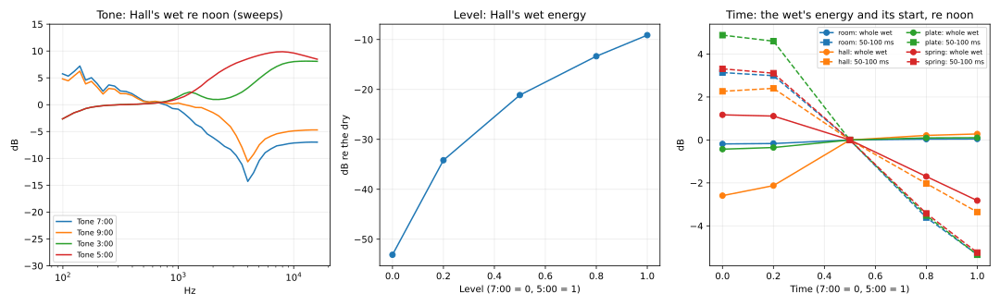

## Time-invariance

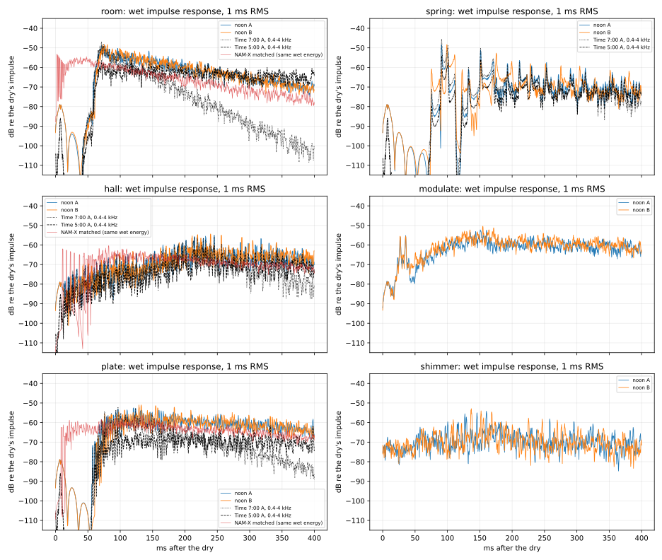

Each burst take, predicted from its loopback through the same mode's sweep response
(another take), against what was recorded, 70–400 ms (`invariance`):

| | Room | Hall | Plate | Spring | Modulate | Shimmer |
|---|---:|---:|---:|---:|---:|---:|
| residual, dB | −38.8 | −37.2 | −36.7 | −37.0 | +3.3 | +0.2 |
| correlation per third-octave | 1.00 at every band | 1.00 | 1.00 | 1.00 (0.95 at 10 kHz) | 1.0 to 160 Hz, ~0 from 400 Hz | 1.0 to 100 Hz, ~0 from 1 kHz |

Room, Hall, Plate and Spring are linear and time-invariant: no modulation in the tank —
and the follow-up's sweeps predict the first session's bursts as well (above), so the
modes repeat across sessions too. (Room's later window, 0.6–1.5 s, reads −15 dB only
because its tail is down at −90 dBFS there.) Modulate and Shimmer change from take to take
above a few hundred hertz — the modulation below.

## Decay and Time

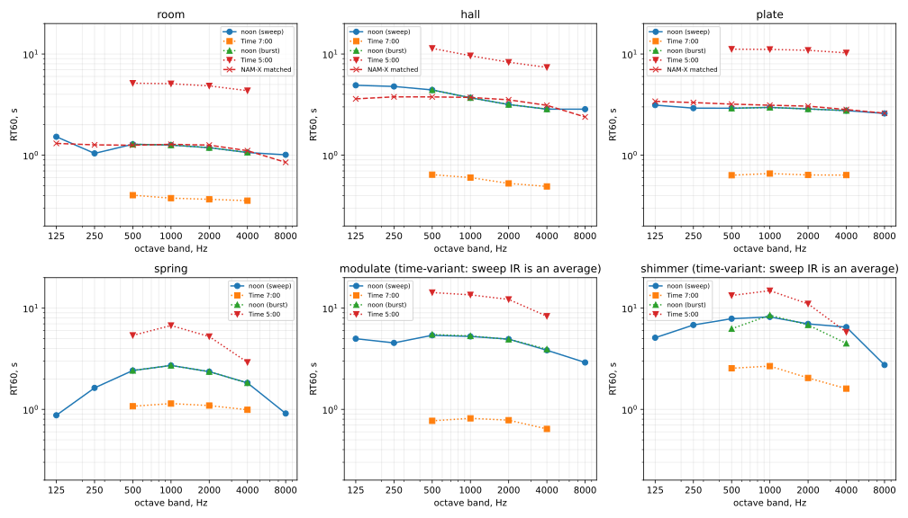

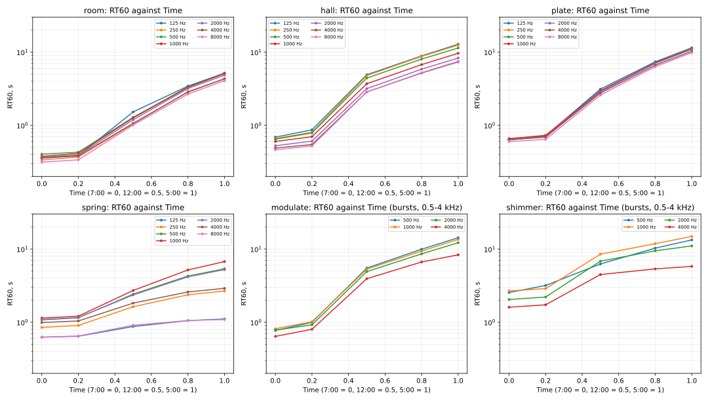

- **Frequency shape at noon:** Room flat (1.0–1.5 s), Plate flat (2.6–3.1 s), Hall
  longer in the bass (125 Hz 4.9 s, 1 kHz 3.7 s, 8 kHz 2.9 s), Spring a hump (0.87 s at
  125 Hz, 2.7 s at 1 kHz, 0.91 s at 8 kHz), Modulate ~5.3 s falling to 2.9 s at 8 kHz.
- **The shape holds across Time:** Hall's 125 Hz / 1 kHz ratio is 1.15 / 1.24 / 1.33 /
  1.31 / 1.33 from 7:00 to 5:00 and its 8 kHz / 1 kHz 0.77 / 0.74 / 0.77 / 0.78 / 0.78;
  Room's 8 kHz / 1 kHz 0.80–0.83, Plate's 0.87–0.91. **Spring's band edges don't follow:**
  its 125 Hz and 8 kHz decay stay at 0.6–1.1 s while 1 kHz goes from 1.1 to 6.7 s.
- **The law, five points** (1 kHz, table above): 7:00 → 9:00 barely moves (×1.05–1.25), 9:00
  → noon does most (×2.2–5.3), noon → 3:00 ×1.4–2.6, 3:00 → 5:00 ×1.25–1.55. The same in all
  six modes (so the knob's taper, not a setting by eye). For a model, interpolate log RT60
  between the five points; Spring's 125 Hz and 8 kHz by their own rows (`time_law`).
- **The start doesn't move:** onsets are the same at every Time (Room 58 ms, Plate 60,
  Hall 26, Spring 89 on A), and the first 100 ms is the *same waveform* (correlation
  0.99–1.00 at 50–100 ms), only louder below noon and quieter above (50–100 ms re noon,
  7:00 / 9:00 / 3:00 / 5:00): Room +3.1 / +3.0 / −3.6 / −5.3 dB, Hall +2.3 / +2.4 / −2.0 /
  −3.4, Plate +4.9 / +4.6 / −3.5 / −5.3, Spring +3.3 / +3.1 / −3.4 / −5.2.
- **The wet's energy stays put:** the whole response's energy re noon at the same four
  positions: Room −0.2 / −0.2 / 0.0 / 0.0 dB, Plate −0.4 / −0.4 / +0.1 / +0.1, Hall −2.6 /
  −2.1 / +0.2 / +0.3, Spring +1.2 / +1.1 / −1.7 / −2.8. Time sets the tank's feedback and
  scales the wet to keep its energy: a longer tail starts quieter. (In NAM-X's Reverb the
  wet's energy grows with Decay; its trims level the types at one decay.)

## Character: stereo, density, spectrum

- **Stereo:** A and B are decorrelated tails (coherence within ±0.1 above 250 Hz from the
  onset on) at matched levels (±0.6 dB), in every mode but Spring, where they are
  half-correlated (~0.45 at every band) — one tank heard at two pickups. The onsets differ
  per side (Hall 26/42 ms, Plate 57/62, Room 58/61).
- **Build-up:** Room and Plate start abruptly at ~58 ms and are dense within ~100–150 ms;
  Hall rises slowly from 26 ms to its peak at ~245 ms and stays sparse (normalized echo
  density 0.6–0.7) for 200 ms — a granular swell, not a wall; Modulate starts at 22 ms
  with a few discrete early reflections (27, 35 ms) and is dense by 50 ms.
- **Spectrum** of the first 2 s (1/3 octave, re 1 kHz): Room, Hall, Modulate roll off below
  500 Hz (−8/−9 dB at 125 Hz) and are flat to slightly bright above; Plate cuts the bass
  hard (−21 dB at 125 Hz, −13 at 250) and rises on top (+6 at 8 kHz, +8 at 12.5 kHz);
  Spring is a band, 125 Hz–4 kHz (−28 dB at 8 kHz).

## Tone

The same filter in Hall and Spring, on the wet only and outside the tank: the early part
and the tail change alike, and the RT60s don't move (Hall 4 kHz 2.83 / 2.86 / 2.86 s at
7:00 / noon / 5:00). Hall's wet re noon from the follow-up's sweeps (1/6 octave, A/B mean,
`tone_law`), dB:

| Tone | 100 Hz | 140 Hz | 280 Hz | 560 Hz | 1.1 kHz | 2.2 kHz | 3.2 kHz | 4.5 kHz | 6.3 kHz | 9 kHz | 12.7 kHz |
|---|---:|---:|---:|---:|---:|---:|---:|---:|---:|---:|---:|
| 7:00 | +5.8 | +7.2 | +3.5 | +0.5 | −1.6 | −6.9 | −9.5 | −12.7 | −8.2 | −7.3 | −7.0 |
| 9:00 | +4.8 | +6.2 | +2.9 | +0.5 | 0.0 | −2.1 | −5.8 | −9.2 | −5.8 | −5.0 | −4.7 |
| 3:00 | −2.6 | −1.1 | 0.0 | +0.2 | +2.1 | +1.0 | +1.8 | +4.0 | +6.5 | +7.9 | +8.1 |
| 5:00 | −2.6 | −1.1 | −0.1 | +0.2 | +1.5 | +6.0 | +7.8 | +8.9 | +9.7 | +9.8 | +9.1 |

A tilt around ~600 Hz: below noon the bass comes up (+4…+7 dB under 200 Hz) and the treble
goes down with a dip near 4 kHz (−13…−14 dB at 7:00) that recovers to −7 dB above 6 kHz; above
noon the deep bass comes down 2.6 dB and a shelf rises to +9–10 dB from 4.5 kHz. 3:00 isn't
halfway to 5:00: a small bump at 1.1 kHz, a plateau to 3 kHz, then the shelf. The first
session's burst curves (Hall and Spring, 1–4.5 kHz) agree with these to ~1 dB.

## Spring

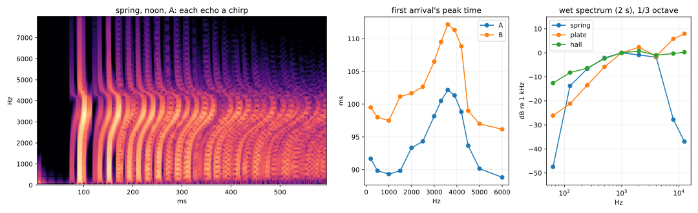

A spring-tank model: every echo is a dispersive chirp. The first arrival's peak time
(`spring.first_arrival_ms`) is ~89 ms at 1 kHz on A, rises to ~102 ms at 3.6 kHz and falls
back to ~89 ms above 4.5 kHz — the group-delay peak of a spring's transition frequency,
near **3.7 kHz** (B: 97 → 112 → 96 ms). Before that main arrival a weaker one comes at
75 ms. The echoes repeat at ~41.5 / 60 / 79 ms on A and ~23.6 / 53 / 77 ms on B (envelope
autocorrelation, the same at 300 Hz–1 kHz and 1–2 kHz): more than one spring, mixed
differently per output. The wet is a band, 125 Hz–4 kHz, whose edges decay in ~1 s at any
Time.

## Modulate

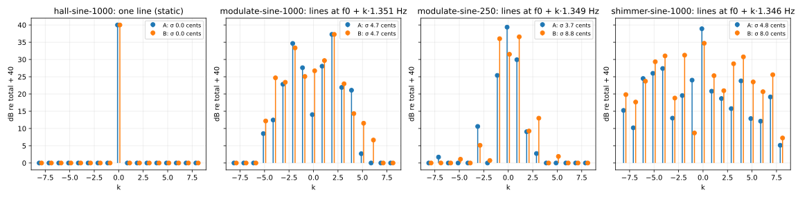

The held tones (Level 5:00, the dry cancelled) show the modulation directly
(`modulation`). Hall's wet is one line at exactly 1 kHz (0.00 cents). Modulate's is a
comb of lines at 1 kHz ± k × **1.349 Hz** (1.349–1.351 Hz on both outputs and both tones):
one LFO, period 741 ms. At 1 kHz the carrier itself is nearly gone (−26 dB A, −13 dB B)
and the k = ±2 lines (±2.7 Hz) are the strongest — a deep modulation; at 250 Hz the
carrier dominates (A) with k = ±1 at −10…−15 dB. RMS frequency deviation (from the lines'
second moment): **4.7 cents at 1 kHz** on both outputs, 3.7 (A) / 8.8 (B) cents at 250 Hz —
about the same in cents at both frequencies, so a **modulated delay**, not a frequency
shift: for a sinusoidal LFO, **±0.45 ms** at 1 kHz (0.36 / 0.85 ms at 250 Hz). The wet is a
sum of many paths, so the folded pitch has no clean waveform; the lines are the robust
measure. Decay: 0.8 / 1.0 / 5.3 / 9.4 / 13.5 s at 1 kHz from 7:00 to 5:00; A and B
decorrelated; onset 22 ms.

## Shimmer

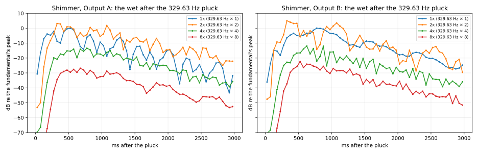

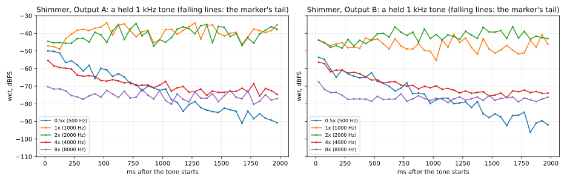

A feedback shimmer on a modulated tank. **The same LFO as Modulate's** runs through it
(lines at 1 kHz ± k × 1.346 Hz; 4.8 cents RMS on A, 8.1 on B). After the 329.63 Hz pluck
the wet carries the **octave up at the fundamental's own level** within ~300 ms, then
outlasts it (3 s after the pluck: the fundamental −32 dB, the octave −22 dB, A); two
octaves up settles at about −15 dB and three octaves at about −28 dB, each ~50–100 ms
later than the one below — every pass through the shifter loses ~14 dB and goes back into
the tank. On the held 1 kHz tone, steady state (3–10 s): the octave at −0.8 dB re the
fundamental on A and +6.0 dB on B, two octaves up −35 dB, three −38 dB (A; −28 / −31 on
B: the passes lose more above 2 kHz), no octave down (500 Hz at the noise). After the tone stops the octave again
outlasts the fundamental (A, 1.5 s later: 1 kHz −78 dBFS, 2 kHz −58). The tone's first
~0.6 s is masked by the marker's shimmered tail, so the build-up timing comes from the
plucks. Decay at 1 kHz: 2.7 / 2.9 / 8.5 / 11.8 / 14.9 s from 7:00 to 5:00.

The Shimmer session settles its structure: **Tone** sets the octave, fed forward from the
note and climbing through the tank's recirculation (7:00: no octave at all); the tails fall
fast, then linger; see [The Shimmer session](#the-shimmer-session-2026-11-01).

## Against NAM-X's Reverb

NAM-X's Plate, Hall and Room rendered with
[`render_reverb`](../../../tools/capture/render_reverb.cpp) (wet only, Mix 100 %), Decay set
to the pedal's RT60 at 1 kHz, Damping to its 8 kHz/1 kHz ratio (`namx_matched`):

| | RV-6 Room | NAM-X Room 47.5 % / 0 | RV-6 Plate | NAM-X Plate 69.1 % / 20 | RV-6 Hall | NAM-X Hall 74.6 % / 0 |
|---|---:|---:|---:|---:|---:|---:|
| RT60 125 / 1k / 8k Hz, s | 1.52 / 1.26 / 1.01 | 1.31 / 1.28 / 0.85 | 3.13 / 2.97 / 2.59 | 3.41 / 3.12 / 2.60 | 4.91 / 3.69 / 2.85 | 3.60 / 3.72 / 2.39 |
| onset / peak, ms | 58 / 71 | 2 / 3 | 57 / 121 | 8 / 135 | 26 / 245 | 10 / 82 |
| echo density 50 ms after onset | 0.75 | 0.99 | 0.75 | 0.82 | 0.58 | 0.57 |
| spectrum 125 Hz / 8 kHz re 1 kHz, dB | −9 / +3 | −11 / +6 | −21 / +6 | −12 / +7 | −8 / 0 | −8 / +7 |
| wet energy, dB | −16.0 (re the dry) | −3.9 (Mix 100 %) | −16.7 | −3.9 | −21.1 | +1.7 |

Per mode:

- **Room → NAM-X's Room, voiced:** the decay fits (its top octave dies a little faster
  even at Damping 0); it needs ~58 ms of pre-delay and is ~3 dB too bright at 8 kHz.
- **Plate → NAM-X's Plate, voiced:** the decay fits at Damping ~20; it needs ~50 ms of
  pre-delay (NAM-X's starts at 8 ms) and a much steeper bass cut than the Low Cut's
  6 dB/oct (−21 dB at 125 Hz).
- **Hall → measured early part + a fitted tail:** NAM-X's Hall peaks at 82 ms with
  discrete early reflections; the RV-6's swells slowly to 245 ms, holds its bass longer
  (no low-frequency decay control in NAM-X's FDN) and is darker on top. Since Time
  doesn't change the first ~250 ms but for a gain, a fixed measured head (a short
  convolution) joined to an FDN tail with a bass multiplier fits the pedal's own design.
- **Spring → a new algorithm** (dispersive all-pass chains, two or three springs with
  the measured repeats and transition frequency, band edges with their own fixed decay),
  or convolution with measured IRs — it is time-invariant, and the five Time positions
  are measured, but its tail is up to ~7 s long.
- **Modulate → a modulated FDN**: one 1.35 Hz LFO, ±0.45 ms on the lines, onset 22 ms with
  a few early reflections, RT60 ~5.3 s at noon (NAM-X's Hall modulates each line at its own
  rate, 0.31–1.2 Hz, ±0.3 ms).
- **Shimmer → NAM-X's Shimmer** does the same thing (octave-up feedback through
  `StretchShifter`), on the Modulate tank; the pedal's levels (the octave at the
  fundamental's level, ~14 dB lost per pass below 2 kHz, more above) give a target.
  (The Shimmer session refines this: Tone sets the octave, the recirculated share is taken
  from the loop, the tails have two slopes, and the shifter's latency in the loop matters.)

A NAM-X **RV-6 Type** needs the pedal's frame, unlike the Reverb's Mix: the dry
always at unity, Level = the wet's gain (x², 7:00 = off, noon = −12 dB re 5:00), Tone = one
post tilt filter for all modes (the table above) but Shimmer, where it sets the octaves (the
Shimmer session; whether it also tilts there is unmeasured), Time = decay by the five-point law with
the wet's energy held constant. That is what the RV-6 types do (next section).

## In NAM-X

All six modes are Reverb types (branch `dsp/reverb-rv6`, 2026-10-31): Type = Modulate | Spring
| Plate | Hall | Room | Shimmer (preset key `reverb/type`, 3–8). Since 2026-11-03 they are the
only reverb in NAM-X: the classic Plate, Hall and Room (types 0–2, which an old preset's
type now loads as the RV-6's Plate, Hall and Room) are gone, with their Width, Pre-delay and
its Sync, the cuts and Shimmer. The user, 2026-11-03: "despite not being 100 % accurate, all
effects sound very good". The knobs take the pedal's names and clock positions: **Mix =
Level, Decay = Time, Damping = Tone** (0–100 % = 7:00–5:00; no new preset keys). The engine
is [`src/dsp/Rv6Reverb.h`](../../../src/dsp/Rv6Reverb.h):

- **The frame** (every mode): the dry untouched; the wet × Level² × the mode's gain; Tone
  (but in Shimmer, where it sets the octave) a low shelf, a peak and a high shelf whose gains are interpolated between the five measured
  positions (0.7 dB rms from Hall's four Tone sweeps); Time the five-point law, the wet
  scaled by √(RT60 at noon / RT60) and a fitted correction so its energy follows the
  pedal's. A mono output sums A and B at equal power.
- **Room, Hall, Plate, Modulate, Shimmer:** 16-line feedback delay networks (Hadamard
  feedback, a low/mid/high loss per line from the RT60 at 1 kHz and the pedal's ratios),
  input taps for the start (Room 47 ms, Plate 41 ms and Hall 26 ms into the tank, plus the
  tank's own delay; Modulate first echoes at 27 and 35 ms), an input sign pattern that
  reaches the outputs on the first pass (a Hadamard row there cancelled and built the tail
  ~60 ms late). Static except Modulate and Shimmer: one 1.35 Hz LFO, ±0.2 ms per line (5.0 /
  6.0 cents RMS at 1 kHz against the pedal's 4.7 / 4.7). Room and Hall add a second, slower
  tank, Room and Modulate a band of their own in the loss (below).
- **Room, Hall, Plate, Spring: the pedal's own start** (2026-11-01, after "I don't hear them
  that different" in live play — the tanks matched the decays, levels and colours but not
  the first few hundred milliseconds, where most of each mode's character is): the pedal's
  measured wet at noon over its first 350 / 450 / 450 / 800 ms (from 10 ms before its onset,
  faded out over the last 30 ms; [`Rv6EarlyData.h`](../../../src/dsp/Rv6EarlyData.h), from
  the sweeps by [`rv6_early.py`](../../../tools/capture/rv6_early.py)) is played by
  convolution ([`Rv6Early.h`](../../../src/dsp/Rv6Early.h): uniformly partitioned, 256-sample
  blocks, no added latency — the wet starts tens of milliseconds in) less the tank's (the
  spring's) own response over the same window, rendered at the engine's rate in
  `prepare()`: tank plus kernel is the pedal there, the tank alone carries the tail after,
  and the mode's EQ and gain move only that tail. Time reshapes the kernel by partition,
  exp(−Δα (t − t₀)) with Δα the tank's decay rate at that Time less noon's, and a level per
  Time position on top (Hall's swell keeps its level while its tank shortens: −9.4 dB at
  7:00 against the wet's own Time gain); t₀ and the levels are fitted on the follow-up's
  sweeps at the other four Time positions. Against those, the envelope (10 ms steps) is
  within 0.6–2.7 dB everywhere, where the tanks alone were 1.2–10.5 dB off; the waveform
  over the window correlates 0.93–1.00 with the pedal's (Hall at 7:00 / 9:00: 0.65 / 0.72),
  0.0 before. Spring's start runs to 800 ms: at 450 its one-spring tail took over loud and
  died fast where the pedal's bends (its early decay 14 % long; now 2 %). Hall's 18-tap swell
  and 16 direct echoes are gone (one tap; the swell is the kernel's). 44.1 and 96 kHz give the
  48 kHz response (correlation 0.99+); `prepare()` takes ~20 ms at 48 kHz, ~100 at 96 (the
  kernels resampled).
- **The tails' shape** (2026-11-01, Room, Hall, Modulate; `DecayShape`, fitted by
  [`fit_rv6_decay.py`](../../../tools/capture/fit_rv6_decay.py)): the pedal's decays bend —
  per octave each 10 dB takes longer than the last (at 1 kHz, the first 10 dB to the 50–60 dB
  down: Plate 2.63 → 3.23 s as RT60s, Hall 3.27 → 4.38, Room 1.07 → 1.38, at every Time
  position the noise allows, 7:00 to 3:00), where one tank decays in a line; and Room's and
  Modulate's lows die sooner around 200 Hz than at 125 or 500 Hz. A second, slower tank (lines
  ×1.13) under the first makes the bend — Hall's RT ×1.39 at −2.6 dB, Room's ×1.16 at −19 dB
  (Modulate found no use for one) —, the tank's own low and
  high RT ratios are rescaled, and a broad band of its own shortens Room's 200 Hz (×0.58) and
  Modulate's 200 Hz (×0.72) region. Fitted on the octave bands' Schroeder curves (the energy
  left after each moment — the decay a held, broadband sound shows once it stops) from the
  measured start's end over the next 40 dB, the pedal's noise taken off, at every Time
  position the sweeps have (Modulate: noon; its bursts don't deconvolve, the tank moves).
  Per band mostly 0.2–1.0 dB rms at noon, 3:00 and 5:00 (Room's 250 Hz ~2, Hall at 9:00
  1–2), from up to 3 dB with one tank. Held notes — the tails of 600+ sines from 80 Hz to 1.5 kHz held
  and stopped, from the IRs — die as the pedal's: the median and the 10–90 % spread 0.5, 1
  and 2 s after the stop within ~1.5 dB (Room, Hall, Plate; the version before the measured
  starts left them 2–3 dB too slow in Hall and Plate). The plucks' four notes are pure sines,
  each a sample of a few modes: NAM-X and the pedal differ by up to ±5–10 dB note by note,
  either way, whatever the fit — reported, not fitted (a fit that weighed them put a narrow
  dip on each note). Plate keeps one tank: its slower one (×1.24 at +0.8 dB, fitted on the
  held notes as well) matched the curves but left 7:00 and 9:00 worse (its measured start
  takes the tanks off as they are at noon, and the pedal's Plate decays straight there) and
  the held notes 2 dB fast 2 s after the stop; with its tail's level fitted on the tail
  instead, its early decay matched without it.
- **Spring:** three loops of 24 stretched first-order all-passes (K = 7 at 48 kHz: the
  group delay peaks at 3.43 kHz) and a delay, a one-pole band in each loop (the edges'
  short decay); A mostly the 40 ms loop, B the 46 ms one after the 23 ms one. First
  arrival at 1 kHz → 3.6 kHz: A 90.0 → 102.8 ms, B 99.3 → 108.8 ms (pedal 89.3 → 102.2,
  97.5 → 112.2); A/B coherence 0.40 / 0.47 / 0.46 at 250 Hz / 1 kHz / 4 kHz (pedal 0.34 /
  0.47 / 0.45).
- **Shimmer** (its constants refitted 2026-11-17 with the focused session's bursts and stabs among
  the targets: the numbers in this paragraph are the fit of 2026-11-01, the new ones in
  [Shimmer refitted](#shimmer-refitted-2026-11-17-bursts-and-stabs-beside-the-held-notes);
  rebuilt 2026-11-01 on the Shimmer session, refitted the same day after
  listening; the first version shifted the input forward ×2.0 and added a weak feedback,
  Tone a tilt): Tone sets the octave (7:00 none), which enters two ways, as in the pedal —
  **forward**, the note shifted into the tank (×1.02 at noon, ×1.87 at 5:00; band 150 Hz
  fourth-order to 1 kHz), and a **share** of each pass of the tank (0.43 at noon, 0.36 at
  5:00, 83 % of it taken from the loop) sent up an octave behind its own band (73 Hz to a
  fourth-order 4.5 kHz), so the octaves climb ~14 dB apart and the unshifted tail shortens.
  A second, longer tank (lines ×1.13, RT60 ×1.59, −31 dB) takes the same input and isn't
  shortened: the tails fall fast, then linger, as the pedal's do. Both tanks lose their highs
  faster than Modulate's kind (above 3 kHz a third of the 1 kHz RT60, not 0.78) and swing
  twice as deep (±0.46 ms), each line at its own rate (0.95–1.75 Hz; set by ear: with one
  shared rate a chord's notes took turns — the B and G# octaves swelled and dipped against
  each other at 1.37 Hz, envelope correlation −0.3 to −0.4 at every octave, the pedal's
  −0.3 to +0.2 — now −0.05 to +0.24).
  The tanks' input is the 1×'s band: a second-order floor at 357 Hz (Q 0.62) and 469 Hz
  on top — the pedal's 1× rises ~8 dB from the low E to 165 Hz and ~15 more to 330 Hz, which
  a fourth-order floor can't follow (it left 165–250 Hz 10–17 dB loud). Tone doesn't tilt
  here. The shifter is **`GrainShifter`**, a delay-line octave (two taps reading 299 ms
  grains at twice the speed, Hann cross-faded): the pedal's octave ripple at 6.8 Hz and its
  side lines; the classic Shimmers keep `StretchShifter`. Fitted by
  [`fit_rv6_shimmer.py`](../../../tools/capture/fit_rv6_shimmer.py) on the session's held
  notes, the fifth, the chord and the 82 Hz pluck — each line's level and decay, third-octave
  spectra while held and over three windows of the tail (NAM-X also pays for sounding over
  the pedal's floor), the octaves' spread; the chord and the pluck count double — NAM-X
  rendered from the played files ([`render_rv6`](../../../tools/capture/render_rv6.cpp)) and
  measured by the same code
  ([`rv-6-shimmer-namx.json`](2026-11-01-shimmer/fit/rv-6-shimmer-namx.json), residual
  1.76; not comparable with the first fit's 2.18, the targets grew):

  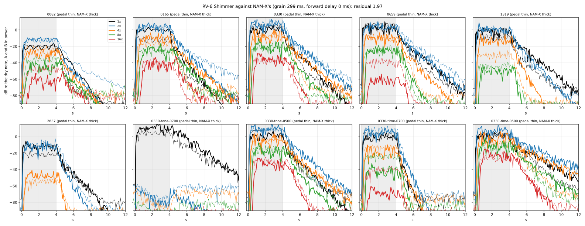

  - The low E's octave: −11.1 dB held (pedal −12.4), its pluck's −13.5 (pedal −15.3; the
    first version +8 dB). Spread like the pedal's: −28.3 dB of its energy on the exact line
    (pedal −24.2), the slow beating heard on the pedal.
  - Averaged over the six pitches: 1× −5.6 dB (pedal −8.5), the octave −1.8 (pedal −1.5),
    two up −17.6 (pedal −24.8: high notes still climb too far, 4× of 1319 Hz −14 / pedal
    −31). Tone 7:00: no octave and the long 1× tail, as the pedal; Time's ends and Level
    12:00 follow.
  - **Still loud: the chord's B and G#, the fifth's A** (247, 208, 220 Hz) — the 1× 5–13 dB
    over the pedal, the chord's octaves with it (to 3.3–4 kHz, +14 to +18 dB; the fifth's
    +4 to +7), and 165 Hz +13; the chord's 82, 330 and 659 Hz and their octaves match. A held sine samples one
    point of a tank's irregular response (NAM-X's 1× moves ±4 dB, a 14 dB range, across
    150–260 Hz); the pedal's notes there follow a smooth slope. Not reachable by the fitted
    parameters.
  - **The octaves bloom slower**: each step up waits for half a grain (150 ms) and a pass
    through the tank — 4× of 330 Hz at ~280 ms (pedal ~200), 8× ~470 (pedal ~300).
  - Stable: at Time, Tone and Level 5:00 an impulse decays steadily (−76 dB at 5 s, −242 at
    59 s) and a full-scale chord held 20 s stays bounded. CPU twice Modulate's (two tanks).

The fitted part — each mode's RT60 table, energy-vs-Time correction, colour EQ and level,
and the Tone filter — is [`fit_rv6.py`](../../../tools/capture/fit_rv6.py) (Shimmer
apart: its impulse responses carry the octaves' tails into every band) against this
study's JSON (it rewrites the header's FITTED block; three rounds converge). Rendered
through [`render_reverb`](../../../tools/capture/render_reverb.cpp) and measured like the
pedal:

| | Room | Hall | Plate | Spring | Modulate |
|---|---:|---:|---:|---:|---:|
| RT60 at 1 kHz (T30), five Time positions | within 1 % | 7 % | 3 % | 4 % | 2 % |
| decay per octave at noon (T20, 125 Hz–4 kHz, mean / worst) | 6 % / 125 Hz −15 % | 4 % / 125 Hz −13 % | 4 % / 250 Hz +8 % | 6 % / 2 kHz +11 % | 4 % / 250 Hz +10 % |
| early decay at 1 kHz, s (pedal) | 1.11 (1.10) | 3.46 (3.40) | 2.71 (2.70) | 2.64 (2.59) | 5.47 (5.56) |
| wet energy re noon, five positions | within 0.0 dB | 0.0 | 0.3 | 0.0 | 0.0 |
| wet at noon re the dry | −16.1 dB | −21.2 | −16.7 | −22.9 | −14.8 |
| spectrum of the first 2 s, 125 Hz–12.5 kHz, rms | 0.1 dB | 0.1 | 0.3 | 0.3 | 0.1 |
| onset / peak, ms (pedal) | 60 / 76 (60 / 76) | 33 / 219 (33 / 219) | 60 / 133 (60 / 133) | 75 / 99 (75 / 99) | 27 / 138 (23 / 155) |
| echo density 50 ms after onset (pedal) | 0.75 (0.75) | 0.58 (0.58) | 0.75 (0.75) | 0.39 (0.39) | 0.90 (0.94) |

Room's, Hall's, Plate's and Spring's starts are the pedal's (before the early responses:
onset / peak 59 / 96, 56 / 275, 58 / 181, 73 / 92 ms, Room and Plate dense at once — 1.00 and
0.94). Hall's T30 reads 5 % short because its decay shape was fitted on the whole curves
(a bent decay's T30 depends on its bend); its early decay and held notes match. With a measured start a mode's EQ and gain move only the tail: their colour
and level are fitted on the tail after the start (`fit_rv6.py --audio`; Spring's tail had
been 7 dB short at 125 Hz and 4 at 4 kHz, Room's 13 dB long at 63 Hz), each tail's energy
now within 0.3 dB of the pedal's. The Time law and the coherence match as well. CPU, one
core at 48 kHz: 1.9–2.3 % for Room and Hall (the convolution and the second tank), 1.6 %
Plate, 2.4 % Spring (an 800 ms convolution), 1.3 % Modulate, 2.2 % Shimmer (the classic
types 0.4–1 %). `DspGoldenTest` renders each RV-6 type
(`reverb-rv6-3` … `-8`).

## Still open

- Tone and Level were measured in Hall (Tone's 7:00/5:00 also in Spring, agreeing) and,
  on one held note, in Shimmer, where Tone sets the octaves; Time in every mode.
- The Time law between the measured positions is an interpolation (five points).
- Modulate's LFO waveform (sine, triangle) can't be read from a sum of paths; the rate
  and depth are what a model needs.
- Dynamic and +Delay modes, Input B (true stereo in): left out by the user.

## The Shimmer session (2026-11-01)

Planned 2026-10-31 and recorded 2026-11-01:
[`rv-6-shimmer.json`](../../../tools/capture/plans/rv-6-shimmer.json), 19 takes. The first
NAM-X Shimmer (branch `dsp/reverb-rv6`) matched the held 1 kHz tone but missed the plucks'
octaves by 5–8 dB, and the earlier takes couldn't tell its structure apart: the plucks
overlap and die while their octaves build, and the one held tone is one pitch, its start
under the marker's own shimmered tail.

### The takes

| Takes | Signal | Asks |
|---|---|---|
| `bypass-sweep` | sweep, pedal off | the session's dry path |
| `modulate-tone-0082`, `-0330` | 4 s sines, Modulate, Level 5:00 | the tank alone on a note: is Shimmer's 1× Modulate's tank? |
| `shimmer-tone-0082` … `-2637` | 4 s sines on the low E and its octaves (82, 165, 330, 659, 1319, 2637 Hz), −24 dB | per pitch and line (½×, 1×, 2× … 16×): onset, steady level, decay after the note |
| `shimmer-tone-0330-quiet`, `-loud` | 330 Hz at −36 and −12 dB | is the octave linear in level? |
| `shimmer-fifth`, `shimmer-chord` | 220 + 330 Hz; an open E chord (82–330 Hz), held | a linear shifter keeps notes apart; a nonlinear octave adds their sum and difference (550 and 110 Hz for the fifth) |
| `shimmer-plucks` | the 82 and 330 Hz plucks, 15 s apart | the plucks again, each tail on its own |
| `shimmer-tone-0330-tone-0700`, `-0500` | Tone at its ends | what Tone does in Shimmer |
| `shimmer-tone-0330-time-0700`, `-0500` | Time at its ends | Time on the octaves too, or only on the tank |
| `shimmer-tone-0330-level-1200` | Level 12:00 | Level a plain output gain here too |

The marker plays on the **loopback only** (`"marker_to_pedal": false`, in each sidecar):
the pedal starts every take from silence. All takes at Level 5:00, Tone and Time noon, but
for the knob takes.

**Checks.** No slip in any take: `capture.py`'s own check abstains on tones (a periodic
signal matches a period away), so a 96-tap FIR from the played file to the loopback stood
in — it leaves −44 to −82 dB over each take, its worst 20 ms at the onsets (a slip leaves
~0 dB from there on). No clicks or dropouts on either output (1 ms high-band spikes
against their ±50 ms surroundings, and a linear-prediction scan that catches every pluck
attack at ×300); `shimmer-tone-0330`'s two reported xruns left no trace. One stimulus
defect: **the second pluck (330 Hz) was cut** 1 s after its onset at about −11 dB (the
plan gave the 16 s body's last pluck 1 s), a step the reverb then rang with; its 82 Hz
pluck is clean. `capture.py` now refuses plans whose plucks are cut above −60 dB (every
earlier pluck plan cut its last at −33 to −58 dB — on 2026-10-31 the 330 Hz pluck at −33 dB).

**Measurement** (`--shimmer`): the wet is the recording minus the loopback through the
dry path (zero before the signal: the pedal heard silence there). Each line k·f0 is
followed by complex demodulation through a Blackman-Harris window (sidelobes −92 dB) of
max(20 ms, 10/f0) — 121 ms at 82 Hz, 30 ms at 330 — not a brick-wall band, whose ringing
reaches before the onsets; levels in dB re the dry note at the same output, measured the
same way. Onsets: the first frame within 20 dB of the line's steady level (2.5 s to the
note's end), re the dry note's own onset.

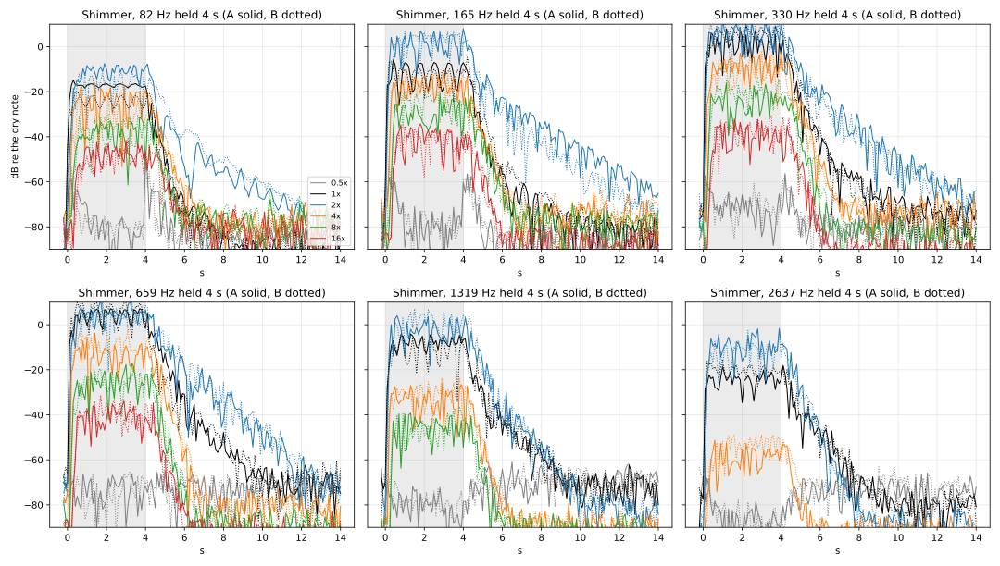

### What it shows

**Steady levels**, dB re the dry note (A / B):

| note | 1× | 2× | 4× | 8× | 16× |
|---|---:|---:|---:|---:|---:|
| 82 Hz | −17.0 / −23.6 | −10.8 / −15.1 | −23.1 / −30.4 | −36.7 / −36.3 | −47.1 / −49.0 |
| 165 Hz | −10.8 / −11.8 | +0.9 / +3.7 | −18.0 / −17.7 | −29.0 / −24.1 | −40.3 / −41.3 |
| 330 Hz | +1.5 / +5.8 | +5.8 / +6.8 | −8.4 / −9.7 | −25.5 / −20.3 | −38.0 / −36.9 |
| 659 Hz | +5.7 / +6.7 | +5.2 / +3.8 | −12.5 / −9.0 | −25.5 / −25.0 | −39.7 / −40.2 |
| 1319 Hz | −7.8 / −10.2 | −3.2 / +1.8 | −33.4 / −29.7 | −45.0 / −45.4 | |
| 2637 Hz | −24.2 / −20.4 | −8.5 / −11.7 | −57.7 / −52.8 | | |
| Modulate 82 Hz | +8.2 / +3.9 | ≤ −76 | | | |
| Modulate 330 Hz | +9.7 / −9.5 | ≤ −83 | | | |

No ½× anywhere (at the noise). A single held sine samples one point of a reverb's
irregular response (Modulate's 330 Hz: +9.7 dB on A, −9.5 on B), so read trends, not
single cells: Shimmer's wet is a **band** — its 1× peaks at 330–659 Hz (+1.5 to +6.7 dB)
and falls to −17 / −24 dB at 82 Hz and −24 / −20 at 2.6 kHz, where Modulate's tank is full
at 82 Hz (so Shimmer's 1× is not Modulate's tank as is). The octave is **about as loud as
the note** (−3 to +7 dB) from 165 Hz to 1.3 kHz, and each further octave ~14 dB weaker on
average (on the 82–659 Hz notes: 2×→4× −12 to −21 dB, 4×→8× −6 to −17, 8×→16× −10 to
−17), more lost above ~2.5 kHz.

**Nothing builds up.** Every line reaches its level within ~0.3–0.5 s and holds it flat
for the whole note. Onsets at 330 Hz (A / B, ms after the dry note): 1× 80 / 140, 2× 180 /
160, 4× 200 / 210, 8× 290 / 310, 16× 340 / 350 — each octave 20–100 ms after the one
below (~60 on average), alike at every pitch (A: 2× 110–180 ms, 4× 180–230, 8× 270–320,
16× 340–400).

**Decay after the note: one law per frequency.** Normalized to its held level, the same
frequency reached by different routes (1× of 1319 Hz, 2× of 659, 4× of 330, 8× of 165, 16×
of 82) falls along one curve for the first 25–30 dB (~1.5–2 s); later the 2× lines, the
loudest, keep a slower tail above the noise, 15–20 dB down (the JSON's single-slope
`decay_db_per_s` mixes the two slopes and the floors: read the trajectories). Nothing
like a separate long octave reverb.

**Linear, exact, smeared.** Quiet, noon and loud (−36, −24, −12 dB) give every line within
0.3 dB. The fifth shows no intermodulation: its sum (550 Hz) sits at −57 / −54 dB, where
it sits in the 330 Hz-only take too, and the difference (110 Hz) isn't there — a linear
shifter, not a nonlinear octave. The 2× is exactly 2:1 (+0.25 cents on every 330 and
659 Hz take that has one; the other pitches read ±4–25 cents, where the window can't part the line
from its spread). Each Shimmer line is **spread** (side peaks 4–15 Hz off — 10–40 cents —
11–23 dB down) where Modulate's 1× is one clean line (all else ≥ 68 dB down); the
octaves' envelopes ripple at the LFO's 1.37 Hz and its harmonics (31 % on A, 58 % on B
for 330 Hz's 2×), with no grain rate of their own. The low E's octave is another matter
(*added 2026-11-01, after listening*): it ripples at **6.77 Hz** (18–33 % on A and B) and only
0.2–1 % of its energy within ±6 % of 165 Hz sits on the exact line, the rest in side lines
~6.8 Hz apart — the signature of a **delay-line octave shifter**: two taps read a grain at
twice the speed, cross-faded half a grain apart, and their sum ripples at twice the grain
rate (a ~300 ms grain), as deep as the pitch makes the taps' phases differ. The grain length
scanned against the pedal's spread on five pitches fits best at ~299 ms.

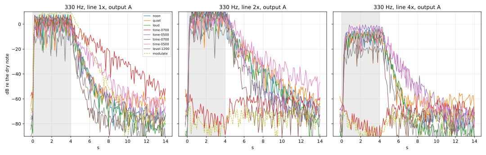

**Tone sets the octaves.** At 7:00 there is **no octave at all** (2× to 16× at the noise,
−77 to −93 dB) and the 1× rings far longer (~−6 dB/s against ~−21 at noon). At 5:00 the
octaves grow, the higher ones most (2× +2.4 / +2.1 dB re noon, 4× +5.0 / +3.8, 8× +7.5 /
+5.0, 16× +7.5 / +7.0), the 2× decays faster and the 4×–8× slower. Whether Tone also tilts
the wet here isn't measured (one pitch).

**Time sets the loop**, octaves included: at 7:00 the higher octaves are weaker (4× −4.5 /
−5.3 dB, 8× −3.0 / −2.3 re noon) and die fast after the note; at 5:00 stronger (4× +1.3 / +1.0, 8×
+9.8 / +6.7, 16× +11 / +10) and ring long; the 2×'s held level barely moves (+6.6, +5.8,
+2.6 dB on A).

**Level** is a plain output gain: at 12:00 every line is 12.0 ± 0.4 dB down, decays
unchanged (as in Hall).

**The 82 Hz pluck** (re the dry pluck's peak, A / B): 1× peaks at −15.1 / −20.1 dB at 0.28 /
0.39 s, 2× at −12.1 / −13.7 dB at 0.84 / 0.61 s, 4× at −17.6 / −23.2 dB at 0.52 / 0.46 s,
8× at −34.5 / −32.9 dB — the octave peaks well after the note. The 330 Hz pluck was cut
(above) and isn't used.

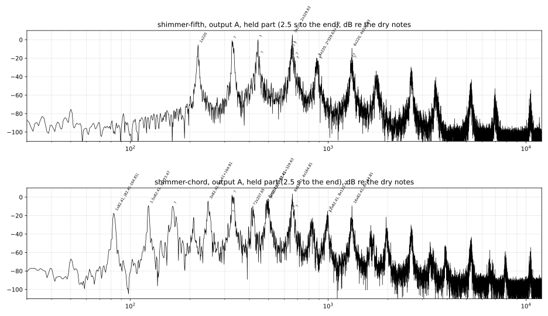

### The structure

*Corrected 2026-11-01, the same day: the first reading said "no forward path"; the octave
steps say otherwise.*

**Tone sets the octave, which enters two ways.** At 7:00 neither: a plain long reverb,
no octave at all.

- **Forward**: the note itself, shifted, into the tank. The first octave stands
  ~7 dB over the 1× on average (+6, +12, +4, −0.5, +5, +16 dB from 82 Hz to 2.6 kHz on A),
  while every later step is ~14 dB *down*. A single loop can't do that: in its steady
  state each octave is the same fraction of the one below, the first included. So the
  first octave has a feed of its own, and Tone scales it too (nothing at 7:00). The 82 Hz
  pluck's octave peaking late doesn't argue against it: the recirculation keeps adding to
  the octave while the note rings.
- **Recirculation**: a share of each pass goes up an octave and the rest recirculates as
  it is. Each octave feeds the next (the constant ~14 dB step); a larger share
  (towards 5:00) lifts the higher octaves most and shortens the unshifted tail (the 1×
  rings far longer at 7:00). Time scales this loop's gain, octaves included.

**The tails have two slopes.** After the note every line falls fast for 20–40 dB
(~−20 dB/s), then lingers at about −7 dB/s, the slope the 1× has from the start at Tone
7:00. A single loop shortened by the share gives one slope; the pedal behaves as if part
of its tail isn't shortened by it.

**The octaves come ~70 ms apart**, the first after the note as late as each further one
after the last (A means: 1× 75 ms, 2× 148, 4× 200, 8× 296, 16× 362).

Level is the output; the shifter is linear and exact, its lines spread.

What a model needs against NAM-X's first Shimmer (forward 2.0 plus an added, weak
feedback, through one shifter at 150 ms latency, Tone a tilt):

1. **Tone as the octave's amount**: the forward gain and the shared share, both zero at
   7:00, fitted at noon and 5:00; the shared share taken from the loop.
2. **Separate bands**: the forward octave passes 2.6 kHz at full level, the climb from
   there is weak (−31 dB for 1319 Hz's 4×).
3. **A tail that lingers**: a part of the tank the share doesn't shorten.
4. **The shifter's latency in the loop**: each step waits for it. A short STFT block can't
   part the low E from its octave (a 40 ms block left the low notes' climb buried while
   they played), so the block is a compromise between the bass and the climb's speed.
5. **A fit by simulation** on the session's played files, measured with the same
   `--shimmer` code, on trends (A and B in power), not single cells.

## A blind test (2026-11-11): validation for the focused session to come

`../mystery/2026-11-11-mystery-2` (`../mystery/README.md`), in no fit: Room, with Time aimed at 1:30 and
Tone and Level at 10:30. Read from the takes: Room (the tail starts about 60 ms after a click; the
model's Room start correlates 0.37–0.40 with it, the other modes 0.03–0.05), Time 1:00, Tone 12:30,
Level 9:50, the three knobs by matching the model's Room to the tail. So if the knobs stood where they
were aimed: at Tone 10:30 the model's Room is 4–6 dB too dark at 4–8 kHz (Tone's curve was measured in
Hall and Spring only), its tail at Time 1:30 about 18 % long (2.05 s for 60 dB against the pedal's 1.73
around 1 kHz). Level was read 40 minutes low; whether that is the model or the knob is open. Dynamic and +Delay could not be told
from Room: they were never measured. To check when the RV-6 gets its focused session.

## The focused session: recorded and scored 2026-11-15, fitted 2026-11-17

Plan [`rv-6-focused.json`](../../../tools/capture/plans/rv-6-focused.json): 123 takes, 96 min of
audio (two to two and a half hours at the pedal; takes already recorded are skipped, so it can be
split), both outputs, the adapter. To record:

    tools/capture/reamp.py rv-6 --plan focused --session 2026-11-15-focused

(the session's name is free: use the day it is recorded). The interface has to be on the capture
profile first.

**The layout** (the user: freeze the knobs and change the mode in consecutive takes; a Mode change
also clears the tail): E.Level, Tone and Time are set once per block and only Mode turns from take
to take, up the dial in one block and down it in the next; 20 blocks of six takes. A take is a
`sequence` (new in `signals.py`: several signals in one take, each with its own level and tail;
`signals.part_starts` says where each begins), every signal followed by silence as long as that
mode's tail at that Time: a −24 dB sweep, a 50 ms noise burst (October's), in Modulate and Shimmer
a held note (1 kHz / 330 Hz), the guitar's stabs at full level. The marker goes to the loopback
only.

**The blocks:** bypass and the dry with E.Level off; everything at 12:00 (bursts at −24 / −12 /
0 dB: is the wet linear?; then stabs, chords, the lead, quiet funk); Time at 3:00, 5:00, 7:00,
9:00; Tone at 9:00, 7:00, 3:00, 5:00; Tone's ends at Time's ends (does Tone act after the tank in
every mode?); E.Level at 5:00, 3:00, 9:00; two settings with all three knobs off 12:00, kept out
of every fit (`check-a`, `check-b`); the first block again at the end.

**What it is for** (what October left unmeasured): Tone's curve per mode (measured in Hall only;
the blind test's Room 4–6 dB too dark at 4–8 kHz), the decay per band at every Time, Level and
whether the wet is linear at a guitar's level, Tone against Time, and the model against the pedal
on guitar, never compared.

**The scoring** (a tail can't be matched sample for sample: the tanks aren't the pedal's
algorithm), per mode, on the wet alone: the start (the first 350–800 ms, the pedal's own measured
start in the model: a waveform residual), the decay per octave band, the wet's third-octave level
over time, the two outputs' correlation. Done means, at the measured positions: decay within 10 %
per octave band, level within 1 dB per third octave, the start no worse than at noon today.

**The budget** (after the PH-3's Rise and Fall): one session for the scoring tool and the plots,
one for fixes and A/B pairs. Fixes are tables and constants (Tone per mode, loss ratios per band,
the Time law, Level); no engine rebuild: a tail whose texture constants can't fix is written down
as a known miss and the user asked. The scoring tool comes first and needs no pedal: prove it on
October's Hall at noon and on the blind Room session before trusting a number. Knobs in real
units (Time in seconds, Level in dB) are an open question to the user.

**Recorded 2026-11-15** as `2026-11-15-focused`: all 123 takes, the adapter, both outputs, no
xruns, no clipping (the highest peak on the pedal's inputs −15.5 dBFS). A first look, nothing
fitted: the wet is there in all six modes on both outputs and follows the knobs (one second after
the burst, Hall's tail is 69 dB under the burst at Time 7:00, 44 at 12:00, 38 at 5:00; E.Level
5:00 is 13 dB over 12:00 in Modulate and Spring); the tail's level re the burst is the same at
−24, −12 and 0 dB within about 1 dB (the wet is linear at a guitar's level); on guitar in Room at
noon the wet alone (the take minus the bypass take) is 10.5 dB under the dry.

### Scored, 2026-11-15

Tools: [`rv6/takes.py`](../../../tools/capture/rv6/takes.py) (the takes made comparable),
[`rv6/focused.py`](../../../tools/capture/rv6/focused.py) (the numbers: `measure`, `floor`,
`report`), [`rv6/plots.py`](../../../tools/capture/rv6/plots.py) (a page per mode:
[Modulate](2026-11-15-focused/fit/focused-modulate.png), [Spring](2026-11-15-focused/fit/focused-spring.png),
[Plate](2026-11-15-focused/fit/focused-plate.png), [Hall](2026-11-15-focused/fit/focused-hall.png),
[Room](2026-11-15-focused/fit/focused-room.png), [Shimmer](2026-11-15-focused/fit/focused-shimmer.png));
the numbers per take in [`fit/focused.json`](2026-11-15-focused/fit/focused.json). Nothing in
`src/` changed.

**The takes, made comparable.**

- *Slips:* 30 of the 123 takes have one sample repeated somewhere (PipeWire; all three channels
  together). `scorecard.slips` can't read this session — along a sweep the loopback's delay moves
  with frequency (about a sample between 300 Hz and 3 kHz), which it calls a slip in nearly every
  take — so each block's lag is compared with the median of all the takes' at that block, and a
  slip is placed to the sample by the loopback above 200 Hz (one in a sweep's last seconds, where
  no lag is read, left the dry 25 dB up at 10 kHz until it was placed there).
- *The dry:* `level-0700-hall` (E.Level fully down) gives the dry path per output, its sweep
  deconvolved into a 4096-tap FIR; taken out of the bypass takes it leaves them 58–61 dB down
  (`scorecard.chain_filter`, a Welch estimate, left 10 dB on a sweep: don't use it on one). The
  wet is the recording minus that.
- *The model:* `render_rv6` from each take's played signal at the take's knobs (7:00, 9:00,
  12:00, 3:00, 5:00 = 0, 0.2, 0.5, 0.8, 1), its wet through the same FIR. The marker is silenced
  in what the model is fed: it went to the loopback only, and its tail in the model made a first
  burst read 20 dB hot until it was.

**The scorer against the pedal itself** (in place of October's Hall and the blind Room, which
have another layout: the first block's sweeps against the last block's, the same settings two
hours apart). Room, Hall, Plate, Spring: level within 0.1 dB, tone within 0.2 dB rms (Spring 1.7:
bands with next to nothing in them), the response's first 400 ms equal to −38…−44 dB (Room −15:
its response is shorter than the window). Modulate and Shimmer are not time-invariant (the
waveform differs entirely, +2 and −4 dB) but level and tone repeat within 0.2 and 0.4 dB. Hall's
RT60s read the same from the burst's tail and from the sweep's response (3.64 s at 1 kHz both);
the burst's are used everywhere (the sweep's are nonsense in Spring, whose response is a chirp).
Window by window a guitar through two different tanks differs by 4–6 dB rms whatever the fit, so
on guitar the bands' means are scored, not the windows.

**One block is not what its name says:** the six `tone-0900-*` takes were recorded with Tone at
12:00 (the pedal's response equals the noon take's within 0.3 dB in the five modes that can be
compared). Tone 9:00 is measured only in `check-a` (with E.Level and Time at 3:00): there the
guitar's bands sit within 1.2–2.7 dB rms. Six takes to redo if Tone 9:00 matters.

**What holds** (Modulate, Spring, Plate, Hall, Room):

- *Level* at E.Level 12:00, 3:00, 5:00: within 0.9 dB on bursts and 0.3 dB on guitar (Modulate at
  5:00 +1.9 on guitar).
- *The wet is linear* at a guitar's level: the wet's energy re the burst's is the same at −24,
  −12 and 0 dB within 0.5–1.2 dB (the loudest a little low; 1.9 dB in Modulate at E.Level 5:00).
- *Tone at 12:00, 3:00, 5:00:* within 0.6–1.2 dB rms over the third octaves in every mode, so
  October's Hall curve holds in the other modes on the bright side; and Tone at 5:00 does the
  same thing at Time 7:00 and 5:00 within 0.3 dB (a filter after the tank).
- *Decay* from Time 12:00 up, 500 Hz – 4 kHz: Plate, Hall and Room within 9 %; Spring within 8 %
  but its 4 kHz octave 22 % short at 3:00 and 5:00; Modulate 2–18 % short (worst at 2–8 kHz at
  3:00 and 5:00).
- *The start* at noon is the pedal's (−36 to −47 dB; Room −15), and the two outputs' likeness
  matches (0 in every mode but Spring's 0.45, the model's 0.45).
- *On guitar* the bands' means sit within 1.2–2.3 dB rms (the median over each mode's takes).

**What doesn't:**

| | the pedal | the model |
|---|---|---|
| E.Level 9:00 | | 1.3–3.4 dB quiet in every mode, on bursts and on guitar, and again in `check-b` (set anew: 1.8–4.5): the Level law is about 2.4 dB low there |
| Tone 7:00, under 250 Hz | a bass lift that depends on the mode: +21 dB at 80 Hz in Plate, +12 in Room, +10 in Hall re noon, none in Modulate and Spring; in Plate, Hall and Room the two outputs become alike there (correlation 0.2–0.5 from 0), and it changes with Time (±2.5 dB) | one curve for every mode (+5 to +7 at 80 Hz): 14 dB short in Plate at 80 Hz, 4 short in Hall and Room, 6–7 too much in Modulate and Spring |
| Tone 7:00, the top | the notch at 4 kHz 3–5 dB deeper in Modulate, Spring, Room; Spring loses 12 dB more at 10 kHz | |
| Time 7:00 and 9:00 | the same within 10 % (Hall 0.55 / 0.61 s, Room 0.40 / 0.42, Plate 0.74 / 0.77 at 1 kHz) | Hall 11–31 % long with another swell (its peak 5 dB low and early); Room 22–31 % long under 250 Hz and at 8 kHz; Plate 8–19 % short under 1 kHz; Modulate 8–20 % long at 9:00 |
| the start off noon | | degrades with Time (−15 to −26 dB at 3:00 and 5:00; Hall and Plate −2 to −9 at 7:00) and with Tone at 7:00 (−3 to −9): the measured start is noon's |
| low octaves | | 125–250 Hz off by 10–30 % in places (Spring 250 Hz 12–29 % long, Plate 125 Hz +28 % at 5:00, Room 125 Hz −26 % at noon); a single burst reads those bands roughly |
| **Shimmer** | after a burst the tail lasts 6.4 s at 1 kHz at noon (1.9 at 7:00, 8.3 at 3:00) | 2.9 s at noon (1.0 at 7:00; right only at 5:00), a taller first peak, and on the guitar's stabs 7–9 dB quiet at E.Level 9:00, 3:00, 5:00 (−1.7 over the four excerpts at noon), `check-a` −16; bands' means 4 dB rms. It was fitted to held notes and plucks; on bursts and stabs it is far off |

Not looked at yet: the held notes (Modulate's wander, Shimmer's octaves), the lead and funk
excerpts one by one, Output B beyond its level and likeness.

**Proposed fixes** (the next session; constants and tables only, each a change to what the
Reverb sounds like): the Level law's 9:00 point (+2.4 dB); Tone below noon per mode under 250 Hz
(Plate, Room, Hall more, Modulate and Spring less) and the 4 kHz notch's depth; the Time law's
bottom in Hall (and its swell there), Room and Plate; Shimmer's tail against a burst below Time
3:00 — the one that may not be a constant.

**Shimmer's burst, read closer** (the same day; the 1 kHz octave's envelope after the −12 dB
burst, dB, pedal / model):

| | 0.2 s | 0.4 s | 1 s | 2 s | 4 s | 6 s |
|---|---:|---:|---:|---:|---:|---:|
| noon | −60.5 / −55.9 | −61.9 / −61.8 | −73.8 / −83.2 | −83.9 / −90.0 | −96.8 / −103.2 | −106.8 / −115.2 |
| Tone 7:00 (no octave) | −64.3 / −64.2 | −64.6 / −65.4 | −68.5 / −72.5 | −75.0 / −83.8 | −89.0 / −105.1 | −100.8 / −123.1 |
| Time 5:00 | −76.1 / −60.8 | −71.6 / −65.0 | −74.5 / −86.7 | −84.9 / −91.2 | −92.4 / −94.1 | −102.4 / −102.7 |

- At noon the two late slopes agree (about −6.5 dB/s from 2 s on). The miss is the first second:
  the model starts 4.6 dB hot and drops 27 dB where the pedal drops 13, so its lingering part
  sits 6–8 dB low. The "6.4 s against 2.9" above is that, read between −5 and −25 dB.
- With the octave off (Tone 7:00) the pedal is one slope, about −6.5 dB/s; the model falls at
  −10 and faster. The plain tank under the Shimmer is too short at noon.
- At Time 3:00 and 5:00 the pedal swells: 1 kHz peaks at 0.4–0.7 s and is 13–16 dB quieter at
  0.1 s than at noon. The model starts at the same level at every Time.
- On every burst the model is 5–15 dB bright above 5 kHz.

The structure of 2026-11-01 (the octave forward, a share recirculated, a second tank that
lingers) can express all four, so this is a refit with bursts and stabs among the targets, not
a new engine, and needs no new capture to start. One thing may not fit: the held notes' tails
have their knee 20–40 dB down, the bursts' 15–20, and a linear tank should show the opposite
order. If one set of constants can't serve both, that is the case for a session of short
single-pitch bursts.

**From the web** (searched 2026-11-15; no patent, no one else's measurements):

- Roland's RV-6 Service Notes (Aug. 2015, 17058986E0), the digital sheet: the DSP is a
  UPD800402GJ on a **16.9344 MHz** crystal (384 × 44.1 kHz), with an SDRAM and a stereo codec;
  the dry path is analog, summed with the DAC at the output op-amps. So the pedal runs at
  44.1 kHz or a multiple; the notes don't state the rate.
- Boss's later Shimmers give the pitched part a sustain of its own: the RV-500's Release
  ("the length of the reverberation (PITCH)"), the SH-4d's Pitch Feedback ("the proportion of
  the delay sound that is fed back into pitch shift"). Not the RV-6, but the same kind of loop
  the 2026-11-01 session read from it.
- Boss on the RV-6: "many parameters are simultaneously adjusted inside" per knob position, so
  Time and Tone each move several things at once.

## The fixes of 2026-11-17: E.Level, Tone and what it adds, Time off noon

The four things the scoring found off, taken in turn. The first three are here; Shimmer has its
own section below. Tools: [`rv6/tone.py`](../../../tools/capture/rv6/tone.py),
[`rv6/time.py`](../../../tools/capture/rv6/time.py), and for listening
[`rv6/ab.py`](../../../tools/capture/rv6/ab.py). All numbers are the scorer's, before → after, on
the same takes (the plots per mode are redrawn).

### E.Level

The wet's gain was the knob's square at every position. At 9:00 the pedal is 13.5 dB under 12:00,
not the square's 15.9: the model read 1.3–3.4 dB quiet there in the five modes, on bursts and on
guitar, and again in `check-b` (set anew). Now the square from 12:00 up (3:00 and 5:00 held
within 0.9 dB and are left) and a gentler power below it, through 9:00:
`gain = (knob / 12:00)^1.696`. At E.Level 9:00, model − pedal, burst / guitar: Modulate −2.6 / −2.7
→ −0.2 / −0.3, Spring −2.7 / −2.0 → −0.3 / +0.5, Plate −1.8 / −2.4 → +0.6 / +0.1, Hall −3.4 / −2.1 →
−0.9 / +0.3, Room −1.3 / −2.2 → +1.1 / +0.3; `check-b` (in no fit) within ±0.9 dB on bursts.
Between 7:00 and 9:00 nothing is measured: the power law runs on to silence.

### Tone is one filter, the same in every mode

Room, Hall, Plate and Spring repeat to the sample, so a take's sweep response over the noon take's
is Tone's filter itself. Read as a coherent ratio per sixth octave (what Tone adds beside the
filtered wet, below, is another signal and averages out) the four modes agree within 0.1 dB at
3:00 and 5:00, and at 7:00 wherever they can be read; Modulate's energy ratio agrees. Re 12:00, dB:

| Tone | 50 Hz | 80 | 125 | 200 | 500 | 800 | 1 k | 1.25 k | 1.6 k | 2 k | 2.5 k | 3.2 k | 3.6 k | 4 k | 4.5 k | 5 k | 6.4 k | 8 k | 10 k |
|---|---:|---:|---:|---:|---:|---:|---:|---:|---:|---:|---:|---:|---:|---:|---:|---:|---:|---:|---:|
| 7:00 | 0.1 | 0.2 | 0.1 | 0.1 | −0.1 | −0.7 | −1.6 | −3.1 | −5.0 | −7.0 | −8.8 | −11.3 | −14.7 | −20.1 | −14.0 | −10.8 | −8.6 | −7.7 | −7.3 |
| 3:00 | −5.5 | −3.8 | −1.4 | −0.3 | 0.2 | 0.7 | 1.5 | 2.3 | 1.5 | 1.1 | 1.3 | 2.1 | 2.7 | 3.5 | 4.4 | 5.3 | 6.8 | 7.8 | 8.1 |
| 5:00 | −5.5 | −3.8 | −1.4 | −0.3 | 0.2 | 0.6 | 1.2 | 2.2 | 3.7 | 5.4 | 6.8 | 7.8 | 8.2 | 8.6 | 8.9 | 9.2 | 9.7 | 9.9 | 9.6 |

Against October's table (Hall alone, an energy ratio): **below noon the filter does nothing
under 500 Hz** — the bass lift October read in Hall is not the filter (next) —, its cut starts
at 1 kHz and its notch at 4 kHz is 20 dB deep in a sixth octave, not 13–14 (the added reverb
filled it in the energy ratio); **above noon** there is a low cut October's fit had at a quarter
of its depth (−5.5 dB at 50 Hz, −3.8 at 80, the same at 3:00 and 5:00), 3:00 has its bump at
1.2 kHz before the shelf, 5:00 is a plain shelf from 1 kHz. The 9:00 block was recorded at 12:00,
so 9:00 is October's Hall with the added reverb's share taken out as 7:00 shows it (`check-a`'s
bursts, with Tone at 9:00 in every mode and in no fit, agree: below).

In NAM-X the filter was three sections with fixed frequencies and a gain per position; it is now
three sections **per measured position** (a high shelf, the notch and a broad dip at 7:00 and
9:00; a low shelf, a peak and a high shelf at 3:00 and 5:00), fitted to the sixth-octave band
averages within 0.03–0.10 dB rms; between two positions on the same side of noon the sections'
frequency, Q and gain are interpolated, towards noon the gains fade. Tone's curve, model − pedal
over the third octaves 50 Hz–5 kHz: within 0.03–0.3 dB rms at 3:00 and 5:00 in all five modes
(was 0.6–1.2), and at 7:00 within 0.1–0.2 dB in Modulate and Spring at every Time (was 2.0–4.2:
they had a 7 dB bass lift the pedal doesn't have there).

### What Tone adds below noon: a low reverb, the same on both outputs

At Tone 7:00, Plate, Hall and Room gain bass that Modulate and Spring don't: +19 dB at 80 Hz in
Plate, +8 in Room, +7 in Hall re noon. It is not a filter. The take less its Tone-noon twin (the
tank's own wet cancels 30 dB or more under 500 Hz, where the filter is flat) leaves **one signal,
the same on both outputs** (their difference 14–21 dB under their sum; between two noon takes two
hours apart the same subtraction leaves 28 dB less), where the modes' own wets are unlike on the
two outputs. What it is, from the nine takes with Tone at 7:00 (three modes at Time 7:00, 12:00
and 5:00):

- **A reverb of its own**: it starts about 40 ms after the note in all three modes (before
  Plate's and Room's own wet, and long before Hall's swell) and decays in a line. Its RT60,
  63–400 Hz, at Time 7:00 / 12:00 / 5:00: Plate 0.60 / 2.19 / 5.72 s, Hall 0.67 / 3.39 / 7.12,
  Room 0.64 / 1.53 / 4.35 — following Time, shorter than Plate's and Hall's own tanks at noon
  (3.0, 3.8 s) and longer than Room's (1.3).
- **The same level and colour in the three modes**: its energy per third octave is even from
  50 to 400 Hz (within 1 dB between the modes), then falls about 3.5 dB an octave to 5 kHz. So
  the lift is whatever each mode's own wet lacks there: Plate's own bass is cut hard.
- **Its energy holds across Time** within 2 dB (+0.5 dB at 7:00, −1.7 at 5:00 re noon).
- **It doesn't follow E.Level**: in `check-a` (E.Level 3:00, Tone 9:00) the modes' own wets are
  8 dB up and the shared part is where Tone 7:00 at E.Level 12:00 has it less 2–3 dB (60–120 Hz:
  Plate 18.8 against 21.5, Hall 17.2 against 20.6, Room 17.5 against 21.0). Measured at those two
  E.Level settings only.
- **At Tone 9:00** it is 1.2 dB under 7:00 (October's Hall, E.Level 12:00), gone at 12:00.
- Above 1 kHz it is a small part of the wet but for the first 100 ms, where at short Time it
  fills the filter's notch (Hall at Time 7:00: the 4 kHz third octave −8.5 dB, not −17).

In NAM-X (`LowShape`, `LOW_TANK` in `Rv6Reverb.h`): a 16-line tank of its own, fed 20 ms in,
through a low shelf and a first-order low-pass, added alike to both outputs after Tone's filter
and the level; an RT60 per mode and Time position (set so that it *reads* as the pedal's: the
same line through its level per 100 ms gives Plate 0.61 / 2.23 / 5.85 s, Hall 0.67 / 3.44 / 7.28,
Room 0.65 / 1.59 / 4.45), one level per mode and a correction per Time position, 1 at Tone 7:00,
0.87 at 9:00, nothing from 12:00 up. It runs only while Tone is below 12:00 in those three
modes. Since nothing is measured under E.Level 12:00, there it follows the knob (E.Level at 7:00
has to be silence); above 12:00 it stays put, as measured. (A first version tapped the mode's own
tank: right in the sweeps' spectra, but on guitar the bass rang too long in Plate and Hall and
too short in Room, and came 250 ms late in Hall.)

Tone 7:00's curve re noon, model − pedal over the third octaves 50 Hz–5 kHz, at Time 12:00 /
7:00 / 5:00: Plate 0.5 / 1.3 / 1.0 dB rms (was 4.4 / 4.9 / 4.1 in the scorer's own figure, 14 dB
short at 80 Hz), Hall 0.9 / 2.9 / 0.7, Room 0.8 / 0.9 / 1.1. The outputs' likeness over the
whole response, pedal / model: Plate 0.25 / 0.28, Hall 0.34 / 0.36, Room 0.18 / 0.19 (the model's
was 0.0). On the guitar's stabs at Tone 7:00 the bands' means: Plate 3.4 → 1.8 dB rms, Hall 1.4 →
0.8, Room 3.1 → 2.7, Modulate 2.6 → 1.9, levels within −1.4…+1.2 dB. `check-a` (Tone 9:00,
E.Level 3:00, Time 3:00, in no fit): bursts' tone 1.6 → 0.7 dB rms in Plate, 1.5 → 0.5 in Hall,
2.2 → 0.9 in Room, 2.3 → 1.3 in Modulate; on guitar 1.5 → 1.2, 1.2 → 0.7, 2.5 → 1.5, 2.7 → 1.7.

Not modelled: whatever it does under E.Level 12:00; its first 100 ms above 1 kHz only roughly
(Hall at Time 7:00 and Tone 7:00 keeps 3 dB too much notch); why Modulate and Spring have none.

### Time off noon

`rv6/time.py` follows the wet after the −12 dB burst per octave band (250 Hz–8 kHz, 20 ms steps,
both outputs) and fits, per mode and position, the tank's RT60, the wet's level, the measured
start's level and the slower tank's level to the pedal's levels over time.

- **Modulate** at 9:00 was 8–20 % long: RT60 1.08 → 1.01 s; now +1 to +9 % (250 Hz–4 kHz).
- **Plate** at 7:00 and 9:00: levels over time 1.03 → 0.95 and 0.92 dB rms; the decay within
  ±7 % from 500 Hz up (250 Hz stays 14–18 % short).
- **Room** at 7:00 and 9:00: levels 2.4 → 1.6 and 2.5 → 1.5 dB rms. Its slower tank, whose lows
  last twice as long, was too loud at short Time (250 Hz +24…+27 % → +1…+5 %, 8 kHz +22 → +11).
  The price: 1 kHz, which the pedal holds longer than its neighbours there (0.40 s against 0.33
  at 500 Hz), now reads 16–17 % short.
- **Hall** needed more than tables. Its sweep responses at the five Time positions, laid over
  noon's, say what the pedal does: **the first ~250 ms are noon's at every Time, only louder or
  quieter by a constant (+2 dB at 7:00 and 9:00, −2 at 3:00, −3 at 5:00), and the decay Time
  sets starts after them** (re noon: flat to 260 ms, then −90 dB/s at 7:00). The pedal's tank
  comes after its swell. NAM-X's was fed at 26 ms and decayed from the first moment, so at short
  Time its own start, which the measured start only cancels at noon, came through 7–8 dB loud at
  60–140 ms, and the tail was handed over 10–16 dB low in the treble. Now **the tank is fed
  240 ms in**; the measured start is noon's as before (the engine subtracts the tank's own
  response from it at start-up), the tail's level and colour at noon were retuned to where they
  were (0.5–3 s after the note within 0.3 dB of the old model per third octave; the echo density
  after the hand-over 1.02–1.09 against the pedal's 1.04–1.08), and the tables refitted at the
  four positions off noon. Model − pedal over the sweep's response, 20 ms steps, at Time 7:00:
  broadband 2.3 → 1.7 dB rms, 1 kHz 2.9 → 2.4, 4 kHz 5.2 → 3.0; on the burst's levels 4.0 → 2.5
  (7:00) and 3.5 → 2.3 (9:00); the decay at 2–8 kHz from +23…+27 % to +4…+9 %, at 500 Hz and
  1 kHz still 15–18 % long by the burst's measure; the start's waveform −2.0 → −4.7 dB. At 3:00
  and 5:00 the start improves too (−17 → −22 and −15 → −20 dB) and everything else holds.
  What is left at short Time: the pedal's start is also darker there (+3 dB at 1 kHz, −1 at
  4 kHz re noon: the model keeps noon's colour), and the model dips 2–5 dB at 220–280 ms, where
  its start begins to decay and the pedal's still holds.

### After the three fixes

On guitar, the median over each mode's takes of the bands' means, and the level's worst case:
Modulate 2.00 → 1.74 dB rms (worst level 3.8 → 2.2 dB), Spring 1.61 → 1.57 (5.3 → 1.8), Plate
1.57 → 1.56 (2.4 → 1.4), Hall 1.20 → 0.98 (4.5 → 2.2), Room 2.26 → 2.05 (2.3 → 1.7). The Reverb's
CPU: nothing changes from Tone 12:00 up; below it Plate, Hall and Room run one tank more (one
core at 48 kHz, offline: Plate 1.6 → 2.1 %, Hall 2.3 → 2.7, Room 1.9 → 2.4).
`DspGoldenTest`'s five entries for these modes are re-recorded (Tone at 35 % there).

To listen: `rv6/ab.py --was BINARY` writes, per take, the pedal's recording, NAM-X now and NAM-X
from a build before the fixes, over the guitar's stabs, into the session's `ab/` (git-ignored):
eighteen takes by default, one or two per fix and a few of Shimmer's.

Still open in the five modes: Tone 9:00 by a block of its own (six takes: it rests on October's
Hall and `check-a`); the low reverb under E.Level 12:00; Hall's and Room's 500 Hz–1 kHz decay at
Time 7:00–9:00; Plate's 250 Hz at short Time; Spring's 250 Hz (12–29 % long) and its 4 kHz octave
at long Time (22 % short); Modulate's 2–8 kHz at 3:00 and 5:00 (to 18 % short). The held notes
and Output B beyond its level and likeness are still not looked at.

## Shimmer refitted, 2026-11-17: bursts and stabs beside the held notes

One attempt, as budgeted: the structure of 2026-11-01 as it is, its constants refitted with the
focused session among the targets ([`fit_rv6_shimmer.py --focused`](../../../tools/capture/fit_rv6_shimmer.py)).
Added to the held notes, the chords and the pluck of the Shimmer session: the wet after the
−12 dB burst at twelve settings (every Time and Tone position measured, and Tone's ends at Time's
ends) and over the guitar's stabs at five, followed per octave band, 125 Hz–8 kHz, in 100 ms
steps, both outputs, where the pedal stands 6 dB over its floor; Time's 9:00 and 3:00 free (they
followed October's law). `check-a` and `check-b` stay out. The fit converged (275 evaluations).

**One set of constants serves both.** The Shimmer session's residual, the fit's own measure on
held notes and plucks, goes from 1.76 to 1.82; on the bursts and stabs the levels' rms difference
per take goes from 4.2–12.1 dB to 2.4–6.1:

| | was | now | | was | now |
|---|---:|---:|---|---:|---:|
| burst, noon | 7.4 | 4.2 | burst, Tone 7:00 | 10.2 | 3.7 |
| burst, Time 7:00 | 5.2 | 3.1 | burst, Tone 3:00 | 4.5 | 2.8 |
| burst, Time 9:00 | 5.0 | 2.4 | burst, Tone 5:00 | 4.2 | 2.7 |
| burst, Time 3:00 | 7.2 | 4.6 | burst, Tone 7:00, Time 7:00 | 12.1 | 5.3 |
| burst, Time 5:00 | 7.6 | 6.1 | burst, Tone 7:00, Time 5:00 | 5.5 | 4.1 |
| stabs, noon | 6.4 | 4.7 | burst, Tone 5:00, Time 7:00 | 5.8 | 2.8 |
| stabs, Time 7:00 | 7.0 | 5.3 | burst, Tone 5:00, Time 5:00 | 6.8 | 5.5 |
| stabs, Time 3:00 | 6.9 | 4.6 | stabs, Tone 7:00 | 8.5 | 3.0 |
| stabs, Tone 5:00 | 5.2 | 4.0 | `check-b` burst (no fit) | 5.7 | 2.7 |

The 1 kHz octave after the burst, as in the table above (dB, pedal / was / now):

| | 0.2 s | 0.4 s | 1 s | 2 s | 4 s | 6 s |
|---|---:|---:|---:|---:|---:|---:|
| noon | −60.5 / −55.9 / −56.0 | −61.9 / −61.8 / −61.2 | −73.8 / −83.2 / −76.7 | −83.9 / −90.0 / −85.1 | −96.8 / −103.2 / −102.6 | −106.8 / −115.2 / −117.3 |
| Tone 7:00 (no octave) | −64.3 / −64.2 / −61.0 | −64.6 / −65.4 / −62.1 | −68.5 / −72.5 / −68.8 | −75.0 / −83.8 / −75.5 | −89.0 / −105.1 / −88.5 | −100.8 / −123.1 / −100.4 |
| Time 5:00 | −76.1 / −60.8 / −61.6 | −71.6 / −65.0 / −66.1 | −74.5 / −86.7 / −79.7 | −84.9 / −91.2 / −82.5 | −92.4 / −94.1 / −96.3 | −102.4 / −102.7 / −105.5 |

By the scorer: the tail after a burst at noon read 54–65 % short in every octave and now reads
4–17 % short from 250 Hz to 2 kHz (4 kHz 32 %); at Time 9:00 from 24–49 % short to within 13 %;
with the octave off (Tone 7:00) from 27–49 % short to −19…+13 %. On the guitar's stabs the level
at E.Level 9:00, 3:00 and 5:00 read 6.7–9.3 dB quiet and reads 2.7–4.1; over the four excerpts at
noon −1.7 → −1.0 dB, the bands' means 3.2 → 2.7 dB rms.

**What moved** (the SHIMMER block and Shimmer's row of VOICINGS): the plain tank is longer (its
RT60 at 1 kHz 4.6 / 6.0 / 11.5 / 18.8 / 20.0 s at the five Time positions, from 2.3 / 2.5 / 7.4 /
11.9 / 16.7) and the wet's gain lower (−0.1 dB, from +4.7; at Time 7:00 and 9:00 5 dB lower
again); the forward octave is ×1.53 at noon and ×1.96 at 5:00 (from ×1.02, ×1.87), the share
0.40 / 0.36 with 82 % of it out of the loop; the tanks' input band is wider (a floor at 253 Hz,
Q 0.48, to 942 Hz, from 357–469 Hz); the second tank is three times as loud (−21.5 dB) and no
longer the longer one by its setting (RT60 ×0.83 of the first's: it still outlasts the first,
whose own decay the share shortens). At every knob's end an impulse decays steadily (−340 dB at
59 s) and a full-scale chord held 30 s stays bounded (the wet's peak 5.1 against the old 8.6).

**What it still misses**, by the takes:

- **Tone 9:00 with a long Time** (`check-a`: Tone 9:00, Time 3:00, E.Level 3:00, in no fit): the
  pedal's tail is three to four times the model's and its stabs 14 dB louder. Tone 9:00 has no
  take of its own in Shimmer (the 9:00 block was recorded at 12:00): the model's 9:00 is a guess,
  0.4 of noon's octave, and the pedal plainly does something else there. (Set from `check-a`
  itself after listening, below; the six takes would still give it a take of its own.)
- **The swell at long Time**: at 3:00 and 5:00 the pedal starts 13–16 dB quieter and peaks at
  0.4–0.7 s; the model still starts at once (14 dB hot at 0.2 s at Time 5:00). Not in the
  structure.
- **Tone 7:00 at Time 7:00**: the plain tank is now 21–55 % long there (it was 18–50 % short);
  5.3 dB rms on its burst.
- The late tail at noon (from 4 s on) is 6–10 dB low, the stabs still about 3 dB quiet, and the
  top octave decays a third fast.
- After a low chord held 30 s the new tail falls a little faster than the old from 5 s on; the
  pedal's isn't known there.

The held notes of the focused session (330 Hz at every setting) are still not read.

### After listening, the same day: "brighter and or louder", and a modulation in the pedal's tail

The user, on the listening files of the refit above: Shimmer still sounds very different,
brighter and or louder than the pedal; and in `time-0700-shimmer` the pedal's tail seems to have
some modulation. Both are in the takes.

**The comparison was blind where it mattered.** It compared only the steps where the pedal stood
over its floor, so NAM-X sounding on after the pedal had gone quiet cost nothing. On the Time 7:00
stabs the wet per octave band over time shows it at once: to 2 kHz the two agree; at 4 kHz the
model holds for half a second after each stab and then decays 10–15 dB over the pedal; at 8 kHz it
holds for most of a second, 20–30 dB over, where the pedal's dies with the stab. `focus_residual`
now takes every step of every band, the pedal's floor under NAM-X: on that take the 8 kHz band
read 17.0 dB rms and 4 kHz 8.3 (3–5 below), with NAM-X alone over the pedal's floor in 51 steps.

**Time scales the octaves' regeneration, and the model's didn't.** Limiting the climb's top band
by hand cures Time 7:00 and spoils 3:00 and 5:00, where the pedal has that treble: the pedal's
top octaves die with the note at short Time and build and ring at long (the Shimmer session said
so on one held note). A tank's loss per pass hardly moves the octave loop (the lines are short
against the RT60 at any Time), so the loop's gain gets a table over Time
(`ShimmerShape::back_at`). A second fit with the corrected comparison and this table free
(278 evaluations, converged at once: held notes 1.83, bursts and stabs 0.386 from 0.425) put it
at 0.67 / 0.80 / 1 / 1.41 / 1.54, a middle between the noise bursts, which want the octaves at
short Time, and the guitar, which doesn't. Three choices were then made for the guitar, by hand
and against the held notes' residual (1.83 → 1.97):

- the climb at Time 7:00 and 9:00 at 0.35 and 0.60 (scanned on the Time 7:00 stabs: 8 kHz 10.8 →
  5.1 dB rms, 4 kHz 5.3 → 3.4, NAM-X alone over silence in 17 steps, not 35; the two bursts there
  0.331 → 0.375);
- the climb's top at 3.2 kHz, from 5.1 (on the stabs the 8 kHz band 5.4 → 3.3 dB rms at noon and
  3.7 → 2.2 at Time 3:00; on the bursts it loses about 1 dB rms there);
- **Tone 9:00 from `check-a`**, which is therefore no longer a check (`check-b` is): the pedal's
  9:00 has next to no octave — the forward octave 0.09 of noon's and the share 0.01, where the
  model guessed 0.4 of each. On that take the burst's levels 17.3 → 3.6 dB rms, the tail from
  53–73 % short to within 22 %, the stabs from 14 dB quiet with 9–14 dB too much at 4–8 kHz to
  +1.3 dB and within 4.3 dB per band.

**As heard**: the wet's energy per octave band over the stabs and their tail, every step counted,
model − pedal, dB (125 Hz … 8 kHz, then all bands):

| | 125 | 250 | 500 | 1 k | 2 k | 4 k | 8 k | all |
|---|---:|---:|---:|---:|---:|---:|---:|---:|
| noon, before this session | +7.0 | +5.2 | +3.2 | +0.3 | −0.2 | +2.1 | +4.5 | +1.4 |
| noon, the first refit | +3.6 | +1.4 | +1.6 | +0.3 | +0.7 | +3.0 | +5.1 | +0.8 |
| Time 7:00, before | +10.3 | +8.4 | +3.7 | +3.3 | +2.9 | +4.0 | +5.2 | +3.6 |
| Time 7:00, the first refit | +3.3 | +1.0 | −1.0 | −0.6 | −0.3 | +1.8 | +4.1 | −0.5 |
| Time 3:00, before | +9.8 | +9.0 | +5.6 | +2.8 | 0.0 | +1.7 | +1.7 | +3.1 |
| Tone 5:00, before | +6.1 | +5.1 | +5.3 | +5.2 | +4.4 | +5.0 | +4.0 | +5.0 |
| Tone 9:00 (`check-a`), the first refit | −5.7 | −2.0 | −2.2 | −2.2 | +0.5 | +9.1 | +13.8 | −2.0 |
| **now:** noon | +3.7 | +1.3 | +0.9 | 0.0 | +0.5 | +2.4 | +2.2 | +0.5 |
| Time 7:00 | +4.8 | +2.3 | −0.3 | +0.2 | +0.5 | +0.3 | −3.0 | +0.2 |
| Time 3:00 | +5.1 | +3.8 | +3.3 | +1.2 | −0.6 | +2.0 | +1.4 | +1.3 |
| Tone 7:00 | −0.7 | +2.4 | −0.1 | +1.5 | +0.9 | +1.6 | +0.5 | +0.8 |
| Tone 5:00 | +2.6 | +0.8 | +2.3 | +2.7 | +1.6 | +1.9 | −1.5 | +2.2 |
| Tone 9:00 (`check-a`) | +0.9 | +4.3 | +2.7 | +1.9 | −0.3 | +1.3 | +0.3 | +2.4 |

[`rv6/heard.py`](../../../tools/capture/rv6/heard.py) makes this table: it is the measure to use
from here on, beside the plots — a band's mean over the steps where the pedal sounds says nothing
of what rings on after them, and a mean of decibels hides a wet that is louder at its top and
quieter in its tail.

**The modulation is real and not modelled.** The level ripple on the tails is the same in the
pedal and in the model (2–3 dB rms, no steady rate), and a partial's pitch wanders about as far
(8 cents rms, the pedal's up to 23 on one stab). What differs is the pattern: over the 4 s after
the last stab, 35–41 % of the pedal's level movement in the 1–4 kHz band sits on the harmonics of
its 1.35 Hz LFO (a movement without pattern puts 18 % there): the tail moves in a figure that
repeats every 0.74 s. NAM-X's, each line at its own rate since 2026-11-01, has 12–18 %. One rate
for every line gives 18–23 %, and so do one rate with the lines' phases over a quarter of the
cycle (14–15 %) or all together (15–23 %): the pattern isn't made by how the tank's lines are
swung. Not pursued further.

**Tried and left**: the forward octave's band wide (3–6 kHz) and the climb's narrow (1.3–2.5 kHz),
as the Shimmer session's held notes read (the first octave passes 2.6 kHz at full level, the
climb from there is 30 dB down) — the fit has them the other way round (1.07 and 3.2 kHz). Set by
hand with nothing else refitted it is worse on bursts and stabs alike (0.376 → 0.42–0.45); a
whole refit from there was not run.

**What is still off**: the top octave blooms late (each step up waits for half a grain and a pass
through the tank: at noon the 8 kHz band peaks 0.2–0.4 s after the pedal's); the pedal's swell at
long Time; the wet 2 dB loud at Tone 5:00 in every band; the low octave (125 Hz) 3–5 dB loud; the
tail after a burst at Time 7:00 a quarter to a third short now (the price of the guitar's top
octaves there); Tone 7:00 at Time 7:00 long.

Everything this session tried, in order, with what each thing scored and the dead ends that only
have a line here, and where to look next: [`HANDOFF.md`](HANDOFF.md).

The subsequent stereo measurements locate most of Shimmer's pitch and modulation on a shared
path feeding a largely fixed stereo response. A clock-locked renderer reproduces the held-note
cycle and still misses the motion on the guitar release. [Shimmer routing study](SHIMMER-ROUTING.md)

An offline model with a triangular octave read and a shared stereo response reduces the
short-Time guitar release error against the pedal's sweep from 52.7% to a median of 5.3%
over four clock starts. The study includes listening files and independent guitar checks.
[Shimmer prototype](SHIMMER-PROTOTYPE.md)

The Reverb rack now uses this model for Shimmer on `dsp/reverb-rv6`. The compiled processor also measures 5.3% on the short-Time release and 1.14 dB median spectral error over the 20 guitar comparisons. [Rack measurements and listening files](SHIMMER-PROTOTYPE.md#rack-implementation)
