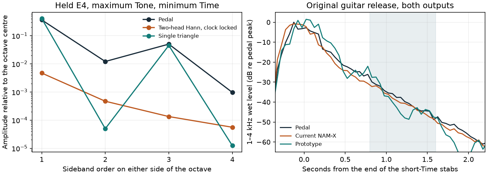

# RV-6 Shimmer on a shared stereo response

The rack now plays this model on `dsp/reverb-rv6`. “Current NAM-X” in the original experiment and figures refers to the previous tank implementation at `e1fe4c9`. [Measurements from the rack](#rack-implementation)

On the short-Time guitar recording that prompted the handoff, the pedal leaves **5.5%** of its wet release outside the stereo relationship measured on its sweep. Current NAM-X leaves **52.7%** against that same pedal sweep. The offline prototype gives **3.1–8.3% over four clock starts**, with a median of **5.3%**. The two recordings have independent, free-running clocks. The percentage measures stereo amplitude and phase within the release. It permits different waveforms inside the measured stereo relationship. [Original routing experiment](SHIMMER-ROUTING.md)



## The octave window

At maximum Tone and minimum Time, the held 329.63 Hz note is nearly commensurate with the 6.729 Hz grain hop. This makes the shape of the read window particularly visible. Remove the independently swept unshifted stereo response at each generated line, then average the two sideband amplitudes on either side of the octave. The octave centre has amplitude one.

| Distance from the centre in grain hops | Pedal | Two overlapping Hann heads at the pedal's clock | One triangular window per hop |
|---|---:|---:|---:|
| 1 | 0.364 | 0.0047 | 0.405 |
| 2 | 0.012 | 0.00047 | 0.00005 |
| 3 | 0.050 | 0.00013 | 0.045 |
| 4 | 0.001 | 0.00006 | 0.00001 |

At exact tuning a triangular window gives first and third sidebands of 0.405 and 0.045 and nulls at the even orders. The two-head overlap largely cancels the movement at this pitch. The triangular read in the prototype spans **148.6 ms** and gives greatest weight to audio about **80 ms** back, including its small fixed offset. Current NAM-X reads two overlapping 299 ms grains with their greatest weight about 150 ms back. The window is an effective model of the forward octave. These measurements leave the pedal's exact delay-line implementation open.

## What makes the sound

The renderer takes the dry mono DI. A clocked octave shifter supplies the direct sound and up to three successive octave raises to short mono filters. A longer mono return comes from the octave-off sweep at a nearby Time setting. Moving delay reads and further octave raises act on that return while it decays. At each measured knob position, the paths meet at a **single causal stereo filter** that supplies the frequency-dependent level and phase at Outputs A and B. Between measured positions the renderer mixes neighbouring models and compensates for cancellation measured with a common noise probe. Only the filter-design step uses frequency-domain projections. Wet playback uses the current and past input samples.

The calibration separates octave orders on the logarithmic sweep by fitting the dry input and successive triangular reads under a finite impulse-response length. It factors those responses through a stereo filter learned from the dark, bright and matching sweeps. The noise bursts and held 330 Hz note set the relative levels, motion and decay. When turning Tone down, each additional rise in pitch also passes through the measured feedback gain. The 9:00 Tone correction uses the noise burst from `check-a`, the only focused recording at that position. All guitar excerpts and the entire `check-b` recording were withheld from coefficient fitting.

An earlier trial sent the clock-locked NAM-X tank through the measured stereo output. The stereo score fell, but a version fitted to the attack was over 10 dB too quiet in the original release. The captured octave-off return supplied the missing decay. The late-level adjustment uses the part of the correction on which the noise burst and the held-note release agree. Where both probes resolve a 20 dB drop above the floor, they also set the slope of the late impulse response. On the original guitar this reduced the 1.6–2.2 s level deficit from 12.2 to 3.6 dB. Guitar scores were inspected between iterations to choose the design. [Offline renderer and calibration](../../../tools/capture/rv6/shimmer_prototype.py)

## Guitar results

The spectral score is the RMS of seven wet-energy errors in dB from 125 Hz to 8 kHz. It includes the full excerpt and recorded tail, both stereo channels, and the measured floor under each model. Each score compares a model directly with the same pedal recording. Across **20 excerpt/setting pairs** the median fell from **2.35 to 1.14 dB**. Several settings repeat the same guitar DI.

| Guitar excerpt | Current NAM-X | Prototype |
|---|---:|---:|
| Time 7:00, stabs | 2.30 dB | 0.91 dB |
| Noon, stabs | 1.96 dB | 0.49 dB |
| Noon, chords | 2.14 dB | 1.18 dB |
| Noon, lead | 1.97 dB | 1.04 dB |
| Noon, funk | 3.01 dB | 1.16 dB |
| Held-out `check-b`, stabs | 2.42 dB | 0.57 dB |
| Held-out `check-b`, lead | 3.30 dB | 0.52 dB |

The original **44.0%** compared NAM-X against its *own* sweep. On that particular release the prototype scores **0.14%** against its own sweep. A shared output filter makes this an easy test. The pedal-sweep comparison above is stricter. Using the physical burst as another stereo reference gives **7.1%** for the recorded guitar and **4.3–9.4%** for the prototype's four starts. At noon the pedal-sweep release result is **5.2%** for the pedal, **46.0%** for current NAM-X, and **4.6–8.4%** for the prototype.

On the short-Time listening file the 1–4 kHz release level, 0.8 to 1.6 seconds after the excerpt, is **1.0 dB above** the recording. The fraction of the tail's envelope movement on the clock harmonics is **40% / 33%** on pedal A / B, **18% / 22%** on current NAM-X and **35% / 35%** on the prototype. On the noise burst, the short-Time 4 and 8 kHz bands now peak in the same 50 ms frame as the pedal, centred at 325 ms. At maximum Time the prototype's 8 kHz peak is still 100 ms late.

The separate noon guitar release is still **3.7 dB quiet** and its envelope is too regular. On the focused noon E4, the unshifted fundamental is about **10 dB quiet**. Across the six earlier input pitches, 15 octave-to-fundamental ratios give about **7 dB RMS** error. This counts generated bands below 10 kHz whose recorded level exceeds −35 dB relative to the fundamental. [Scores, individual phases, octave ratios and burst timing](2026-11-15-focused/fit/shimmer-prototype.json)

Two further trials addressed that E4. Taking the fine frequency response of the unshifted path from the maximum-Tone capture brought the deficit down to about 2 dB, but increased the noon funk error from 1.16 to 1.72 dB and made the 165 Hz note worse. Adding a static residual learned from repeated sweeps and the burst recovered less than 1 dB of the E4 fundamental. The listening files use the version scored in the table.

## Reproduce and listen

From the repository root, with the local capture WAVs present, the following builds the offline comparison renderer, calibrates the filters and scores the recordings. The prototype runs at 48 kHz. Its output includes the measurement rig's gain and response. The bank and 24-bit listening WAVs live in git-ignored `build-rv6/shimmer-model/`.

```sh
mkdir -p build-rv6/shimmer-model/baseline
git archive e1fe4c9 src/dsp tools/capture/render_rv6.cpp | tar -x -C build-rv6/shimmer-model/baseline
g++ -std=c++23 -O2 -Ibuild-rv6/shimmer-model/baseline/src/dsp -Iexternal/signalsmith-stretch/include \
    -Iexternal/signalsmith-linear/include build-rv6/shimmer-model/baseline/tools/capture/render_rv6.cpp \
    -o build-rv6/shimmer-model/current
export OPENBLAS_NUM_THREADS=1
python3 tools/capture/rv6/shimmer_prototype.py fit
python3 tools/capture/rv6/shimmer_prototype_check.py --current build-rv6/shimmer-model/current --audio --earlier
python3 tools/capture/rv6/shimmer_prototype_check.py --current build-rv6/shimmer-model/current \
    --publish captures/boss/rv-6/2026-11-15-focused/fit
python3 tools/capture/rv6/shimmer_prototype.py render captures/di/stabs.wav \
    build-rv6/shimmer-model/my-stabs.wav --time 0 --tone .5 --level .5
```

The short comparison repeats the last attack and its release in pedal, current NAM-X, prototype order. Each full comparison uses the same dry stereo recording path and a single playback gain across all three versions. [Short release comparison](../../../build-rv6/shimmer-model/listening/short-release-pedal-current-prototype.wav) · [Full short-Time pedal](../../../build-rv6/shimmer-model/listening/time-0700-shimmer-stabs-pedal.wav) · [Full short-Time prototype](../../../build-rv6/shimmer-model/listening/time-0700-shimmer-stabs-prototype.wav) · [Comparison program](../../../tools/capture/rv6/shimmer_prototype_check.py)

## Rack implementation

The Shimmer selection in the Reverb rack (preset type 8) runs the shared clock, the forward and returning octave paths, and the twelve fitted stereo responses. Time and Tone mix the neighbouring measured settings. The filters store 16-bit taps with a separate floating-point scale for each group of 256 taps to retain the quiet decay. The exporter removes the capture rig's measured complex response from each stereo channel. The executable embeds the resulting 13 MiB bank. [DSP](../../../src/dsp/Rv6Shimmer.cpp) · [Bank exporter](../../../tools/capture/rv6/export_shimmer.py)

The DSP runs at the capture rate of 48 kHz. The dry passes immediately and the wet has 64 samples (1.33 ms) of block delay. Other host rates use a windowed-sinc converter on the wet path. With 128-frame callbacks at 48 kHz, Shimmer averaged 71 µs at noon and 221 µs at Time 96%, Tone 58%, where three responses contribute. The respective 99th percentiles were 96 and 278 µs against a 2,667 µs deadline. These are local Release-build timings.

| Guitar measurement | Previous rack | Offline prototype | Compiled rack |
|---|---:|---:|---:|
| Short-Time release outside the pedal sweep's stereo relationship | 52.7% | 5.3% | 5.3% |
| Short-Time stabs, seven-band RMS error | 2.30 dB | 0.91 dB | 0.91 dB |
| Median seven-band RMS error over 20 excerpt/setting pairs | 2.35 dB | 1.14 dB | 1.14 dB |
| Held-out `check-b` lead | 3.30 dB | 0.52 dB | 0.52 dB |

The pedal's own short-Time release measured 5.5%. The new release scores are medians over four clock starts. The guitar comparison enters through the same `ReverbProcessor` as the rack and applies the rig's response to its wet signal. The checker also writes two listening files with the pedal first and the rack second, at one gain for each pair. [Scores for every excerpt](2026-11-15-focused/fit/shimmer-rack.json) · [Short-Time release comparison](../../../build-rv6/shimmer-model/rack/time-0700-pedal-rack.wav)

From the repository root, build the app and run the comparison with the local recordings present.

```sh
cmake -S . -B build-release -DCMAKE_BUILD_TYPE=Release
cmake --build build-release --target namx render_rv6
OPENBLAS_NUM_THREADS=1 python3 tools/capture/rv6/shimmer_rack_check.py
```

After refitting the offline model, run `OPENBLAS_NUM_THREADS=1 python3 tools/capture/rv6/export_shimmer.py` and rebuild to embed the new bank.
