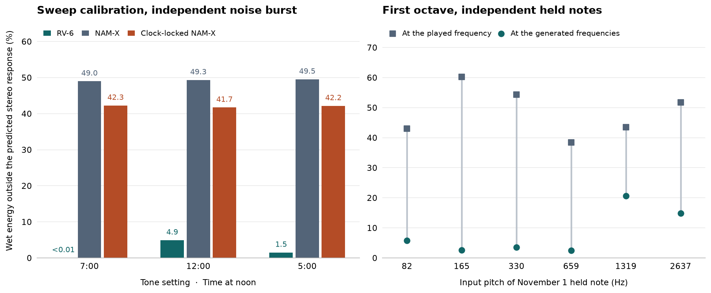

# Where the RV-6 Shimmer generates its motion

**The dominant pitched and modulated sound reaches a largely fixed stereo response.** At minimum Tone, with the octave turned off, a calibration sweep predicts the relationship between the two wet outputs on a separate guitar passage almost to the recording floor. The unpitched note itself still moves. With the octave audible, its stereo amplitude and phase follow the frequency it *lands on*. These observations constrain where to put the time variation in a model for Input A driving Outputs A and B.

NAM-X currently moves the delay reads inside both stereo feedback delay networks. Those reads help determine the instantaneous signals at A and B. Summing them for the mono octave feedback leaves the two moving stereo outputs in place. [Engine signal path](../../../src/dsp/Rv6Reverb.h)



## Use one signal to calibrate and another to test

After slip correction and dry removal, take the complex pair of sweep outputs at each frequency. On a separate burst or guitar recording, ask how much of its wet energy lies outside the A/B amplitude **and phase** relationship measured on the sweep. In the table, Time is at noon. Lower is better.

| Tone | Pedal, burst | NAM-X, burst | Clock-locked NAM-X, burst |
|---|---:|---:|---:|
| 7:00 | 0.008% | 49.0% | 42.3% |
| Noon | 4.9% | 49.3% | 41.7% |
| 5:00 | 1.5% | 49.5% | 42.2% |

At Tone 7:00 there is also a direct one-way test. Learn a regularized filter from sweep A to sweep B. Give it **only guitar A**. Its error against recorded guitar B is **−30.3 dB** relative to the wet B signal. NAM-X's error on the same test is **+7.1 dB**. This works in the presence of substantial modulation. On the held 330 Hz note, lines beside the carrier contain about 73% of A's wet energy and 14% of B's energy in the measured band. On the interface loopback those sidebands are about 102 dB below the band total.

At noon, seven sweep and burst excitations give a better estimate of the dominant stereo response. Once frozen, it leaves 1.66% of a separate noon guitar take outside that response. A smaller contribution remains when the octave is active. At Time 7:00 and Tone noon, the single-sweep test leaves **5.7% on the guitar take that prompted the investigation**, against **48.2%** for NAM-X.

The test is frequency selective. Moving the sweep calibration by 30 Hz leaves 51% outside on the noon guitar take. Time matters too. At minimum Tone, using the Time 7:00 sweep on the Time 5:00 burst leaves about 26% outside, against less than 0.1% with the matching Time.

## Locate the octave relative to the stereo response

A held 329.63 Hz sine provides a particularly clean distinction. Measure the stereo relationship on a separate, octave-off sweep at the same Time setting. For each spectral line of the generated first octave, predict its stereo relationship two ways.

| Pedal setting | Use the relationship at the input note, 329.63 Hz | Use the relationship at each generated line near 659 Hz |
|---|---:|---:|
| Time 7:00, Tone noon | 65.3% outside | 1.1% outside |
| Time noon, Tone noon | 57.1% | 3.9% |
| Time noon, Tone 5:00 | 61.4% | 1.2% |
| Time 5:00, Tone noon | 64.2% | 2.0% |

The destination prediction also wins at **all six pitches** of the separate November 1 session, 82–2637 Hz. Its error rises to 15–21% at the two highest input pitches. The 1 kHz recording from the October 31 follow-up gives 3.5% at the generated lines against 48.8% at the input frequency. Even at Tone 7:00, the modulation sidebands of the *unshifted* 330 Hz note carry the stereo response at their individual frequencies. At Time noon the error is 0.019%, against 69% using the carrier's stereo relationship.

Turning Tone up also changes the distribution of the movement. At Time noon, about 56% of the first octave's fitted line energy sits on every fifth line of the clock grid at Tone noon. At Tone 5:00 that fraction is 99.6%. Uniformly raising the octave level would leave this fraction unchanged.

## The shifter and modulation keep time together

The held notes put the output lines at the input frequency plus integer multiples of **1.3458 Hz**. A measurement on the focused 330 Hz note gives 1.345816 Hz independently on A and B. This predicts the *phase advance* of every generated octave across about 743 ms. Fixing that clock and testing the first octave on the six earlier notes leaves at most 1.0% complex-envelope prediction error on either output. The separate 1 kHz take gives about 0.1%.

In a private renderer, give every tank line the measured rate, keep its original phase offset, and make the two-head shifter's hop rate five times that rate. Double-precision phase accumulation avoids numerical detuning. At noon the next-cycle first-octave error is 0.06% / 0.03% on A / B, close to the pedal's 0.05% / 0.02%. The clock-locked model still fails the sweep-to-guitar stereo test.

It also misses the movement after the strings stop. Over four seconds of the noon guitar tail, **43% / 45%** of the pedal's 1–4 kHz envelope movement lies on the clock harmonics. The current build gives 17% / 10% and the locked build 20% / 18%. The stereo finding applies inside that decay. Restrict the sweep-derived stereo filter to half a second of audio on either side, then examine windows starting 0.8 seconds after the excerpt ends. About 4–6% of the pedal's wet energy is left as error in the three release windows. The dominant component retains the repeating envelope on both sides. On the original Time 7:00 guitar take, in the 0.8–1.6 s release window, the same test leaves 5.5% on the pedal, 44.0% on NAM-X and 45.7% on the clock control. The later short-Time windows approach the recording floor.

## Implication for the next model

The subsequent offline prototype implements the shared path and tests its grain window and
release on held-out guitar recordings. [Prototype measurements and listening files](SHIMMER-PROTOTYPE.md)

Put the clocked octave generator and the principal modulation on a **shared signal path**, and let a stereo reverb or diffuser give each resulting frequency its measured A/B response. A mono modulated feedback return into a stationary stereo network is another realization with this property. Use the octave-off sweep at the matching Time as a stereo constraint, the held notes to check pitch and phase, and the separate guitar release to check motion. The remaining error with the octave active gives a measure for any additional stereo path.

These mono-input recordings identify a relationship between outputs. They allow a common filter to be moved between the source and the two output filters. The precise feedback wiring, the distribution of decay time between stages, and the number of physical tanks therefore remain open. A raw Shimmer sweep includes the unknown moving source and by itself gives only the stereo constraint.

## Reproduce the measurements

For a reference stereo vector `S` and a test stereo vector `Y`, the energy outside the reference relationship at one FFT bin is `abs(S_A * Y_B - S_B * Y_A)^2 / (abs(S_A)^2 + abs(S_B)^2)`. Sum over 200 Hz–6 kHz and divide by the test's total wet energy in the same band. This permits a different complex source amplitude at every frequency. The one-way guitar prediction instead uses only the sweep-derived B/A filter and test A. It limits inverse gain at deep nulls with a regularizer of 0.001 times the total sweep power at that bin.

The broadband test uses the first 18 seconds of the sweep and ring-out, the first six seconds from the −12 dB burst, and the guitar stabs with their recorded tail up to the FFT length. Using the full sweep and burst tails gives 4.92% at noon and 0.014% at minimum Tone and maximum Time. The note tests fit the nearby clock lines jointly, within 27 spacings on each side of the nominal output band. The release metric uses the detrended 1–4 kHz envelope, the 0.7–20 Hz range, and a tolerance of 0.12 Hz around clock harmonics. [Measurement program](../../../tools/capture/rv6/shimmer_structure.py) · [Results by take and output](2026-11-15-focused/fit/shimmer-routing.json)

From the repository root, use the standard offline renderer and optionally build the clock control against private copies of two headers. Recopy the headers before each application of the patch.

```sh
mkdir -p build-rv6/clock-control/baseline
git archive e1fe4c9 src/dsp tools/capture/render_rv6.cpp | tar -x -C build-rv6/clock-control/baseline
g++ -std=c++23 -O2 -Ibuild-rv6/clock-control/baseline/src/dsp -Iexternal/signalsmith-stretch/include \
    -Iexternal/signalsmith-linear/include build-rv6/clock-control/baseline/tools/capture/render_rv6.cpp -o build-rv6/clock-control/current
cp build-rv6/clock-control/baseline/src/dsp/{Rv6Reverb,GrainShifter}.h build-rv6/clock-control/
git apply -p0 --directory=build-rv6/clock-control tools/capture/rv6/shimmer_clock_control.patch
g++ -std=c++23 -O2 -Ibuild-rv6/clock-control -Ibuild-rv6/clock-control/baseline/src/dsp -Iexternal/signalsmith-stretch/include \
    -Iexternal/signalsmith-linear/include build-rv6/clock-control/baseline/tools/capture/render_rv6.cpp -o build-rv6/clock-control/locked
OPENBLAS_NUM_THREADS=1 python3 tools/capture/rv6/shimmer_structure.py \
    --render build-rv6/clock-control/current --clock-render build-rv6/clock-control/locked \
    --output build-rv6/clock-control/results.json
```
