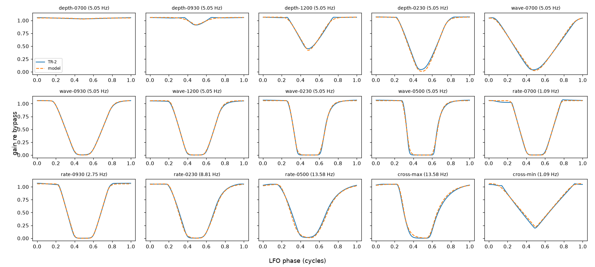
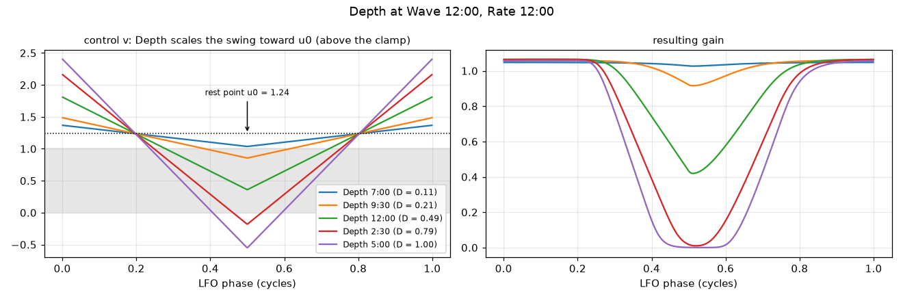
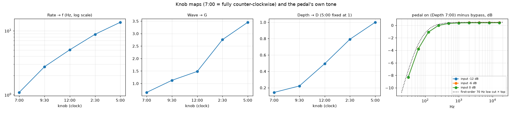

# Boss TR-2 Tremolo

Captured 2026-10-26, session [`2026-10-26/`](2026-10-26/). Rig, tools and method:
[`tools/capture/README.md`](../../../tools/capture/README.md). Fit:
`tools/capture/fit_tr2.py captures/boss/tr-2/2026-10-26` (~10 s) → [`2026-10-26/fit/`](2026-10-26/fit/).

The TR-2 has three knobs, **Rate**, **Wave** and **Depth**, and is mono. This study
finds what its gain does over time at any setting, and what the pedal does to the sound
besides. The result is a model of seven constants and two knob maps that matches every
recorded cycle to a median 1.5 % of full gain.

## The model

The output is the input, high-passed, times a gain that moves with the LFO:

```
y(t) = g(t) · HP70(x(t))
```

1. **LFO phase:** φ(t) = frac(f·t), f = the rate in Hz.
2. **Triangle:** tri(φ) = 1 − 4·min(φ, 1 − φ) — +1 at φ = 0, −1 at φ = ½.
3. **Control signal:**

   ```
   v = u0 + D · ( G · (tri + β) − κ )
   ```

   G from the Wave knob, D from the Depth knob, u0, β, κ constants.
4. **Soft clamp to [0, 1]:**

   ```
   c = S(v) = [ ln(1 + e^(s·v)) − ln(1 + e^(s·(v − 1))) ] / s
   ```

   ≈ 0 below 0, ≈ v inside, ≈ 1 above 1; s sets how round the corners are (s → ∞ is a
   hard clamp).
5. **Follower with separate fall and rise times** (one-pole, per sample at rate fs):

   ```
   a = 1 − exp(−1 / (τ · fs)),   τ = τ_down if c[n] < g[n−1] else τ_up
   g[n] = g[n−1] + a · (c[n] − g[n−1])
   ```
6. **Gain:** top · g.
7. **Tone, outside the LFO:** a first-order high-pass at ~70 Hz on the audio.

How the knobs work, in words:

- **Wave is a plain gain on an offset triangle.** A small G keeps the triangle mostly
  inside the clamp's window: the gain follows it, a triangle (Wave 7:00). A large G
  overshoots both edges: the clamp flattens the top and the bottom into a square (Wave
  5:00). There is no separate shaping circuit in the model; the clamp does it all.
- **Depth pulls the whole swing towards a rest point above the clamp's top** (u0 =
  1.25 > 1). At low Depth the control barely dips below 1: the gain hardly moves. At
  full Depth it dives below 0: the gain reaches silence for part of every cycle. The
  offset β makes the gain spend more of the cycle at full level than at silence.
- **The gain drops about 2.5× faster than it recovers** (τ_down 3.5 ms, τ_up 8.7 ms):
  on fast, square settings it leaves the top almost at once and creeps back up to it.
  A gain element with a fast attack and slow release behaves like this (a light-dependent
  resistor lit by an LED is the classic one); the model doesn't depend on what the
  TR-2's actually is.

### Parameters

| Constant | Value | Meaning |
|---|---|---|
| u0 | 1.2543 | rest point of the control (above 1: full level at Depth 0) |
| β | 0.42844 | DC offset added to the triangle before the Wave gain |
| κ | 0.96141 | offset subtracted before Depth scales the swing |
| s | 18.391 | clamp sharpness |
| top | 1.05787 | gain at the top of the cycle: +0.49 dB over bypass |
| τ_down | 3.46 ms | follower time constant while the gain falls |
| τ_up | 8.66 ms | follower time constant while the gain rises |

| Knob position | 7:00 | 9:30 | 12:00 | 2:30 | 5:00 |
|---|---|---|---|---|---|
| Rate → f (Hz) | 1.0930 | 2.7491 | 5.0517 | 8.8147 | 13.5843 |
| Wave → G | 0.6422 | 1.1268 | 1.4826 | 2.7587 | 3.4550 |
| Depth → D | 0.1432 | 0.2218 | 0.4937 | 0.7928 | 1 (fixed) |

D at 5:00 is fixed at 1: D and G only appear together in the swing, so one of them
has to set the scale. 7:00 = fully counter-clockwise, 5:00 = fully clockwise; the
positions between were set by eye, so their maps carry a few degrees of uncertainty
(7:00 and 5:00 are exact). Between positions, interpolate. Rate was measured directly
(each take's LFO frequency), not fitted; the Wave knob doesn't move it (5.046–5.056 Hz
across the Wave takes, 0.2 %).

### How well it fits

Per take, the error between the model and the measured averaged cycle, in units of the
pedal's full gain (bypass = 1):

| Take | Rate · Wave · Depth | rms | max |
|---|---|---|---|
| depth-0700 | 12:00 · 12:00 · 7:00 | 0.010 | 0.014 |
| depth-0930 | 12:00 · 12:00 · 9:30 | 0.010 | 0.031 |
| depth-1200 | 12:00 · 12:00 · 12:00 | 0.015 | 0.044 |
| depth-0230 | 12:00 · 12:00 · 2:30 | 0.022 | 0.051 |
| wave-0700 | 12:00 · 7:00 · 5:00 | 0.017 | 0.029 |
| wave-0930 | 12:00 · 9:30 · 5:00 | 0.005 | 0.011 |
| wave-1200 | 12:00 · 12:00 · 5:00 | 0.009 | 0.022 |
| wave-0230 | 12:00 · 2:30 · 5:00 | 0.013 | 0.051 |
| wave-0500 | 12:00 · 5:00 · 5:00 | 0.021 | 0.077 |
| rate-0700 | 7:00 · 12:00 · 5:00 | 0.015 | 0.034 |
| rate-0930 | 9:30 · 12:00 · 5:00 | 0.009 | 0.020 |
| rate-0230 | 2:30 · 12:00 · 5:00 | 0.016 | 0.042 |
| rate-0500 | 5:00 · 12:00 · 5:00 | 0.026 | 0.074 |
| cross-max | 5:00 · 5:00 · 5:00 | 0.025 | 0.051 |
| cross-min | 7:00 · 7:00 · 2:30 | 0.020 | 0.052 |

All 15 takes over 256 phase bins: rms 0.017. The two cross takes are the check on the
structure: their Wave and Depth values are shared with other takes, and no other take
combines them. Figure: [`fit/tr-2-cycles.png`](2026-10-26/fit/tr-2-cycles.png).

**Not modelled:** at the slowest rate (1.09 Hz: rate-0700, cross-min) the real top sags
by ~3 % just before each fall. Small; leave it unless it's audible.



### The pedal's own sound

From the Depth 7:00 sweeps against the bypass sweeps at the same levels (−12, −6 and
0 dB re the reference):

| Third-octave band (Hz) | 31.5 | 63 | 125 | 250 | 500 | 1k | 2k | 4k | 8k | 16k |
|---|---|---|---|---|---|---|---|---|---|---|
| on − bypass (dB, at 0 dB) | −8.33 | −3.78 | −1.10 | −0.02 | +0.29 | +0.37 | +0.39 | +0.39 | +0.39 | +0.40 |

- **A low cut close to first order at ~70 Hz**, and +0.4 dB of level. The 70 Hz corner
  was read off this response (the dotted curve in `tr-2-knobs-tone.png`), not fitted by
  least squares. The level shows as `top` in the gain model (+0.49 dB, measured on the
  1 kHz carrier's envelope; the sweep says +0.37–0.40 dB at 1 kHz — a 0.1 dB
  disagreement between two methods).
- **Linear:** 0 dB against −12 dB input gives +11.94…11.97 dB in every band.
- **Distortion:** H2 −61 dB, H3 −70 dB re the fundamental (bypass: −65, −76): inaudible.
- **Noise:** −86.9 dBFS RMS with the pedal on (−93.7 bypassed), ~73 dB under the
  reference peak. The LFO bleeds through at 5.05 Hz at −84 dBFS: sub-audio and ~70 dB
  down, inaudible.

## How the model was found

The data: a 1 kHz sine through the pedal for 20 s per setting, its envelope (Hilbert
magnitude, 300 Hz low-pass) divided by the bypass take's — the gain relative to bypass
— and the median over all cycles per phase bin: one averaged LFO cycle per take,
phase 0 at the fundamental's peak (`analysis.py`). Figure:
[`fit/tr-2-raw.png`](2026-10-26/fit/tr-2-raw.png).

1. **First look.** Rate 1.09–13.6 Hz; Depth 5:00 reaches silence; the pedal adds +0.4
   dB; Depth 7:00 still ripples by 2 %; and Depth and Wave interact (at Depth 2:30, the
   triangle end of Wave doesn't dip as deep).
2. **Guess 1: a triangle morphing into a square** (tanh(k·tri)/tanh(k), the shape
   normalized to its swing). Wrong: shape errors of 17–25 % of the swing. The cycles
   have strong even harmonics (H2/H1 up to 0.44): the gain sits at full level for ~40 %
   of the cycle and touches silence briefly. Not a symmetric shape — something clamps
   the top and the bottom.
3. **Guess 2: a soft clamp of an offset triangle**, top·S(b + A·tri), fitted per take
   (offset b, amplitude A). Good: 1–4 % per take. But its parameters trade off against
   each other, and the swing A shrank with rate (1.58 at 1 Hz, 1.0 at 13.6 Hz).
4. **Adding a 5 ms symmetric smoothing after the clamp** explained most of that, and
   the per-take fits got to 1–3.6 %.
5. **Guess 3, circuit-shaped:** triangle → Wave gain → separate clipper → Depth → a
   power-law gain element, with one parameter per knob position shared across takes.
   Failed: 7–18 % errors, the Wave gains came out flat.
6. **The relations between the per-take parameters gave the structure.** Along the Wave
   series (Depth 5:00) every take satisfied (b − 0.304)/A = 0.377 ± 0.002 — Wave is a
   plain gain on a fixed offset triangle. Along the Depth series (Wave 12:00),
   b = 1.238 − 0.274·A — Depth scales the swing towards a point above the clamp. Both
   together: v = u0 + D·(G·(tri + β) − κ). Fitted with one G per Wave position and one D
   per Depth position, shared by all takes: rms 0.029, cross-min (no own parameters)
   within 1.4 %. Weak only where Wave and Rate are both high (cross-max 7 %).
7. **The fall/rise asymmetry**, spotted by eye in the fast takes' plots: the real
   pedal's falling edge is earlier and steeper, and its rising edge creeps up to the top.
   Measured: at Wave and Rate 5:00 the gain falls 90→10 % in 8 ms but rises 10→90 % in
   20 ms, and takes another 12–28 ms from 90 to 99 %. Replacing the symmetric smoothing
   with a follower with separate fall and rise times (3.5 / 8.7 ms) made the
   rate-dependent swing term unnecessary (it ran off to its bound), dropped one
   parameter, and brought the rms from 0.029 to 0.017 (cross-max 7 % → 2.5 %).

The fit (`fit_tr2.py`): `scipy.optimize.least_squares` over all 15 sine takes jointly,
7 constants + 5 G + 4 D + one phase offset per take (aligning the cycles only), 256
phase bins per cycle. The follower is nonlinear, so it is simulated over three cycles
per take and the last one compared. Convergence was checked by refitting from the
solution with tolerances at 1e-12: identical parameters.

## The measurements

`tools/capture/plans/tr-2.json`, 23 takes, 7.2 min of audio, all at 48 kHz with zero
xruns and a 9.5 ms round trip (455–456 samples):

- 4 bypass takes: log sweeps 20 Hz–20 kHz at −12, −6, 0 dB, and the 1 kHz sine (the
  gain reference).
- 3 sweeps at Depth 7:00 (the pedal's own tone, and whether it distorts with level).
- 1 kHz sine, 20 s each: Depth at 7:00, 9:30, 12:00, 2:30 (Rate, Wave 12:00); Wave at
  all five positions (Rate 12:00, Depth 5:00); Rate at 7:00, 9:30, 2:30, 5:00 (Wave
  12:00, Depth 5:00); cross-max (all 5:00) and cross-min (Rate 7:00, Wave 7:00, Depth
  2:30).
- 10 s of silence with the pedal on at Depth 5:00 (noise and LFO bleed).

The pedal ran on a battery. The WAVs are not in git (240 MB); the sidecars and the rig
are.

## Figures

All written by `fit_tr2.py`:

- [`tr-2-raw.png`](2026-10-26/fit/tr-2-raw.png): one second of a take and its envelope.
- [`tr-2-model.png`](2026-10-26/fit/tr-2-model.png): the model's stages for Wave 7:00,
  12:00 and 5:00.
- [`tr-2-depth.png`](2026-10-26/fit/tr-2-depth.png): Depth pivoting the swing around u0.
- [`tr-2-knobs-tone.png`](2026-10-26/fit/tr-2-knobs-tone.png): the knob maps and the
  pedal's frequency response.
- [`tr-2-cycles.png`](2026-10-26/fit/tr-2-cycles.png): all 15 takes, measured against
  the model.





## Implementing it

Everything runs per sample and is cheap: a phase accumulator, the triangle, two
softplus terms (`x > 0 ? x + log1p(exp(−x)) : log1p(exp(x))` avoids overflow), the
follower and a one-pole high-pass. The follower and the high-pass keep state per channel
(and per LFO for an auto-panning stereo variant). Knob positions map to G and D by
interpolating the tables above.
