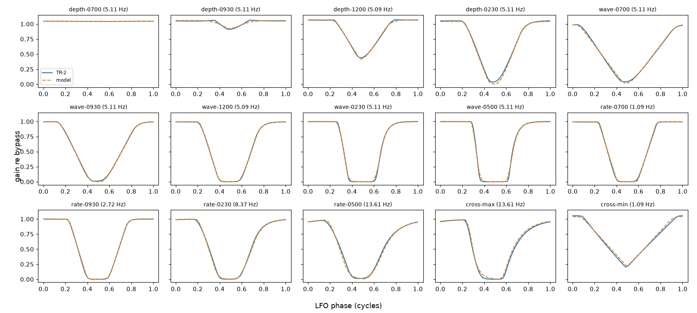
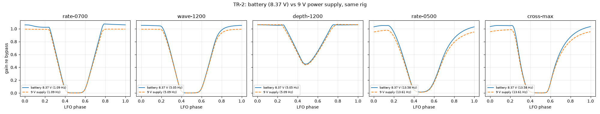
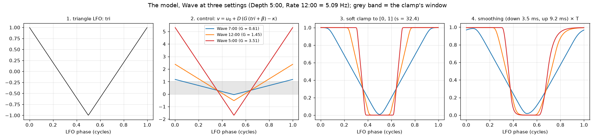
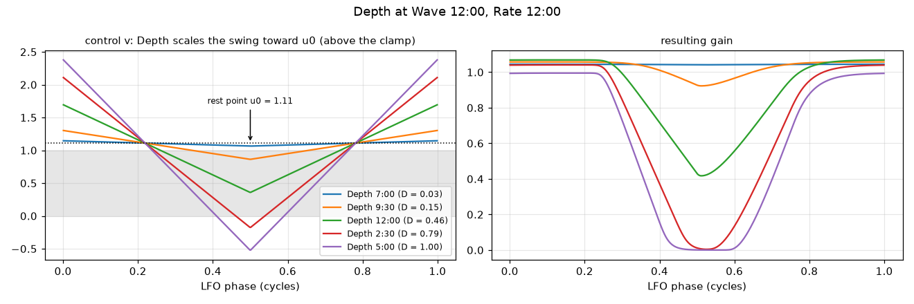
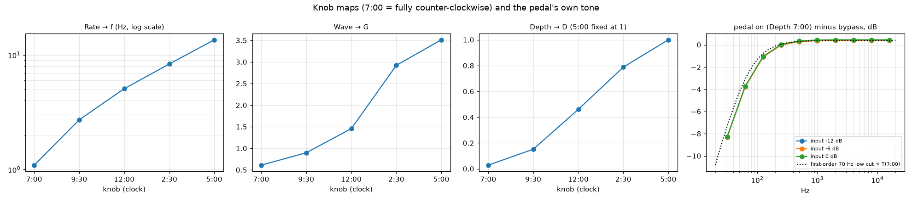
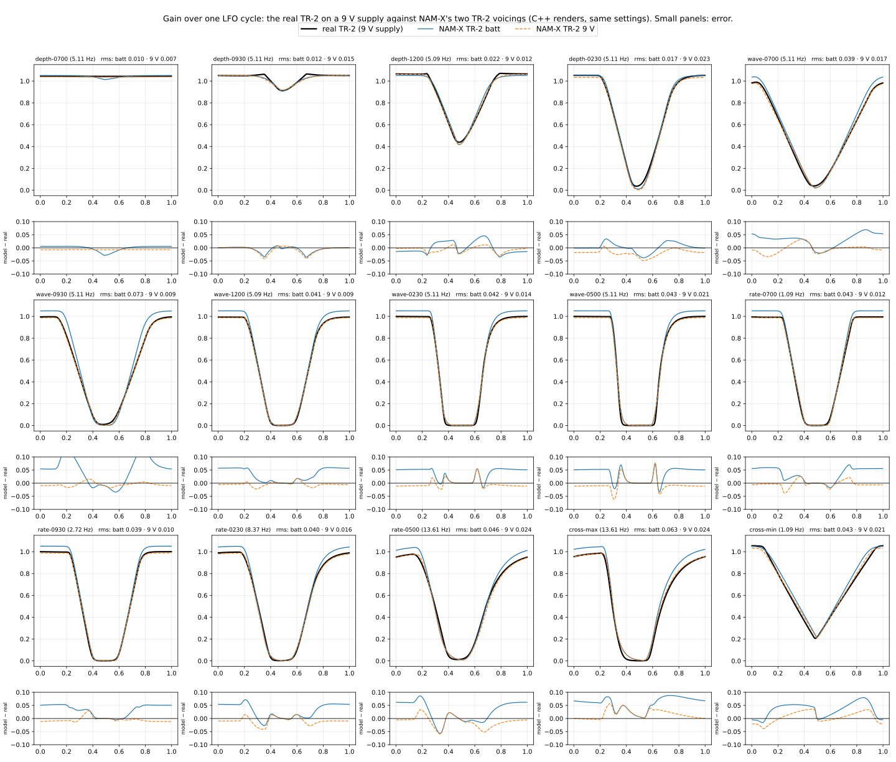

# Boss TR-2 Tremolo

Two sessions, 2026-10-26, same rig and calibration
([`tools/capture/README.md`](../../../tools/capture/README.md)):

| Session | Power | Role |
|---|---|---|
| [`2026-10-26-psu/`](2026-10-26-psu/) | 9 V power supply | **the reference**: the pedal as designed |
| [`2026-10-26/`](2026-10-26/) | a tired battery (8.37 V without load after the session) | the first capture; NAM-X's first TR-2 voicing was fitted to it and approved by ear |

Fit either with `tools/capture/fit_tr2.py captures/boss/tr-2/<session>` (~10 s) →
`<session>/fit/`.

The TR-2 has three knobs, **Rate**, **Wave** and **Depth**, and is mono. This study
finds what its gain does over time at any setting, and what the pedal does to the sound
besides. The result is a model of six constants and three knob maps that matches every
recorded cycle of the supply session to a median 1.3 % of full gain. The pedal is analog:
with it on, the signal arrives no later than bypassed (0.0002 ms at minimum Depth; at full
Depth the 1 kHz carrier is even 25 µs *early*, the 70 Hz low cut's phase lead plus whole-
sample alignment), where any A/D/A path would add a millisecond or more.

## The model

The output is the input, high-passed, times a gain that moves with the LFO:

```
y(t) = g(t) · HP70(x(t))
```

1. **LFO phase:** φ(t) = frac(f·t), f = the rate in Hz.
2. **Triangle:** tri(φ) = 1 − 4·min(φ, 1 − φ) — +1 at φ = 0, −1 at φ = ½.
3. **Control signal:**

   ```
   v = u0 + D · ( G · (tri + β) − κ )
   ```

   G from the Wave knob, D from the Depth knob, u0, β, κ constants.
4. **Soft clamp to [0, 1]:**

   ```
   c = S(v) = [ ln(1 + e^(s·v)) − ln(1 + e^(s·(v − 1))) ] / s
   ```

   ≈ 0 below 0, ≈ v inside, ≈ 1 above 1; s sets how round the corners are (s → ∞ is a
   hard clamp).
5. **Follower with separate fall and rise times** (one-pole, per sample at rate fs):

   ```
   a = 1 − exp(−1 / (τ · fs)),   τ = τ_down if c[n] < g[n−1] else τ_up
   g[n] = g[n−1] + a · (c[n] − g[n−1])
   ```
6. **Gain:** T · g, T (the level at the top of the cycle) from the Depth knob.
7. **Tone, outside the LFO:** a first-order high-pass at ~70 Hz on the audio.

How the knobs work, in words:

- **Wave is a plain gain on an offset triangle.** A small G keeps the triangle mostly
  inside the clamp's window: the gain follows it, a triangle (Wave 7:00). A large G
  overshoots both edges: the clamp flattens the top and the bottom into a square (Wave
  5:00). There is no separate shaping circuit in the model; the clamp does it all.
- **Depth pulls the whole swing towards a rest point above the clamp's top** (u0 > 1).
  At low Depth the control barely dips below 1: the gain hardly moves. At full Depth it
  dives below 0: the gain reaches silence for part of every cycle. The offset β makes
  the gain spend more of the cycle at full level than at silence. **Depth also sets the
  top level:** +0.35 to +0.58 dB over bypass up to 2:30, falling to unity (−0.04 dB)
  at 5:00.
- **The gain drops about 2.5× faster than it recovers** (τ_down 3.5 ms, τ_up 9.2 ms):
  on fast, square settings it leaves the top almost at once and creeps back up to it.
  A gain element with a fast attack and slow release behaves like this (a light-dependent
  resistor lit by an LED is the classic one); the model doesn't depend on what the
  TR-2's actually is.

### Parameters

| Constant | Supply (reference) | Battery | Meaning |
|---|---|---|---|
| u0 | 1.1100 | 1.2372 | rest point of the control (above 1: full level at Depth 0) |
| β | 0.43044 | 0.42832 | DC offset added to the triangle before the Wave gain |
| κ | 0.80716 | 0.94378 | offset subtracted before Depth scales the swing |
| s | 32.387 | 18.439 | clamp sharpness |
| τ_down | 3.52 ms | 3.46 ms | follower time constant while the gain falls |
| τ_up | 9.21 ms | 8.67 ms | follower time constant while the gain rises |

| Knob map, supply (battery) | 7:00 | 9:30 | 12:00 | 2:30 | 5:00 |
|---|---|---|---|---|---|
| Rate → f (Hz) | 1.0932 (1.0930) | 2.7225 (2.7491) | 5.0928 (5.0517) | 8.3682 (8.8147) | 13.6106 (13.5843) |
| Wave → G | 0.6086 (0.6394) | 0.8973 (1.1260) | 1.4543 (1.4793) | 2.9215 (2.7585) | 3.5130 (3.4576) |
| Depth → D | 0.0278 (0.1122) | 0.1515 (0.2136) | 0.4603 (0.4907) | 0.7878 (0.7931) | 1 (fixed) |
| Depth → T | 1.0452 (1.0477) | 1.0578 (1.0583) | 1.0690 (1.0646) | 1.0410 (1.0650) | 0.9952 (1.0579) |

D at 5:00 is fixed at 1: D and G only appear together in the swing, so one of them
has to set the scale. 7:00 = fully counter-clockwise, 5:00 = fully clockwise; the
positions between were set by eye in each session, so their maps carry a few degrees of
uncertainty (7:00 and 5:00 are exact) — that, not the power, is most of the difference
in the middle columns (compare Rate 12:00 and 2:30, set by eye; Rate 7:00 and 5:00 agree
to 0.02 % and 0.2 %). Between positions, interpolate. Rate was measured directly (each
take's LFO frequency), not fitted; the Wave knob doesn't move it (0.2 %). The constants
trade off against each other (u0, κ, D and T especially), so compare the sessions by
their curves, not parameter by parameter.

### How well it fits

Per take, the error between the model and the measured averaged cycle, in units of the
pedal's full gain (bypass = 1), supply session (battery in brackets):

| Take | Rate · Wave · Depth | rms | max |
|---|---|---|---|
| depth-0700 | 12:00 · 12:00 · 7:00 | 0.000 (0.004) | 0.001 (0.007) |
| depth-0930 | 12:00 · 12:00 · 9:30 | 0.013 (0.011) | 0.036 (0.033) |
| depth-1200 | 12:00 · 12:00 · 12:00 | 0.010 (0.014) | 0.025 (0.040) |
| depth-0230 | 12:00 · 12:00 · 2:30 | 0.020 (0.021) | 0.047 (0.052) |
| wave-0700 | 12:00 · 7:00 · 5:00 | 0.016 (0.017) | 0.034 (0.030) |
| wave-0930 | 12:00 · 9:30 · 5:00 | 0.008 (0.005) | 0.018 (0.011) |
| wave-1200 | 12:00 · 12:00 · 5:00 | 0.007 (0.009) | 0.017 (0.021) |
| wave-0230 | 12:00 · 2:30 · 5:00 | 0.012 (0.013) | 0.052 (0.051) |
| wave-0500 | 12:00 · 5:00 · 5:00 | 0.019 (0.021) | 0.075 (0.077) |
| rate-0700 | 7:00 · 12:00 · 5:00 | 0.012 (0.015) | 0.033 (0.034) |
| rate-0930 | 9:30 · 12:00 · 5:00 | 0.007 (0.010) | 0.025 (0.020) |
| rate-0230 | 2:30 · 12:00 · 5:00 | 0.014 (0.016) | 0.034 (0.042) |
| rate-0500 | 5:00 · 12:00 · 5:00 | 0.023 (0.026) | 0.067 (0.074) |
| cross-max | 5:00 · 5:00 · 5:00 | 0.026 (0.025) | 0.051 (0.051) |
| cross-min | 7:00 · 7:00 · 2:30 | 0.023 (0.020) | 0.041 (0.050) |

Median rms: supply 0.0128, battery 0.0149. The two cross takes are the check on the
structure: their knob values are shared with other takes, and no other take combines
them. Figure: [`2026-10-26-psu/fit/tr-2-cycles.png`](2026-10-26-psu/fit/tr-2-cycles.png).



### The pedal's own sound

From the Depth 7:00 sweeps against the bypass sweeps at the same levels:

| Third-octave band (Hz) | 31.5 | 63 | 125 | 250 | 500 | 1k | 2k | 4k | 8k | 16k |
|---|---|---|---|---|---|---|---|---|---|---|
| on − bypass, supply (dB) | −8.28 | −3.73 | −1.05 | +0.03 | +0.34 | +0.43 | +0.45 | +0.45 | +0.45 | +0.45 |
| on − bypass, battery (dB) | −8.33 | −3.78 | −1.10 | −0.02 | +0.29 | +0.37 | +0.39 | +0.39 | +0.39 | +0.40 |

- **A low cut close to first order at ~70 Hz**, and +0.4 dB of level at minimum Depth
  (T at 7:00 in the gain model: +0.39 dB). The 70 Hz corner was read off this response
  (the dotted curve in `tr-2-knobs-tone.png`), not fitted by least squares.
- **Linear:** 0 dB against −12 dB input gives +11.94…12.04 dB in every band.
- **Distortion:** H2 −61 dB, H3 −70 dB re the fundamental (bypass: −65, −76): inaudible.
- **Noise:** −96.6 dBFS RMS with the pedal on (supply; −86.9 on the battery): ~83 dB
  under the reference peak. The LFO's bleed is sub-audio and ~70 dB down, inaudible.

## Battery against power supply

The first session ran on a battery that measured 8.37 V afterwards. To find out whether
that mattered without recapturing everything, `plans/tr-2-check.json` recorded 9 of the
23 takes on a 9 V supply, favouring exact knob positions; it showed a difference, so the
other 14 followed into the same session.

| | Battery (8.37 V) | 9 V supply |
|---|---|---|
| Bypass level (control) | | +0.014 dB |
| LFO rate, Rate 7:00 / 5:00 (exact) | 1.0930 / 13.584 Hz | 1.0932 / 13.611 Hz (+0.02 / +0.2 %) |
| Dip timing, edges, depth of the dips | | identical |
| Tone and gain at minimum Depth | +0.39 dB | +0.45 dB |
| **Top of the cycle at full Depth** | **1.05–1.07** | **0.98–0.995 (~0.5 dB lower)** |
| A ~3 % sag at the top of the slowest setting | present | **gone** (a battery artifact) |
| Noise | −86.9 dBFS | −96.6 dBFS |

So the tired battery left the character alone (speed, shape, the fast fall and slow
rise) but held the top of the cycle ~0.5 dB high at full Depth, and added the slow
setting's sag. On the supply the top level depends on Depth; one constant for it fitted
the battery session (0.0150) but split the difference on the supply (0.0232). Making it
a Depth map fixed the supply fit (0.0128) and left the battery fit as it was (its map
comes out flat). The comparison, five takes of the check overlaid (each session's own
bypass as reference), the curves coinciding except the flat tops at full Depth:



## How the model was found

The data: a 1 kHz sine through the pedal for 20 s per setting, its envelope (Hilbert
magnitude, 300 Hz low-pass) divided by the bypass take's — the gain relative to bypass
— and the median over all cycles per phase bin: one averaged LFO cycle per take,
phase 0 at the fundamental's peak (`analysis.py`). Figure:
[`fit/tr-2-raw.png`](2026-10-26-psu/fit/tr-2-raw.png). Steps 1–7 used the battery
session; step 8 came with the supply session.

1. **First look.** Rate 1.09–13.6 Hz; Depth 5:00 reaches silence; the pedal adds +0.4
   dB; Depth 7:00 still ripples by 2 %; and Depth and Wave interact (at Depth 2:30, the
   triangle end of Wave doesn't dip as deep).
2. **Guess 1: a triangle morphing into a square** (tanh(k·tri)/tanh(k), the shape
   normalized to its swing). Wrong: shape errors of 17–25 % of the swing. The cycles
   have strong even harmonics (H2/H1 up to 0.44): the gain sits at full level for ~40 %
   of the cycle and touches silence briefly. Not a symmetric shape — something clamps
   the top and the bottom.
3. **Guess 2: a soft clamp of an offset triangle**, top·S(b + A·tri), fitted per take
   (offset b, amplitude A). Good: 1–4 % per take. But its parameters trade off against
   each other, and the swing A shrank with rate (1.58 at 1 Hz, 1.0 at 13.6 Hz).
4. **Adding a 5 ms symmetric smoothing after the clamp** explained most of that, and
   the per-take fits got to 1–3.6 %.
5. **Guess 3, circuit-shaped:** triangle → Wave gain → separate clipper → Depth → a
   power-law gain element, with one parameter per knob position shared across takes.
   Failed: 7–18 % errors, the Wave gains came out flat.
6. **The relations between the per-take parameters gave the structure.** Along the Wave
   series (Depth 5:00) every take satisfied (b − 0.304)/A = 0.377 ± 0.002 — Wave is a
   plain gain on a fixed offset triangle. Along the Depth series (Wave 12:00),
   b = 1.238 − 0.274·A — Depth scales the swing towards a point above the clamp. Both
   together: v = u0 + D·(G·(tri + β) − κ). Fitted with one G per Wave position and one D
   per Depth position, shared by all takes: rms 0.029, cross-min (no own parameters)
   within 1.4 %. Weak only where Wave and Rate are both high (cross-max 7 %).
7. **The fall/rise asymmetry**, spotted by eye in the fast takes' plots: the real
   pedal's falling edge is earlier and steeper, and its rising edge creeps up to the top.
   Measured: at Wave and Rate 5:00 the gain falls 90→10 % in 8 ms but rises 10→90 % in
   20 ms, and takes another 12–28 ms from 90 to 99 %. Replacing the symmetric smoothing
   with a follower with separate fall and rise times (3.5 / 8.7 ms) made the
   rate-dependent swing term unnecessary (it ran off to its bound), dropped one
   parameter, and brought the rms from 0.029 to 0.017 (cross-max 7 % → 2.5 %).
8. **The top level as a Depth map** (supply session): with one constant the supply fit
   was 0.0232; its tops sit at 1.05–1.07 up to Depth 2:30 and ~1.00 at 5:00. One T per
   Depth position: 0.0128.

The fit (`fit_tr2.py`): `scipy.optimize.least_squares` over all 15 sine takes jointly,
6 constants + 5 G + 4 D + 5 T + one phase offset per take (aligning the cycles only),
256 phase bins per cycle. The follower is nonlinear, so it is simulated over three
cycles per take and the last one compared. Convergence was checked by refitting from the
solution with tolerances at 1e-12: identical parameters.

## The measurements

`tools/capture/plans/tr-2.json`, 23 takes, 7.2 min of audio, all at 48 kHz with zero
xruns; the round trip was 455–456 samples, and 504 in the supply session's last takes
(PipeWire changed it mid-session — each take measures its own):

- 4 bypass takes: log sweeps 20 Hz–20 kHz at −12, −6, 0 dB, and the 1 kHz sine (the
  gain reference).
- 3 sweeps at Depth 7:00 (the pedal's own tone, and whether it distorts with level).
- 1 kHz sine, 20 s each: Depth at 7:00, 9:30, 12:00, 2:30 (Rate, Wave 12:00); Wave at
  all five positions (Rate 12:00, Depth 5:00); Rate at 7:00, 9:30, 2:30, 5:00 (Wave
  12:00, Depth 5:00); cross-max (all 5:00) and cross-min (Rate 7:00, Wave 7:00, Depth
  2:30).
- 10 s of silence with the pedal on at Depth 5:00 (noise and LFO bleed).

The supply session took 9 of these first (the check plan) and the other 14 later, the
knobs set again by eye in between. The WAVs are not in git (~240 MB per session); the
sidecars and the rigs are.

## Figures

Written by `fit_tr2.py` into each session's `fit/` (links: supply session):

- [`tr-2-raw.png`](2026-10-26-psu/fit/tr-2-raw.png): one second of a take and its envelope.
- [`tr-2-model.png`](2026-10-26-psu/fit/tr-2-model.png): the model's stages for Wave
  7:00, 12:00 and 5:00.
- [`tr-2-depth.png`](2026-10-26-psu/fit/tr-2-depth.png): Depth pivoting the swing
  around u0, with each position's top level.
- [`tr-2-knobs-tone.png`](2026-10-26-psu/fit/tr-2-knobs-tone.png): the knob maps and
  the pedal's frequency response.
- [`tr-2-cycles.png`](2026-10-26-psu/fit/tr-2-cycles.png): all 15 takes, measured
  against the model.





## Implementing it

**In NAM-X:** the Tremolo's Type knob (`src/dsp/Tr2Tremolo.h`, used by
`TremoloProcessor`; preset keys `tremolo/type` and `tremolo/wave`):

| Type | `tremolo/type` | Voicing |
|---|---|---|
| Sine | 0 (default) | the original sine tremolo |
| TR-2 batt | 1 | the battery session's fit as it was when approved by ear (2026-10-26): one top level, 1.05787, for every Depth |
| TR-2 9 V | 2 | the supply session's fit, top level by Depth — added for an A/B against the approved one |

Depth and Wave are the pedal's knobs as 0–100 % of their rotation (7:00–5:00) through the
maps above; Rate stays in Hz (the TR-2 spans 1.09–13.6 Hz of the Tremolo's 0.5–15). So
Depth 0 % keeps the pedal's small ripple, as the real one does. Stereo is the Tremolo's
usual auto-pan: a second gain 180° apart with its own follower.

**Checked against the recordings:** a 1 kHz sine rendered through `TremoloProcessor` at
each of the 15 measured settings (that session's measured rates, the knob positions as
percentages), analysed exactly like the takes:

| C++ voicing | against | median rms | overall |
|---|---|---|---|
| TR-2 batt | battery recordings | 0.0165 | 0.0179 |
| TR-2 9 V | supply recordings | 0.0147 | 0.0165 |
| TR-2 batt | supply recordings | 0.0413 | 0.0418 |

The last row is the battery's effect, measured: the approved voicing is ~3× further from
the pedal on a proper supply than either voicing is from its own session. Overlaid on the real
pedal (supply session), the difference is almost only the flat tops at full Depth: the
battery voicing sits ~0.05 (~0.45 dB) high there, while the edges' timing and steepness
match — which is why the two are hard to tell apart by ear (2026-10-26). The edge spikes
at Wave 2:30–5:00 are the model's own limit, in both voicings; wave-0930's large batt
error is where the knob landed in each session, not the battery:


 DspGoldenTest
guards all three (`tremolo-tr2`, `tremolo-tr2-stereo`, `tremolo-tr2-supply`).


Everything runs per sample and is cheap: a phase accumulator, the triangle, the soft
clamp (one exp and one log: ln((1 + e^(s·v)) / (1 + e^(s·v − s))) / s, with s·v clamped
to ±40 to keep e^x finite), the follower and a one-pole high-pass. The follower and the
high-pass keep state per channel (and per LFO for an auto-panning stereo variant). Knob
positions map to G, D and T by interpolating the tables above.
